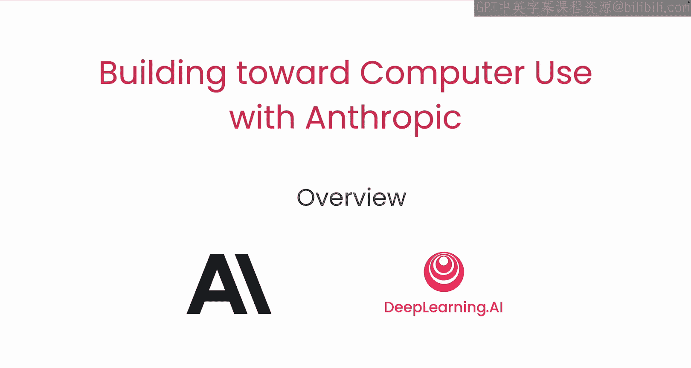
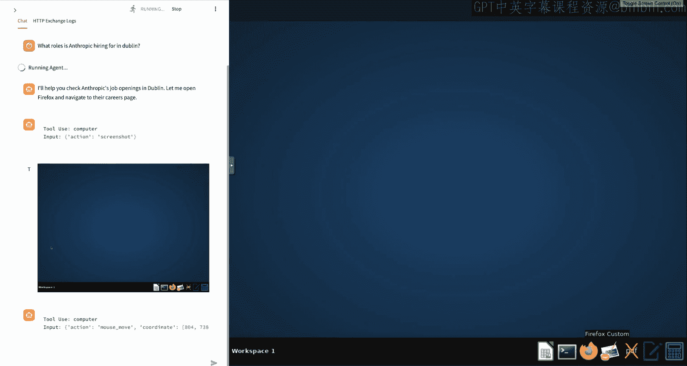
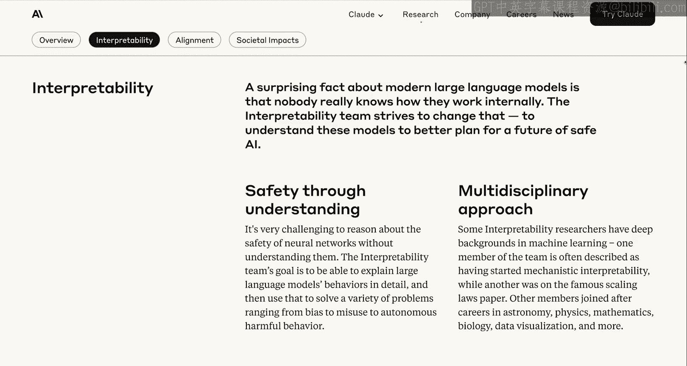
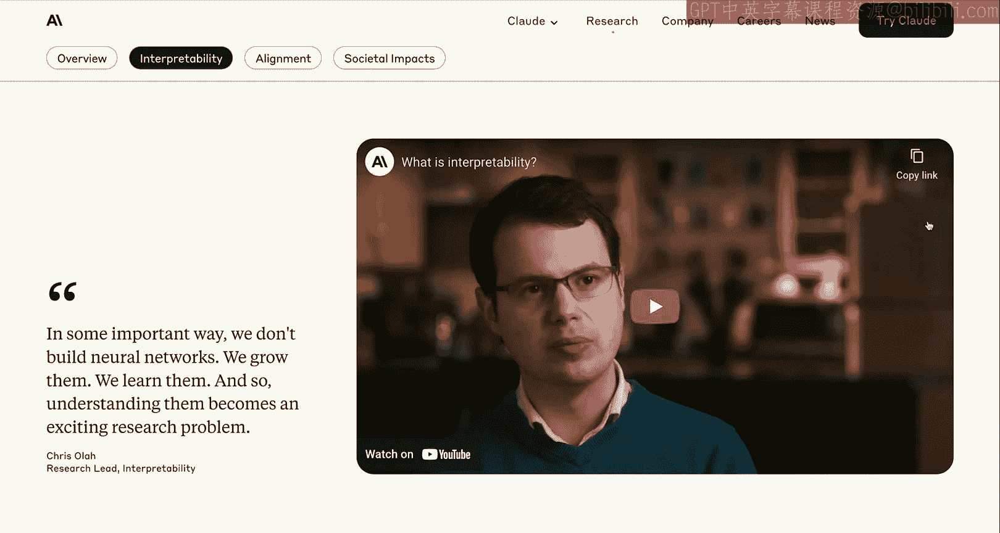
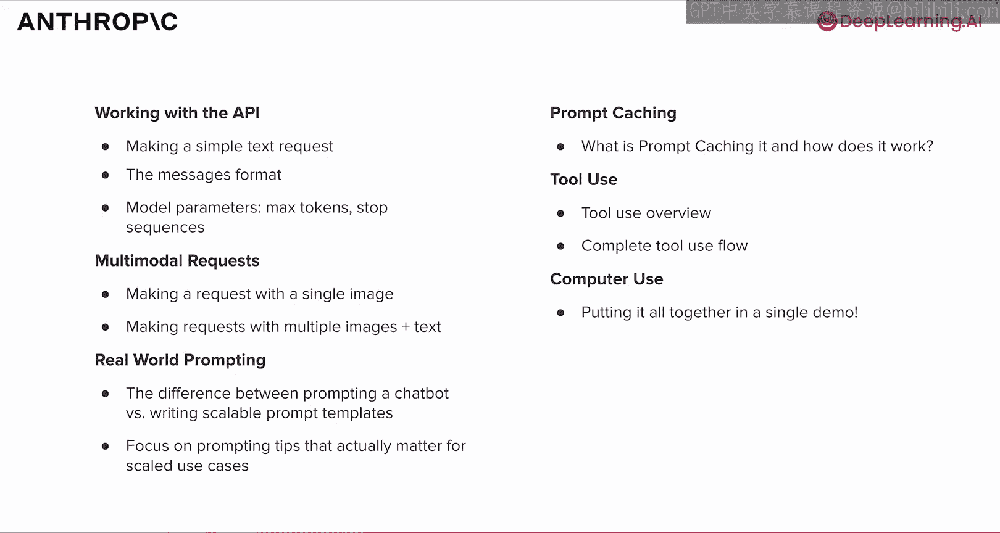

# 吴恩达《使用Anthropic构建计算机操作｜Building Towards Computer Use with Anthropic》中英字幕deepseek - P2：2.overview.zh_en - GPT中英字幕课程资源 - BV11hfiYeEDu

By the end of this lesson， you'll be able to explain Anthropic's approach to AI research and development。

Describe the key principles of AI safety， alignment and interpretability。

 and differentiate between Anthropics family of models。Let's dive in。Alright， let's get started。

 So this course is going to cover everything you need to know about working with the Anthropic API。

 working with our models， building up towards understanding how a computer using agent works。

 So what do I mean by computer using agent。 Well， here's an example。 on the left。

 you can see I'm typing a prompt。 What roles is anthropic hiring for in Dublin。

By the way， this footage is sped up a little bit。 just so you don't have to listen to me talk for too long。

 You can see that the model is using the computer on the right。 It is clicking。

 It's moving the mouse。 It's selecting drop downs。 It's going to expand accordion menus。 Eventually。

 it makes its way to the Anthropic careers page。 It filters by Dublin。

 and then it's going to expand the two roles。A technical program manager and an audit and compliance role in security。

 So this is what I mean when I say a computer using agent that agent you just saw builds upon all the fundamentals of the API。

 So we're going to go through these topics in order culminating in a computer use agent demonstration at the end。

 So that computer using agent sends basic requests to the API text prompts。

 It uses the messages format。 It uses various model parameters。 That's what we'll cover next。

 Then we'll move on to multimodal requests。 You may have noticed the model was using screenshots in order to decide where to click。

 where to drag where to type。 So you'll learn how to make requests that involve images。

 including screenshots。 Then we move on to real worldor prompting。

 which is focused on the pretty big difference between talking to a chatbot like Cla do AI and a conversational manner versus prompting using the API for scalable。

 repeatable prompt templates。 Then you'll learn about prompt caching。

 which is a strategy that the computer using agent employees。 and it also is a great。

aving and latency saving measure。 then you'll learn about tool use。

 which is what enables the model to do things like click and scroll and type or other tools like connect to an API or issue bash commands or run code。

 various tools that we can provide the model with that it can tell us it wants to execute。 Finally。

 at the very end， you'll see how to run the computer using agent that you just saw。

 It combines all of the topics that we've covered。 plus some other things it's a bit of a step up。

 but it's a great capstone that covers all the core concepts of working with the anthropic API。 Now。

 before we dive into actually working with the API。 I want to talk a little bit about enthropic。

 Anthropic is a unique AI lab that has a very heavy focus on research that puts safety at the very frontier。

 So essentially， building frontier models。 the best models in the world at times。

 simultaneously performing cutting edge research using those models。

 This timeline really synthesizes both of those ideas in the span of a few short years on the。

You can see Anthropic was founded in 2021。 you can see the timeline of various model releases leading up to cloudud 3。

5 sonnet in 2024 and on the bottom， you can see some of the key research papers that have been released simultaneously Now this is not a course on research。

 but I do want to call your attention to the research page of anthrops website。

 it's a great resource to learn more about our research both in approachable formats and through full-fledged research papers。

 Some of the key areas that we focus on are interpretability alignment and societal impacts Now I want to pay special attention to alignment alignment science focuses on ensuring that AI systems behave in accordance with our human values and human intentions。

 how do we create AI systems that reliably pursue the objectives。

 the tasks that we want them to pursue， even as they become more and more capable。

 Another heavy research area and Anthropic is interpretability。

 which is a bit of a mouthful but is a really fascinating and critical aspect of AI research。

ability is all about understanding how large language models work internally。

 essentially reverse engineering them or giving the models MRIs or brain scans so we can understand exactly what is happening inside of them at any given point in time。

 It's very difficult to improve models and also to ensure that they are safe without understanding how they work one of the things I encourage you to do if you're interested is to read some of our blog posts Watch some of the videos on interpretability。

 specifically this relatively approachable paper called scaling monosmanity。

 I know the name doesn't sound that approachable but it's full of really cool diagrams and visualizations as it walks through some key interpretability research。

 It's also just a pretty fun read with some interesting examples。 Now。

 as I mentioned at the beginning， Anthropic is not just a research lab focused on safety alignment interpretability。

 Anthropic also releases state of the art， large language models on our models page on our documentation。

 You'll find an up to dateate list of our current models， which like everything in the AI。😊。

ace changes pretty frequently。 so it may not actually look exactly like this。 but as you can see。

 Cloud 3。5 sonnet is currently our most intelligent model， and then cloud 3。5 haiku。

 which is a slightly less capable model， though still very intelligent， that is faster。

 those are the two main choices presented to you currently。

 if you' are going to use one of our models。 Now， if we zoom in on this model comparison table。

 you'll see we have cloud 35 sonnet and cloud 3。5 haiku。

 as well as the original cloudd 3 family of models。

 but the two newest and most capable models are on the left here。35 sonnet in 35 haiku。

 we can see a nice comparison。 a breakdown of their capabilities， their strengths。

 their vision capabilities。 So in general， Cloud 3。5 sonnet is the most intelligent model we offer。

 It is the smartest， the most capable model。 It's multilingual。

 it is multimodal supporting image inputs。 It supports our batches API。

 and one thing that trips some people up is that there are multiple versions of it including。

The most recent upgraded version， which is Cloudd 35 Sonet 2024，1022。

 We'll talk more about the model strings in the next video。

 but this is the most recent version of cloudd 3。5 sonnet。It is fast， however， not as fast as Quad 3。

5 Haiku， which is the fastest model that we offer。 It is very intelligent at very fast speeds。

 So it is faster than Quad 3。5 sonnets。Slightly less capable on some of the popular benchmarks and currently does not support vision。

 Now， let's talk about context window。We're working with 200000 tokens for the context window across both of those models。

 a maximum output tokens of 8192，8192。 Clearly， Cloud 3。5u is cheaper。 It's faster。 but cloud 3。

5 Sonet is the most intelligent model。 And it's what we'll be using throughout this course。

 It's also quite affordable。 And it is the model that currently performs best on computer use tasks。

 largely because it supports image input。 Now we'll learn how to use these models in the next video will start sending requests。

 but I just want you to see the documentation page。

 so that you can always find out about the latest model and see a comparison of how these models stack up across various metrics。

 So that's a tiny bit about Anthropic。 where a frontier research lab。

 creating frontier or cutting edge models。 It's also a little bit about the course and the rough structure。

 We're now going to dive into working with the API。 sendingending our first simple text requests。

Build up， of course， to this computer using agent capstone demo。

Okay， let's get started。