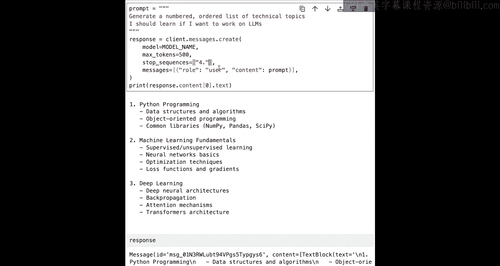
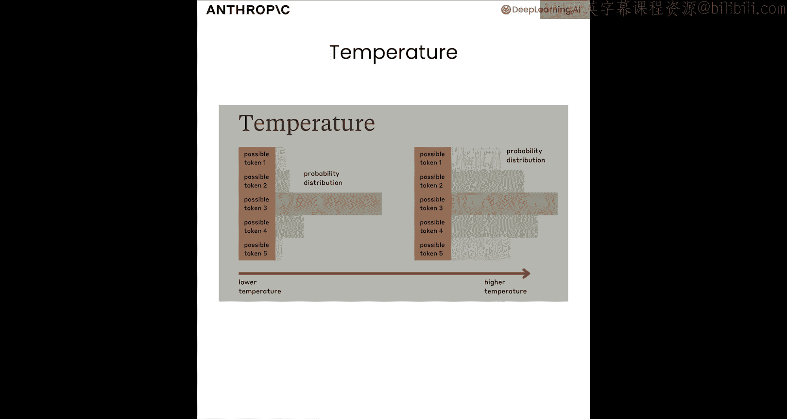
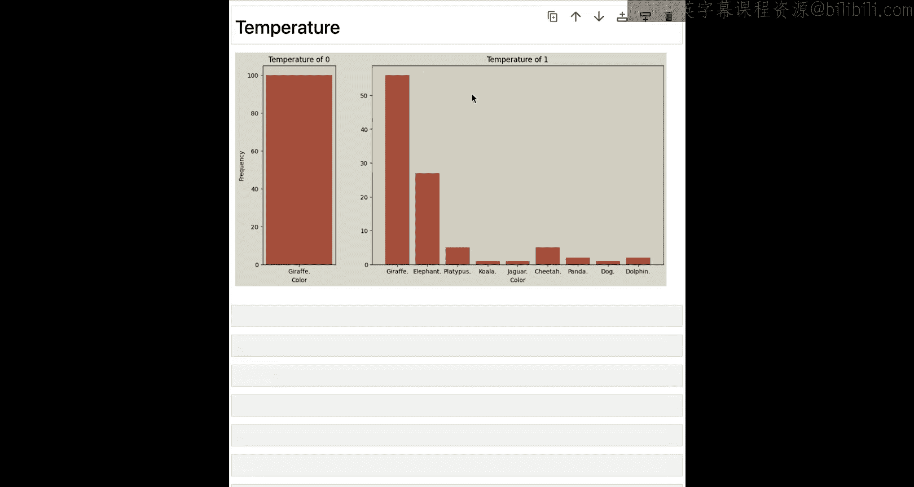
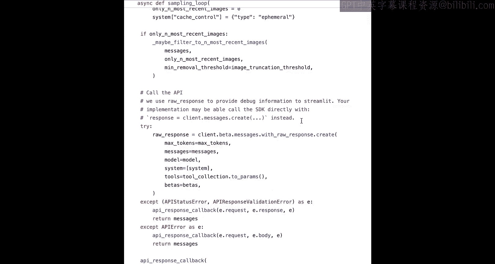

# 吴恩达《使用Anthropic构建计算机操作｜Building Towards Computer Use with Anthropic》中英字幕deepseek - P3：3.api.zh_en - GPT中英字幕课程资源 - BV11hfiYeEDu

By the end of this lesson， you'll be able to make your own API request to cloud。

 You'll format messages effectively for optimal AI responses and control various API parameters like the system prompt。

 Max tokens and stop sequences。

All right， let's dive into the code。

So we'll begin by getting set up with the Anthropic Python SDK。

 The first step is to simply ensure that the anthropic SDK is installed。

 which is as simple as running Pip install Anthropic。And once it's installed。

 we'll go ahead and import it。 specifically， we're going to import capital a Anthropic。

 and we'll use that to instantiate a client that we can then send API requests through。 Okay。

 So on this second line， We're creating our client can call it whatever we want。

 I usually call it client。 And this is where if we had an API key we wanted to explicitly pass through。

 We could pass it in right here。 Anthropic API key equals and then put your key in there。

 So if I leave it off。 this will automatically look for an environment variable called Anthropic API key。

 So now we have our client。 The next step is to make our very first request。

 I've added two cells of code。 The first one is just a model name variable。

 we're gonna to be repeating this model name over and over throughout the course。

 So I'm just going to put it in a variable cloud 3。5 sonnet 2024，1022。 just the latest checkpoint。

 the latest version of cloud 3。5 sonnet。 And then this larger chunk。 The most important piece here。

 is how we actually make a simple request。 So we use our client variable dot messages。Create。

 and there are a few things in here we'll go over in due time。 First of all。

 we're just passing the model name。 This is required。 We do have to pass in Max tokens。

 We'll discuss that in a little bit， and we have to pass in messages。

 So messages needs to be a list containing a list of messages。 In this case， a single message。

 a role of user meaning us the user。 We are providing a prompt to the model that has content set to some sort of content。

 some prompt。 So I asked it to write a haiku about anthropic。 So let's run these cells。

 And then notice I'm printing specifically response do content 0 dot text。

 we'll see what we get in just a moment。 We get a haiku about anthropic。

 seeking to guide AI through wisdom and careful thought toward better futures。 Great。

 So let's talk a bit more about this response object that we get back。 Let's take a look at it。

 There are quite a few pieces in here。 First of all， we have the content that we just discussed。

 content is a list。 If we look at the0 with element。 we can look at its text。

 and we can see the actual haiku。 We also have。😊，The model that was used。 We have the role。

 Remember that our original message had a role of user。

 So this response back is a message with a role of assistant。 We also have stop reason。

 which tells us why the model stopped generating。 In this case， says end turn。

 which means essentially， it reached a natural stopping point。 Stop sequence is none。

 We'll talk more about stop sequence in a bit。And then under usage。

 we can see the number of tokens involved in our input， the actual prompt。

 as well as the output tokens that were generated。 In this case，30 tokens of output。

So go ahead and try this yourself。 Put any sort of prompt you'd like in here in place of write a haiku about Anthropic。

Next up， we're going to discuss the specific format of the messages list。

 So the SD K is set up in such a way that we pass through a list of messages。

 It's required along with Max Sokens and a model name。 And this list of messages so far。

 is only included a single message with a role set to user。

 The idea of the messages format is that it allows us to structure our API calls to Claude in the form of a conversation。

 We don't have to use it in that way。 We haven't so far。

 but it's often useful if we are building any sort of conversational element or need to preserve any prior context。

 for now， all you need to know about messages。 is that they need to have a role set either to user or to assistant。

 So let's try and provide some previous context Let's say perhaps have been talking to Claude in Spanish。

 And I'd like Claude to continue speaking in Spanish。

 So I've updated the messages list to add some previous history where I have a user message saying。

 hello， only speak to me in Spanish。 and then I have a response assistant message that saysla。

 and then I have my。Final user message。 The only thing that's changing is this role。

 going from user to assistant back to user。 I'm providing Claude with some conversation history。

 And then I'm finally saying， how are you， And if I run this。

The model will take the entire conversation into account， right， This is the entire prompt now。

 And then we get a response in Spanish。 So this is useful in a couple of different scenarios。

 The first and perhaps most obvious is in building conversational assistance in building chatbots。

 So here we have a very simple implementation of a chatbot that takes advantage of this message format。

 We're going to alternate messages between a user and an assistant message growing the message list as the conversation takes turns。

 So we start with an empty list of messages。 And then we have a while loop。

 We're going to loop forever。 unless a user inputs the word quit at which case will break out。

 We need to provide an escape hatch。 but if they don't type quit。 we'll ask a user for their input。

 and then we'll make a new message dictionary with a roll of user。

 The content will be whatever the user typed in like Ho Claude will send that off to the model using the client up messages dot create method we just saw。

 then we'll take the assistance response will print it out。😊。

And then we'll also append that assistant message as a new message to our messages list。

 and then we'll repeat， and we'll keep growing this list over and over and over for each turn in the conversation。

 We'll add our user message。 We'll get a response。 We'll add our assistant message。

 and then we'll send the whole thing back to the model next time。 When we get a new user message。

 So let's try it。 Go ahead and run this。 So let's start with something simple。 Ho， I'm Colt。

I'll send it off。 We get a response。 Hi Colt， I'm an AI assistant。 Nice to meet you。

 How can I help you， Let's just test that it actually has the full context。 Let me ask it。

 what's my name。😊，Okay， we'll send that off。 Your name is Colt。 As you introduced yourself earlier。

 Let's try something a bit more interesting。 I've asked it to help me learn more about how L L Ms work。

 So it'll generate a response from me here。 This one's likely a little bit longer。

 and it gives me some information。 And I'll follow up with expand on the third item。 Again。

 this is just to demonstrate that it gets the full conversational history on its own。

 This message doesn't mean anything to the model。 but with a full conversation history that I'm sending to it。

 Now it expands on that third bullet point。 So that's one use case for sending messages in the message format。

 Another use case is what we call prefil or putting words in the model's mouth。Essential。

 we can use an assistant message to tell the model。

 here are some words that you will begin your response with。 We can put words in the model's mouth。

 So， for example， I'm having it write a short poem about Anthropic。

 Let's change that to something else。 How about a short poem about pigs。 Sure。

 If I go ahead and just run this。😊，It may tell me something like， O， here's a short poem about pigs。

 There we go。 But for some reason， I really want this poem to start with the word Ok。 I insist on it。

 Now， I could tell the model you know， write me a poem about pigs。 You must start with the word ink。

 Also， don't give me this preamble。 just go right to the poem。

 But another option is to simply add in an assistant message that begins with the word Ok。

 So something like this where I have put a new message in here with a roll of assistant。 Cont is ink。

So the model is now going to begin its response from this point， Ok。

 And then you can see the completion we get Ok and snuffle pink and round rolling aly on muddy ground。

 Now， it is important to note， it doesn't include the word Ok in its response。

 because the model didn't generate this word。 I did。

 But the model generated all of this content by beginning with the word Ok。

 So then I could just combine the word Ok with the rest of the poem if I wanted to。

 So that's prefiling the response。 Next， we're going to talk about some of the parameters we can pass to the model via the API to control its behavior。

 The first we'll cover is max tokens。 So we've been using max tokens。

 but we haven't discussed what it does。 In short， Max tokens controls。 Well。

 the maximum number of tokens that Clad should generate in its response。

 Remember that models don't think in full words or in English words， but instead。

 they use a series of word fragments that we called tokens。

 and model usage is also build according to token usage。 for Clad， a token is roughly 3。5 English。

though it can vary from one language to another。 So this max tokens parameter allows us to set an upper bound。

 We can basically tell the model don't generate more than 500 tokens。

 Or let's set this to something high， like 1000 tokens to start。

 I'm going to ask the model to write me an essay on large language models。

 A prompt that likely will generate a whole bunch of tokens， because I ask for an essay。 Okay。

 and here's our response。 pretty long。 looks to be a pretty decent essay。Now， if I tried this again。

 but I instead set max tokens to be something much shorter like 100 tokens， I'll run this。

What will happen here is the model will get cut off essentially mid generation。

 we just cut it off because we've hit this 100 token generation。Importantly。

 if we look at the response object。We'll also see nested inside of here。

The number of output tokens was exactly 100。 They had hit that and it stopped。

 but we also see a stop reason this time that says max tokens。

 So the model didn't naturally stop because stop reason is set to max tokens。

 that's how we know the model was cut off because of our max tokens parameter。

 So this does not influence how the model generates， right。

 We're not telling the model Give me a short response with an entire essay that fits within 100 tokens。

 Instead， what we've done is we've told the model， write me an essay on large language models。

 And then we just cut it off at 100 tokens。 So why would you use max tokens or why would you alter it to something low or something high。

 Well， one reason is to try and save on API costs and set some sort of upper bound where through a combination of a good prompt。

 But also through setting max tokens。 For example， if you're making a chat bot。

 you may not want your end users to have 5000 token turns with the chatbot。

 you may prefer that those conversational turns are short and they fit within a chat window。

 Another reason is to improve speed。The more tokens involved in an output。

 the longer it takes to generate。 The next parameter we'll look at is called stop sequences。

What this allows us to do is provide a list of strings that when the model encounters them when the model actually generates them。

 it will stop。 so we can tell the model once you've generated this word or this character or this phrase。

 stop。 So it gives us a bit more control instead of just truncating a number of tokens。

 We can tell the model。 we want to truncate your output on this particular word。

 So here's an example where I am not using a stop sequence。

 generate a numbered ordered list of technical topics。

 I should learn if I want to work on large language models。 I pass that prompt through。

 I've just moved it to a variable because it's a bit longer。 And I get this nice numbered list。

 But it's quite long。12 different topics。 Now， obviously through prompting。

 I could tell the model only give me the top three or the top 5。

 But I'll just showcase with this example。 I'll copy this and duplicate it。 But this time。

 I'll provide stop sequences， which is a list。😊，And it contains strings。 In my case。

 let's say I want to stop after it generates 4。So for period， we'll try running it again。

And you can see。What we get。 So we get 1，2，3。 And then the model went on to generate 4。

 and it stopped。 Notice that 4 is not included in the output itself。

 And if I look at the response object。We'll also see that we have a stop reason this time。

 set to stop sequence。This is the model， the API telling us it stopped because it hit a stop sequence。

 which stop sequence it hit4， followed by a period。

So stop sequences is a list we can provide as many as we want in here。

This is one way to control when the model stops outputs or when the model stops generating。

And we'll see some use cases for this when we get to some more advanced prompting techniques。 Now。

 the next parameter we'll talk about is called temperature。 This parameter is used to control。

 You can think of it as the randomness or the creativity of the generated responses。 Now。

 it ranges from 0 to 1， where a higher value like  one is going to result in more diverse and more unpredictable responses with variations in phrasing and a lower temperature closer to 0 will result in more deterministic outputs that stick to the more probable phrasing。

So this chart here is an output from a little experiment I ran。

 I don't recommend you run it because it involved making hundreds of API requests。

 but I asked the model via the API to pick an animal。

 My prompt was something like Pick a single animal。 Give me one word。

 And I did this 100 times with a temperature of 0。 And you can see every single response out of 100 was the word giraffe。

 Now I did this again But instead said a temperature of  one。

 And we still get a lot of giraffe responses， but we get some elephants and platypus。

 koala cheetah and so on。 we get more variation。 So again。

 temperature of 0 more likely to be deterministic， but not guaranteed temperature of one more diverse outputs。

 Now， here's a function you can run that will demonstrate this。

 I am asking Claude three different times to generate a planet name for an alien planet。

 I'm telling it respond with a single word。 And I'm doing this three times for the temperature of 0。

 And three times with a temperature of。😊。

So let's see what happens。 I'll execute this cell where I'm calling this function。

 And when I use a temperature of 0， I get the same planet name three times in a row。 Castrx， Castrx。

 castactx。 And when I use a temperature of one， I get Klara。

 Castrx and Caricx spelled slightly differently。 So we do get more diversity there。

Now that we've seen the basics of making a request。 I want to tie it back to computer use， right。

 Everything we're going to learn in this course is in some way related towards building a computer using agent using Cla。

 So this is some code from our computer use quickstar that we'll take a look at towards the end of this course。

 What I want to highlight is a few things。 We are making a request where we're providing max tokens。

 We're providing a list of messages。 We're providing a model name。

 And then some other stuff we'll learn more about later。

 And then we're also using the conversational messages format， as you can see down here。

 We have a list of messages。 it's defined further up in this repository or in this file。

 But we have a list of messages that we are appending the assistance response back to。

 So very similar to the chatbot we saw earlier， except， of course， a lot more complicated。

 It's using a computer。 There's screenshots involved in tools and a whole bunch of interactions。

 but it's the same basic concept。 We send some message off to the model。

 And then we get the assistant response back。 We append that to our messages。😊。

If I scroll up high enough， we can see it's all nested instead of a wild true loop。

 And there's a whole bunch of other logic， of course。

 but it boils down to sending a request off to the API using our client。

 providing things like max tokens and messages and then updating our messages list as new responses come back and providing this updated。

 continuously growing list of messages every single time。

 And we do this over and over and over again， using all the fundamentals we learned so far in this video。

😊。

