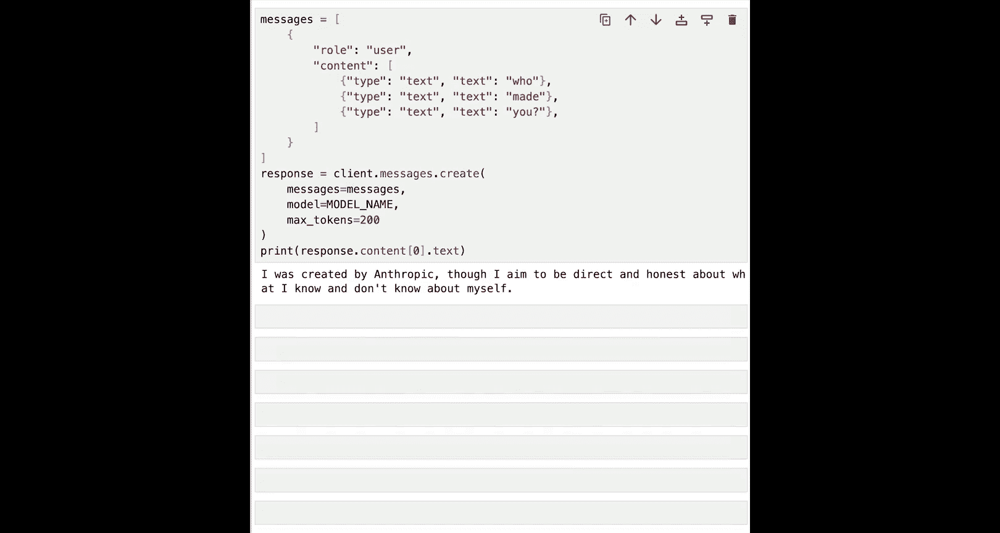
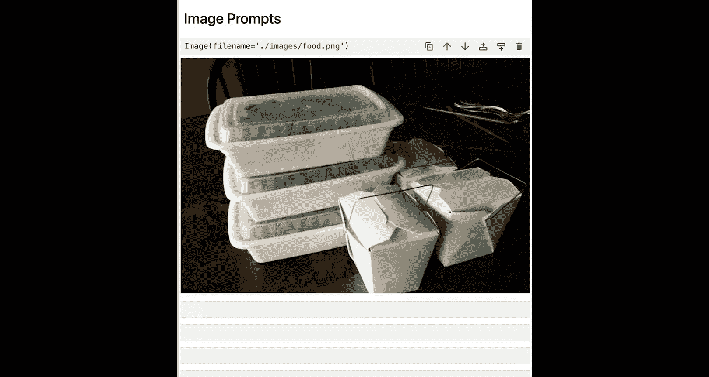
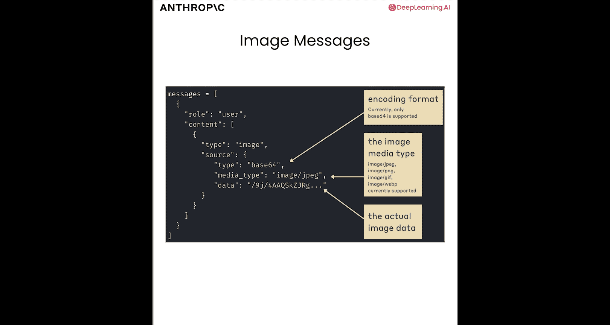
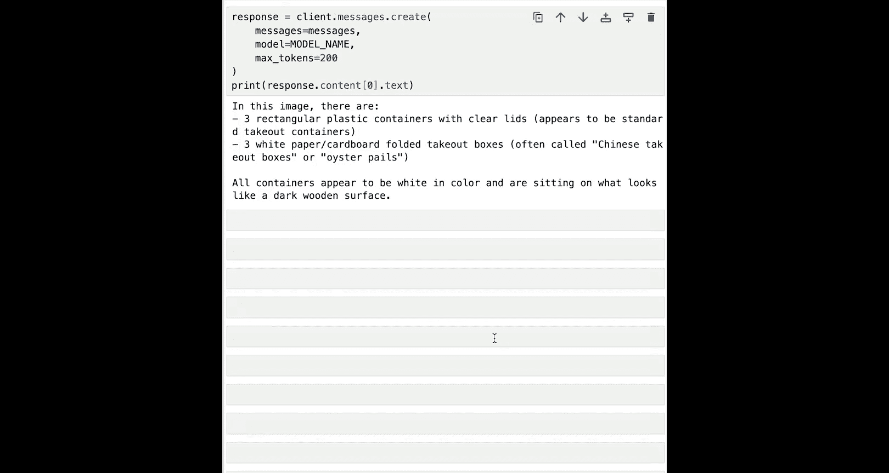
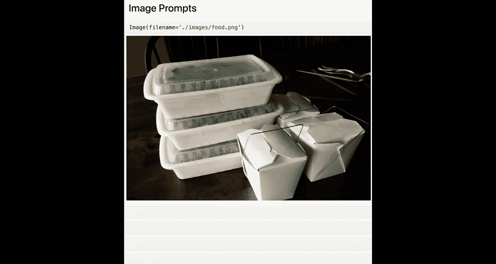
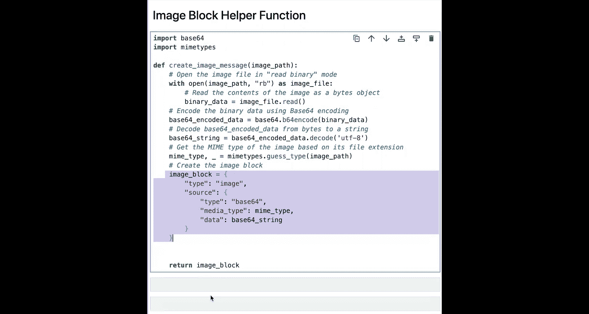
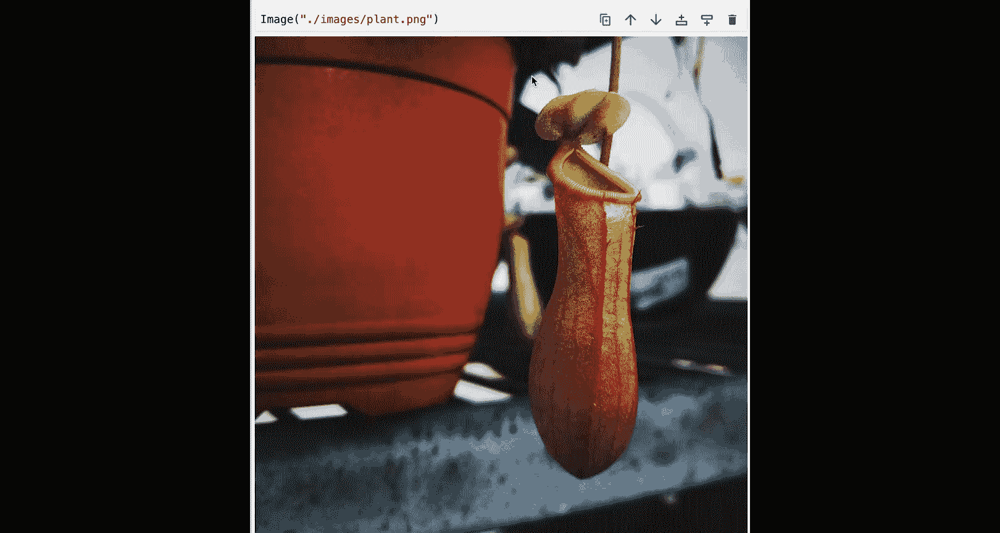
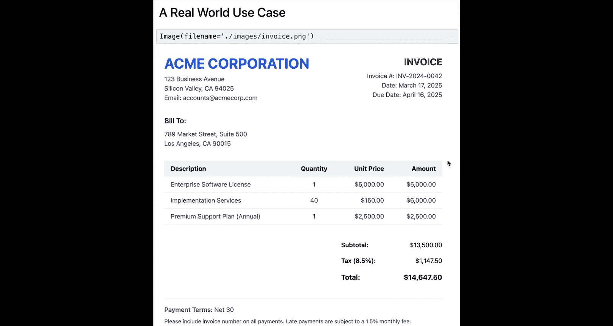
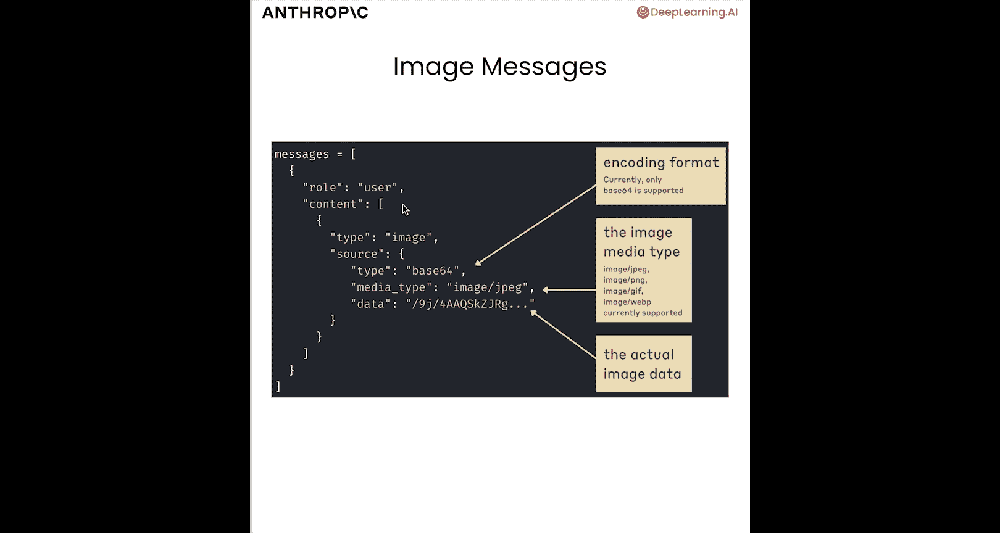
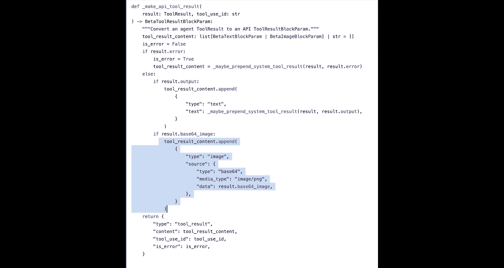

# 吴恩达《使用Anthropic构建计算机操作｜Building Towards Computer Use with Anthropic》中英字幕deepseek - P4：4.Multimodal.zh_en - GPT中英字幕课程资源 - BV11hfiYeEDu

By the end of this lesson， you'll be able to write multimodal prompts that combine images and text and work with streaming responses from the API。

 Allright， let's go。

So let's get started making our first multimodal request。

 We're going to take an image or multiple images， along with some text。

 send it off to the model and get a response。So just as in the previous video。

 we have some basic setup。 We're going to import Anthropic， we'll set up our clients。

 and then we'll have just a helper variable to store the model name string。

Before we start working with images， we need to talk a little bit more about the messages structure we've seen so far。

 So in the previous lesson， we set up a messages list where each message had a role set to user and then content set to a string like tell me a joke。

 And if I run this， we should see a joke。 and we do， in fact， hit a joke。 Not a good one， but a joke。

 Now， this is actually a shortcut， setting content to a string is a shortcut for this syntax here。

 where we set content to a list that contains a bunch of content blocks。 In this case。

 it's just a single content block with a type set to text and then text set to tell me a joke。

 So this will give us the exact same sort of input prompt。 Different syntax appear。

 We have a nice shortcut。 If we're simply doing text prompts。 It's easier to do it this way。

 But as we'll see in just a moment， we'll want to provide a list of content blocks。

 If we're going to provide images。So if I run this。We again， get a joke。

 And just to show you what I mean about a list of content blocks。

 here is a single message that has a role of user content set to a list。

 and it contains three text blocks。 Each one has text of a single word。 Who made you。

 And if I run this， willll see we get a response， I was created by Anthropic。

 So all of these messages are combined and essentially turned into a single input prompt。

So now we go on to images。 So our cloud models accept images as inputs。

 So we need some images to work with。 I've provided you with an images folder that contains a handful of images that will use。

 This is the first one。 Let's say that we hypothetically run a food delivery start。

 and we're using Cla to verify customer claims。 Custom will send us a screenshot saying， look。

 only half my order arrived。 I want to refund。 So we are going to use Cla to analyze images of customer food like this one here。

 We'll start simple and just ask Claude to tell us。

 you know how many boxes and cartons of food are in this image。

 So the first step is to understand how we structure our messages that contain an image。😊。

This diagram illustrates the structure。 So if you notice we have a messages list。

 We have a role set to user just like before。 We have a content list， and then inside of content。

 we have a new type of content block we have yet to see。 We have only seen text blocks。

 but this is an image block。 So type is set to image。 It's a dictionary。

 and then we have a source key set to another dictionary。Where we have type set to base 64。

 we have media type， which is set to the image media type like Jpeg or P G or Gif。

 And then we have the raw image data。 So this is the structure of a single message。

 So back in our notebook， there's a few steps we need to go through before we can actually create that message。

 We need to read in the actual image file itself。 We need to open it。

 which is what we're doing here with the path to food dot P And G。

Then we'll read in the contents of the image as a bite object。

Then we'll encode the binary data using base 64。And then finally。

 we'll take the base 64 encoded data and turn it into a string。 By the end of this。

 we have our base 64 string， which is quite long。 But if we just look at the first 100 characters。

 here's a preview of what it looks like。So now what we need to do is take this base 64 string that contains our properly formatted image data and now put it in a properly formatted message and then send it off to the model。

 So here's some code that takes that base 64 string that contains our food do PNng image data as base 64 as a string and puts it in a properly formatted content block and image content block。

 as you can see type is set to image source is set to a dictionary type is base 64 is a Png and then data is set to our massive variable。

 base 64 string。 and then we follow it up with a second content block This time。

 a text content block that has the text of how many to go containers of each type are in this image。

 very， very simple prompt。 We're sending it this image of to go containers filled with food we want to know how many of each type are in there。

 So now we just take this messages list and send it off to the API。

 So we use the same syntax we've seen before。 clientient messagessages do create。We pass in messages。

 We'll run it。 And we see a response In this image。

 there are three rectangular plastic containers with clear lids and then three white paper or cardboard folded take out boxes。

 often called Chinese take out boxes or oyster pails。That is correct。

 If we go back to the original image。 we do， in fact。

 see three boxes with plastic lids and three of the paper。

 oyster pails or Chinese takeout containers。 Now， going through all these steps to read the image and turn it into base 64。

 and then turn it into a string， encode it in U TF 8 and then add it to a properly formatted message It be a little bit annoying to do over and over。

 So it's a great candidate for making a helper function。

 So here's a helper function that just combines the functionality we saw previously。

 It's called create image message。 It takes an image path。😊。

And then it's going to run those steps that we saw previously。 So it's going to open it。

 read in the binary data。 It's going to encode it with base 64 encoding。

 It's going to turn it into a UTF 8 string。 It's going to guess the mime type。 Remember。

 we need to specify whether it's a PN G or a Jpeg or a GF or some other format。 And then finally。

 it creates an image block properly formatted。 and then returns that image block。

So let's try it with a different image。 The images directory has a plant dot P N G image。

 It's a pitcher plant。 technicalnly， I think it's a Napenthees plant。

 I have had limited success growing these myself。 usually kill them before the pitchers emerge。

 But very cool plant。 I'm going to ask the model just to identify the plant。 Very simple use case。

 So we're going to use this function we've defined。 And here we are。 I have a new messages list。

 A single message in it with role of user。 content is set to a list containing the result of create image message for the plant do P N G image。

 So we get that properly formatted message back。 or technically it's a content block。

 and then we follow it up with a text content block。 Ask a very simple prompt。 What species is this。

 We'll send it off to the model。 We'll run it。😊。

We'll print out the response。 And here we go。 This appears to be an apppenthees pitcher plant。

 which is the type of carnivorous plant and on and on and on。 Okay。

 so just a little helper function to make things of bit easier。

 You could take it a step further and make a helper function just to generate the entire messages list itself where you provide an image path and you provide a text prompt like what species is this。

 Next， let's take a look at a more realistic use case that a lot of our customers are using clod to help with。

 which is analyzing documents。So many documents， let's take an invoice like this one。

 which is called invoice PNG， includes tons of important information。 maybe it's a P Df。

 maybe it's a P G。 We can feed it into cloudde， give it a good prompt and ask it to give us structured data as a response。

So I might be able to turn thousands of invoices into JO and store in a database in a matter of minutes。

So here's what that could look like with a single example。 This invoice out P N G image。

 I provide an image message properly formatted。 Then I provide a text prompt。 A pretty simple one。

 generate a Json object representing the contents of this invoice。 It should include all dates。

 dollar amounts and addresses。 only respond with a Json itself。 I'll send it off to the model。

And we get a Json response back。So it has the company name， which is my company， Accme Corporation。

 our fake address。 It has information on the invoice， Invoice number， the date， the due date。

 information on who it's billed to in their address， the items in the invoice。

 So enterprise software license implementation services， premium support plan。

 and then it has totals， including the subtotal， the tax rate， the tax amount and the actual total。

 And if I scroll back， you can get a closer look at that image and see that all this information is。

 in fact， accurate。So just a slightly more realistic use case for image prompting compared to know identifying a plant species。

Now， one thing we won't demonstrate here， but it's important， you know， it is possible。

 is is providing multiple images in a single message。

Recall that all of our content blocks are treated essentially as one prompt behind the scenes when they're fed into the model。

 so I can provide a combination of multiple image blocks。

 plus multiple text prompt blocks as part of a single user message。 Con is a list。

 So I simply add my content blocks inside。 whether they have a type set to image or a type set to text。

The second topic we'll cover in this lesson is streaming responses。

 What we've seen so far using client messagessage do create works great。 But if I give it a prompt。

 like write me a poem， what you'll notice is that we're waiting for a response until the entire response is generated and ready。

 So it doesn't take all that long。 That was maybe half a second， maybe a second or less。

 And we get the entire generation all at once。😊，But the longer a model's output generation is。

 let's say we're writing an essay with a model。 the longer it will take before we get any sort of content back。

 We don't get a response back until the entire output has been generated with streaming。

 we can do something a bit different。 We can get content back as the content is generated。

 And this is great for user facing scenarios where we can start to show user responses as they're being generated instead of waiting until a full generation is complete。

 So streaming doesn't actually speed up the overall process to generate。

 It just speeds up what we call the time to first token。

 The time that you see the first sign of life。 The first piece of a response。

 And this int is a little bit different， but very similar to this client do messages dot create。

 So here we now have client dot messages tot stream。 And notice we pass in max tokens。

 We pass in a list of messages。 My prompt is simple。 Just write a poem。 We pass in a model name。

 but what's a bit different I that now we're going to it。😊，Over this thing that we're calling stream。

 So I give it this name as stream。 and then I iterate over。

Every single bit of text in stream dot text stream， and then I print it out。

So what we'll see when I run this， I'll just go ahead and execute it。

Is we see the content coming back as it's generated instead of having to wait for the entire thing to be generated at once。

 Let's try it again。 You can see that we get chunks， little chunks 1 by one。

 and we're printing them out as they come in。But again。

 the overall amount of time that it takes to do this generation is going to remain unchanged。 Now。

 it obviously varies from one request to another， but we're not magically getting the full result any faster than we would without streaming。

 We're simply getting results We're getting parts of the output as they're being generated。

So we've seen how to make image requests， sending images as part of a prompt in the content。

 We've also seen how to stream responses back from the model。 Now。

 what I want to do is once again end by showing you a real example from our computer use。

 Quick start implementation。 So this is a function that does a bunch of stuff。

 But if you look closely in here。 in this highlighted text。

 We are appending a correctly formatted image using the format that we talked about earlier in this lesson。

 So type is image source is a dictionary type is Space 64。 And what are these image。

 These are the screen shots that we're providing the model with。

As we've seen previously when we covered sort of an introduction to the computer use aspect of this course。

 the model works by getting screen shotss， analyzing the screen shotss。

 and then deciding to take actions。 So we need to be able to provide images to the model。

 And we use the exact same syntax we've already seen in this lesson。

 We create these image content blocks。A lot more complicated use case here than identifying a plant。

 but it's the exact same syntax。So we're slowly growing our arsenal of tools。 Next。

 we're going to talk about some more real world or complex prompting。

