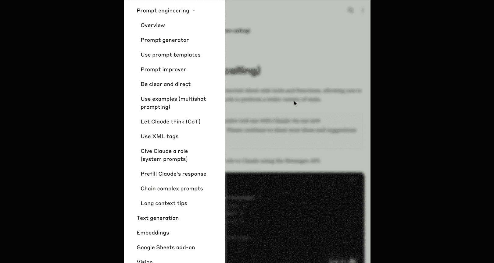
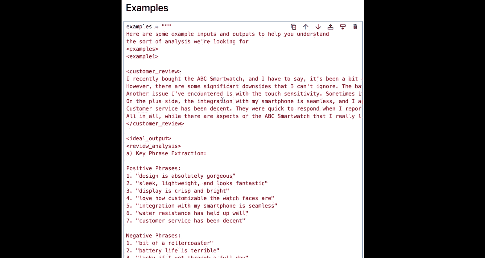
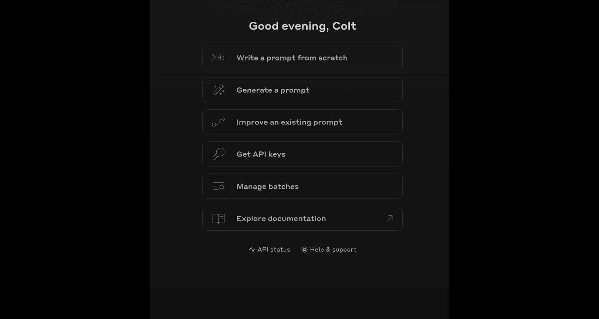
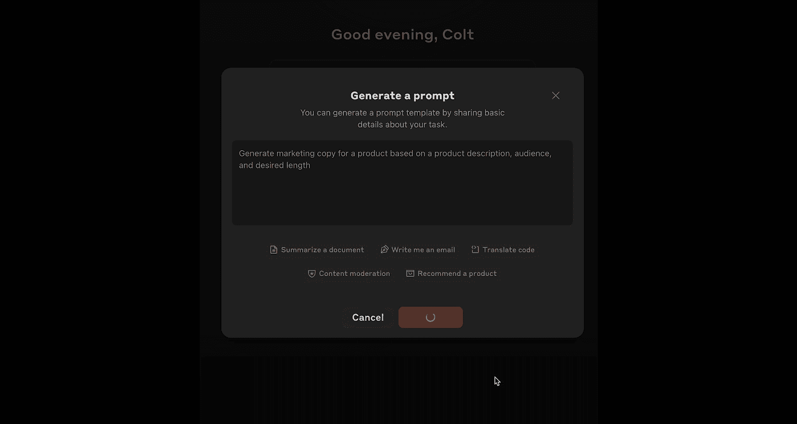
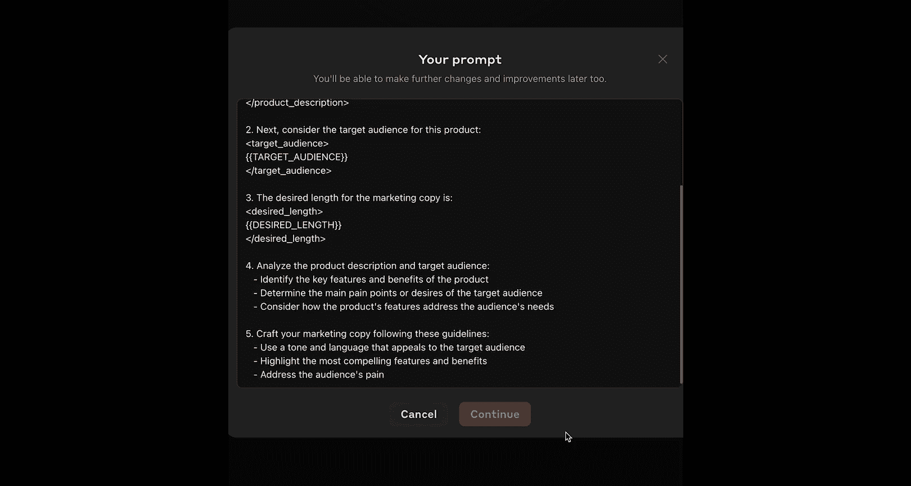
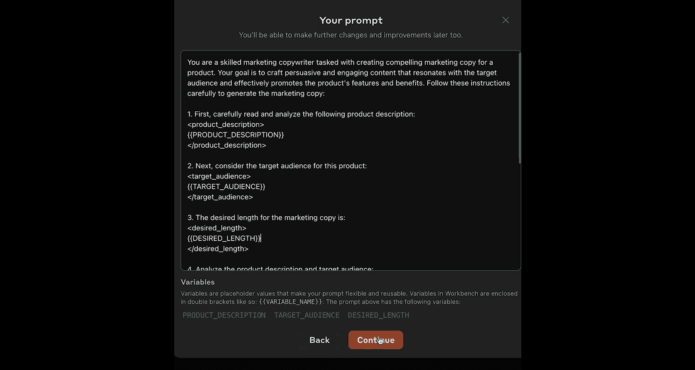
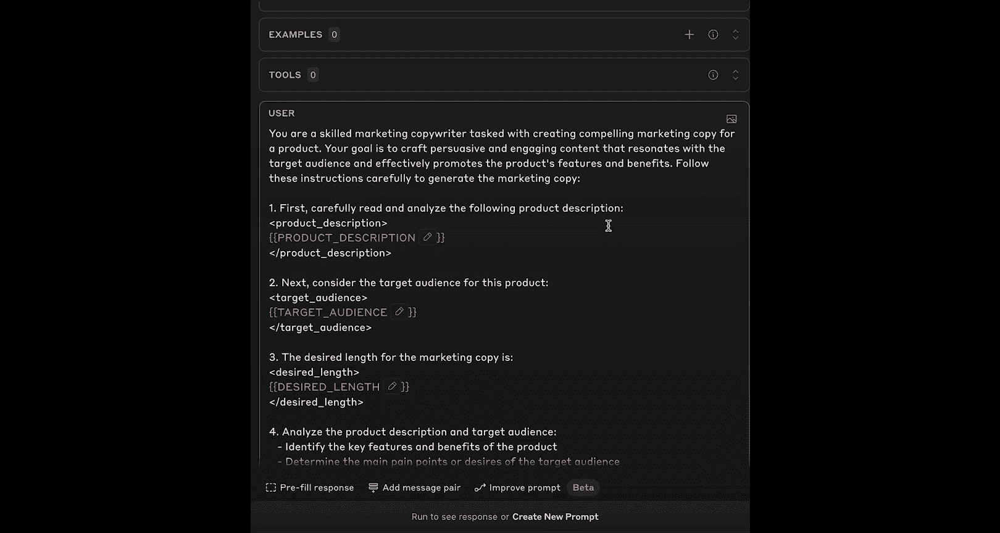

# 吴恩达《使用Anthropic构建计算机操作｜Building Towards Computer Use with Anthropic》中英字幕deepseek - P5：5.prompt.zh_en - GPT中英字幕课程资源 - BV11hfiYeEDu

By the end of this lesson， you'll be able to structure effective prompts that get consistent。

 high quality responses from Claude。 You'll utilize proven prompting techniques that actually matter in the real world and to understand the difference between prompting a chatbot like Claude。

 AI and writing enterprise grade repeatable prompts。😊。

Let's get coding。So the main focus of this lesson is really on the distinction between the types of prompts that we might write as consumers or as users of a chatbot like cloudude。

 AI and the types of prompts that large customers are writing or really any API customers are writing that need to be repeatable and reliable。

This is the anthropic documentation。 We have a section on prompt engineering with a whole bunch of different tips and strategies。

 a lot of which do matter， but some of which matter more than others。

 which is what I want to talk about in this video。 I want to focus on the tips that are worth your time。

 There's a lot of stuff out there on the Internet around prompting。

 some of it is a little bit dubious。 So we're gonna really focus on the prompting tips that have empirical evidence to back them up。

 But first， I want to show you an example of what I mean when I say a consumer prompt versus a real world enterprise prompt。

 So I'm back in a note。 I have the same initial setup we've had from previous videos。

 And here's an example of a potential chatbot or consumer prompt that I might type in the cloudude do AI website。

 help me brainstorm ideas for a talk on AI and education。 And if I'm happy with the result。 great。

 If not， I have as many opportunities as needed to follow up and say， whoops， actually。

 you're focusing too much on AI not enough on education。😊。

Can you change this to a bullet pointed list。 Can you make this mark down， right？

 I can follow up over and over and over again。 I have a lot of wiggle room and room for forgiveness。

 Now， let's take a look at a potential enterprise grade prompt。 Now， I'll warn you ahead of him。

 This is quite long。And way too much to read and go over in this video。 But that's kind of the point。

 I want you to see that these prompts get long。 They get complicated。 They have structured to them。

 A lot of effort goes into creating these prompts beyond just sort of you know。

 coming up with a thought in following it up with another thought in the way that I might talk to cloud do AI。

 So this is an example of a prompt that takes customer service calls。

 transcripts from a customer service call and then generates Json summaries。

 And we might be doing this thousands of times per hour or maybe even per minute。 If we're running。

 know a massive call center， or we have a huge customer support team。

 So we're not going to go over this piece by piece。

 but I'm leaving you with this prompt so that you can go over it if you'd like。

 there are few things in here we'll refer back to the first thing that I want to highlight， though。

 is that for enterprise grade prompts for repeatable prompts。

 we' really think about them as prompt templates where we have some large prompt structure that largely stays the same。

 with a dynamic portion or multiple。namic portions that are inserted as variables。So in this example。

 it starts by saying analyze the following customer service call and generate a JSON object。

Here is a transcript。 And then on this line， we have a placeholder where we actually would insert the real call transcript。

So we would do this dynamically， just using a string method。

 most likely to replace this with a real transcript and then another real transcript and thousands and thousands of them in a repeatable way。

 So we think of this more as a template instead of a one off use case。

 Like you might consider your prompts for Cla dot AI。 So back to the slides for a moment。

 I've listed some of the more important prompting tips here。

 And I've bolded the ones that I think are the most important or more important than anything else。

So one of them is used prompt templates。 We've hinted at that idea。

 Other things on here include letting Claude think。 Also known as chain of thought。

 We'll talk about that in a bit。 structuring your prompts with X M L。

 We saw a little bit of that in the prompt I just showed。

 but we'll also focus on that in the next few minutes。 and using examples。

 These are all techniques that have real data behind them that actually back up the claims that they matter。

 So now what I want to do is go through these。 and try and build a relatively real world prompt。

 It will get a little bit long prompts do get long。 It' a lot of text， a lot of strings。

 But we're going to go through this one bit at a time。

We're going to go about this by building up to a larger real world or enterprise grade prompt。

 And the idea that we'll be using is a customer review， classification and sentiment analysis prompt。

 Let's say that we run some fictional E-commerce Company， Acme Company。

 and we have hundreds of products in thousands and thousands of customer reviews。

 We're going to use the cloud API to help us understand the sentiment of those reviews and some common complaints。

So if this is a hypothetical review， I recently purchased the X， Y Z smartphone。

 It's been a mixed experience。 It lists some positives， some negatives。 It says， you know。

 I expected fewer issues。 I want Claude to be able to tell me in a repeatable fashion。

 Is this a positive review negative as a neutral。 And I wanted to highlight some of the key issues in point of feedback。

 specifically， for doing this at scale with thousands of thousands of reviews。

 I probably want the output to contain some easily extractable and easy to work with output format。

 Often， that will be Json。😊，Maybe something like this。

 Some repeatable object that always has a sentiment score， positive， negative or neutral。

 It has some analysis under a key called sentiment analysis， and then enlist the actual complaints。

 So performance lag， poor value， unreliable， facial recognition and so on。

 And then I can easily do this at scale for thousands of reviews， St in a database， compareare them。

 build charts， whatever I want to do with this repeatable output。

So we're going to approach this piece by piece with our task now defined。

 we want to take customer reviews and turn them into JSO with sentiment analysis information and customer complaint data extracted。

 We're going to go through this one part at a time and then build up the entire prompt。

So the first tip we'll talk about is setting the role for the model。 Now。

 this is actually one that I don't feel as strongly about。 So we'll go through it pretty quickly。

 Something that can be useful is just giving the model a clear role and set of expectations up front。

 So in this case， it might look something like this。

 you are an AI assistant specialized in analyzing customer reviews。

 Your task is to determine the overall sentiment of a given review and extract any specific complaints mentioned。

 Please follow these instructions carefully。 So obviously， this is just one piece of the prompt。

 But we're setting the role or setting the stage， giving the model some context as to what it's supposed to be good at。

 So the next step here， is to provide the actual instructions to the model。 right If we scroll up。

 We told the model。 Please follow these instructions carefully。 Now。

 we're going to give it a very clear and direct ordered list of instructions。

 So the first instructions is to review the following customer feedback。

 We're making this a prompt template where we'll actually insert a customer review。😊。

HereNow you don't have to use these double curly braces。

 you can use whatever sort of variable that you want or placeholder that you want to replace We like to use double curly braces。

 but definitely not a requirement。Additionally， notice that I'm using X， M L tags here。

 Not a requirement either， but clod models tend to work very well with X M L tags。

 You can use any sort of syntax or any sort of separators to tell the model。

 Here's where the customer review begins。 and here's where it ends。

 Some of these customer reviews might be short。 A couple of sentences。

 but for some very disgruntled or very enthusiastic customers。

 we might be looking at thousands of characters。 So we want to clearly tell the model。

 Here's where the review begins。 Here's where it ends。 The next thing that will focus on。

 are the actual steps we want the model to go through。 We've provided at the context and said。

 we want you to review this customer feedback。 We will then eventually insert the customer feedback in here。

 What do we want the model to do。 It may be tempting to simply say。

 generate Json that includes a sentiment score。 Is it positive。

 neutral or negative and a list of complaints that you've extracted。 And that may work。

 It likely will work in a lot of situations。 But one of the prompting tips I want to highlight here。

 is what we call letting Claude think or。😊，Chain of thought。

 essentially telling the model that before it comes to a decision or some sort of conclusion。

 we want it to think out loud and output some analysis to help it make a decision and then eventually make that judgment。

 So here's an example of what I could look like。In this variable instruction part 2。

 another long string， I'm telling the model here's your second step。

 So once you've reviewed the customer feedback， I want you to analyze the review using the following steps。

 There's a few things I want to highlight。 First of all。

 this line here tells the model to show its work in review break down tags。 Again。

 you don't have to use X M L， but the model performs very well。

 the Quad family models perform well with X M L。 So a common strategy is to tell Clad to contain certain parts of its output in certain X M L tags。

 so we can tell it to do its thinking out loud inside of review breakdown tags。

 separate from the actual analysis。 The final result We'll tell it to put its results in some separate tag。

 We tell the model to start by extracting key phrases that might be related to sentiment。

 Then we tell the model to consider arguments for positive， negative and neutral sentiment。

 Do the actual determination of the overall sentiment Ex its reasoning。

And extract complaints that it finds within the actual customer review。 And then we tell the model。

 it's okay for the section to be quite long as you thoroughly break down the review。 Now。

 this is not something that every single prompt needs， right。

 This can result in unnecessary output tokens because the model is going to generate a whole bunch of thinking before it actually generates the actual results or the actual final analysis in Json。

 So this is not something that you need to turn to immediately， but I'm showing it here。

 because it is one of the more powerful techniques to get better results from the model。

 which brings us to our next set of instructions， De on the final output that we want。

 So in addition to the instructions about thinking。

 We're then going to tell the model in our third part of the instructions。 Remember。

 we're going to combine all of these pieces together into a single prompt。

 We're going to tell the model in this third part to generate a Json output。

 with this exact structure。 I want a sentiment score。 a sentiment analysis。

 So the score is simply positive， negative or neutral。 The analysis。This is more details。

 And then an array of complaints。 And I want this to be done inside of Json X， M L tags。 again。

 doesn't have to be X M L， but I want some way to extract this easily。 right。

 This is the meat of the response。 And if I'm doing this thousands of times over and over and over。

 I need an easy， repeatable way to get that Json out。 And then finally。

 I end with some basic reminders。 What happens in the edge case if there are no complaints。

 Use an empty array。Now that we have all these pieces to the prompt， let's put them together。

 What I'm going to do is make a final prompt variable。 I'll make it an F string。

 and I'll dynamically insert the various parts of our prompt。

 So we have the setting the roll part of the prompt。 followed by our instructions， Part 1。

 Part 2 and part 3。 Now， my recommendation is not that you necessarily write these in individual chunks like I have。

 I've just broken it up to make it easier to talk about and sort of walk through one piece at a time。

Now， let's take a look at our final prompt。 So I've printed it out。 and here it is。

 all the pieces together。So now what we'll do is write a function that takes a customer review。

 inserts it into this prompt， and then send it off to cloud。

 and then finally extract the JSON output。So here's a simple function called get review sentiment that uses the final prompt that weve just assembled from all the small pieces。

 it expects us to pass in a customer review。 And then because we're using a prompt template。

 remember， we're going to replace our little placeholder of double braces customer review with the actual customer review that's being passed into the function。

Then we send a request to clause。 So we build our final prompt。 We call it prompt。

 And then we send that off in this list of messages。 And then I'm doing two things。

 The first thing I'm doing is just so we know it's working。

 I'm printing out the entire model's output， which is this line right here。

 I print the entire output， This allows us to see the thought process。 Remember。

 we told the model to perform some thinking， some analysis out loud。

 And then we're going to extract the content in between the Json tags。

 So I'm using regular expressions here to help me do that。

 I'm searching for whatever is inside of Json opening tags in Json closing tags。 If you remember。

 when we built this prompt。 we told the model generate a Json output that follows this structure。

Inside of JSsonN XML tags， put your JsonN inside。So we do that。

 and then we'll print out the final Json output， which is the thing we're really after。

 And then if we don't find that。 for some reason， we'll print。

 there was an error or no sentiment analysis in the response。

 So let's try this with a very simple review。 I'll just write a very simple one right now。 All right。

 So here's a very simple review。 I just wrote， I am in love with my acnephone。 It's incredible。

 It's a little expensive。 So worth it。 I love the colors。 Pretty positive。😊。

Let's try running this now with our function。 Get review sentiment with our first review。All right。

 I'll go ahead and run the cell。And we'll see our response gets printed back。 right。

 So it extracts the key phrases。 Does its thinking out loud。 Here's some positive stuff。

 Here's some negative stuff。 Here's the analysis。The overall sentiment。Complaints。

 there's really just one。 It's a little expensive。 And then finally， at the bottom。

 we could see the actual Json that we extracted。 So sentiment scores positive。 Here's the analysis。

 Here's the complaints。 Not very many complaints。 It's just a little expensive。

 So here's another review。 A lot longer。 It's a bit more mixed。 It lists a lot more issues。

 We're not going to read it together。 but this is maybe a bit closer to a review。

 someone might write。 Now， let's try running this through the model。

 So I'll run this for our review two variable。 In this time， we get output again。

Quite a lot of output。 It extracts the positive phrases。 The negative phrases。

 It does the analysis itself。 It's a bit more conflicted。 It's mixed。

 but it says the negative aspects outweigh the positive ones。 So this also gives us sort of a trace。

 right。 We can understand why Claude generated a certain output。

 which is another advantage of having it think out loud。 And then it extracts the complaints。

And then finally， it gives me my Json output that I can extract and do something with。

 store in a database and repeat this tens of thousands of times。

 One tip that I elected not to show because it tends to get very bulky and long to write is examples。

 also known as end shot prompting。The idea here is that we can show the model in the prompt corresponding inputs and outputs as examples。

 So here's an example of what that might look like。

 It's quite long and not necessary in this example， or in this particular prompt。

 But if you're trying to get the model to do something that is' having a hard time with or is being inaccurate with or not following the right format。

 This is one of the go to strategies。 So what we're doing here is telling the model。

 Here are some examples inputs and outputs to help you understand the sort of analysis we're looking for。

 And then I'll simply say， here are some examples inside of Xml tags。 Here's the first one。

Here's a customer review as the input。 Here's the ideal output you should give me。And as you can see。

 it gets quite long because the ideal output is long in this case。 And this is for one example。

 In the real world， when you are providing examples in your prompts。

 you often want to cover a whole bunch of different cases。 So in this situation。

 at least a positive review， a negative， a neutral。

 maybe an edge case where there's no review It's empty or the review is in a different language。

 we want to cover our base。 So writing these production level prompts really can be a lot of work。

 Now we'll end by taking a look at the anthropic console's prompt generator tool。

 So this is not necessary to complete this course in any way。

 But this is a tool that helps you get the first 75% of the way to writing a real production grade prompt。

 So I'm going to click on generate a prompt。 So maybe the prompt that I need help generating is a marketing copy generator where I pass in things like a product description in bullet points maybe an image。

 The audience that I'm hoping to reach and a desired length。

 Maybe I'm trying to write you know a tweet versus a。

Blog post versus an ad。I want help generating marketing copy。 So I'm just going to hit generate。

 And what we're going to get is a prompt that's generated。 It's using some streaming， by the way。

 which we covered previously， you can see it streaming in。 and this prompt， if we take a close look。

 will include things。

Like prompt variables where I insert the product description and the target audience and the desired length。

 And then I can decide I want to work with this prompt。 As you can see here。

 I can play with the prompt。 I can click to improve the prompt。

 I can also scroll up further and actually add in examples that will be dynamically added to the prompt。

 So this is a tool that just makes the initial pain points of writing these long prompts much。

 much easier。 It still won't give you a perfect prompt on demand。

 but it's much better than starting from a blank page。

