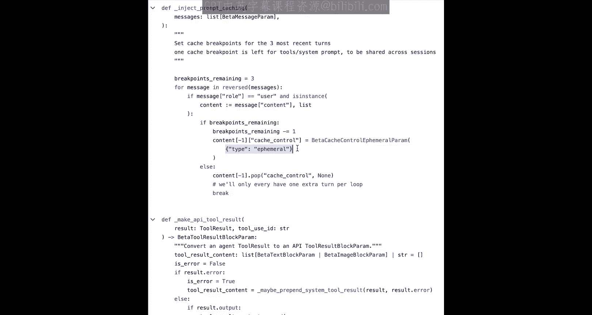

# 吴恩达《使用Anthropic构建计算机操作｜Building Towards Computer Use with Anthropic》中英字幕deepseek - P6：6.prompt_caching.zh_en - GPT中英字幕课程资源 - BV11hfiYeEDu

By the end of this lesson， you'll be able to use prompt caching to reduce costs by up to 90% and reduce latency by up to 85% for long prompts。

 Let's give it a shot。😊。

Let's start by understanding what prompt caching actually does。

 What are the benefits and how does it work， Essentially prompt caching is a feature that helps us optimize API usage by allowing resuming from particular prefixes that our prompts may have in common In short。

 we can cache stuff that is going to remain consistent as a prefix from one API call to the next drastically reducing processing time and costs for any sort of repetitive tasks or prompts that reuse consistent prefix elements。

So let's take a look at some diagrams before diving into some code。

 So on the left we have hypothetical prompt。 I'm just representing it as shapes。

 so this is our prompt that we're going to send off。 none of it has been cached to begin with。

 so we send this request off to the API it's processed and let's say that we decide to cache everything that we send off to the API。

 So at this point we now have all of our prompt prefix the previous prompt from our first request stored in a cache on a follow up request。

 I now have a longer prompt。 It contains the exact same prefix from the first request but a whole bunch of other stuff afterwards。

 We no longer have to process for the API no longer has to process the entire prompt。

 We've cached that prefix from the previous turn。 So when I send this new request。

We're going to get a cache hit。 We'll read from the cache。

 meaning we don't have to reprocess all those tokens。 And depending on how many tokens that is。

 that can save us a lot of time and also save us a lot of money if we're reusing it over and over and over again。

 And then we can write more to the cache and keep this process going where we can incrementally if we want to add to the cache as a conversation grows。

 or we can just cache some particularly long part of our prompt back in your notebook。

 there's the same basic setup we've had， we're importing Anthropic orre setting up the client。

 and we have our model name string variable。 Now， to see the most obvious difference with prompt caching。

 basically with and without prompt caching， we are going to use a very， very long prompt。

 You're actually going to use the entire text of the book。 Frankenstein by Mary Shelley。

 which is available instead of a file called Frankenstein do T X T。

 So the first step here is to open that entire file and read the contents in just into a variable。

 we'll call it book content In this case。 Book content is going to be a very long string。😊。

As you can see here。Here's a small slice of it。 so we can see some of the contents of the book。Okay。

 the next step is to send this off the entire book， along with some prompt。

 like what happens in Chaer 3， Any simple prompt will do here。

 Ily something to do with the book Frankenstein， It's all in a function called make noncd API call。

 and you'll see that there's some timing logic in here to start a timer before and after essentially to calculate the time between the request being sent and the response being received。

And then at the end， the function returns the overall response， and then the delta。

 the time between the start time and the end time。 to be clear。

 this version uses 0 caching whatsoever。 And the highlighted line。

 is where the entire book content that massive string is being provided。

 Notice it's wrapped inside of book X， M L tags。 Not required。

 but it's a nice way just to separate out for the model。 Heres this massive document。 And at the end。

 here's the question。 What happens in chapterer 3。 It is separate from the actual book。

 So we're just demarating the bounds of this massive book。 The next step is to call the function。

 So this line calls a function。 this line prints out how long it took。

 And then this line prints out the actual content we get back from the model。 So run the cell。

And wait， this is a very long prompt， so it may take a while。The response came back。

In this particular instance， it took 17。77 seconds， again， no caching involved whatsoever。

Here's the actual response， which， to be honest， is the least important thing that's happening in this function。

 It's more important to focus on the time element。As well as the actual usage。Which is right here。

So you can see that there are quite a few input tokens that were processed 108，000 input tokens。

 followed by 324 output tokens， that's just the number of tokens used in the generation and zero cache creation input tokens in cache read tokens because we haven't involved caching yet at all。

Now you can move on to the cached version that actually takes advantage of our explicit caching API。

 This is a function。Virtually identical to the previous one。

 except it's called make cached API P call instead of uncached。

 And there's one very important edition right here。

 So in this content block where we're providing the massive book content。

 There now is a cash control property。 or a key set to a dictionary that has type of ephemeral any time you want to set a caching point essentially telling the API。

 I would like to cache all of the input tokens up to this point。 so that I can reuse them next time。

 Our API will do that。 It needs to look for this tag， it has to be here。

 in order to know that we want to write to the cache。 Now， when you run this the first time。

 it's still going to take a long time。 we won't be having any cache hits because we have yet to write to the cache。

 so you can execute it。Again， it will take a while because nothing has been cached yet。

But as part of this request， the input tokens processed up to this cache control will be cached。

That finished running。Here's a response you might get back。

 So all the content that the model actually generated。But for our purposes。

 down here is the most important piece。We see that input tokens this time is only counted as 11。

 output tokens is 324， and cache creation input tokens。Is 108427。

A large amount of tokens have now been stored in the cache。

 The next step is to try and read from them。 Now， going back to this function that you ran earlier。

 make cached API call。 This cache control tag really acts in a dual purpose manner。

 The first time that our API encounters this。 It will perform a cache right up to this point。

 So write all 108000 tokens in the cache。And then on subsequent requests。

 when it encounters this cache control point， it is then going to look to see。

 do we have anything cached up to this point， essentially acting as a read point。

 So its dual purpose in that it acts as a right point and a read point。

So you can send the exact same function， Just run the same function call the exact same request to the API。

 This is now going to act as a read。 so you can run this line again。

 New variable names response to duration 2 that finished running。

 You can take a look at the usage property of the response to noticeice cache creation input tokens is 0 because there is no writing to the cache performed。

 Ca read input tokens is 108000 tokens。 compareare that to the previous turn。

 Ca creation input tokens is 108000 cash read 0。 Sam exact request shape， same messages。This time。

 there was a cache read。 So there was no writing to the cache。

 but there was a massive read from the cache。And if we look at duration 2，6。2 seconds， compared to。

And our totally uncched version， 17 seconds。Exact same prompt。 Think there is one small difference。

This version asked what happens in Chapter 3， This version asks what happens in Chapter 5。

 but basically the exact same length of the prompt， just a different number at the end there。 So 17。

7 seconds。Compared to 6。2 seconds。And that's without considering the cost savings here。

 So let's talk about that。 the way that prompt caching is priced is very straightforward。Essentially。

 you pay a little bit of a premium to write to the cash。

 so cash right tokens are 25% more expensive than regular base input tokens。

 but the significant upside is when it comes time to do the cache reading reading from the cache。

 those tokens are 90% cheaper than uncched base input tokens。And then the actual input and output。

 anything that's not cached and any output that's generated are still priced at just the standard prices。

 So this means that it may not make sense to cash every single thing for every single message。

 but if you have some prompt prefix that is going to remain the same across a whole bunch of requests。

 it can be extremely efficient and cost effective to cash that long prefix and reuse it pay 25% more one time to make the cash right and then pay 90% less for all of those input tokens for every subsequent request that gets a cash hit Now speaking of cash hits one thing that's important to note is that caches do not live forever。

 each cache has a fivemin Ttl or time to live。 So we only support currently at least ephemeral caching。

 And each time you read from a cache it resets that fivemin timer。

 So it also really depends on that use case and how you are using caching and what type of prompt you're sending。

But any time you have a long， long prompt， you want to save money on and you're reusing a lot of that prompt。

 you can use prompt caching。 One common gotcha with prompt caching is multi turn conversation caching。

 Imagine you have a very long conversation， maybe a conversation involving the book Frankenstein。

 where the model is sent that entire book text and there's a whole conversation about it a long common prefix that should be cached to save on tokens。

 especially if the conversation has dozens or hundreds of turns and each turn is long。

 What you can do is cash the conversation as a gross， So by setting a cache control point。 Remember。

 it really can act both as a right point， Write this to the cache。

 everything up to this point and a read point attempt to read from the cache。

 when working with multiturn conversation， What you can do is use to cache control points that you continuously move down the conversation。

 so that you are always cashching the very last user。Ressage。

And you have a cache control point on the second to last user message。Now， why do you do that。

 How does that work， Again， It comes down to this dual purpose nature。

 Imagine that this is a very long conversation that has hundreds of messages。

 This cache control point， presumably， will get a read from the previous turn。

 This used to be the last user message。 And then we got a response。 So this was the last message。

 A write was performed to the cache previously。 And now it acts as a read。There will be a cash hit。

And then this now， at the very end， this cache control acts as the new right point。Telling the API。

 write everything up to here。And then you continue this pattern。 So if the conversation grows。

 which is what this message list shows。It's the same pattern。

Put a cache control on the second to last user message and a cache control on the last user message。

Again， this tells the API write everything up to this point。

 This is new and read everything that you can from this point。

Because this message tell me more about Mars， previously。Was the last message。

 And you continue this pattern of moving these cache controls down the conversation。

 The last user message in the second to last user message to continuously read from the most recent cache。

 And write up to the end of the conversation so that you can read from it next time around。

 And you go over and over and over。 This can confuse some people is on our documentation is' also in this notebook。

 of course， Now I'm not making any requests here。 This is just the messages list that you can refer back to as an example。

 But again， it does trip people up。 Finally， to tie things back to computer use。

 This is a little excerpt from our computer use Quickstar demo that we've been looking at over and over throughout the last few lessons。

😊，I just want to highlight that we do in fact， use cache control Ca control is said to type ephemeral to cache a long history of messages with the model that includes a lot of screenshots。

 which can take up a decent number of tokens。 So if this model is taking actions and it's a I don't know a two or three or four minute interaction where it is trying something doing a screenshot and there's 10 different screenshots and a whole bunch of different tool calls。

 which we've yet to discuss Caching can significantly cut down on the time and also the cost for the actual computer use usage。

So we'll get a chance to look closer at this code later。 This is mostly just to show you， look。

 Caing is real in the wild as well， not just in our educational notebook。

