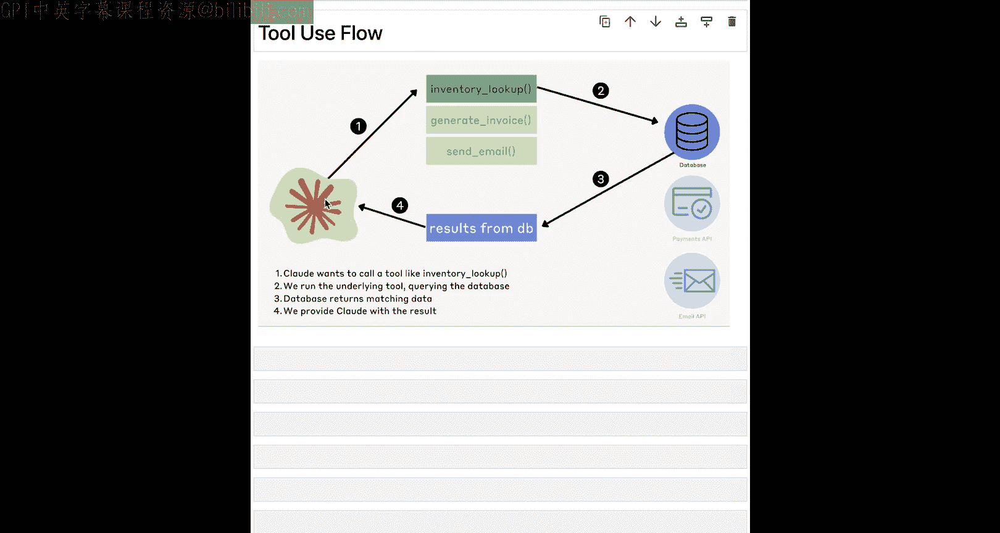
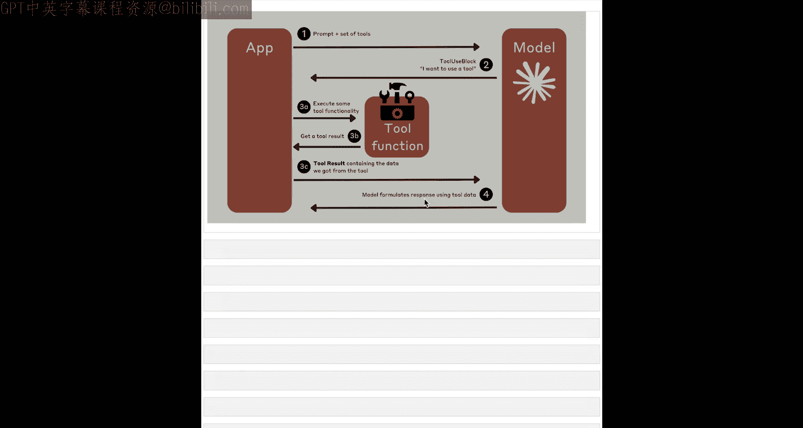
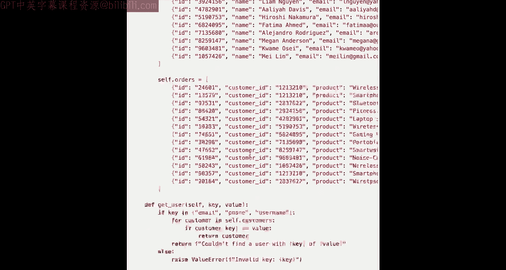
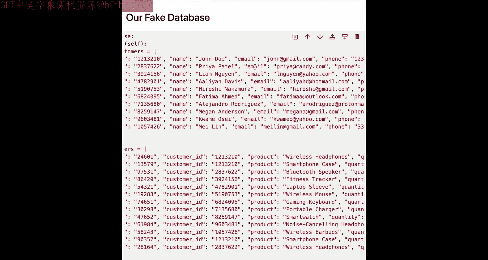
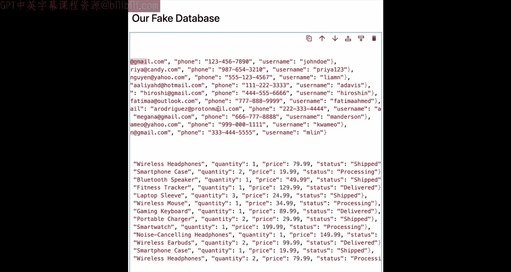
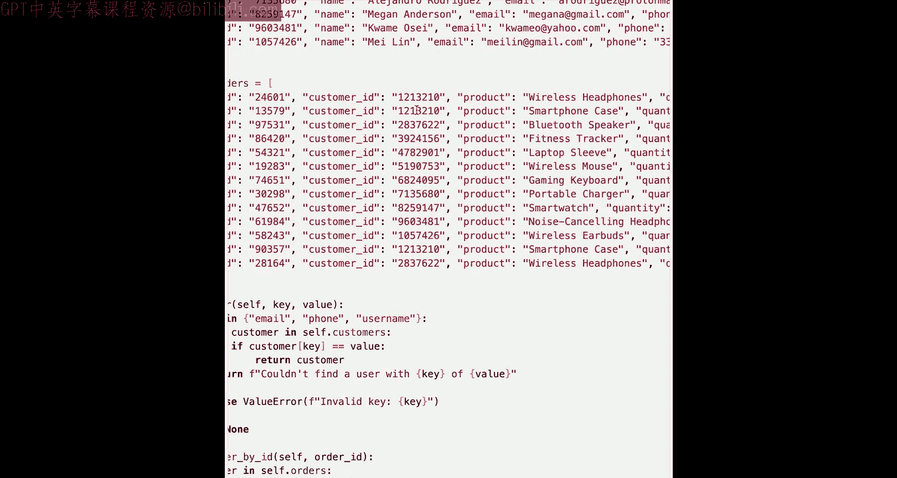
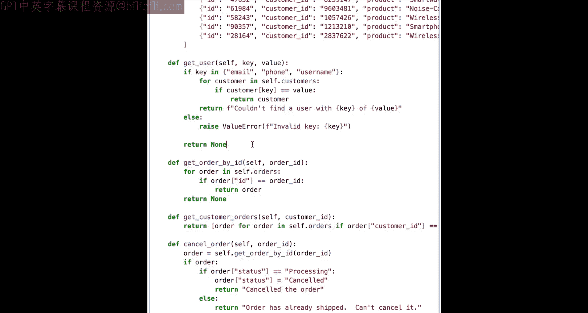
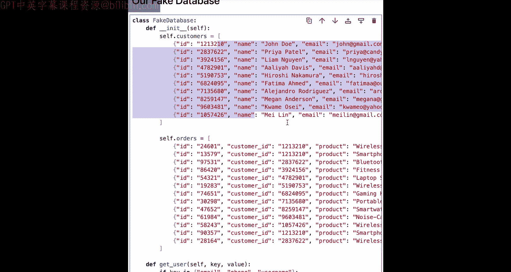
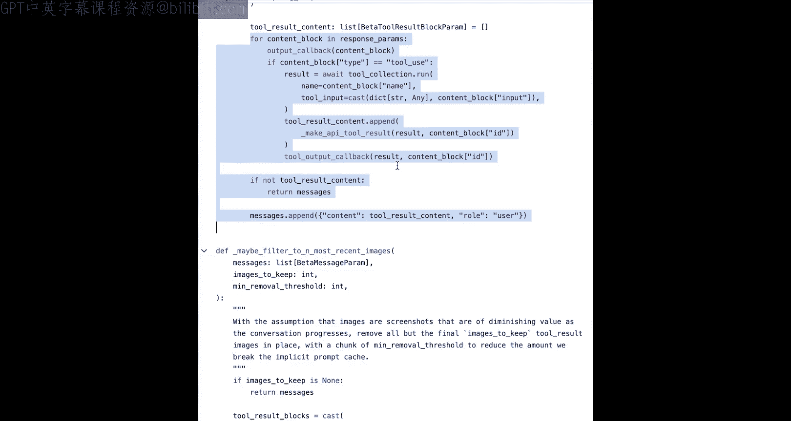

# 吴恩达《使用Anthropic构建计算机操作｜Building Towards Computer Use with Anthropic》中英字幕deepseek - P7：6.5.tool use.zh_en - GPT中英字幕课程资源 - BV11hfiYeEDu

By the end of this lesson， you'll be able to understand tool use workflows with Cla。

 You'll define your own tools and implement your own tool based workflows from start to finish。

Let's get to it。

So let's start with an explanation of what tool use actually is。Tool use。

 also known as function calling， is basically the ability to extend Clade's inherent capabilities。

 We can give Claude some set of external tools or functions。 Give it access to those functions。

 and then allow the model to call those at any point， Although to be a little bit more specific。

 the model itself is simply requesting to call a tool or a function。

 and then we actually do the invocation。 We actually do the function execution and then send the result back to the model。

 So we'll see some diagrams and will build an example of tool use a little chatbot for customer support step by step。

 But before we do that， let's talk about why this matters。

 The short story is that tool use vastly extends the use cases for cloud models。

We can take our normal prompts， whether they're image based prompts or text prompts and combine them with calls to external functions。

 And again， clod itself or the model itself is not directly calling the tools。

 but it's deciding that it wants to call a tool， It's passing arguments through。

 And then we call the actual tool and then pass the result back to Cla。

 And this enables us to do all sorts of things that the models can't do on their own。

 like retrieve dynamic data。 Query， our own databases internally interact with Apis。 Exec code。

 search the web and， of course， control a computer， as you'll see at the end of this video。

 tool use is what powers and enables computer use。 The model can output tool calls to click or move a mouse or type and various other computer actions。

 whenever it wants， And then we can execute those actions and tell the model。 All right。

 We did the click you wanted。 Or we did the mouse move that you wanted。

 Here's what the screen now looks like。 and give it a new screenshot。 We'll build up to that。😊。

To start， we need to understand how tool use works Back in a notebook。

 we have the same basic set up from previous lessons。

This diagram shows the basic flow of tool use on the left right here。 we have our model。

We give it access to a set of tools。 In this case， inventory lookup， generate invoice， send email。

 Maybe these are things you want the model to be able to do。 And in this particular diagram。

 the model decides it wants to call the tool called inventory lookup。 So step 1。

 the model says I want to call this tool。 And we'll see what this looks like in a bit。

 Then it's up to us or up to you to actually execute that tool， that function。

 So inventory look up with some arguments， presumably is going to connect to a database or some sort of API to do some look up in our inventory somewhere。

 Then once you get some results back， you send them off to the model。

 and the model can complete whatever process it was trying to do。 So again。

 the model issues a request to call a tool。 Then you have to execute the tool。

 Then you tell the model about those results。 and then the model can carry on and do whatever it wanted to do next。

This more extensive diagram details the process。 You give the model a prompt and a set of tools。

 You'll soon see how you do that， how you actually write the set of tools and provide them to the model。

 Then the model may decide it wants to use a tool。 So it outputs that。

 It says I'd like to use X tool with these arguments。 Then you actually execute the tool。

 You get some result， write a return value or data from an API or data from a search tool or from a database。

Then you send a tool result back to the model saying here is the result of the tool you wanted to call。

 and then finally， the model can do something with that result。

So there's a couple of steps involved here first。You need to have some set of tools you want to give the model。

Second， you have to define them in the proper format and tell the model about those tools。

 And then third， you have to understand the back and forth flow and the proper format for returning a tool result to the model to start。

 I'm going to show you a fake database class that we'll be using in place of a real database just to keep things simple。

 Imagine we run a company called creatively acme Corporation or Acme Co。

 And this ame Corporation has few different products。 we have customers， we have orders。

 So as you can see here， customers， it's all just placeholder data just to keep things simple。

 But someone like John Doe has an email。

And they also are going to have a username， John Doe。

Theres an orders list in this class representing the database。 Each order has an I D。

 It has a customer I D， and it has a product， a quantity， a price， a status。

 whether it's been shipped or if it's processing。Very， very simple。

 Just taking the place of a real database to keep things simple。

 This class has various functions or methods associated with it， like get user。Get order by I D。

 get customer orders and cancel order。 You can instantiate fake database here and imagine that you are a customer support representative。

 and somebody chats with you and says。My name is John Doe。 My email is John at Gmail dot com。

 I want to cancel an order。 If you look at the orders。

 they don't have John Doe associated or any user name associated with them。 They have a customer I D。

 Each user has a customer I D。

And if you look at the methods we have available， we have Get user。

 which will just find a user based off of an email， a phone or a username。 We have get order by I D。

 which requires an order I D。 We have get customer orders， which requires a customer I D。

 and then cancel order， which requires an order I D。 So if John Doe wants to cancel an order。

It's not as simple as just cancel order unless John Doe happens to know his exact order I D。

 So there's multiple steps involved。 The first step as a human is to get user based off of this email。

 John at Gmail dot com。 Then you can see that John has this user I D。

 The next step is to take that I D for John Doe Find his。Orders using get customer orders。

 And then if you are acting as a customer support representative， you would likely follow up and say。

 I see you have three orders。Two of them have been shipped。

 We can only cancel a order that has not been shipped yet。

 Do you want to cancel the smartphone case order， in which case。

You could finally take this order I D right here and cancel this order using Db dot cancel order。

 and that will cancel that order。Okay， so multiple steps involved is the point here。 It's all fake。

 right， not a real database， but imagine you do run a company with a real database。

 and you want to use cloudde to help automate portions of customer support。

 maybe the low hanging fruit。 And you need to give cloud access to these functions。

 It needs to be able to look up a user by an email or a phone or a username。

 And instead of 10 users or whatever we have here， imagine there's tens of thousands。

 it needs to be able to find orders。 It needs to be able to find orders based on a customer。

 It needs to be able to cancel orders。 Just a small set of tools here。

So how do you tell Claud about these tools。 The first step is to define the schemas for each of your functions。

 And the way that you do that is through Json schema。 If you're not familiar with JSson schema。

 it's a common open format that you can use to define， well， schemas。 And in this case。

 Claud expects or the API expects tools to be passed in using this Json schema format。

 This is a hypothetical tool definition for the get user method， you saw previously。

 So it has a name， get user a description。 and these tool descriptions are important to tell Claud。

 here's what this tool does。 and then an input schema that includes the arguments necessary to call this tool。

As a reminder， this is what get user looks like。So the underlying function has two parameters。

 key and value， both of which are required。Going back to the tool definition， for get user。

 we write the schema to indicate that there are two arguments。1 is called key。1 is called value。

 Both are strings。Key is one of the following choices using this enum。

 It's just a nice syntax to say that it has to be either email， phone or username。

 The idea here is that you can look up a user by an email or by a phone number or by a username。

 And there's also a description attached， explaining how it works。 And then also a value。

 which is a string。Which needs to be the actual email。

 like John@gmail com or the actual phone number or the actual user name。 And then finally。

 down at the bottom here， you can indicate which of these arguments are required to call this tool。

 In this case， both of them are required。 So the next step is to define all of these tools。

 We have four different functions。 We'll have four tool definitions or tool schemas using Json schema and put them in a list called something like tools。

 The name doesn't matter， but we' group them together。

 This list called tools contains four Json schema tool definitions。 Get user。Get order by I D。

 Get customer orders and cancel order， all of which correspond to the previously defined methods we saw in our fake D B class。

 The next step is to give Claude the tools， and send a prompt。

So this is just a simple one off example， not in a function， not in any sort of chat bot loop。

You have a messages list with a single message from a user saying， show me my orders。

 My username is Priya 1，2，3。 Then most importantly， this highlighted vine。

In addition to the fields we've seen before or the parameters you've seen like model。

 max tokens and messages。Now you're passing through tools。

Tools is the list of tools previously defined。 The model will know it has access to these tools and can decide if it needs to call any。

 presumably， if this prompt is asking to show， you， Show me my orders。 My username is Priya 1，2，3。

 The model should call a tool。To look up orders based off of this username， execute the cell。

And then printresponse dot content。 Now we have something we've yet to see。There's a text response。

 I'll help you look up your orders。 Let me first get your user details using your username。

 and then I can retrieve your orders。Followed by something called a tool use block。

 So we have a text block and a tool use block in this tool use block。 If I just。

 let's take the last element in this list so we can hone in on that。

The model wants to call this tool， which is called get user。Specifically。

 it wants to call it with the argument key set to user name and value set to Priya 1，2，3。

 There's also this tool use Id， which is important because the second step。

 once the model says it wants to call a tool is for you to actually execute the tool。

 then tell the model what the result is， and when you do that。

 you give the model the tool result itself， the data from the function along with this I so that the model knows how this tool result corresponds to the initial tool use block。

 The next step is to translate the model's tool use block output。

 basically stating I'd like to call get user with these values。

 and actually execute get user with those values。 or execute any of the other tools。

 get order by I D or cancel order or get customer orders， This is a very simplistic implementation。

 but that's what this function does， it takes a tool name and a tool input and this is tool input right here。

Then as as simple as taking the tool name and the tool input that the model outputted for you and then pass them to process tool call to actually execute that function。

 which is using the database， the D B that you saw previously。 And that's the first half。

The second half is to then send the result back to the model to do that。

 You need to send a follow up message with a role of user where content has a type of tool result。

 tool result must contain the actual content。 In this case。

 this is the content back from calling a tool。 And the tool use I D。 This I D needs to match。

 The corresponding tool result that you send back to the model。 Simply defining this， of course。

 won't do anything。 You need to send it to the model and have some sort of loop or some function so that you can continue chatting or conversing with a model。

 That's the next step is to put it all together。 So you can see the complete flow。This is a simple。

 complete implementation of a chatbot that uses the four tools you saw previously。

There's a lot to cover。You don't need to go over it in extreme detail。

 It's there for you to look at on your own。 But this is the core functionality。

 This function called simple chat。 It uses a system prompt。

 which is a way to provide repeated instructions to set the role。

 sort of set the expectations of the model。 So in this case。

 the prompt says your customer support chatbo for amiko。

 your job is to help users look up their accountant orders and so on。

 And then in each conversational turn， begin by thinking about your response once you're done。

 write a user facing response。 This allows us to separate out the model sort of internal thoughts versus the actual reply that we want to show to a user as a chatbot。

 It's important to place all user facing conversational responses inside of reply X Ml tags to make them easy to parse。

 A note about that。 There's a function called extract reply that does exactly what it sounds like。

 It extracts the contents between reply X Ml tags further down， we start by asking for user input。

 There's a messages list。Starts with a single user message。 Maybe it's just hello。

 there's a way to break out of the loop if the user types the word quit。

And then it's all about tool use。 The messages are sent off to the model in this loop。

 All four tools are provided as that list of tools previously defined the prompt。

 the system prompt has provided model name， Max tokens， all of that that you've seen before。

 Then the model responds with something。You append the message that the assistant responded with。

Remember， there's this list of messages constantly growing when you're trying to build a chatbot。

And most importantly， for this lesson， if the model stopped， because of tool use， if you recall。

 you saw stop reason a few lessons ago。 One reason the model stops is because it just reached a natural stopping point。

 It just is done。 Another reason is that it hits a stop sequence。

 Another reason is that it hits max tokens and another reason is that it wants to call a tool so it stops generating its waiting to get a tool result。

 If that's what the model wants to do。 then extract the tool use information。

 including the name and the input。 There's a print here that just lets you know that Claude wants to use a particular tool。

 Then process the underlying tool。 using the function you saw previously process tool call。 Finally。

 appends a tool result to the conversation history that includes the tool use I D and the actual value returned from the underlying tool function。

 and then the loop repeats。If Claude didn't want to use a tool。

 then simply print out the model's response。 And then you can try chatting to the model。

 simply run the simple chat function and then enter your first conversational message。

 maybe something like Ho to start。 There's a response。 Ho， welcome to Emiko customer support。

 How can I help you。 I can look up your account info， check order status or cancel orders。Let's say。

 Alpo as Priya。Which is one of the users in the fake database with a username of Priya 1，2，3。

 So I'll write that I want to check on my order status。

 And then the model now says I'd be happy to help you check on that。

 provideviide either the order I D。 I don't have that。 So instead， I'll say， I have my username。

 which is Priya 1，2，3。😊，Hit enter。And the model will likely want to call a tool。 Now。

 It wants to call get user， and it actually called two tools the first time it called get user to look up information about Priya。

That then gave Priya's user I， the model then called get customer orders。

 using the user I from Priya。Finally。It found the orders and gave a response saying。

 you have two recent orders， a Bluetooth speaker and wireless headphones。 Is there anything specific。

 you want to know about those。 So that's a simple demonstration of the workflow to wrap up。

 We'll return to our computer use quick start implementation。

 We'll take a much closer look at this in the next video。 But I just want to show you that it does。

 in fact， use tools。 Theres an import at the top to import various tools。

 A computer tool is the one that's most interesting to most people。

 It includes clicking functionality and mouse movement。

 All the tools are combined into this tool collection variable。When a request is sent to the model。

 the tools are passed through the same thing you just saw tools equals some list of tools。

 And then once the models responded back， if it wants to issue a tool or use a tool。

 if the content block type is tool use， there's logic in here to execute a tool。

And then make a tool result and send that back to the model。Slightly nicer code。

 a few helper functions， things are split across files。

 but it's the same core tool use functionality that you saw in this lesson。

