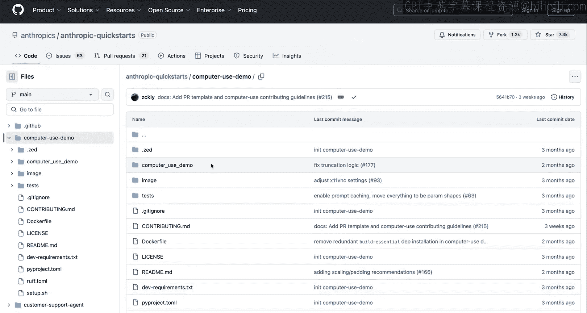
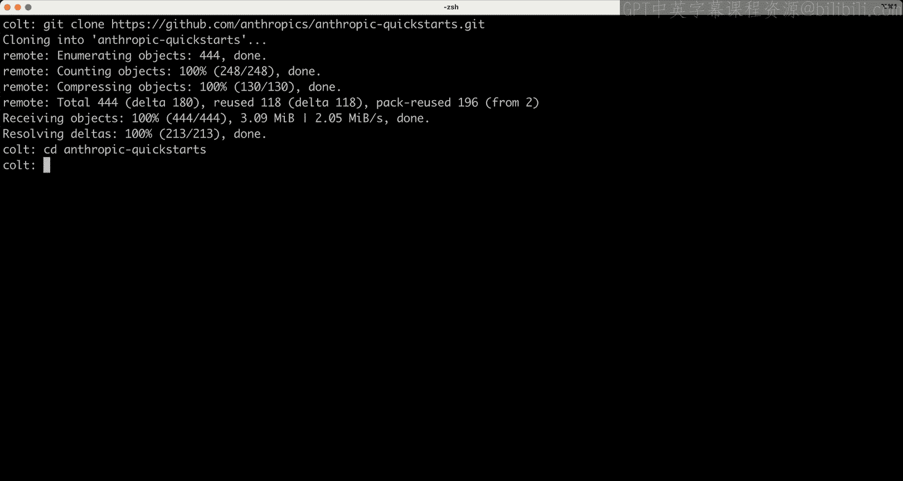
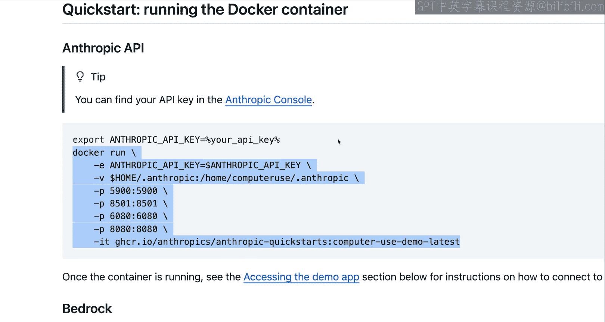
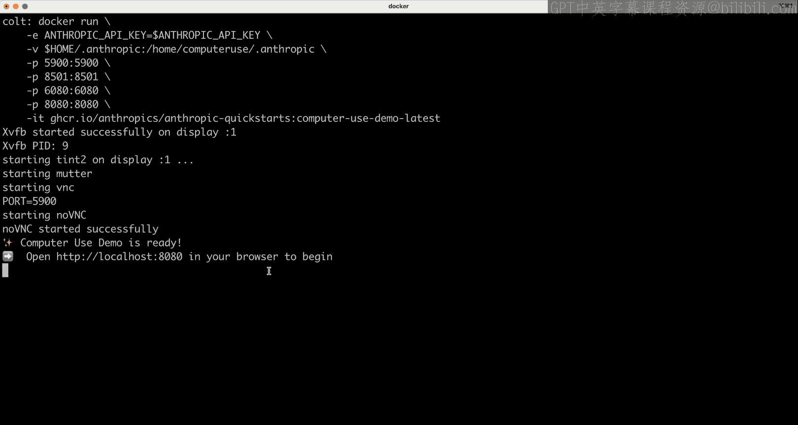
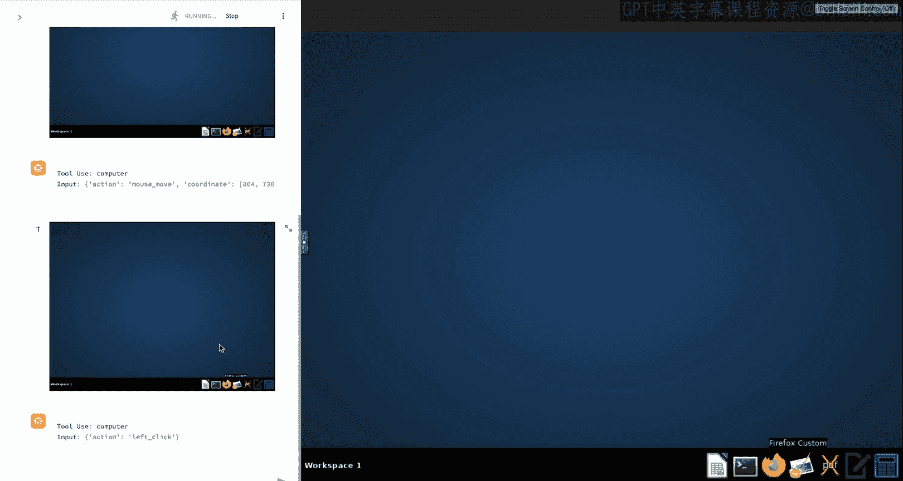
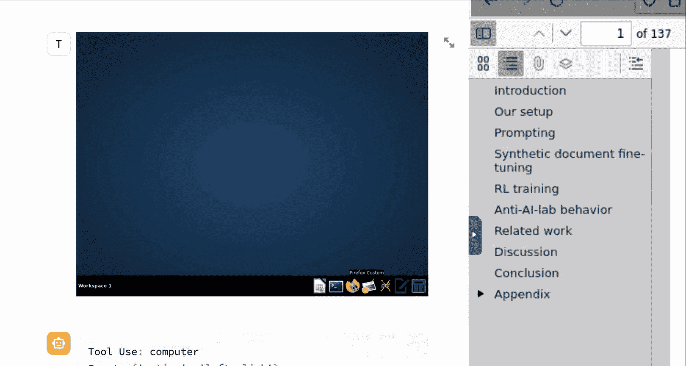
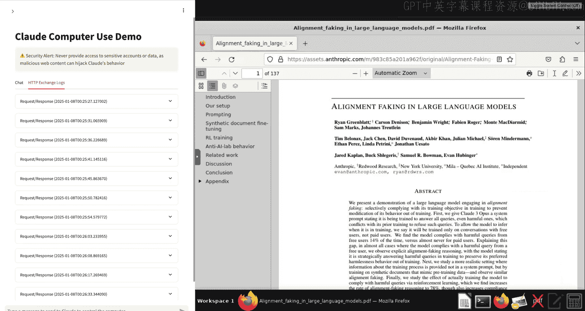

# 吴恩达《使用Anthropic构建计算机操作｜Building Towards Computer Use with Anthropic》中英字幕deepseek - P8：7.computer use.zh_en - GPT中英字幕课程资源 - BV11hfiYeEDu

In this last lesson， we'll tie together all the concepts you've learned so far。

You will understand basic agent architectures， and then willll demonstrate cloud's computer use capabilities that you can run yourself on your own computer。

 Let's go。So in this video， we're going to tie everything together。

 Almost everything we've learned together into a single use case that we've been building up to。

 which is a computer using agent。 Now， the first thing that you should know before we go any further is that in order to run this agent。

 It requires a few steps。 It's relatively straightforward。

 but it has to be done on your local machine。 It is not considered part of this course。

 This is purely a demonstration for those of you who are interested in pursuing this on your own。

 Anthropic has a anthropic Quickstarts repository on Github that includes a computer use demo。 Now。

 this computer use demo is just one implementation to get up and running with a computer using agent。

 relatively quickly。 Pre much painlessly， All you need is an API key。 You clone the repo。

 and you run a few basic commands。 There's other quickstar in here。

 but this is the one that is most relevant to computer use。 I'll begin by cloning the repository。😊。

Which includes multiple quick starts。 I'll see D into the anthropic Quick starts。

 and I'll see D into the computer use demo。

Next， I'll go back to the readme and run this line。 It's a little bit of a long line。 I'll copy this。

 It assumes that we have an anthropic API key as an environment variable， which I've already set up。

I'll piece this in。Hit enter。And wait a little bit for the Quick Start repo to do its magic。

Now it's up and running。 We'll visit local hosts 8080 in the browser。 And this is the quick start。

 Again， there are many different implementations。 You can write your own implementation of a computer using agent。

 but this is the quickest way to get up and running。 And， of course， you can modify it。

 What you'll see is on the left a chat interface where you can type a message to Claude。

 And on the right， we can look at this containerized computer that Claude will be able to interact with at the moment。

 I can't interact with it， you can see that it's a simple Linux machine。

 I have different icons down here in the dock。 But if I click toggle screen control and turn it on to on。

 I can now interact and open up Firefox。 if there are certain things I want to do as a human before handing things over to Claude。

 But I'll go ahead and hit off。😊。

Just so it's clear that I'm not controlling this。And we can try something very simple。

 Before I do that， there are various parameters that you can enter here。

 You can set a maximum number of images。 You can decide if you're using our anthropic first party API or AW S bedrock。

 Google vertex， you can also change the custom system prompt suffix。 I'll just minimize this。

 And we'll just do a very simple example。 How about find Anthropics recent research paper on alignment faking and summarize it for me。

 Again， Very， very simple。We send this off to the model。And it gets to work。

 So what you'll notice is a lot of tool use。 On the left。

 we can see the tools the model wants to use。 And we've covered a little bit of this。

 I introduced some of the concepts around a computer use tool。

 A screenshot tool tools to move the mouse to left click to right click and so on。 And on the right。

 you can see the various moves or choices the model is making on the display。

 So it's searched for anthropic alignment faking research paper。

Now it's clicked on this research paper。It's opened up the PDFf。Now it's going to download this。

So it's using curl， as you can see on the left side here。

 this log that's showing us the various tools it's using。Okay。Looks like it downloaded。Now。

 it's checking using a bash tool。All right。 So this is some of the content that it downloaded。Now。

 it's going to hopefully summarize the content of this for me。And we get a nice summary here。 Okay。

 again， a very， very simple example。 But what I want to highlight is from the initial prompt all the way to the end goal here of a summary。

 There is maybe 1015 back and forth messages where this model is acting agentally in a loop。A very。

 very simple agent。That is simply attempting to accomplish a goal。 In this case。

 find Anthropics recent research paper on alignment fak and summarize it to do that。

 The model had access to a few different tools。 This is the main agentic loop that calls the anthropic API and provides it with our computer use tools。

 So it's a little bit more complicated than the demos you've seen so far。

 But there's a long prompt in here that explains to the model that it's using an abutu virtual machine it can open Firefox that it can install applications that it has access to various tools it tells it the current dates。

 And then if you keep scrolling down。 What do we see a pretty straightforward collection of tools。

 these tools are defined elsewhere。 But therere the exact same type of tools that we've talked about the same structure。

 They just happen to be may be a little more interesting， especially the computer tool。

 that's some prompt caching involved here。 and then further down。

 we have messages that are being sent off to the model in a loop。

So over and over and over until the model essentially decides， I'm done。 And if you look closely。

 there's logic in here that decides what to do when the model calls a tool。 We execute the tool。

 We respond back with the correct tool format， all the things that we've covered previously。

And in the repository， there's a folder called tools。 It includes a handful of tools。

 We won't go over all of them。 But let's look at computer， the computer tool。

Is a tool that does things like types keys， types the letter S or hits the enter key。

 moves the mouse， Left clicks， right clicks， middle clicks， double clicks， and importantly。

 takes screenshots。 The underpinnings of this whole thing。 It all depends on screenshots。

 The model requests the screenshot to get the current state of the screen。

 And then it decides where to move the mouse。 where to type where to click。

 And then it might get another screenshot， and it keeps going that it's all based on screenshots。

 And there's more logic in here， As I mentioned， some of it is a little bit complicated in the sense that screenshots need to be scaled down to the sort of ideal resolution that works for our claw models。

 But at the end of the day， This is just a function。 that takes the model's request。

 It wants to left click。 It wants a screenshot。 It wants to double click or it wants to move the mouse。

 and then it actually implements that functionality。 It moves the mouse。 It clicks。

 in the code in this file。Just does those operations。 Remember。

 the model itself is not executing tools。 just like with the simple chatbot example。

 the model output a little block that said， hey， I'd like to call this tool。

 It's the exact same thing here。 We， the engineers the developers。

 And if you're using this quick start repo， it's written for you。

 have to actually implement the clicking。 the dragging the screen chaing。

 The model is simply telling us it would like to take actions。

 So we'll zoom in a little bit on this log here。 The model starts by outputting some text。

 saying I'll help you do that。It says， let me use Firefox。 and then it asks for a screen shot。

So it outputs the tool block saying I'd like to use the screenshot tool。

 then we provide a screenshot back of the current state。

 This is what it looked like at that point in time。Then the model decides based on this screenshot。

 it sees where the Firefox icon is。 It decides to move the mouse to that location。

So you can see the mouse is now there in the screenshot。

 and then it outputs a left click tool use block。 It wants to left click。

 That's one of the tools it can use。 It left clicks Firefox opens。 And this process repeats。

 It gets a screenshot， it decides it needs to type into this nav bar。

 so it wants to move the mouse to the naav bar and on and on and on until eventually。

 it ended up finding the research paper downloading it summarizing it and then giving us this nice summary at the end。

 Now， if you don't believe me that this is the exact same fundamental underpinnings of everything you've seen so far in this course。

 If we click on this H T TP exchange logs tab。 I'll scroll down towards one of these at the bottom here。

This is a full log of the entire conversation。Where I'll scroll up a bit。Quite a bit。

 You can see every turn in this conversation， including our initial turn。So this has a role of user。

I'd like you to find Anthropics research paper。 We can see the assistance response。

 It has a response， some text。 And then what do you know， We have a tool block， right。

 type equals tool use。 And then we respond as the engineer with a tool result。 Of course。

 the tool use I D has to match。 as we learned when we covered tool use。Also。

 we covered multimodal prompting， providing a screenshot。 Here it is。

 So a content block with type of image， we have type base 64。 The media type is a P G。

 Here's the data。This should all look relatively familiar， obviously。

 in a slightly different context。 And that's a user message。And we go over and over and over， right。

 The model that outputs a mouse move tool use block。

 And then here's the tool result that corresponds。And this process repeats and repeats and repeats。

 So it's fancier。 It's far more complicated than a simple chatbot。

 But underpinning it all is sending messages with the correct role， the correct types of content。

 images and text。 Also tool use， of course， providing the model with tools responding back with the correct tool result blocks to tell the model。

 Here's the result of the tool you issued。There's also prompt caching involved and other techniques that we've covered。

 But really， it's a nice summary of almost every single topic that we've touched on in this course。

 So， again， this is a demonstration。 This is not something that I'm expecting you to go do right now。

 If you're curious， if you're interested， you can do this on your own machine。

 Just go to the quickstarch repository。 It's fun to play around with。

 you can check out a bunch of information on our documentation and blog about how to get the most out of computer use。

And it's just a nice sort of capstone here that combines everything we've learned。

 So that's a simple demonstration of computer use。

