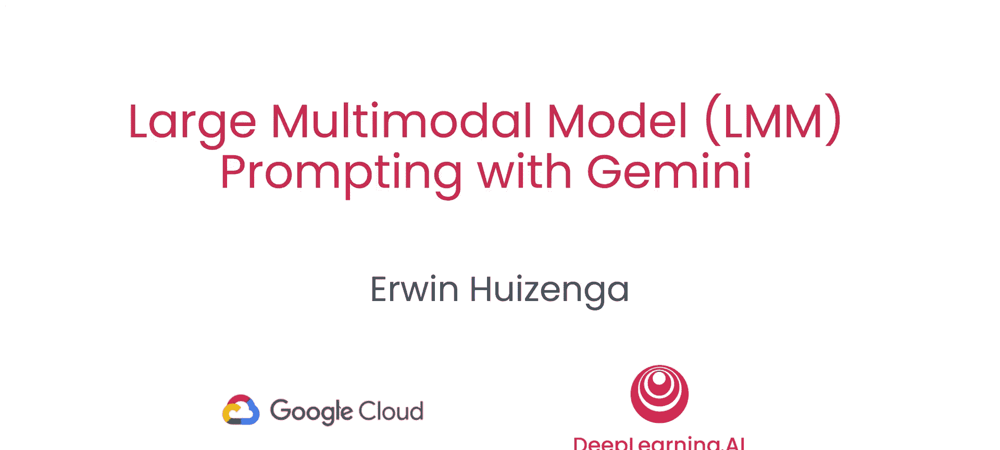
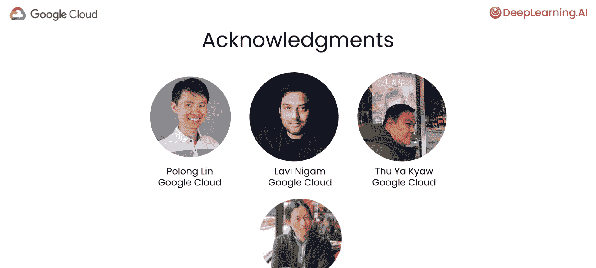
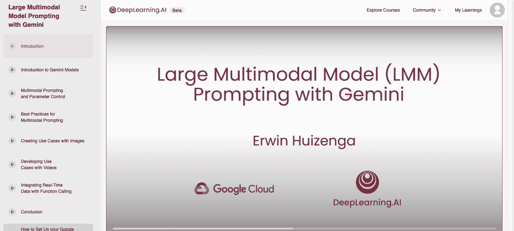
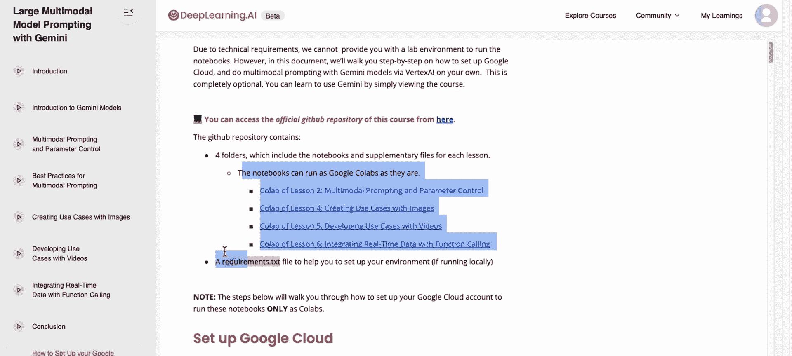

# 吴恩达《使用Gemini进行大型多模态模型提示｜Large Multimodal Model Prompting with Gemini》（豆包翻译 - P1：1.intro - GPT中英字幕课程资源 - BV11M4m1a75d

欢迎来到与谷歌云合作构建的大型多模态模型或 LMM 与。

双子星提示。想象一下，你正在设计一个客户服务应用程序，一位客户上，传了一张产品的图像，比如说一台微波炉，旁边还有一个红，薯，并问，我该怎么处理这个？而 LMM 允许你直接使用文本和图像来回答这个问题。

在 LMM 可用之前，一种方法可能是使用字幕生成模型来编，写图像的描述，然后将该字幕和问题输入到大型语言模型，或 LLM 中。但是一个大型多模态模型，即 LMM，可以直接处理文本和图，像。

从而减少了比如说字幕错过一些关键细节的机会。双子星是最新的少数几个从一开始就被训练来理解文本、，图像、音频和视频混合的模型之一。我很高兴介绍本课程的讲师，欧文·惠辛加，他是谷歌云机。

器学习的开发者倡导者，在 LLM 和 LMM 方面有深厚的经，验。谢谢，安德鲁。我很高兴与你和你的团队在这方面合作。在本课程中，你将学习如何构建多模态用例。具体来说，你将学习什么是多模态。

如何使用双子星 API ，处理不同类型的数据，如图像和视频，以及设置参数和提示，工程的最佳实践，以及如何在多个图像或视频上应用高级，推理。例如，你看到的一个用例是输入一个既有文本又有图表的，文档。

然后让 LMM 回答依赖于阅读和理解文本和图表图像，的问题。你使用 Python 和顶点 AI 双子星来构建这些多模态用例，您将探索各种多模态用例，并学习如何使用双子座模型与，图像进行交互。

包括那些在视频中包含文本或表格的图像，您将学习选择模型参数，并了解这些参数如何影响模型的，创造力和一致性。您将发现提示多模态内容的最佳实践，并使用大型语言模。

型来改进、编辑和增强类似于数字营销人员在为社交媒体。

准备内容时所需的视频。此外，您将学习如何通过函数调用用实时数据集成来增强。

语言模型。许多人致力于创建这门课程。我要感谢，在谷歌云方面，Paulong Lin、Lavi Nigam 和 ，Thu-Yu Qua，以及来自 DeepLearning。ai 的 Eddie Hsu。

也为这门课程做出了贡献。在下一个视频中，Erwin 将介绍多模态和双子座。在您完成这门课程后，无论何时您同时拥有文本和图像数，据，我希望您能使用本课程中的想法如此快速地开发应用，程序。

以至于其他人会将您视为效率的典范。让我们继续看下一个视频并开始吧。本课程仅以视频形式呈现。您只需观看课程即可了解关于双子座的所有信息。如果您希望自己运行代码，我们为您提供了如何访问和运，行笔记本的说明。

让我向您展示这些说明在哪里。在左下角这里，您可以点击如何设置您的 GCP 账户。

这会带您到这份文档。在这份文档中，您将找到如何注册谷歌云平台账户的说明，您还可以找到如何访问谷歌 Colab 笔记本的说明。

