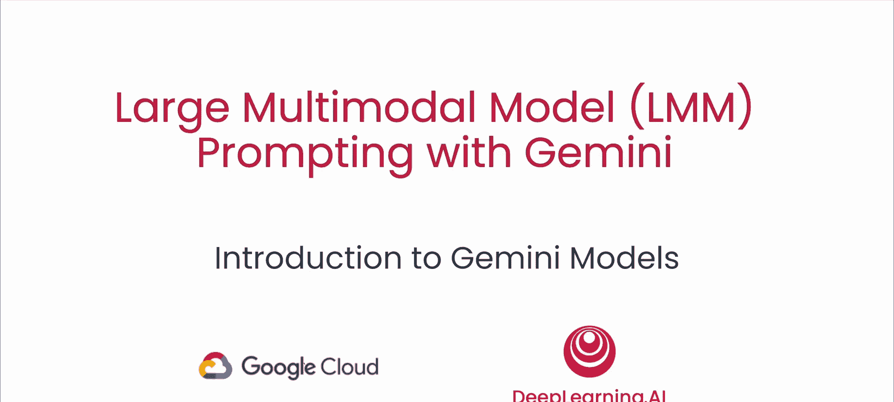
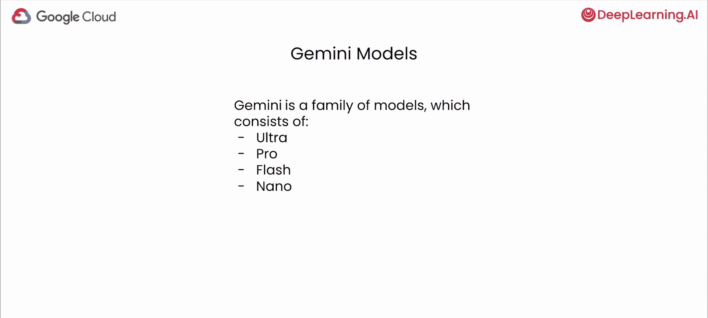
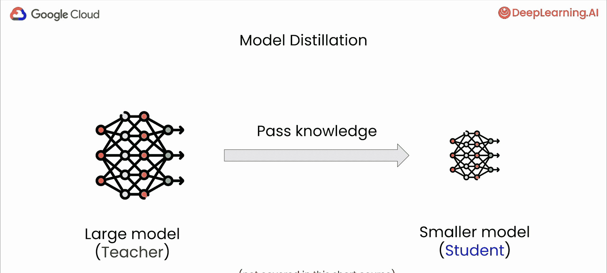
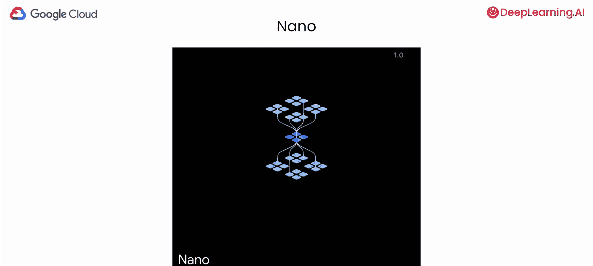
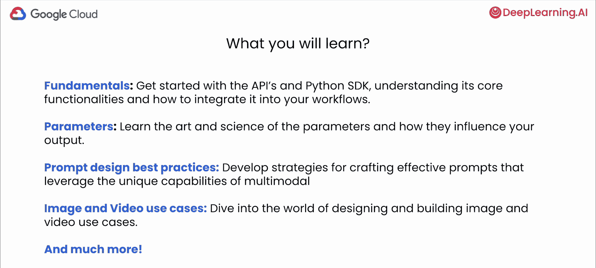

# 吴恩达《使用Gemini进行大型多模态模型提示｜Large Multimodal Model Prompting with Gemini》（豆包翻译 - P2：2.gemini - GPT中英字幕课程资源 - BV11M4m1a75d

在本节课中，你将了解多模态，探索双子座家族中的不同模，型，并理解如何为你的特定用例或应用选择正确的模型。

让我们开始吧。首先，快速概述一下双子座模型家族，让大家都在同一页面，上。双子座是谷歌 DeepMind 的多模态模型。那么这意味着什么呢？嗯，这意味着双子座不仅仅像你可能知道的许多语言模型。

那样仅在文本上进行训练。它还在各种图像、音频、视频和文本数据上进行训练。为什么这很重要？嗯，这种多模态方法意味着该模型可以在这些不同模态之，间进行推理。可以这样想。该模型不仅仅擅长在图片中识别一只猫。

它还可能理解那只猫玩耍的视频、它喵喵叫的声音，甚至，能用一首诗来描述它。这就是多模态的力量。在本课程中，你将更多地了解多模态，并且你将致力于解决，一些非常有趣的用例。所以双子座不仅仅是一个模型。

它是一个为适应不同需求而设计的模型家族。可以把它想象成选择适合工作的正确工具。有不同的模型大小，每个大小都是专门为满足不同的计算，限制和应用要求而定制的。好的，让我们再深入了解一下，看看不同的模型。

首先，有双子座超大型。这是最大且最有能力的模型，在包括推理和多模态任务等，广泛的高度复杂任务中提供最先进的性能。稍后，我们将更多地谈论推理和多模态任务。在现实世界中，使用最大的模型并不总是最佳策略。

想象一下用卡车去快速购买杂货。这有点过头了。这里可能也是如此。在大型语言模型的世界中，我们经常看到一种权衡。最大的模型非常强大，但有时响应会稍微慢一些。双子座专业版被设计为一个多功能的主力模型。

它是一个性能优化的模型，平衡了模型性能和速度等方面，这个模型泛化得非常好。这使得它非常适合需要模型有能力、提供高质量回应并且，在提供回应时非常高效的广泛应用。然后我们有双子座闪光。

这是一个专门为成为最快、最具成本效益的模型而构建的，用于高容量任务，以提供更低的延迟和成本。所以这对于你需要模型快速提供回应的用例来说是完美的，所以想象一下你正在构建一个需要立即回答常见问题的客。

户服务聊天机器人。或者也许你正在开发一个实时语言翻译工具，需要跟上快，节奏的对话。双子座的闪光对速度和效率的强调使其非常适合这些高要，求的用例。然后还有纳米。

双子座纳米是专门为直接在用户设备上运行而设计的轻量，级成员，例如，一部 Pixel 手机。那么我们如何实现这一点呢？

我们通过一个叫做模型蒸馏的过程来做到这一点。把模型蒸馏想象成教一个学生。所以一个大型专家模型，即老师，将其知识传递给一个更小，、更紧凑的模型，即学生。目标是让学生模型学习最重要的技能，而不需要与老师相。

同的快速资源。就 Nano 而言，我们从更大的双子座模型中提炼知识，以创，建一个能舒适地适配智能手机和其他设备的模型。那么为什么是在设备上呢？一个原因可能是你需要对敏感数据进行本地处理。

在本地处理数据可以帮助你避免将用户数据发送到中央服，务器。这对于处理敏感数据的应用程序可能很重要。另一个原因可能是离线访问。用户即使在没有互联网连接时也可以访问人工智能功能。

这对于需要离线工作或具有可变连接性的应用程序很有用。

。现在，你可能会感到困惑。有所有这些不同的模型。我们有一个双子座模型。你可能会看到像羊驼这样的东西。有所有这些不同的模型，在这些模型家族中，你也有不同的，模型版本。这可能会非常令人困惑。

我如何为我的用例选择正确的模型？选择最佳模型不是一刀切的情况。正如我们刚刚看到的，每个模型都有其自身的优势和权衡，那么让我们将其分解为你可能想要考虑的关键因素。所以做出决定的第一步是了解你的用例。

那么你试图构建什么？也许是一个聊天机器人，一个内容生成工具？不同的任务和用例可能更倾向于不同的模型和能力。一旦你理解了你的用例，将你的用例与这三个轴进行对比，可能会有所帮助。当然，还有很多其他要求。

但让我们现在先简化一下，只是，为了更好地理解我们如何选择正确的模型。你可能想要看看模型的能力。所以仔细评估模型规格，它是否与你的用例相符？例如，它能处理文本，还是也能处理图像？你可能还想要看看延迟。

你的模型应用需要多快响应？如果实时交互很重要，你想要一个能快速生成响应的模型，你可能还想要看看成本。所以更大的模型通常会提供卓越的性能，但计算成本更高，为了选择一个模型。

你可能想要将你的用例与这些要求进，行对比。例如，如果你正在开发一个图像搜索工具，你可能想要优先，考虑具有出色图像处理能力的模型。好的，我们已经多次提到多模态。让我们在实际中分解一下这意味着什么。

一个多模态模型学习理解像图像、视频和文本这样的东西，让我们想想一个能说音频、视频、图像、PDF、文本甚至，代码这样的语言的模型。那么这对你和你的用例意味着什么？例如。

你可以使用多模态模型从图像中提取文本。曾经想从一个梗图或文档扫描中取出文本吗？它也能理解像图像或视频中发生的事情。它可以识别物体、场景甚至情绪。我们也将在本课程中介绍其中一些用例。很酷的是。

你可以以不同的方式提供这些输入，这在课程中，你也会看到。输入可以是代码、文本、PDF 图像、视频和音频的混合。好的，让我们看一个例子。假设我想在这里左边给我的猫买一套新衣服。

所以我可以给模型两张我的猫的图像，并且我可以提供一，个提示，在这种情况下是一个文本提示。你认为对这只猫来说什么会是好的服装？我将把图像和文本都作为模型输入。然后模型会给我一个回应。

根据这两张图像建议我可以给，我的猫买的最好的服装。输入可以交错，这意味着它可以是文本、图像、音频之类，的混合。所以在这个例子中我们有一张图像，接着是文本提示，然后，又是一张图像。所以你可以改变这个顺序。

顺序很重要，我们将在课程后面讨论这个。我们还谈到了高级推理和跨模态推理。这意味着模型可以分析复杂的信息并在不同模态中提取见，解，使其在科学、法律和金融等领域有价值。实际上任何与该挑战作斗争的行业。

这样想。想象你是一个研究气候变化影响的研究人员。吉姆和我可以一起分析科学论文、文本、也许卫星图像、，视觉数据和像温度图表、数值数据之类的东西。然后它可能能够识别模式和趋势，帮助你理解大局。

这里有一个视觉示例。这是一个学生对一个物理问题的解决方案。我们有一张图像。图像上有学生提出的问题和答案。我们有一个文本提示。所以我们要求模型尝试逐步推理问题，然后推理学生给出，的答案是否正确。

如果解决方案是错误的，模型被要求解释错误之处并解决，问题。所以我们在这里提供了一个文本提示和一张图像。在右边，我们可以看到模型的答案。看看你是否认为模型的响应是正确的。

这里很酷的一点是模型能够跨文本和图像进行推理。图像包含文字和一幅画，然后提供一个既有文本又有一些，数学 LaTeX 的响应。好的，所以你了解了双子星模型家族。你了解了成为一个多模态模型意味着什么。

你了解了跨模态推理。在整个课程中你将学到一些东西。首先，我们来看基础。那么我们如何通过使用 Python SDK 和 API 来开始使用，这些模型呢？我们将讨论核心功能以及如何将其集成到你的工作流程中。

或用于用例。我们将讨论参数以及它如何影响输出。我们将讨论提示以及多模态模型提示的最佳实践。我们将讨论大量的图像和视频用例，以及你如何使用这些，模型来解决其中一些用例。当然，还有很多很多。

