# 吴恩达《使用Gemini进行大型多模态模型提示｜Large Multimodal Model Prompting with Gemini》（豆包翻译 - P3：3.prompt and parameter control - GPT中英字幕课程资源 - BV11M4m1a75d

在本节课中，您将探索使用文本和图像来提示多模态模型，您将了解各种模型参数以及如何选择和理解它们对模型创，造性和一致性的影响。好的，让我们深入代码。

为了运行此笔记本，我们必须执行一些设置代码。我们首先要做的是导入我们的工具并进行认证。认证的意思是我们能够从我们的笔记本环境在云中调用双，子座 API。所以我们需要设置一些凭证和我们的项目 ID。

该项目包含我们在本课程中在云中使用的资源和双子座 ，API。我们还将指定一个区域。区域的意思是我们将在哪里执行我们的代码。在这种情况下，我们使用美国中部 1。接下来，我们将导入顶点人工智能 SDK。

所以顶点人工智能 SDK 就像一个 Python 工具包，帮助您，与双子座交互。这样我们就可以使用 Python 来调用双子座 API 并在我，们的笔记本中获得响应。我们需要初始化顶点 SDK。

意思是我们需要告诉 SDK 我们，在哪个项目中在哪个区域内使用双子座模型，并且我们需，要给它我们的凭证。凭证的意思是双子座 API 知道这是欧文，我被允许使用该， API。好的。

现在是时候选择我们的模型了。为了使用双子座 API，我们必须导入 SDK。从 SDK 中，我们将导入生成模型。有多个生成模型。在这种情况下，我们使用双子座模型。然后我们必须指定我们的模型。

我们可以说模型等于，然后取我们刚刚导入的生成模型并，选择我们的双子座模型。所以在这种情况下，我们将使用双子座 1。0 专业版 2。模型正在更新，所以可能有不同的版本。让我们运行这两个。接下来。

我们必须从我们的工具中导入一些辅助函数。如果你想更了解工具函数中发生了什么，看看 utils。py ，文件。一旦我们导入了这些，我们就可以调用我们的模型。那么让我们从一个非常基本的提示开始。

问什么是多模态，模型。我们正在使用我们刚刚在这里指定的模型，我们可以运行，这个，然后它将调用 API。在这里你看到输出。随意更改提示并使用双子座专业版来看看它给出什么样的，响应。

你现在可能想知道在这个辅助函数中发生了什么。那么让我们去看看我们如何使用 SDK 调用 API。所以首先，我们需要一个提示。好的，所以一旦我们有了一个提示，我们可以使用模型。

generateContent 来调用 API。所以这让我们用我们的提示来调用 API。所以我们将在这里使用提示 1 以获得响应。很酷的是我们可以使用流式传输来获得响应。所以我们可以将流设置为真。

所以通常你会在大型语言模型中看到的是，你必须等待你，的响应完成，然后模型才会作为用户向你返回响应。如果我们使用流式传输，所以如果我们启用流式传输，我们，不必等待完整的响应完成。

你可以在片段一进来就开始处理它们。那么假设你想要构建一个实时聊天机器人，并且你不想让，你的用户等待完整的响应完成。你可以在响应进来时进行流式传输。好的，所以我们要运行模型。生成。我们称之为响应 1。

所以我们要运行这个。然后当你运行响应 1 时，你可以看到它生成了一个对象。而这是一个流式对象。所以如果我们想要获得实际的响应，你需要使用循环遍历，生成器对象。那么让我们在响应 1 中使用一个循环。

并打印每个响应。你将看到的是一个 JSON 响应。现在你可能会想，这个 JSON 看起来一点也不像我之前收，到的文本响应。那么让我们看看如何获得文本响应。我们必须再次调用 API 以获得响应。

所以我正在调用生成内容，然后我们必须再次对对象进行，循环。但我们正在做的是打印响应。文本。所以我们从 JSON 对象中只获取模型的文本响应。并且正如你将看到的，我们已将流式设置为真，因此一旦可，用。

响应就会实时进来。都很有趣，文本到文本。但是欧文，你谈到了多模态。好的，你说得对。让我们看看如何使用图像和文本从双子座获得文本响应。首先，你需要从顶点 AI SDK 导入几个额外的类。

你知道我们要添加到的生成模型。所以我们添加图像。这让我们处理图像并将它们发送到双子座 API。并且我们要导入部分。这用于多内容消息。例如，我们想要将文本和图像结合起来并发送给双子星应，用程序编程接口。

接下来，我们可以导入我们的多模态模型。在这种情况下，我们使用双子星 1。0 专业视觉版，我们可，以将其用于图像或视频等数据。现在我们需要一个提示词和一张图像。所以我们有一张非常酷的安德鲁的图像。

然后我们要让模型描述这张图像里有什么。所以我们将加载本地图像。我将运行提示词。然后我要将图像和提示词组合起来，这样我们就可以将它，们两者都发送给双子星应用程序编程接口。我先放图像。

因为我们已经看到先放图像然后放提示词会，给我们更好的响应。我也会在课程后面谈到双子星的最佳提示实践。

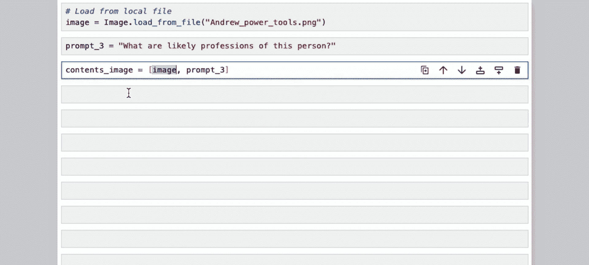

让我们看看图像和提示词。所以在这里你可以看到我们有一张安德鲁拿着锤子和电钻，的图像。

我们要求双子星描述这张图像里有什么。让我们调用应用程序编程接口看看它的回应。

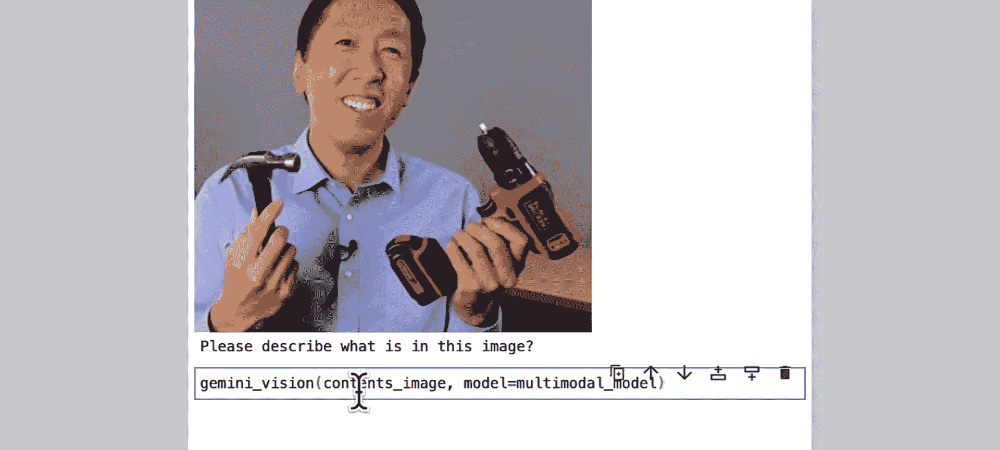

所以图像和提示词都给到双子星。双子星给我们的回应说图像显示一个拿着锤子和电钻的男。

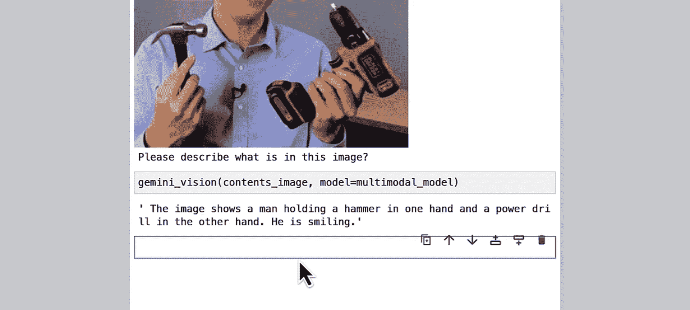

人。并且，安德鲁在微笑。让我们问它一个不同的问题。一个更有趣的问题。所以让我们问它这个人可能的职业是什么。接下来，你可以运行内容图像。如果你愿意，你可以在提示词中再次打印图像，但你也可以。

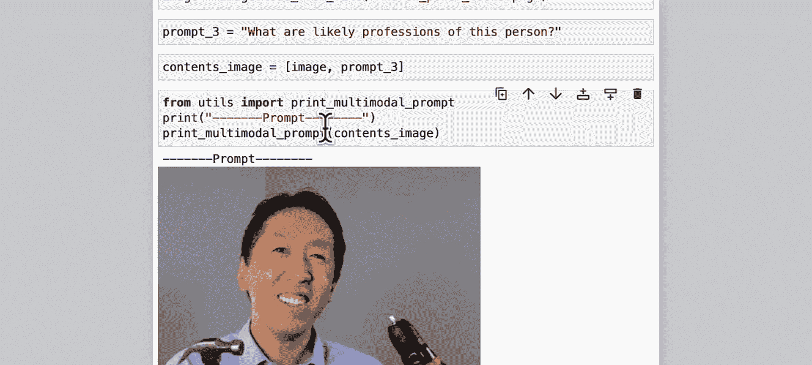

跳过它。然后你运行双子星视觉来使用新的提示词但相同的图像获，得输出。

所以这个人可能是个杂务工或木匠或者也许是个建筑工人。

。通过这个提示，你可以看到我们不仅进行图像描述，而且我，们还要求模型对这个人的职业进行推理。它实际上向我们描述这个人拿着一把锤子和一个电动钻。而这两者都是这些职业中常用的工具。

所以模型认为很可能是个杂务工或木匠或建筑工人，因为。

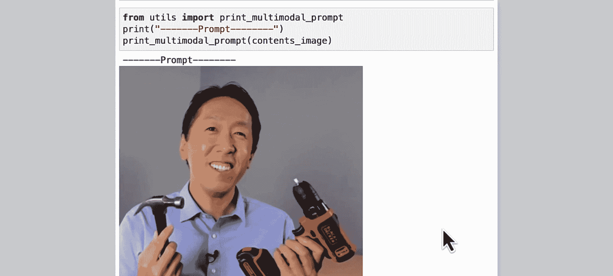

这个人拿着这些工具。所以如果你记得在过去，我们必须首先使用图像模型进行，描述，然后使用那个输出并将其发送到一个大型语言模型，也许对图像进行推理或根据这些描述得出关于图像的一些，结论。

比如这个人可能的职业是什么。在这里，我们将图像和提示都发送给双子座模型来对图像，进行推理。

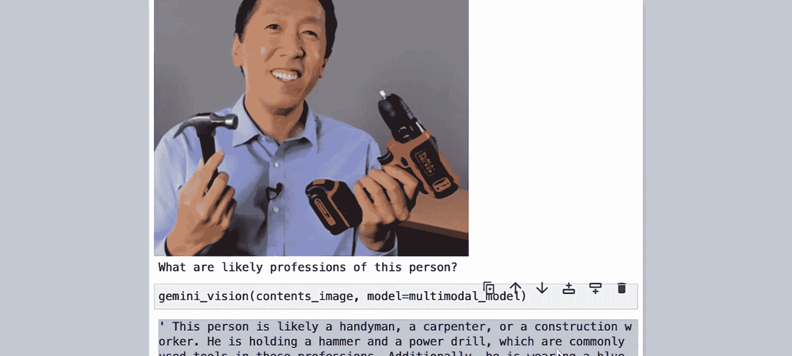

这是一步。这是我们如何使用文本或提示以及图像并将其发送给双子，座的一个例子。现在让我们做别的事情。让我们使用一个视频和一个提示，并要求模型描述那个视，频里有什么。所以为了做到这一点。

我们首先需要一个视频。而且我想和我们到现在为止所做的不同。我们不会使用本地视频。我们将从云环境加载一个视频。我这样做的原因是图像或视频可能并不总是在本地可用。如果你用双子座构建一个应用程序。

你可能想把你的图像，或视频存储在云中。所以你必须从别的地方加载它。在这个例子中，我们使用一个云存储桶。把它看作是云中的一个存储环境，在这种情况下我可以存，储我的图像或我的视频。

我们使用一个统一资源标识符，它告诉我们我们的视频在，哪里。所以我们现在有一个统一资源标识符和一个统一资源定位，符。所以你可能想知道有什么区别。好的，统一资源标识符就像一个独特的字符串，就像我们在。

这里看到的，它就像一个数字地址，精确定位任何类型的资，源，可以是在线的，甚至是离线的。在这种情况下，它是谷歌云中的一个存储环境，我们的视频，就存储在那里。

而统一资源定位符就像是统一资源标识符的一种特定类型，用于识别互联网上的资源。我要用交互 Python 来显示视频。所以让我们导入交互 Python，然后显示视频，这样你们至。

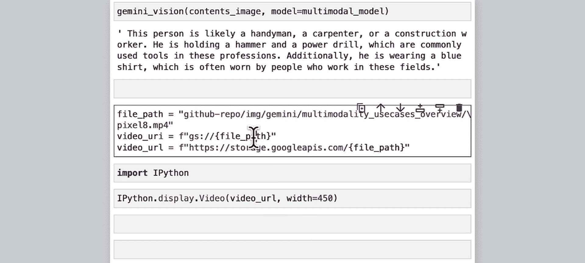

少可以看一看。让我们运行这些单元格。然后这里就是视频。

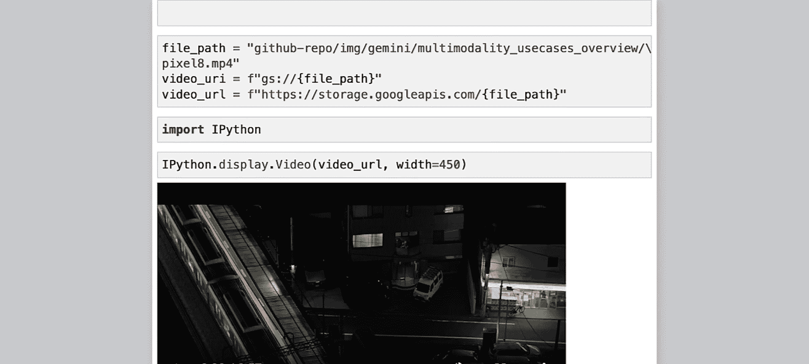

如果你想知道是关于什么的，你可以从笔记本中看看视频，我们要问模型几个问题，只有你看了完整视频才能回答。

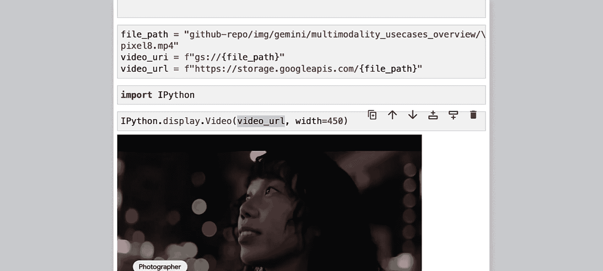

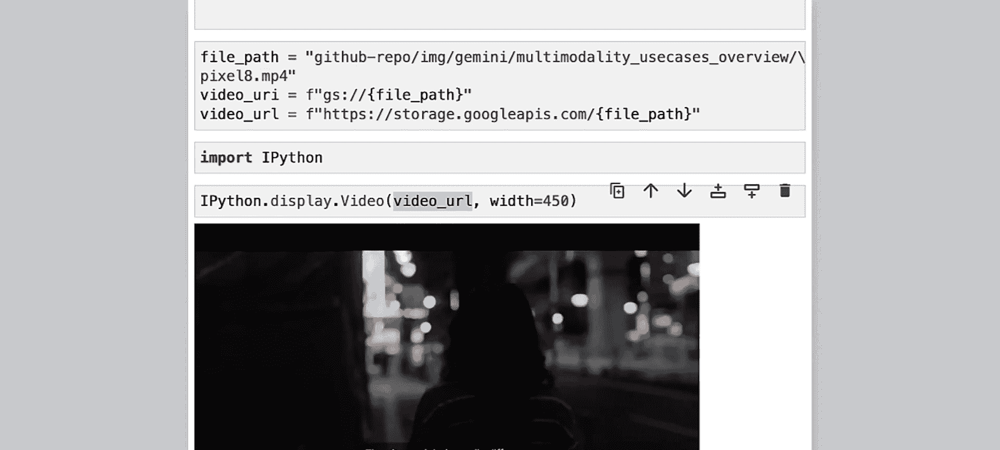

一旦我们有了视频，我们就需要一个提示。

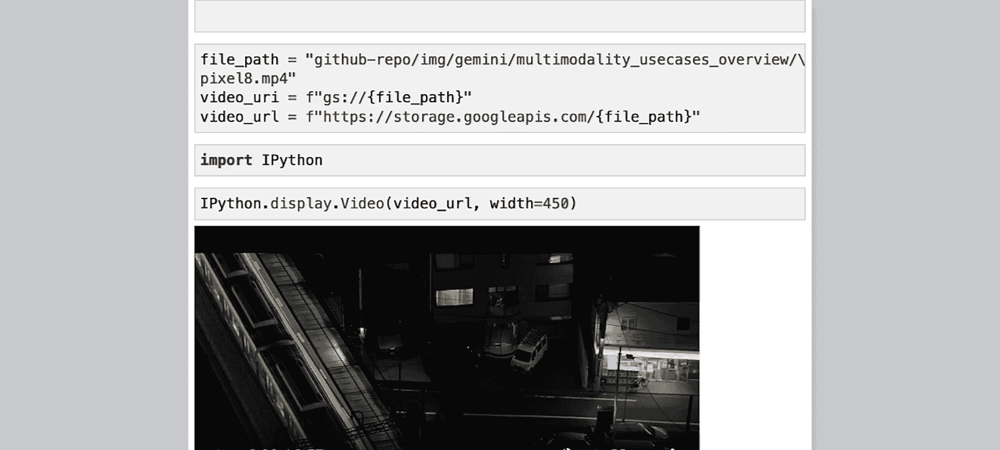

这个提示比我们之前看到的要复杂一些，因为我们要问几，个问题。而这些问题只有你看了完整视频才能回答。所以我们问这个人的主要职业是什么，突出显示的手机的，主要特征是什么，还问这是在哪个城市录制的。

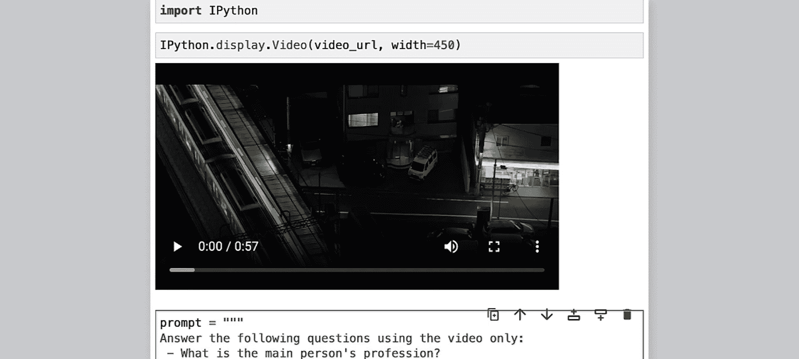

好的，所以我们有了我们的提示，我们有了我们的视频。现在我们必须加载我们的视频，并且我们必须再次组合内。

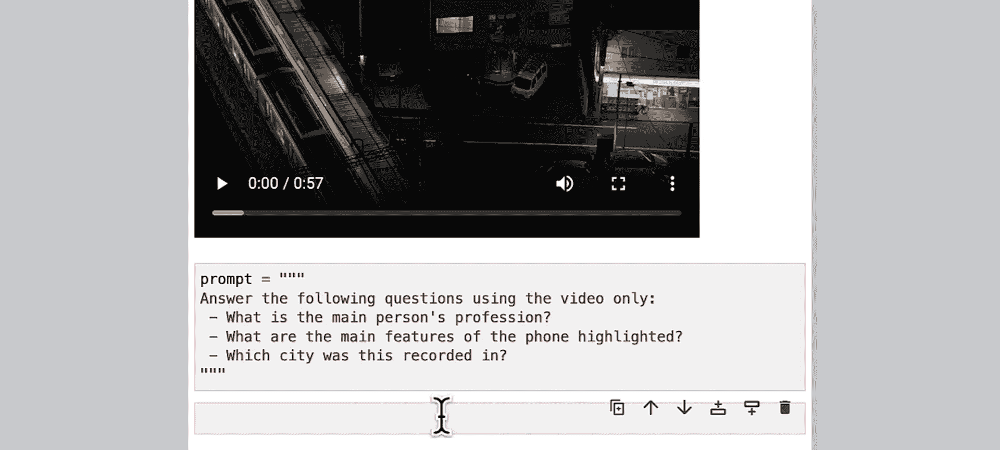

容。所以我们要把视频和提示组合起来，并发送给双子星应用，程序编程接口。就像我们之前做的那样，我们可以使用生成下划线内容。

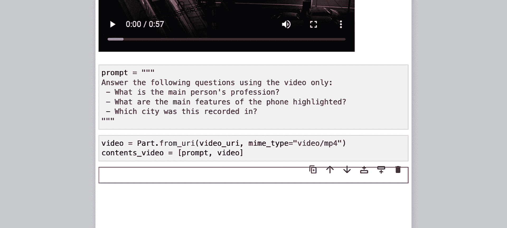

我们发送视频和提示，并将流式传输设置为真。现在让我们看看模型如何回答我们关于视频的问题。

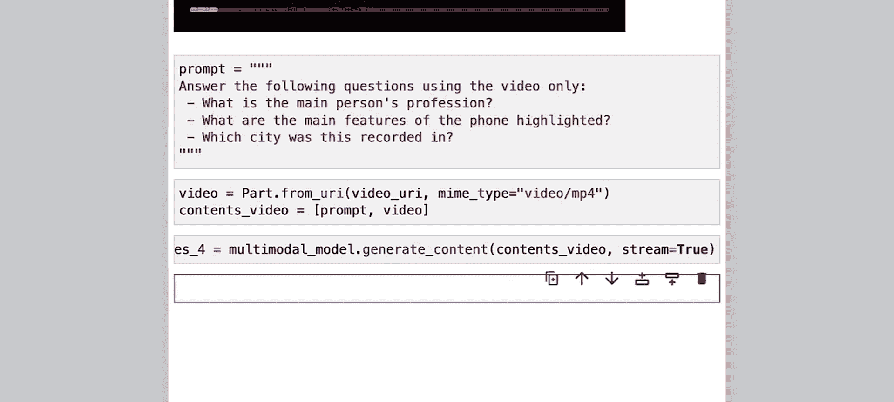

好的，所以模型告诉我们视频中的人是一名摄影师，手机的，功能是夜景模式和视频增强，并且是在东京拍摄的。

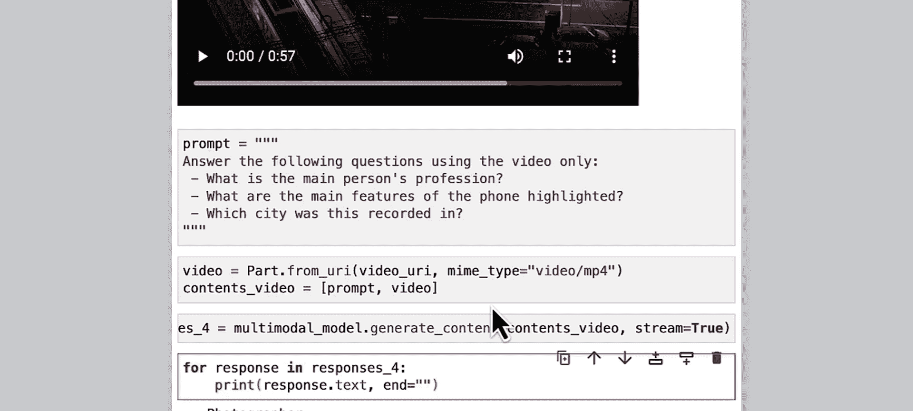

你可以观看视频看看模型是否正确。你可以看看代码并摆弄一下，看看模型的行为。你可能想要稍微改变一下提示。接下来，你将学习参数以及如何使用参数来影响双子星模，型的输出。在你尝试不同的模型参数之前。

我想快速概述一些关键模，型参数。你可能已经读过或了解过这些参数，所以我会很快地讲一，下，以确保每个人都在同一页面上并且了解这些基础知识，好的，想象一下你的大型语言模型输出就像一个餐厅菜单。

把语言模型可能生成的单词想象成一个巨大的餐厅菜单。每个单词都是一道菜，每道菜被点到的概率不同。当然，有些菜比其他菜更受欢迎。在图像中，每个方块代表一道菜和一个概率。你不想看到每一个选项。

也许只是前五或前十，那些最有可，能很棒的。这就是前 K 个可以帮忙的地方。前 K 个的工作方式类似。这是一种从大量概率中找到最好或最相关结果的方法，在，这种情况下，就是我们所有的菜。而不是查看所有的。

前 K 个专注于最有可能是你正在寻找，的前几个选择。好的，它是这样工作的。首先，排名。所以每道菜中的每个概率根据它有多好得到一个分数。然后我们进行选择。算法会挑选出分数最高的那些项。

直到达到你想要的数量，比如说如果你想要前五个菜品，那你就把 K 设为 5。结果就是你会得到一个前 K 个选项的简短列表。这会为你节省时间和精力。然后我们有前 P 个。

前 P 个是通过从一个较小的可能单词池中选择来控制语，言模型的创造力和随机性的一种方式。前 P 个就像告诉厨师，我想要最好的菜品，即使它们不是，最受欢迎的。不断建议菜品。

直到我们涵盖了菜单整体美味程度的 80%，前 P 个为单词的累积概率设定一个阈值。模型不断将单词添加到它的选项列表中，直到达到那个阈，值。这是如何运作的呢？如我们所知，每个可能的菜品都有一个概率。

这些概率会被加起来，从最有可能的单词或菜品开始，也就，是概率最高的那个菜品，然后前 P 个设定一个阈值。阈值可以是类似 0。8 这样的。我们不断添加单词及其概率，直到达到阈值。意思就是我们达到了 0。

8 或者超过了它。那时候我们就停止。然后我们有温度。温度就像调整餐厅的氛围。低温等于更具确定性，也就是说低温，类似 0。2，意味着餐，厅安静平和。大型语言模型会谨慎行事，选择最有可能的菜品。

输出是可预测且集中的。高温意味着更多的随机性。所以像 0。8 这样的高温意味着餐厅非常热闹和繁忙。大型语言模型会冒险，探索不太可能的菜肴，其输出更具创，意且更多样。双子座对这些参数中的每一个都有默认值。

双子座远景的温度默认值是 0。4，范围在 0 到 1 之间。前 K 的默认值是无，范围在 1 到 40 之间。前 P 的默认值是 1，范围在 0 到 1 之间。我的建议是在开始时将参数保持为默认值。

从那里你可以尝试将参数设置为不同的值，看看模型输出，如何变化。我们也会在笔记本中详细介绍。我认为最好一次改变一个参数，这样你可以对每个变化如，何影响输出有一个总体了解。让我们回到代码。好的。

所以在我们开始玩弄模型参数之前，让我们首先使用，我们上面使用的相同远景模型为一个图像用例运行一个示，例。所以我们要从安德鲁加载一个本地图像，并将其发送到双，子座应用程序编程接口。接下来。

我们必须写一个提示。所以我们要要求双子座应用程序编程接口描述图像中正在，发生的事情，目前模型不需要提及名字，只需描述图像。让我们运行这个。然后我们需要将图像和提示的内容组合起来。

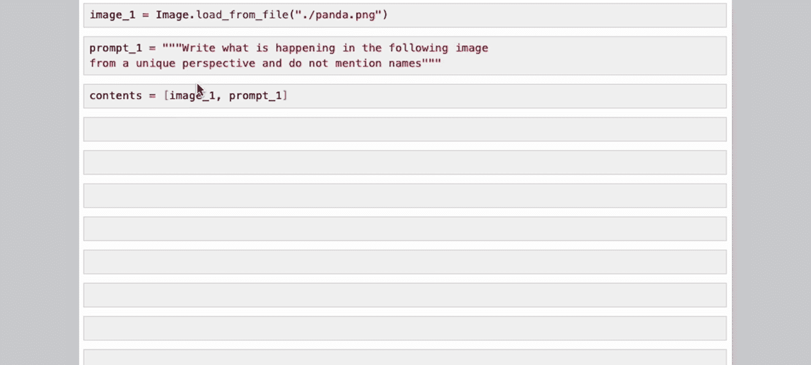

现在让我们打印图像和提示。所以如你所见，这是安德鲁的一张图像。实际上，这是安德鲁拿着一个填充香蕉的图像。那么现在让我们问双子座它在图像中看到了什么。我们可以再次使用生成内容来调用应用程序编程接口。

我们给它图像和提示的内容。我们将流设置为真。

我们然后运行这个并调用 API，然后我们可以打印响应文。

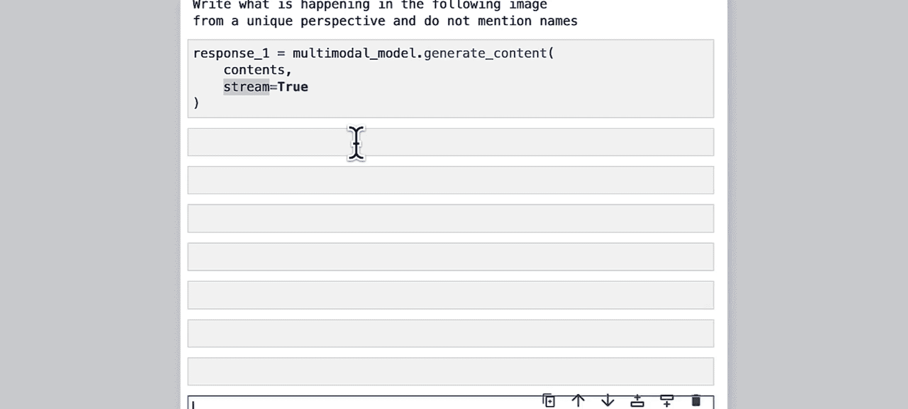

本。一旦我们得到响应，模型说一个男人坐在电脑屏幕前。

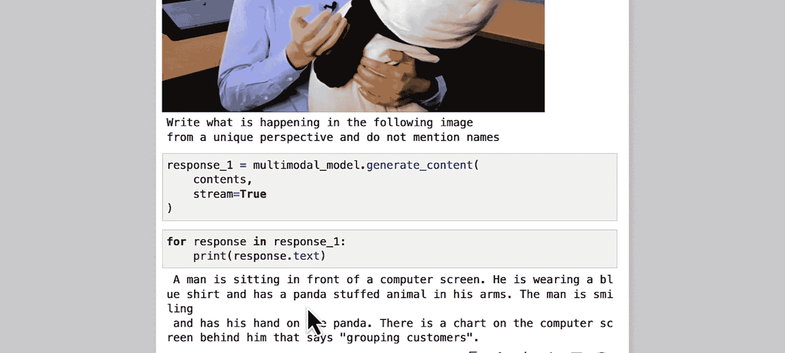

那是正确的。他穿着一件蓝色衬衫，怀里有一个熊猫毛绒玩具。

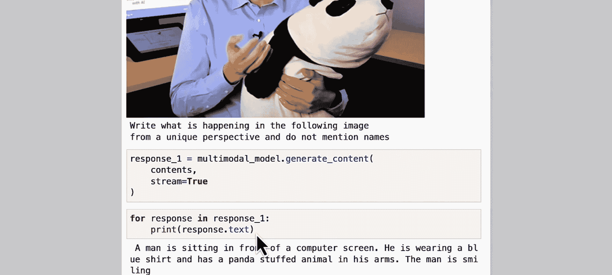

也是正确的。这个男人在微笑。检查。在他身后的电脑上有一个图表，上面写着客户分组。

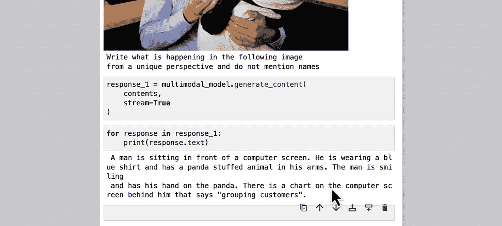

是的，背景上有一个幻灯片，上面写着客户分组。那令人印象深刻。我甚至没有注意到那个幻灯片。

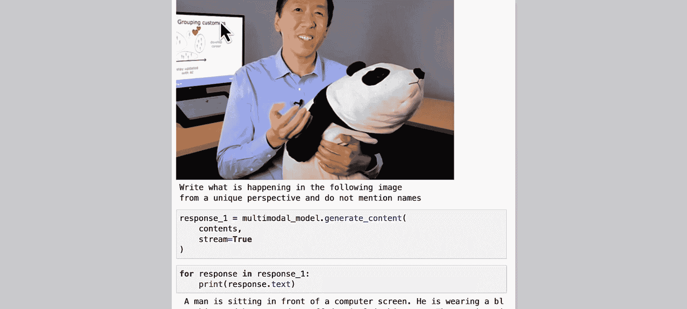

谢谢你，双子座，告诉我那个。所以在这种情况下，我们使用了我们的默认参数。为了让我们将参数设置为自定义值，我们需要设置生成配，置。我们将使用我们的辅助函数来使调用 API 更容易。接下来。

我们必须设置我们的参数，我们可以通过生成配置，来做到这一点。生成配置让我们将参数设置为特定值，而不是我们刚刚谈，到的默认值。在这个例子中，它只改变了两个参数。我们将温度设置为它的最低值，0。0。

并且我们将前 K 设置，为 1。让我们运行这两个单元格。然后我们可以使用我们带有参数的生成配置并调用双子座， API。这里再次，我们有我们的内容。我们有我们的模型。我们只是添加我们的生成配置。

让我们看看我们从模型中得到什么输出。好的，不错。但正如你记得的，当我们将温度设置为低，在这种情况下可，能的最低值，这意味着我们的输出应该更加一致。我要再运行一次这段代码，看看是否得到类似的输出。

如你所见，我们得到了相同的输出。所以模型如预期的那样一致，因为我们把温度设为低，并且，把前 K 个设为 1。所以我们得到了概率最高的标记。好的，让我们改变参数的值。让我们朝另一个方向走。

现在让我们把温度设为高，设为 1。我们要把前 K 个设为最大值 40。让我们运行这个。现在让我们用新的参数值调用应用程序编程接口。然后让我们打印响应。如你所见，这个输出比我们之前得到的要冗长得多。

我们看到一些重叠。模型谈到了蓝色衬衫。有一个填充动物熊猫。但这里有一些额外的信息。例如，它说这个男人以一种表明他对它非常兴奋的方式拿，着熊猫。而且看起来熊猫在微笑。嗯，你可以说熊猫没有在微笑。如你所见。

这个答案更冗长，也更有创意。你可能会看到一个与我不同的答案，因为我们把温度设为，高，前 K 个也设为高。所以我们得到了更多的创意。现在让我们看看下一个参数，前 P 个。所以让我们保持参数不变。

所以我们像刚才那样保持温度为 1。前 K 个为 40，但我们要加上前 P 个。记住，前 P 个的值范围在 0 到 1 之间。我们要把它设为低到 0。01。

我们这样做是因为我们想看看是否能抵消我们在这个例子，中刚刚看到的一些创造力，一些随机性。好的，让我们运行这个，然后调用 API。如你所见，我们得到了一个与我们最初得到的非常相似的，答案。所以我们可以说。

通过将 top P 设置为低值，我们抵消了，一些创造力和一些冗长。为你的参数找到完美的设置仍然是艺术和科学之间的平衡，你可能想测试不同的参数，看看什么对你的用例最有利。如前所述。

如果你有像分类这样的用例，你可能想将随机性，设置为较低温度，较低 top K 和较低 top P。如果你需要更多创造力，你想增加这些参数。你可以摆弄它们。双子座还有其他参数你可以用来控制你得到的输出。

让我们再看两个。首先，让我们看看最大输出标记数。在我们的生成配置中，我们可以设置最大输出标记数。最大输出标记数意味着在响应中可以生成的最大标记数。对于双子座，一个标记大约是 4 个字符。

100 个标记大约对应 60 到 80 个单词。为最大输出标记数指定一个较低的值，如 1，以获得较短的，响应。或者一个较高的值，如 2000，意味着你可能得到更长的响，应。

最大输出标记数的范围在 1 到 2048 之间。好的，让我们将我们的最大输出标记数设置为 10，看看它，如何影响输出。让我们调用 API 并看看我们得到什么响应。在这种情况下，如预期的那样。

我们得到了一个非常短的响，应，而 Nan 正坐在电脑前。根据你的用例，你可能想要控制你得到的输出。如果你有一个用例，其中你的输出需要非常切中要点且简，短，那么你可能想要降低它。要小心。

可能会发生在一个非常奇怪的地方，比如在一个句，子中间被截断。所以也要摆弄这个参数，看看它如何影响输出。我们可以设置的另一个参数叫做停止序列。停止序列指定了一个字符串列表，告诉模型如果在响应中。

遇到其中一个字符串就停止生成文本。如果一个字符串在响应中多次出现，那么响应会在它首次，出现的地方截断。字符串是区分大小写的。例如，如果你为儿童构建一个聊天机器人，这可能是一个你。

可能想要使用停止序列的用例。可能有一些你不想返回给最终用户的单词。所以你可能有一个你想要过滤掉的单词列表。这就是你可以使用停止序列的地方。让我们用一个字符串创建一个停止序列。

我们知道我们的图像有一只熊猫，所以让我们用熊猫作为，我们的停止序列。然后我们可以用这个停止序列参数调用 API。如你所见，我们得到的响应是一个男人正坐在电脑屏幕前。

他穿着一件蓝色衬衫并且有一个……然后停止。你可以猜到这就是应该出现熊猫这个词的地方。它找到了熊猫这个词，然后停止返回输出。只是为了记录，我喜欢熊猫。谁不喜欢熊猫呢？这只是一个例子。好的，作为练习。

你可以更改停止序列字符串。所以你可以更改这个词。或者也许你可以给它加一个。所以再加一个字符串。然后重新运行这段代码。这就是所有参数的情况。在下一节课中，我们将深入探讨与双子座有关的图像用例。

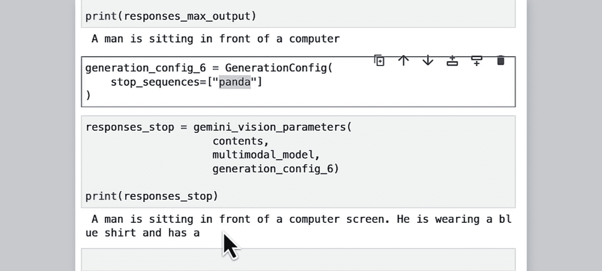