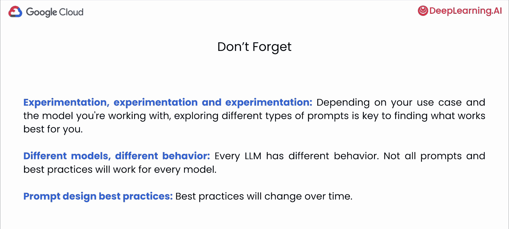
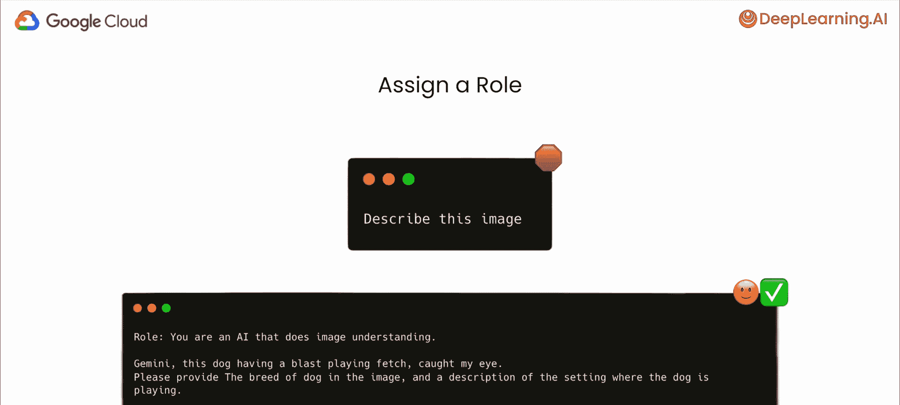
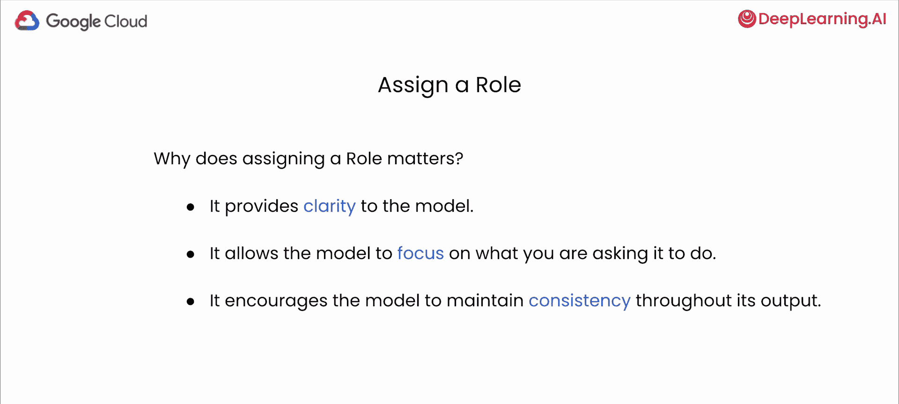
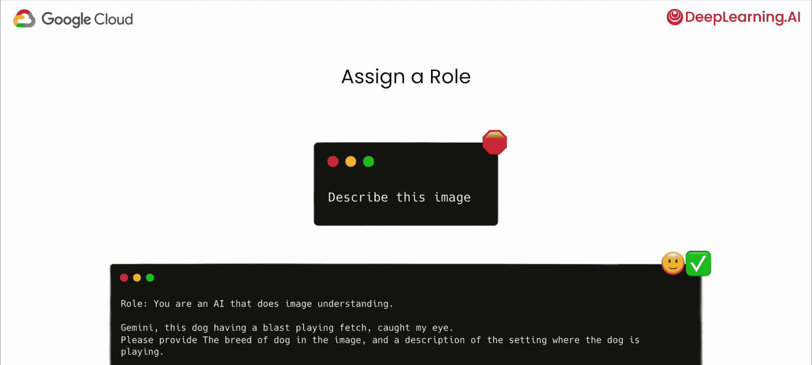
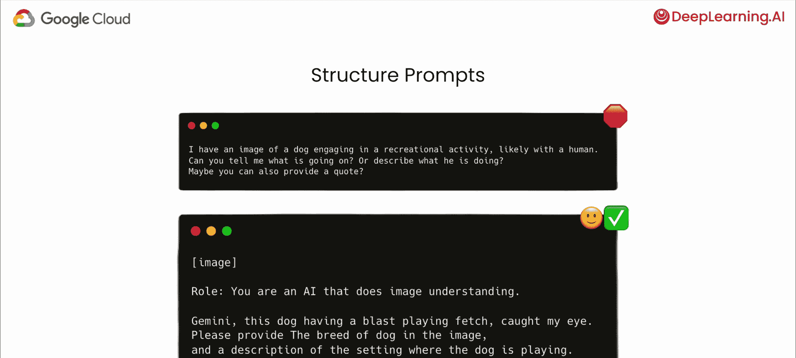
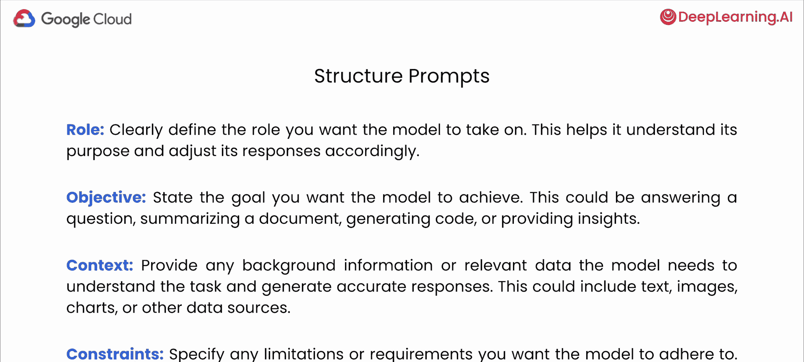
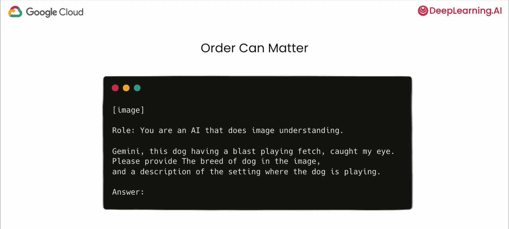
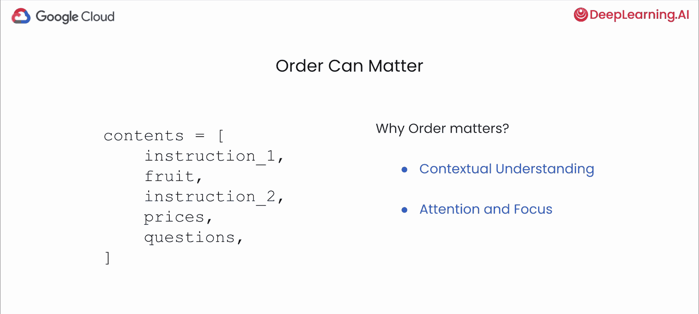

# 吴恩达《使用Gemini进行大型多模态模型提示｜Large Multimodal Model Prompting with Gemini》（豆包翻译 - P4：4.best practice - GPT中英字幕课程资源 - BV11M4m1a75d

在本节课中，你将深入探究提示图像的最佳实践，涵盖从图，像要求到有效多模态提示的最佳提示结构的所有内容。

好的，让我们开始吧。在本节课中，你将探索如何处理图像，我们将逐步介绍一些，常见的用例以及如何跨模态推理。但首先，让我们谈谈有效使用图像与我们的模型配合的技，术要求。所以，图像会被转换为标记。目前。

你可以为你的用例使用多达 3000 个图像。你可以使用的图像类型是 PNG 或 JPEG。这些是相当常见的格式。图像中的像素数量没有限制。然而，较大的图像会被缩小且效果更好。每张图像占 258 个标记。

在我们深入探讨如何为有图像用例时设计提示，以及查看，一些关于如何制作这些提示并使其对处理这些图像用例有，效的提示之前，至关重要的是要记住，使用多模态大型语言，模型是一个不断发展的领域。所以。

情况会随着时间而变化。所以，有几件事要记住。实验至关重要。对于多模态模型的完美提示，没有一种放之四海而皆准的，方法。不同的用例、不同的模型，甚至数据类型都需要不同的方，法。所以。

确保你探索各种提示结构、措辞和格式，以找到最适，合你的具体用例的方法。模型行为。所以，模型行为各不相同。每个模型都有其自身的特点和细微差别。在一个模型上效果良好的提示在另一个模型上可能不会产。

生相同的结果。所以，要注意不同模型对你的提示如何响应，并相应地调整，你的方法。然后，最佳实践。它们总是会随着时间而演变。我们做的研究和实验越多，我们就越会了解哪些对我们的，用例和不同模型有效。

大型语言模型领域正在迅速发展，所以新的技术和最佳实，践不断涌现。现在，让我们看一个用例的例子和一些可能帮助你改进多，模态提示设计的策略。

为了探索你如何精心制作有效的多模态提示，让我们深入，一个场景。所以，想象你有一张图片。在这种情况下，一张可爱狗狗的图片。并且你想了解图片中正在发生什么。这就是提示设计和提示工程变得至关重要的地方。

通过精心设计你的指令，你可以引导模型处理图片并理解，诸如其背景之类的事情，并生成你用例所需的特定输出。让我们看看对我有用的一些技巧和策略，以帮助改进我的。

用例提示。首先，清晰和简洁很重要。把提示想象成给同事的任务分配。如果你的指示模糊或冗长，结果可能不是你所期望的。对这些模型也是如此。你可以看到第二个提示有了显著的改进。它更具体、更可行。

并引导模型朝着我们希望模型返回给，我们的信息方向发展。虽然多模态模型很强大，但它们绝对不是读心者。所以要像给一个聪明但需要明确指导的人解释任务那样编，写你的提示。

所以要避免过于技术性的行话或对模型应该知道什么的假。

设。让我们来看另一个例子。在与模型交互时，提供明确的指令至关重要。一种有效的技术是在你的提示中为模型分配一个特定的角，色。所以可以这样想。想象你在导演一场戏。你不会只是给演员一个剧本然后说，去吧。

你要告诉他们他，们的角色是什么，他们的动机是什么，以及他们应该如何与，他人互动。类似地，角色指令告诉模型在你的请求的上下文中如何行。

动。那么为什么角色指令很重要？首先，它提供了清晰性。角色指令明确了模型的任务，减少了歧义并提高了其输出，的相关性。其次，聚焦。它们引导模型朝向特定的风格、语气或细节水平，使响应。

更符合你的需求和你的用例。第三，一致性。通过指定一个角色，你鼓励模型在其整个输出中保持一致，的声音和视角。

在这种情况下，我们有一个例子，我们指定模型的角色是一，个进行图像理解的人工智能。另一个例子可以是，比如说你要总结财务文件。你可以给模型指定为财务专家的角色。

接下来，让我们谈谈提示结构。这是至关重要的，因为你设计输入的方式直接影响多模态，模型的表现。你构建提示词的方式会影响模型解析提示词中信息的能力，它还有助于模型正确理解如何使用给定信息。

为了给提示词构建结构，你可以使用前缀或类似 XML 标签，来划分提示词组件的不同部分。在这个例子中，我们可以看到这个提示词的结构是我们首，先提供图像。接下来，我们分配一个角色。

然后我们有我们的问题或询问。然后我们留出空间让模型提供它的答案。没有一种结构适用于所有情况。这取决于你的用例和你使用的模型。所以也要对此进行试验。那么为什么提示词结构很重要呢？

把你的提示词想象成给模型的一组指令。一个结构良好的提示词有三个关键作用。首先，就像在我们的例子中一样，它组织信息。它帮助模型轻松识别你输入中的不同类型内容。所以在这里我们可以看到图像、角色和问题。其次。

它可以引导解释。它阐明了每条信息应该如何使用以及与其他信息的关系。图像是要被总结吗？它是一个代码片段要被执行吗？提示词结构提供了这些线索。第三，它鼓励期望的输出。通过在提示词中设定明确的期望。

你增加了得到你所期望，的那种回应的可能性。没有一种结构适用于所有用例或所有模型。但这里有一些你可以用来给你的提示词添加结构的例子。首先，角色。我们已经谈论过角色了。

但这有助于模型理解其目的并相应地调整其回应。其次，你可以谈谈目标。所以说明你希望模型实现的目标。这可以是回答一个问题、总结一份文档、生成代码，或者，也许是提供见解。尽可能具体。第三，有背景。

提供模型需要理解任务并生成准确回应的任何背景信息或，相关数据。这可能包括文本、图像、图表或其他数据源。第四，你可以考虑限制条件。指定你希望模型遵守的任何限制或要求。

这可能包括回应的长度、输出的格式或对某些类型内容的，限制。例如，你可以指定你希望输出为 HTML 格式。这些事情可以帮助你改进你的提示结构。

在多模态模型中，你呈现信息的顺序在模型输出的质量和，相关性方面起着重要作用。这既适用于我们刚才谈到的提示结构，即你构建文本提示，的方式，所以你提出的问题、你给出的指令，它们可以影响。

模型的回应，而且模态的顺序也很重要。你呈现不同类型输入（如图像、文本、表格等）的顺序会影，响模型的理解和连接点的能力。考虑一个你分析医疗报告的场景。通过在 X 光图像之前呈现患者的病史可以帮助模型更好。

地解释视觉信息。为什么顺序很重要？首先，它为模型提供了上下文理解。模型在处理信息时会建立更好的理解。你呈现细节的顺序可以为后续信息的解释设定基础。注意力和焦点。通过战略性地排序你的提示和模态。

你可以引导模型的注，意力到特定方面，可能提高其回应的准确性。还可以实验你的提示顺序和模态顺序。这些是我用来改进我的多模态提示的一些技巧和策略。希望它们也能帮助你处理你的使用案例。

