# 吴恩达《使用Gemini进行大型多模态模型提示｜Large Multimodal Model Prompting with Gemini》（豆包翻译 - P5：5.create use cases with images - GPT中英字幕课程资源 - BV11M4m1a75d

本课程重点关注涉及图像的用例。您将学习如何从图像中提取有关物品或价格的信息，并探，索实际应用，例如根据一组可用图像为您的客厅推荐家具。

等等。让我们找点乐子。在本课程中，您将学习如何使用多模态模型处理图像和文，本提示。在深入探讨之前，就像在第一节课中一样，我们必须运行我，们的设置代码。首先，我们需要获取我们的凭证并确保我们可以进行身份。

验证。其次，我们将指定我们要使用双子星 API 的区域，再次是，美国中部 1。然后我们将导入顶点人工智能软件开发工具包，以便与双，子星 API 交互，然后我们将所有这些联系在一起，并使用。

我们的凭证、区域和项目 ID 初始化软件开发工具包。一旦您执行了此操作，我们就准备好开始了。为了使用我们的模型，我们首先需要再次导入软件开发工，具包。我将导入软件开发工具包，我将导入生成模型类和图像类。

因为我们将在我们的用例中使用图像。接下来，我将导入我们的多模态模型。在这种情况下，我们将使用双子星 1。0 专业视觉版本 001，这个模型非常适合处理图像。对于这个第一个用例。

您不仅将使用像文本和图像这样的，不同模态，而且您还将跨这些模态进行推理。意思是，模型需要从图像中提取信息，以便回答来自文本提，示的一些问题。好的，让我们看看这个，让我们开始吧。首先。

我们需要导入我们的第一张图像。第一张图像是一碗水果的图像。我们将使用从文件加载来加载本地图像。所以我们要设置水果，并且要加载本地文件。在这种情况下，它是一张 JPEG 图片。

第二张图像是我当地超市水果价格的列表。而且，这也是本地图像并且是 JPEG 格式。很酷的是，我们将要求模型回答关于这两张图像的一些问，题，并且它只能根据在这些图像中看到的内容来回答问题，现在。

让我们拿这两张图像并创建一个列表。所以我们有一个名为图像的列表。我们有我们的水果图像和价格。现在让我们使用我们的辅助函数来查看这些图像。再次，我们将使用工具。我要导入打印多模态提示。

这让我们可以打印图像。

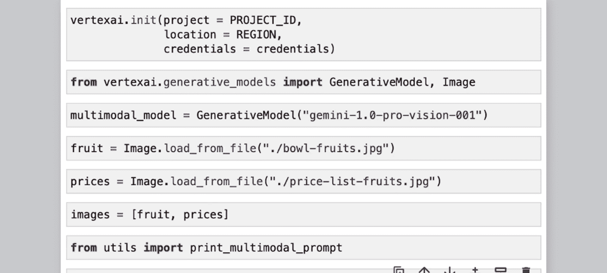

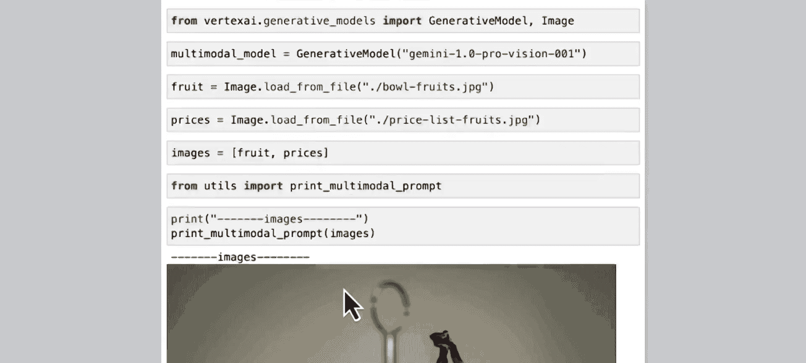

你可以在这里看到我们的两张图像。所以首先，一碗有一些香蕉和一些苹果的水果。

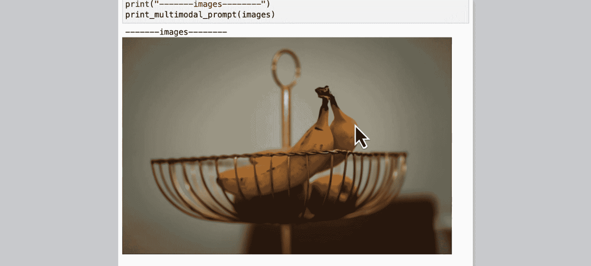

第二张图像是水果的截图以及每个物品以美元计价的价格。

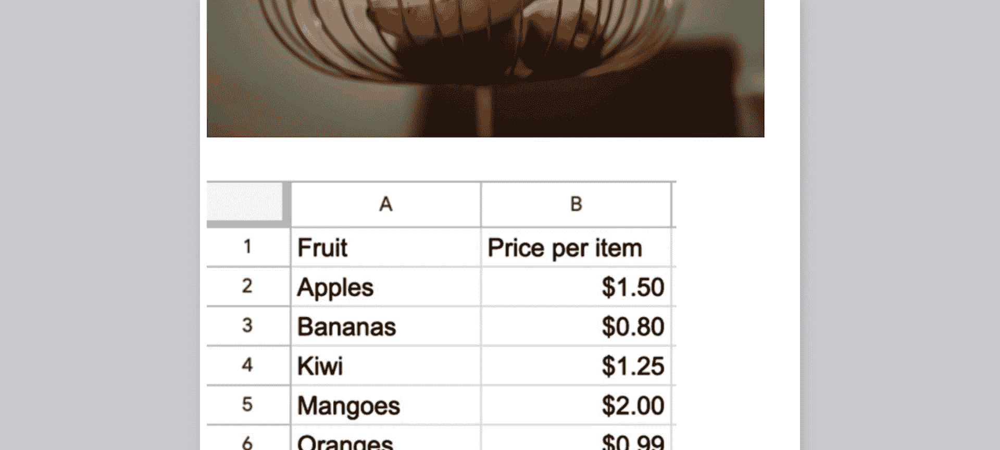

。现在是时候写一些提示了。正如我们在第三课中刚刚讨论的，构建你的提示可以帮助，模型性能，特别是如果我们必须在不同模态之间进行推理，所以首先，让我们为模型创建一个指令。所以我们将这个指令称为一。

这是我们提示的第一部分。而我的第一个指令是我想用三个香蕉、两个苹果、一个猕，猴桃和一个橙子制作一个水果沙拉。这是我那碗水果的图像。所以我提供了一个我想制作水果沙拉的指令。并且我告诉模型。

这是我那碗水果的图像。我们还将添加第二个指令。第二条指令是告诉模型，按照这条指令，我当地超市有一份，水果价格表。现在让我们创建一些问题。这些是我们希望模型回答的问题。首先。

我们要求模型描述图像中我的水果碗里有哪些水果，以及有多少个。其次，根据图像中我碗里的水果和水果沙拉食谱，我缺少什，么？第三，根据我还需要购买的水果，这些水果的价格和总费用，是多少？为了回答这些问题。

模型首先需要查看图像。让我们运行这个。现在让我们再次把所有东西整理成一个列表。所以我们将这个列表称为内容。这就是我们将图像和提示组合在一起的地方。你能看到我是如何使用顺序的吗？我们已经讨论过这个。

我将指令与图像分组。指令一设置场景并谈论我想做什么以及提供成分信息。指令二谈论价格表。最后，是我们希望模型回答的问题。随意尝试改变这个顺序，看看它对模型有何影响。例如。

我们可以说我们要把问题一直移到最上面。但现在，让我们保持原始结构。我们在我们的列表中组合了所有的模态。现在我们可以看看我们要发送给模型的所有东西。

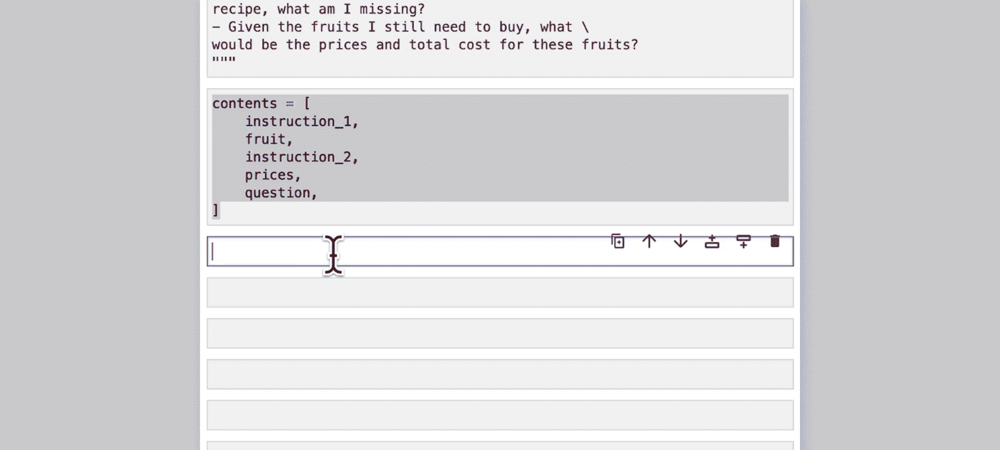

所以让我们打印我们的提示和我们的图像。所以在这里你可以看到这条指令一，我们水果碗的一张图。

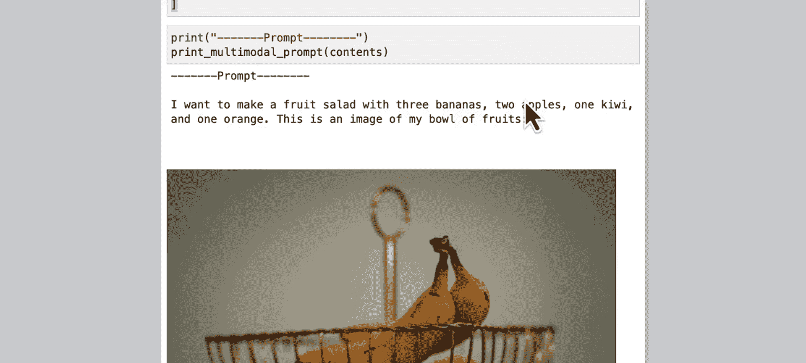

像。第二个带有价格表图像的指令。然后是我们希望模型回答的问题。现在你准备好将所有这些发送给模型以获得回应。再次为此使用工具函数。就像我之前提到的，随意进入 utils。py 查看所有帮助我。

们调用 API 的逻辑。我要运行这个。然后你准备好调用模型以获得回应。那很快。让我们看看回应。所以模型告诉我们你的水果碗里有两个香蕉和两个苹果，这是正确的。要制作一份水果沙拉。

你需要三个香蕉、两个苹果、一个，猕猴桃和一个橙子，好吗？所以我们少一个香蕉、一个猕猴桃和一个橙子。这些水果的价格是 0。80 美元、1。25 美元和 0。99 美元，好的，让我们看看价格。

所以香蕉确实是 0。80 美元。我们有猕猴桃，是 1。25 美元，这是正确的。然后我们有橙子的 0。99 美元。这是正确的。所以模型能够理解我们目前缺少什么，我们还需要买什么。

以及这将花费的总成本是多少。那么让我们看看模型关于成本的说法是否正确。1。25 美，元加 0。99 美元，对一个橙子来说是很划算的。并且正确，对我来说购买额外水果这是 3。04 美元。好的。

我们现在已经学会了如何在我们的提示中使用图像，如何构建我们的提示，以及我们如何让模型跨越这些模态，进行推理并根据它在这些模态中看到的内容回答问题，在，这种情况下，是图像。我们的下一个用例。

我们将使用双子座作为推荐系统，为我，们的房间推荐一把新椅子。对于这个用例，我们也将使用更多图像。所以我想为我的客厅买一把新椅子，所以我有四张椅子的，图像。这是椅子一、二、三、四。另外。

我还有一张我客厅的图像。我们将椅子的图像组合在一个列表中。在这里我们有我们房间的图像。好的，如你所见，我们从本地文件加载了我们房间的图像。我们必须对我们椅子的图像做同样的事情。因为我们有一个列表。

所以我们必须从文件、从统一资源，标识符，为我们列表中的每个统一资源标识符加载。为了打印，让我们首先创建一个房间图像的列表。然后我们将用我们椅子的列表扩展这个列表。然后我们可以打印所有的图像。

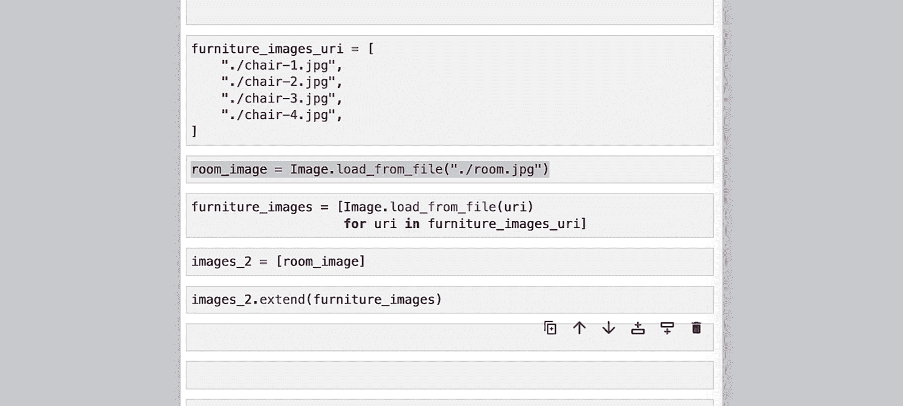

在这里你可以看到我们的图像。第一张图像是我们客厅的图像。如你所见，它是一个非常干净和白色的设计。

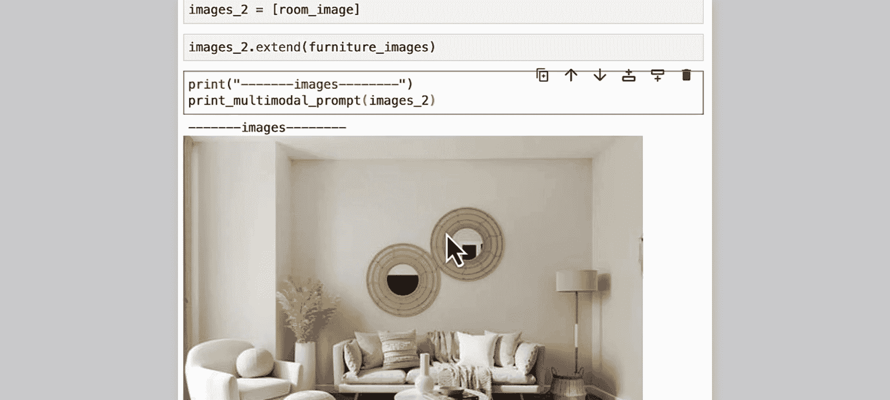

然后我们有我们想从中挑选一把放在我们客厅的四把椅子，好的，现在是时候编写我们的指令来编写我们的提示了。在我们的第一个例子中，我们的每个指令和问题都是一个，变量。在这种情况下，让我们使用一种不同的方法。

假设你开始使用双子座。从一开始就将你的指令和图像组合起来可能更容易。在这里我们有图像和我们指令的列表。一切都在一个变量中。让我们来看看这个。我们告诉双子座它是一个室内设计师。并且我们说，考虑以下椅子。

这里我们有我们椅子的图像和我们房间的图像。对于这些椅子中的每一把，我们都要求双子座解释它是否，适合房间的风格。我们现在已经把所有东西都放在这个变量推荐下划线内容，中。

让我们一起打印出来看看它是如何流动的。有这个指令，你是一名室内设计师。

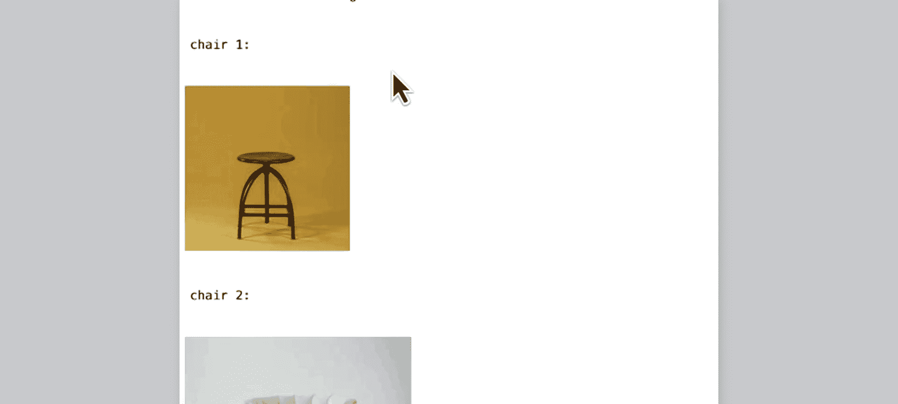

我们有椅子，还有我们房间的图像。

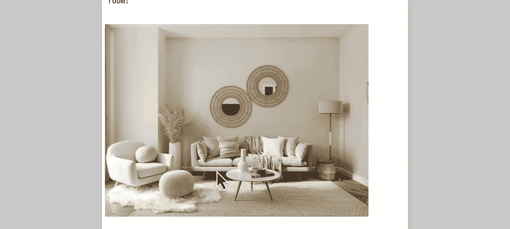

当看我们提示中的图像时，我们可以看到，这里有很多空白。

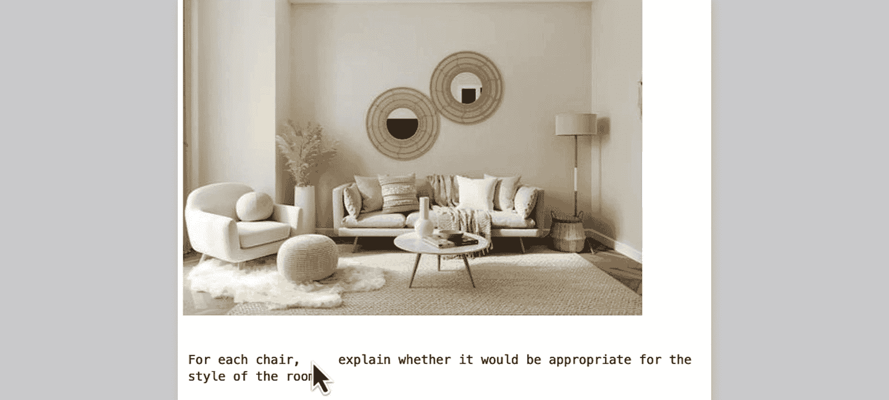

。让我们修正它。重新运行，我们可以看看是否修正了。

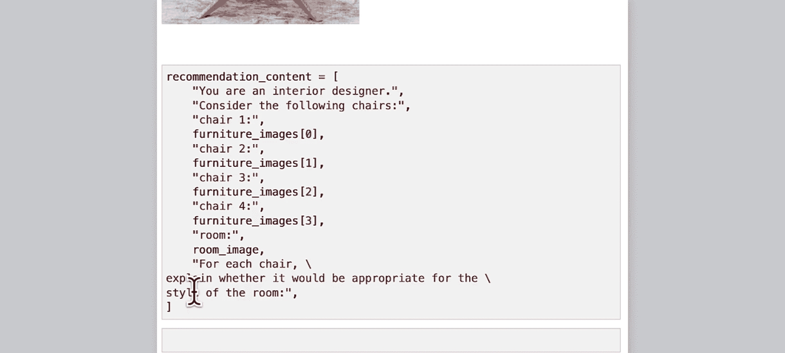

干净多了。对于这些语言模型，空白会影响模型的回应。这就是为什么你想看看你的提示，看看是否一切都好。我们现在对此很满意，我们可以把它发送给双子座以获得，回应。

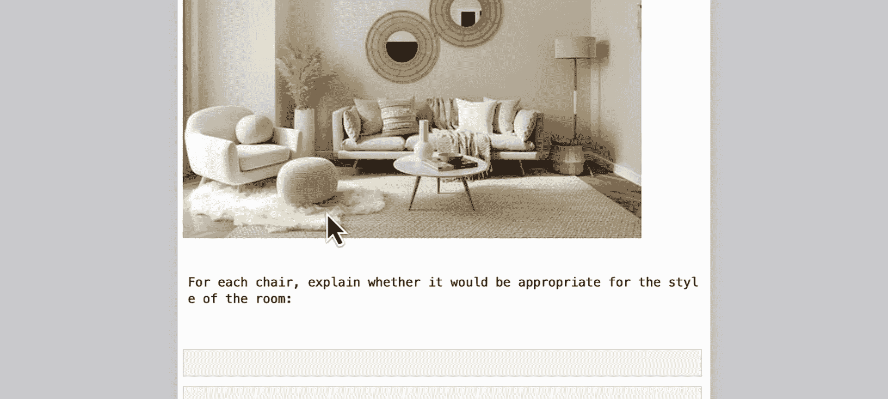

我们将使用我们的辅助函数调用 API 并获得我们的回应，好的，让我们查看回应，看看双子座对我们的椅子怎么看。所以第一把椅子，这把椅子不适合这种风格，因为房间是现，代的，有简洁的线条。

而椅子是由木头和金属制成的。让我们往上看。

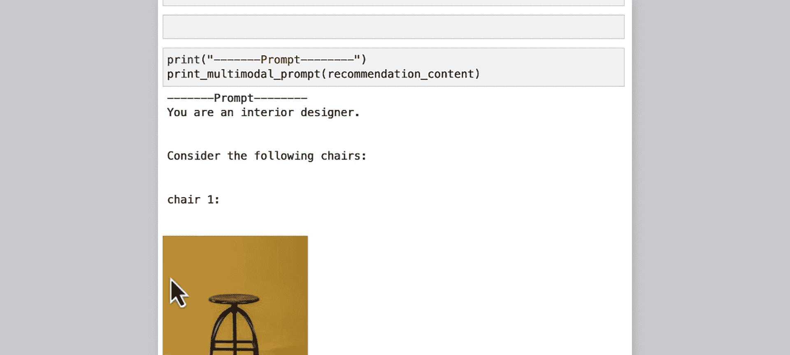

是的，木头和金属，我认为双子座在这里说它不适合房间的。

风格是对的。这很酷，对吧？让我们选另一把。让我们选第四把。这把椅子会适合房间的风格。这把椅子有一个时尚、现代的设计，会与房间的简洁线条，相得益彰。这把椅子也用一种柔软、中性的面料覆盖，会与房间的颜。

色相匹配。好的，让我们向上滚动，我们的房间，还有第四把椅子。是的，这把椅子在这个房间里会看起来很棒。这里让我印象深刻的是，双子座不仅根据颜色匹配椅子，还，根据它的制作材料和房间里椅子的风格进行匹配。

随意看看第二把和第三把椅子的答案，看看你是否同意双，子座的选择。太棒了，现在我有了一个私人室内设计师。我现在就去买一把椅子。好的，看到我们如何使用多模态模型进行推荐很有趣。现在让我们看看另一个用例。

但是让我们看看一个我们将使用双子座 1。5 的用例。这是一个为在广泛任务中进行扩展而优化的中型多模态模，型。它的表现与 1。0 超类似。该模型支持最多 100 万个标记上下文。如我之前提到的。

每个提示最多可包含 3000 张图像。当你需要构建能够理解和处理更大块信息的应用程序时，这非常有用。比如冗长的文档、代码库或扩展的对话。这很方便，因为我们不需要首先将我们的数据分块，然后一。

块一块地发送给模型。我们现在可以将像文档这样冗长的东西发送给模型并得到，一个响应。好的，让我们导入我们的模型，1。5 版本 001。所以在这个例子中，你处理一个我们需要将收据逐项列出。

并检查费用是否符合公司政策的用例。我们都知道处理收据不是最有趣的事情。所以让我们看看是否可以稍微自动化一下。在这个例子中，你必须跨越多种模态进行推理，比如图像和，文本，然后将信息结合起来得出结论。

我们将抛出一些变化或边缘情况，如果你喜欢棒球，我喜欢，称之为曲线球，看看模型的表现。现在让我们首先读取图像并编写一些提示，就像我们之前，做的那样。在这个用例中我们的图像是收据。让我们运行这些。接下来。

你可以加载收据的图像。所以我们将使用 image。loadFromFile，给它图像的路径，然后加载这些图像。所以现在你已经加载了收据。接下来，你必须加载商务旅行费用的公司政策。在这种情况下。

它是一个文本文件。所以我们将加载本地文本文件，比如说 ，txtFileTravelPolicy，然后我们将把那个文件读入我们的，变量 policy。如果你愿意，你可以打印 policy 并检查公司政策。

让我清除这个，然后我们继续。所以现在是时候进行一些提示了。首先，我们将为模型设置一个初始指令，因为我们希望模型，是真实的。并且我们希望模型在对一个问题不确定答案时是透明的。所以例如。

如果模型没有足够的信息来回答一个问题，我们，希望模型突出显示这一点。其次，我们将设置一个规则。所以在这种情况下，我们将构建一个是人力资源专业人士，的模型。所以你是一个人力资源专业人士和旅行费用专家。

接下来，我们将有我们的任务。我们粘贴任务。所以你正在审查一次商务旅行的旅行费用，我们向模型问，几个问题。首先，要把收据上的所有东西都逐项列出，所以包括税。然后我们希望模型计算总销售税。第三。

我们希望模型从其中一张收据中只提取员工用餐的，费用。所以员工和同事一起用餐，而员工只吃了肯德基的碗餐。所以我们希望模型提取这个食品项目的费用。第四，我们想计算其他人的花费金额。然后第五，让我改一下。

我们想根据公司政策检查费用并标记是否有任何问题。所以有一大堆问题，而这些问题模型只能根据我们提供的，图像加上公司政策来回答。所以让我们运行这个，把所有东西都整合在一起。好的，所以我们有收据，内容。很酷。

再说一次，这将是我们所有图像和提示的列表。所以这些指令、任务和角色。就像我提到的，我们会抛出一些难题。所以让我们看看它们是什么。所以让我们打印出所有内容，也就是提示和图像。然后让我们看看这个。

如果我们看这些收据，你可以看到有些不是那么好。这些质量相当低。所以对我来说已经很难看清上面有什么了。所以让我们看看模型是否可以。有些这些费用超出了公司政策。第三，有这顿和同事一起吃的饭。

所以让我们看看模型是否能够弄清楚员工吃了哪顿饭，哪，些饭是同事的。好的，我现在要清除这个。所以输出很清晰。然后让我们调用模型看看它如何响应。好的，所以我们要调用模型并打印输出。好的，让我们查看输出。

所以首先，我们可以看到模型已列出收据。好的，已经让我的生活更轻松了。然后有一张与同事一起用餐的收据。所以它按要求计算了总销售税。它还提取了员工与同事一起用餐的费用。这些是同事的费用。

所以它把这顿饭从员工那里分出来了。然后它检查了所有的费用。所以所有收据对照公司政策。我们可以看到这些收据有一些问题。所以让我们深入研究一下。我们可以看到员工喝了一杯绿色冰沙。呃哦，这是个问题。

根据公司政策，这被标记为不可报销。所以公司政策是员工不允许喝绿色冰沙。还有，每日限额也有问题。好的，第四课就到这里。我们已经看到了如何在不同用例中使用多模态模型。我们已经看到了如何跨模态进行推理。

我们已经看到了如何使用多模态模型进行推荐。我们已经看到了如何使用模型从不同图像中提取信息，然，后与政策进行比较。在下一课中，你将分析视频。你将了解什么是大海捞针问题，以及如何使用模型来解决。

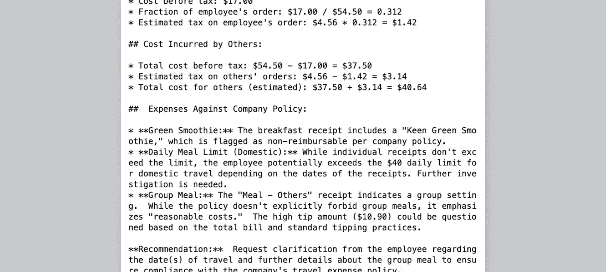