# 吴恩达《使用Gemini进行大型多模态模型提示｜Large Multimodal Model Prompting with Gemini》（豆包翻译 - P6：6.use cases with videos - GPT中英字幕课程资源 - BV11M4m1a75d

在本节课中，您将学习如何使用双子座模型与视频进行交，互，例如提取标题或通常需要观看整个视频的特定内容。您将处理大海捞针问题，并学习使用多模态模型来解决它，让我们创造奇迹！在本节课中。

我们将讨论如何使用带有双子座模型的视频。

来构建一些很酷的用例。首先，我们需要运行我们的辅助函数，以便我们可以使用双，子座 API。我们的认证代码。我们将再次使用相同的区域。我们需要使用开源 SDK，然后初始化 SDK。就像我们之前做的那样。

接下来，我们必须再次导入我们的模型。就像在图像课上一样，我们将使用双子座专业视觉。所以双子座专业视觉模型能够处理图像、视频和文本。现在是时候深入研究我们的第一个视频用例了。在这个第一个用例中。

您将是一名数字营销人员。您将处理一个需要发布在网站上的视频。所以为了将其发布在我们的网站上，我们需要从这个视频，中得到几件事。我们需要视频的标题。我们需要描述，并且我们需要一些可以在网站后端使用的。

元数据。让我们为此使用双子座模型。就像我们在第一节课中看到的那样，我们需要加载我们的，视频。这是一个关于顶点和链接链的视频。就像在第一节课中一样，我们需要一个 URI，并且我们需要，一个 URL。

一旦您运行此代码，您就可以再次使用 IPython 在笔记本，中显示视频。首先，我们需要导入 IPython。接下来，我们可以使用 IPython 在笔记本中显示视频。

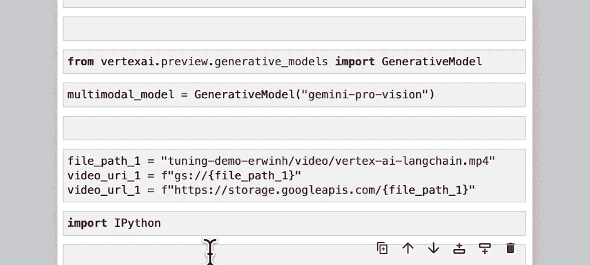

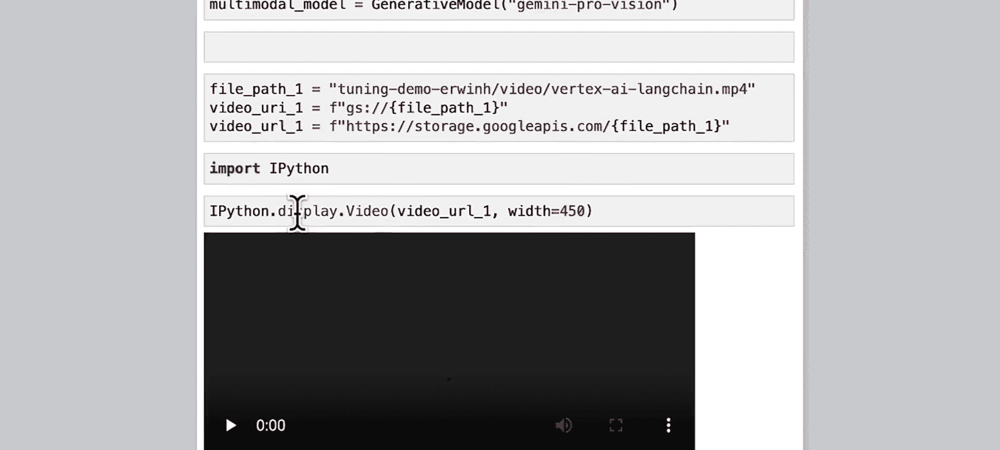

这里我们有这个视频。你甚至可以看看这个视频，看看里面有什么。这将帮助你判断模型是否给出了好的回应。你要做的是，你将使用这个视频，并将其与提示词一起发送，给模型。模型会查看视频里有什么。目前。

它不会使用音频来理解发生了什么。这里很酷的一点是我们不需要处理视频。意思是我们不需要将视频转换为模型可以理解的格式。就像图像一样，对吧？记得在过去，有时你需要将图像转换为不同的格式，以便模。

型可以读取数据并给你一个预测。这里真正酷的是，在将视频发送给双子星模型之前，你不需，要进行任何视频预处理。为了一些背景知识，如果你曾与任何计算机视觉模型合作，过。

它们通常期望视频或图像处于特定的文件格式，比如仅，为 mp4，或者处于特定的高度和宽度。这意味着如果你试图给它一个模型无法处理的视频，你首，先要将其转换为模型期望的文件格式，如 mp4，然后还要将。

视频调整为模型可以处理的高度和宽度。但在这个双子星的例子中，它可以处理几乎任何视频大小，和形状，以及大多数流行的文件格式，如 mp4、mov 或 ，mpeg 等，仅举几例。这使我们更容易使用。接下来。

你将从统一资源标识符加载视频。为了做到这一点，我们需要导入我们之前使用过的一些类，我们将使用部分来从统一资源标识符加载视频。所以这里我们使用部分，这是我们的类。我们将从之前指定的统一资源标识符加载。

这是我们的统一资源标识符，我们将指定视频文件类型。在我们的例子中是 MP4 格式，但如前所述，我们也可以使，用其他文件格式。你可以运行这个。现在你导入了视频，是时候写提示词了。

正如我们在上一节课中讨论的，在写提示词时，如果我们逐，步构建我们的指令，这可以帮助改善输出。我们也可以将我们的提示词分解成不同的部分。让我们再详细解释一下。所以在接下来的例子中。

我们有几个模型要完成的任务。你还记得吗，我们需要一个视频的标题，我们需要一个摘要，我们还需要为我们的网站备份生成一些元数据。也要记得，你是一个从事视频工作的数字营销人员。所以我们可以先为模型指定角色。

以确保模型有更多的上，下文。接下来，你可以指定模型需要执行的任务。所以我们说任务等于，并且要确保是逐步的。在你写下任务之前，让我们为模型提供更多一点的上下文，我们要把这个视频添加到我们的网站上。

在我们能这样做之前，我们需要完成几个任务。并且让我们要求模型提供一些结构，这样我们就可以从它，那里得到每个答案。好的，现在是任务时间。首先，我们需要视频的标题。其次，让我们要求模型写一个摘要。第三。

你需要为你的网站后端的元数据。我们的后端只处理 JSON 格式。所以让我们要求模型以 JSON 格式返回元数据。在这我们有一个标题、一个简短描述、视频的语言以及制，作该视频的公司。正如你在这里看到的。

我们把提示分成了两部分。有角色部分，还有任务部分。我们现在有了我们的提示。现在让我们把所有东西放在一起，看看我们得到什么回应，内容一等于，我们现在可以把所有东西缝合在一起。我们的视频首先出现。

就像图像一样。然后我们有我们的角色。然后我们有任务。你运行内容一。接下来，你也设置你的配置，并且你设置你的温度参数。随意把这个改成更高的温度，或者先按原样运行一次，然后，再改。

再运行一次看看回应有何不同。问问你自己这个问题，你还记得温度的作用吗，就像我们在，上一节课讨论的那样？你现在在平方一上有内容。你有你的配置文件。你要么更新了温度，要么保持原样。这取决于你。接下来。

让我们生成回应。为此，你将使用多模态模型。生成下划线内容，并且你带上，你的内容、你的配置文件，并且你将把流式设置为真。随意也许这次把这个改成假，看看和流式有什么不同。现在，你可以打印回应。

所以我们去打印，并且我们说回应。文本。你可能注意到我们和上一节课的做法不同。这是因为你把流式设置为假，意思是我们没有多个对象需，要逐个迭代并打印。我们只有一个对象要打印。好的，让我们打印响应。很好。

让我们看看这个。标题是在顶点高上使用 LangChain 构建人工智能驱动的，应用程序。这是正确的。这是视频的标题。我们现在有了这个视频是关于什么的简短描述。在那之后，我们得到元数据响应。如你所见。

我们的元数据是一种相邻格式。所以我们这里有一个对象，其中我们有一个带有标题、简，短描述、语言和创建视频的公司的键值对。记得我说过我们可以将提示分为角色、任务和格式。你可能注意到这里没有格式变量。

与谷歌团队一起使用这些模型，在我们处理的用例中，我们，首先构建角色提示，其次是任务，然后是响应格式。所以我们有角色、任务和然后格式。根据我们的经验，这对我们使用过的大多数模型似乎都很，有效。

以我作为开发人员的经验，如果你将这些分成独立的变量，你可以使你的提示更可重用。所以这些中的每一个都将是一个包含你的提示文本的变量，所以这也使你更容易试验和迭代你的提示，因为你只需要。

更新这些变量中的一个。另一个优点是，如果你将其投入生产，并且你可能需要在你，的生产系统中更新某些东西，比如说你想更新角色，那么你，只需要更新这些变量中的一个。

双子星使你更容易将你的提示分解为其各个组成部分，因，为它接受多个文本提示的列表。因为你可以给它一个字符串列表，所以你不必将角色、任，务和格式放入一个提示中。现在就这么做。让我们加上这个。

看看这对输出有何影响。所以我们在这里要求模型以 JSON 格式输出元数据。所以请以 JSON 输出元数据。我将在我们的任务中去掉它。所以我要在这里更新我们的任务变量。

你更新了任务并且指定了格式下划线 JSON 变量。我们现在还需要将这个变量添加到内容中。格式在任务之后。也重新运行这个。除非你在调整，否则你不需要重新运行你的温度。正如我们之前讨论的。

我不会一次改变太多。所以一旦你更新了提示，也许你想先保持温度不变，看看更，新后的提示如何影响输出。在那之后，你也可以再稍微调整一下温度。所以我现在就保持不变，但这取决于你是否想这样做。重新运行响应。

我们现在将流保持为假。然后我将打印出响应，看看有何不同。你可能想给模型一些时间思考。你可以看到带有元数据的 JSON 响应与我们之前看到的非，常相似。所以将格式分离到一个单独的变量中对这个响应没有太大。

作用。这只是让你更容易管理。比如说如果你想将格式改为不同的，比如 CSV 文件，你可，以只改变这个。让我们进入下一个用例。在下一个例子中，你将做几件事。我们将有一个视频。

我们会就那个视频向模型问几个问题，你要写三个问题。问题一的答案，模型将用来回答问题二和三。好的，让我们开始为此编写代码。首先，你需要像我们之前做的那样指定视频的统一资源标。

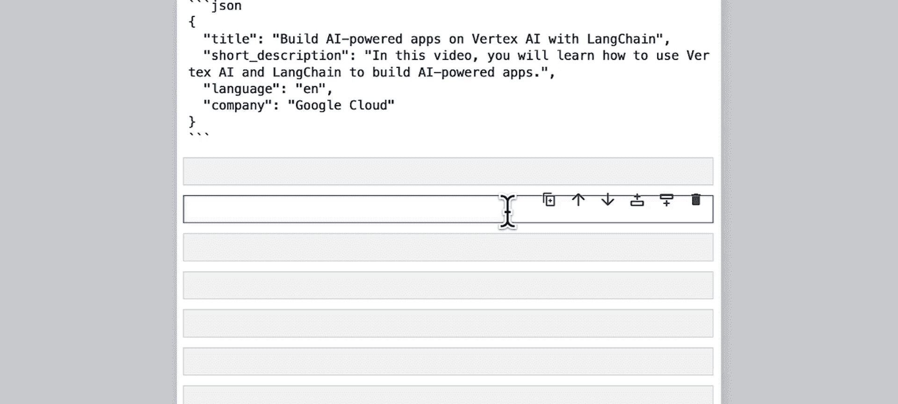

识符和统一资源定位符。我们可以打印视频，我们可以看看视频以及它是关于什么，的。如果你观看这个视频，你可以看到它是关于一个回归模型。

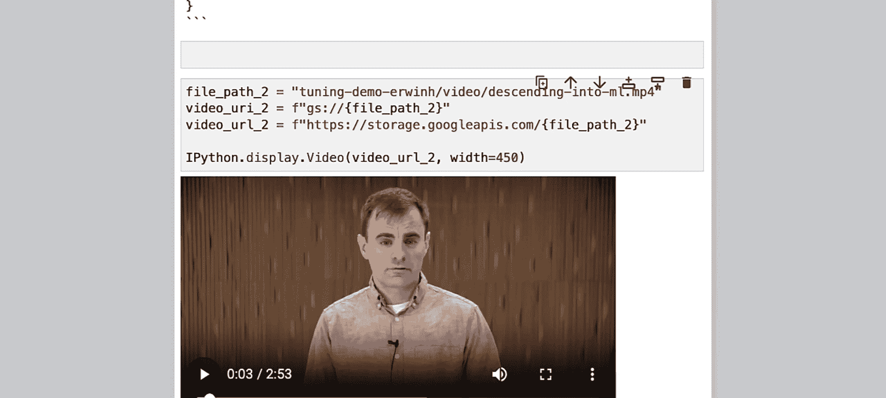

的。接下来，我们将从我们的统一资源标识符加载视频。这是视频二。

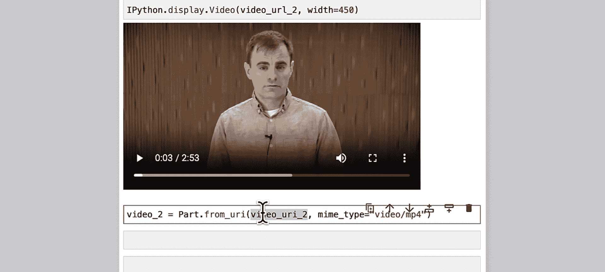

接下来，我们将写一个提示。在这个例子中，你的提示将只使用一个变量。我们说提示，在这里你将写下你的提示。你将使用一个非常基本的指令。你将要求模型观看视频并回答以下问题。所以问题是，问题一。

视频中解释了哪个概念？问题二是，这里变得有点棘手，基于问题一的答案，你能解，释这个概念的基本数学吗？所以我们没有给这个视频是关于什么的提示。问题三，这将更加棘手。

你能提供一个简单的斯卡伊特代码示例来解释这个概念吗，我们在过去的大型语言模型或其他模型中看到的是，有时，你不想一次问太多问题。有时如果你将每个问题一个一个地分开，性能会更好。在这里。

我们将把所有这三个问题组合起来，再加上我们要。

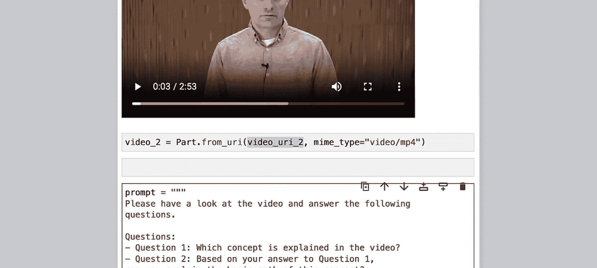

发送一个视频。接下来，让我们把所有这些组合到我们的内容中。让我们称这个内容为二，你先说视频。所以我们有视频二，然后你在这里输入你的提示。接下来，你可以用你的视频和你的提示调用模型。我们把流设为假。

这里我们有内容下划线二。你可以这样打印输出，responses。text。好的，让我们看看输出，看看模型对视频的理解是否正确。这个视频解释了线性回归的概念。

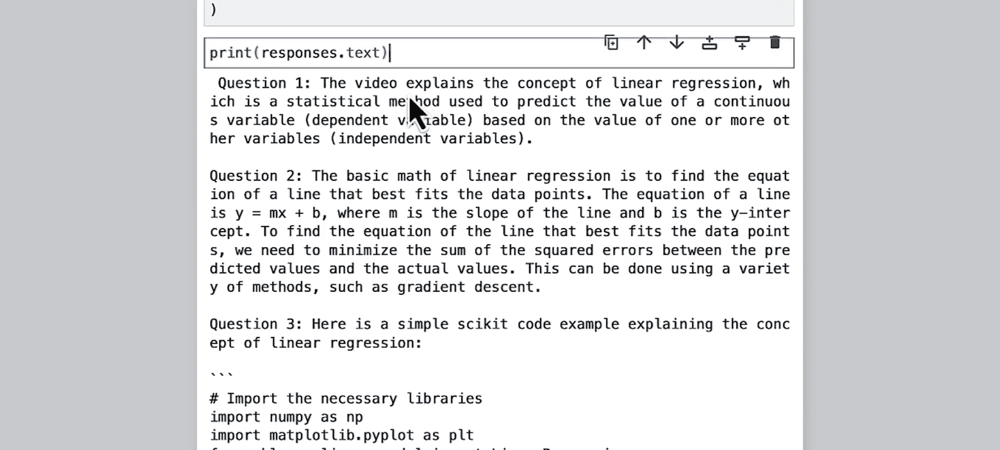

如果你观看这个视频，你可以看到，是的，它是关于线性回。

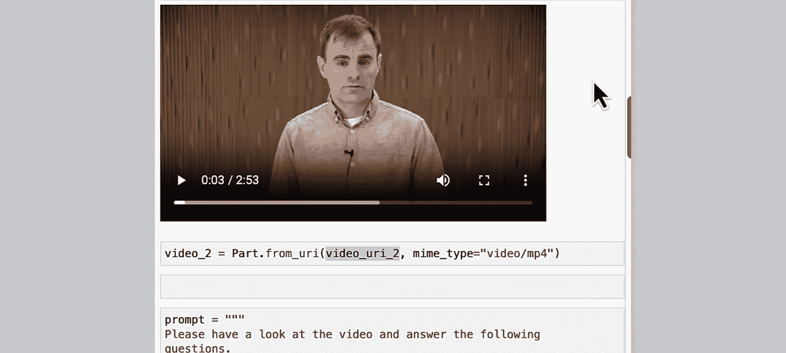

归的。其次，这里有线性回归的基本数学知识。你可以看到方程 y 等于 mx 加 b。你可以拿出你的统计学书籍，看看模型是否正确。好的，现在另一个令人兴奋的部分是这里有简单的斯卡吉。

特代码解释线性回归的概念。所以你可以在下面看到你的代码。你可以看看代码，看看它是否正确，但让我们做个测试并复，制粘贴看看它是否运行。你可以看看你的代码，想想你怎么看，甚至可以试一试。当我运行这段代码时。

我得到了这个有点弯曲的奇怪图形，所以代码运行了。这是一条笔直的直线吗？我认为不是。不错的尝试。对你来说，代码可能运行也可能不运行。试一试就知道了。当你使用模型输出代码时，一定要始终检查它。好的。

让我们进入下一个用例，看一个视频，我们要向模型，询问关于这个视频的一些问题。但现在是你写提示的时候了。

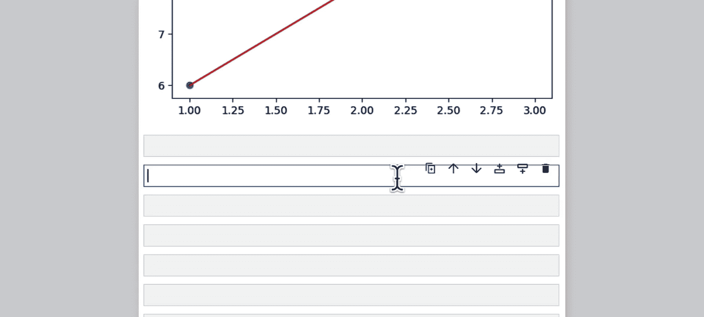

首先，我会给你一个视频来处理。请看看这个视频，这样你就能想出一些提示问题。

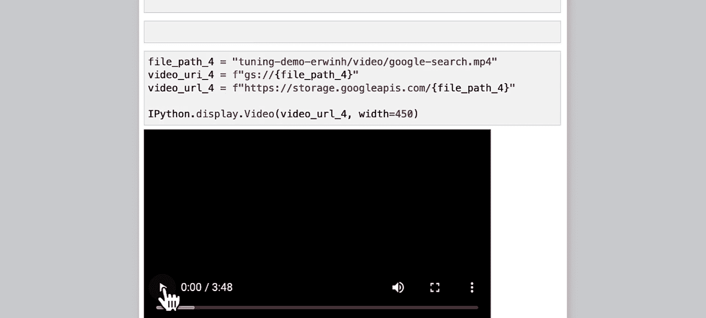

接下来，从统一资源标识符加载视频，现在是时候编写提示，词了。在这个例子中，我将其设置为一个变量。你可以随意将所有内容放在一个单独的提示词中，或者像，我们之前那样创建单独的变量。我现在就用一个。

我会给你一个基本的提示词模板。所以我们要让模型回答关于视频的一堆问题。我希望模型以表格形式呈现结果，每行一个问题及其答案，我们喜欢结构。让我们让它更有趣，确保表格是标记语言格式，这样我们就。

可以在笔记本上运行它来检查格式。现在是你编写一些问题的时候了。我会给你一个例子。但你可以根据视频想出其他问题。最常搜索的运动是什么？我再试一个。最常搜索的科学家是什么？你可以运行提示词。

然后你把所有东西放在一起。你调用内容。我先放我的视频。你可以随意改变顺序，看看是否会得到其他结果。

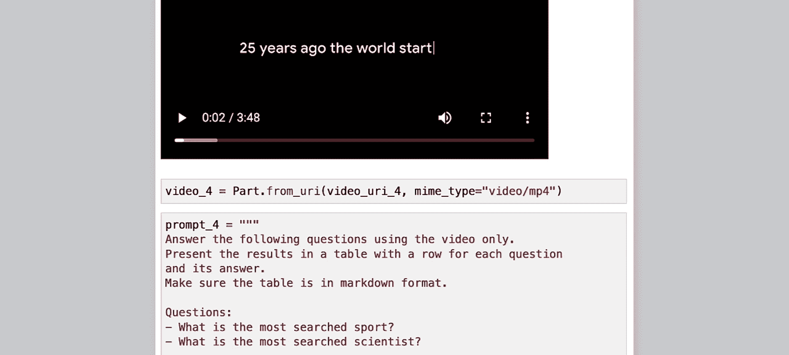

现在你调用应用程序编程接口。你再次使用生成下划线内容。我们有我们的内容了。我把我的字符串设置为真。由你决定你要做什么。接下来你将打印响应。好的，这是我们的答案。让我们先检查问题。

那么最常搜索的运动是什么？所以根据视频，模型说是足球。我可以看出这个模型不是来自荷兰，因为我们喜欢称之为，足球。但我现在对这个答案没问题。其次，搜索最多的科学家是谁？说是尼古拉·特斯拉。

你可以去检查模型是否正确。但你可能有不同的问题，因为你写了自己的提示词和自己，的问题。接下来，让我们检查这个标记语言是否给我们一个好的表，格结构。复制，粘贴到电子表格中。确保设置为标记语言。

在这里从代码设置为标记语言。然后运行它。是的，看，我们得到了一个很好的表格，问题，答案。说实话，我不认为这里的答案应该是尼古拉·特斯拉。我认为应该是爱因斯坦。正如我们所知，对于这些模型。

有时我们可能会有点幻觉。重要的问题是，我们对此能做些什么来试图减轻这种情况？你可以尝试的第一件事是改变你的提示词，看看是否能改，善输出。你可以添加一句话，比如如果在视频中没有找到答案，就说。

在视频中没有找到。你可以运行提示词，运行内容，并生成一个新的响应。你可以尝试的也许首先是对你的提示词做一些改变，看看，是否能改善你的输出，或者调整参数看看是否有帮助。

你曾经有没有在一个视频中滚动寻找一个特定的时刻？在一个 50 分钟的视频中来回可能非常耗时。让我们弄清楚一个模型是否能在这里帮助我们。你可能听说过在干草堆中找针的概念。在双子座的背景下。

干草堆中的针指的是它在大量数据（干，草堆）中找到特定信息（针）的能力。如你所记得的，我们谈到了大上下文窗口以及它如何帮助，处理大量和海量的数据。这个窗口允许模型理解特定信息可能隐藏其中的更广泛上，下文。

增强其在数据干草堆中找到针的能力。好的，让我们看看是否能在干草堆中找到一根针。让我们看一个视频的用例，在其中一个视频中我们想要找，到特定信息。并且让它更有趣一点，让我们搜索在视频中不那么明显的，东西。

其次，我们将要求模型不仅分析一个而是三个视频，总计超，过 50 分钟的视频内容，这意味着我们必须利用大上下文，窗口。让我们导入工具并加载模型。如前所述，我们不会将一个视频发送给模型。我们将发送三个视频。

这些视频中的每一个都是深度学习人工智能平台上的大型，语言模型操作课程的一节课。让我们看看其中一个视频里面有什么。我们将从一个统一资源标识符加载视频，就像我们之前做，的那样。

然后我们将使用 IPython 的内联框架在这里显示视频。现在我们只看一个视频，我们将让模型处理所有三个视频。

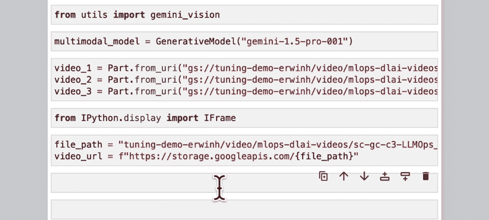

如你所见，这是大型语言模型操作课程的一节课。这是三个视频，关于不同主题的三节课。

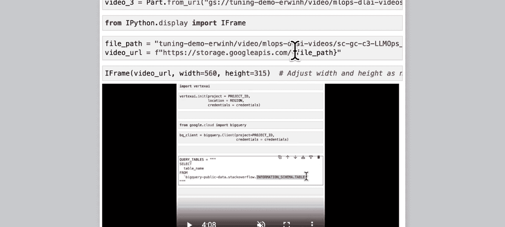

随意滚动视频看看里面有什么。我们已经加载了我们的视频。现在是时候写一些提示词了。并且让我们使用我们在第二节课中讨论的一些设计原则。首先，让我们为模型设定一个角色。在这个用例中。

我们希望模型专门用于分析视频并大海捞，针。接下来，我们可以在向模型提供视频之前添加一条指令。该指令说这里有三个视频。每个都是来自深度学习人工智能的大型语言模型操作课程，的一节课。你的答案仅基于这些视频。

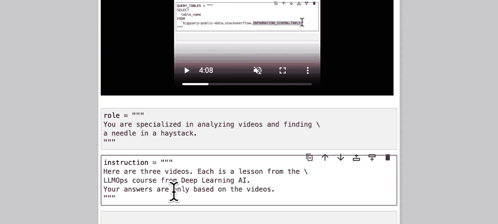

通过提供此指令，模型更清楚我们对它的期望。接下来，让我们写下我们的问题。你将向模型问两个问题。第一个问题是为每个视频以及视频中讨论的内容创建一个，总结。将总结限制在最多 100 个字。

正如我们在提示设计技巧中所讨论的，向你的模型提供期，望有助于获得更好的答案。在这种情况下，我们希望总结简短，所以我们要求模型将答，案限制在 100 个字。第二个问题，在这三个视频中。

教师在哪个视频中运行并解，释这段 Python 代码？大查询下划线客户端点查询。这有点棘手，因为据我所知，这段代码在课程中，但又不完，全是这样，因为这里也有一个参数。

我们还希望模型让我们知道在视频中的何处可以找到该代，码，这样我们就可以检查答案。现在让我们把所有东西放在一起。就像我们之前做的那样，我们将创建一个列表。首先，我们将给出我们的角色。这就像设置舞台。其次。

我们将设置一条指令只是为了管理期望。在指令之后，我们将提供第一个视频，视频一，视频二，并且，我们将添加视频三，下划线三。我们将以我们的问题结束。好的，现在我们把所有东西都放在一起了。我们有这个角色。

我们正在给模型提供一条指令。我们有视频一、二、三，还有问题。现在你可以把所有这些发送给模型。所以我们将再次使用多模态点生成内容。我们将流式设置为真。好的，现在是时候把所有这些发送给模型并检查响应了。

模型正在获取大量信息。所以有三个提示和三个视频。这些视频相当长，所以在你看到响应出现之前可能需要一，些时间。模型需要处理所有这些数据。好的，在这里你可以看到输出。所以对于每个视频。

我们都有关于所讨论内容的总结。所以第一个视频确实是关于大型语言模型操作概念的。第二个视频侧重于数据操作，也是正确的。第三个视频侧重于自动化和编排。所以这些总结都是正确的。

但是现在让我们看看大海捞针式搜索。所以我们要求模型在视频中寻找这个代码。所以模型告诉我们它在第二个视频中。并且它出现在时间戳 4 分 19 秒。

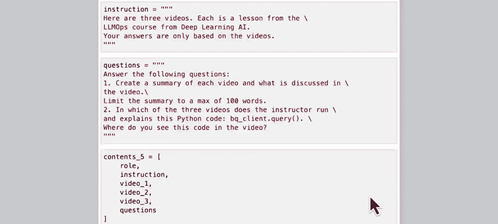

那么我们去看视频。让我们滚动到 4，19。这是 15，17，18，19。

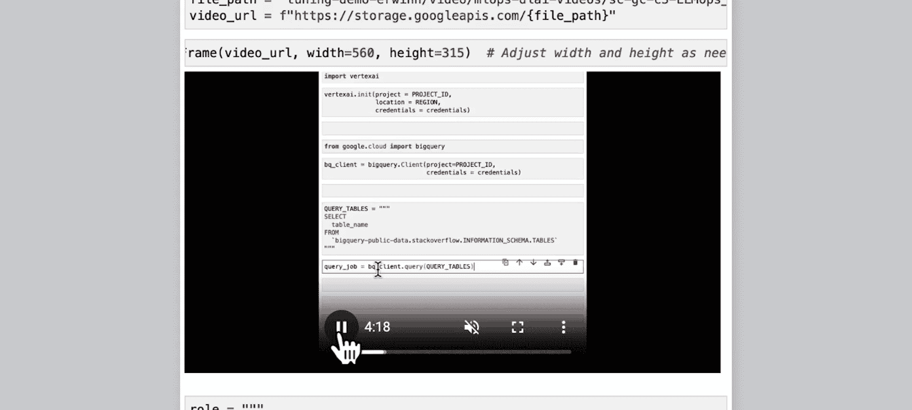

正如你所看到的，代码开始类似，但这里确实提供了一个参。

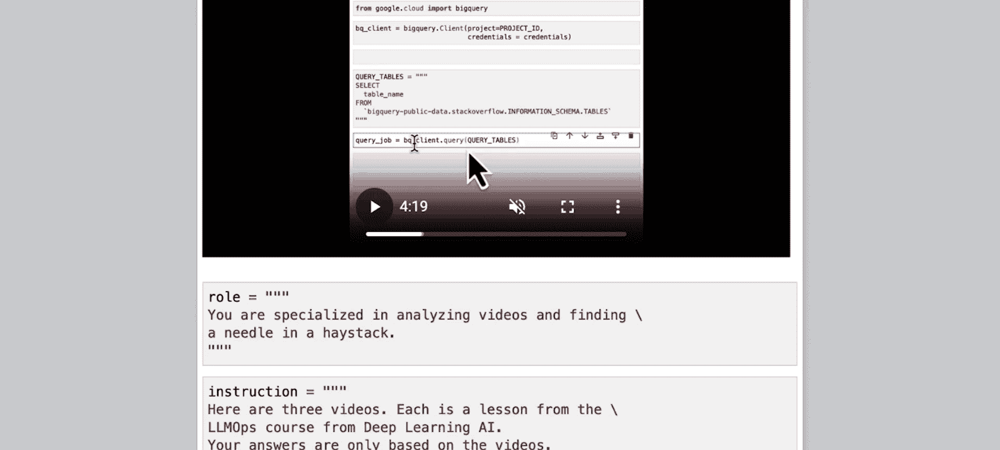

数。所以即使我们没有确切地提供视频中的这个代码，它仍然，能够在这三个视频中找到它，并给我们一个确切的时间戳，告诉我们在哪里可以找到这个代码。这样，我们可以轻松搜索视频并找到我们正在寻找的信息。

如果我必须自己做这件事，那会花费很长时间。而且我可能会错过这个，因为视频太多了。好的，所以不仅可以随意尝试提示。你也可以尝试不同的内容顺序。比如说你可以把角色添加到末尾，然后重新运行下面的代，码。

所以重新运行单元格和下面所有的代码，看看输出如何变，化。你可以探索顺序如何影响模型的输出。好的，这就是第 5 课的内容。你了解了如何在你的用例中使用视频。如何进行视频搜索。如何大海捞针。

以及如何利用大的上下文窗口。在下一课中，我们将深入探讨函数调用以及它如何帮助你。

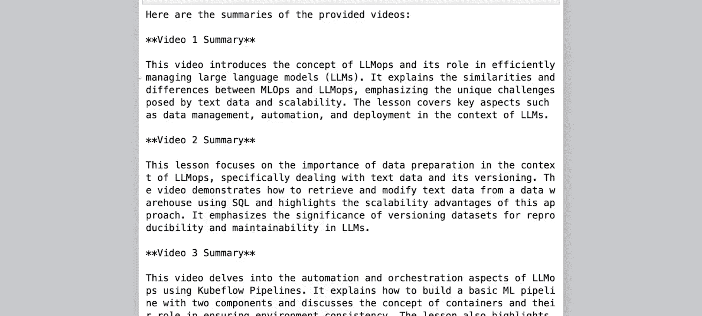