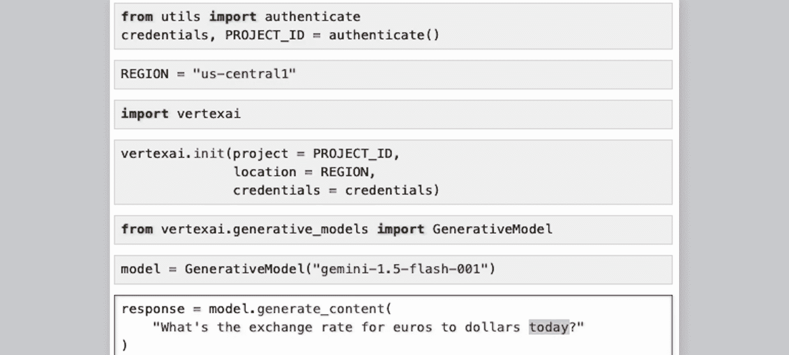
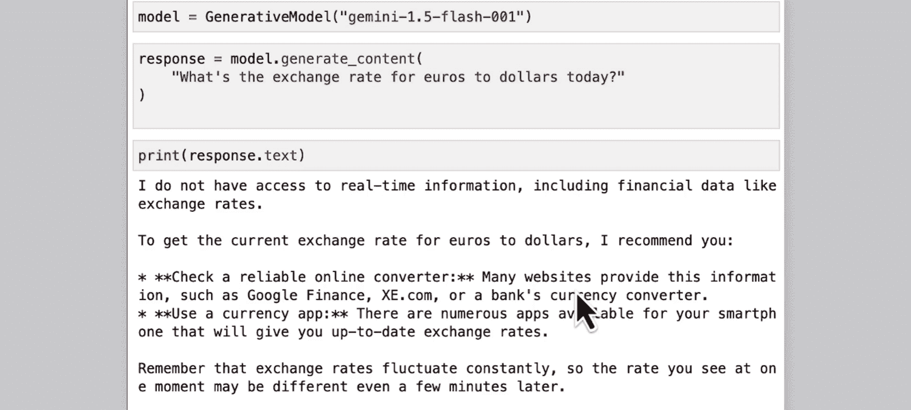
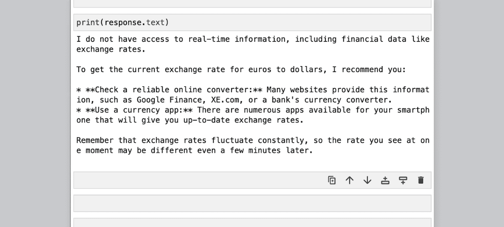
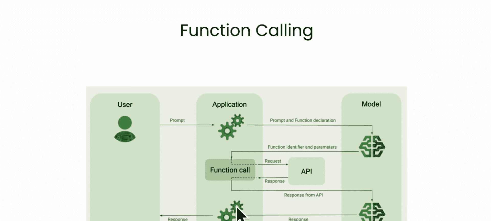
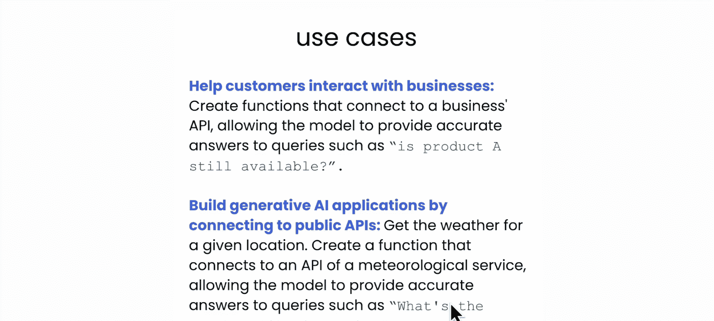
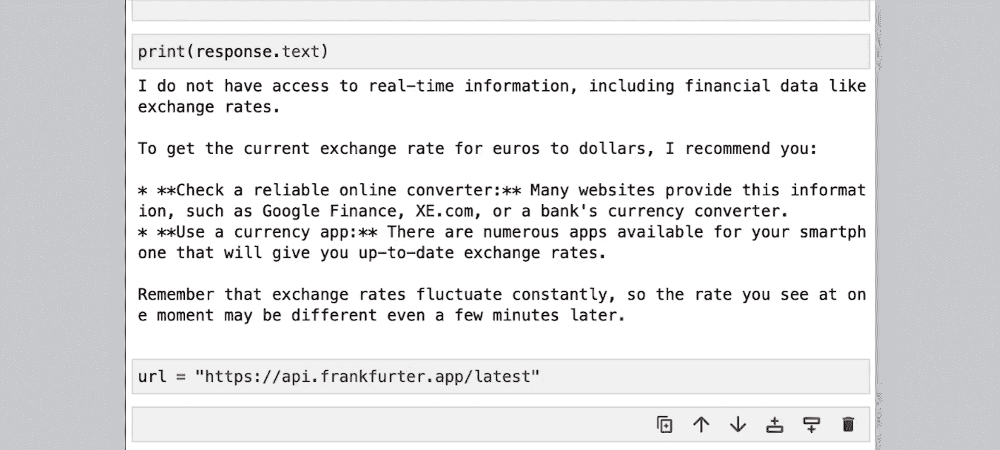
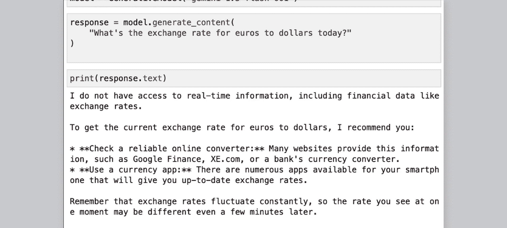
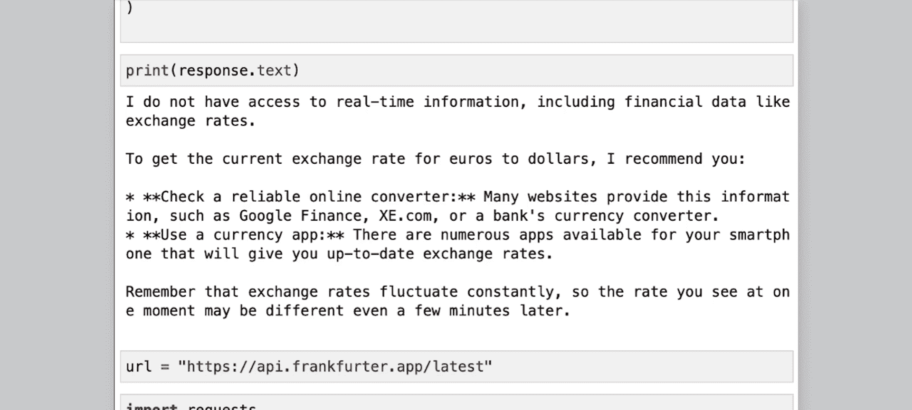
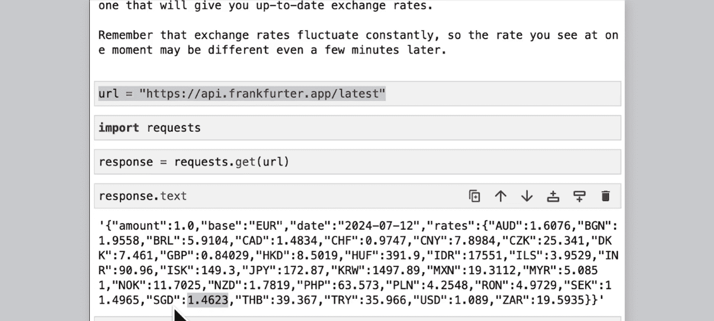
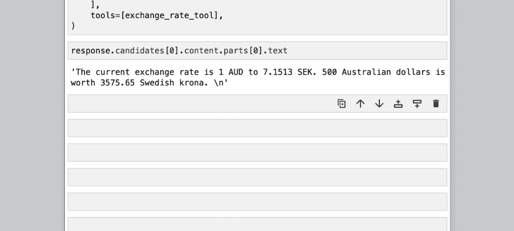

# 吴恩达《使用Gemini进行大型多模态模型提示｜Large Multimodal Model Prompting with Gemini》（豆包翻译 - P7：7.real time data with funtion call - GPT中英字幕课程资源 - BV11M4m1a75d

在本节课中，你将学习如何通过使用函数调用整合实时数，据来增强语言模型。你将创建函数声明，处理 API 响应，并将这些函数无缝集，成到语言模型中，提高应用程序的准确性和自动化程度。让我们开始编码吧！

好的，让我们从关于函数调用的第 6 课开始。让我们进入这个用例来帮助理解什么是函数调用以及它为，什么有用。想象一下，你想知道欧元对美元的当前汇率。而不是手动搜索此信息，你可以要求模型为你提供。

我们将问模型今天欧元对美元的汇率是多少。为了做到这一点，首先我们需要运行我们的辅助函数，以便，我们可以使用 Gemini API。我们的认证代码将再次使用相同的区域。

我们需要使用开源 SDK 然后初始化 SDK。就像我们之前做的那样。其次，我们必须选择我们的模型。在这种情况下，我们将使用我们在第 1 课中谈到的闪存模，型。接下来，我们必须设置我们的提示并调用模型。

如前所述，我们将问模型今天欧元对美元的汇率是多少。今天很重要，因为我们不想要过时的汇率。让我们看看我们的模型有多新，看看它是否知道今天欧元，对美元的汇率。

好的，让我们解开这个响应。我无法访问实时信息，包括像汇率这样的金融数据。模型无法访问今天欧元对美元的汇率。

这不是很有帮助。那么，你是否曾经与大型语言模型或生成式人工智能模型，交互，并询问它实时或当前信息，结果却得到包含过时信息，或不准确信息，或者在这种情况下，根本没有任何信息的回，复？

大型语言模型在解决许多类型类型的问题方面很强大。然而，它们受到以下限制的约束。它们在训练后被冻结，导致知识陈旧，并且它们不能查询或，修改外部数据。函数调用可以解决这些缺点。

让我们来看几张幻灯片。正如我刚才提到的，函数调用可以解决其中一些缺点。所以，你可以使用函数调用来定义自定义函数并将其提供，给模型。例如，你可以定义一个名为“获取下划线天气”的函数，该函。

数接受一个位置参数并返回关于该位置当前天气状况的信，息。那么，会发生什么呢？用户与应用程序交互，给出一个提示。这个提示和函数声明进入模型。在处理提示时，模型可以选择将某些数据处理任务委托给。

你确定的函数。模型不会直接调用函数。相反，模型提供包括要调用的函数和要使用的参数值的结，构化数据输出。例如，对于一个提示“波士顿的天气如何”，模型可以将处理。

委托给“获取天气”函数并提供位置参数值“波士顿”。你可以使用模型的结构化输出来调用外部 API。例如，你可以连接到天气服务应用程序编程接口，提供位置，波士顿，并接收关于该位置的温度、云量和风力状况等信。

息。然后你可以将应用程序编程接口的输出反馈给模型，使其，完成对提示的回应。对于天气示例，模型可能会提供以下回应。在波士顿当前是华氏 38 度，部分多云。而这是给用户的一个回应。

不直接让模型调用应用程序编程接口的优势在于，你可以，使用任何你想要调用的代码语言、任何框架、任何应用程，序编程接口。通常，这种功能是应用程序后端系统的一部分。

你可以使用函数调用的一些用例，例如，帮助客户与企业互，动。你可以创建连接到企业应用程序编程接口的函数，允许模，型对诸如产品 A 是否仍然可用之类的查询提供准确答案，或者我能获取产品 B 的最新价格吗？

或者你可以通过连接到公共应用程序编程接口来构建生成，式人工智能应用程序，就像我刚才讨论的例子，获取某个位，置的最新天气数据。当然，还有很多很多其他用例。这样想。如果你有一个用例。

你想包含最新或最新信息并将其提供，给模型以获得更准确的回应，这是一个典型的你可以使用，函数调用的用例。

好的，现在让我们学习如何使用函数调用来查询外部服务，中的信息并向你的最终用户返回相关回应。对于这个应用程序，你将使用法兰克福香肠。不，不，不是香肠。在这种情况下，法兰克福是欧洲中央银行发布的当前和历。

史外汇汇率的开源应用程序编程接口。这些是最新的汇率。由于大型语言模型在训练后权重是固定的，它可能不知道，最新汇率。好的，让我们指定应用程序编程接口的网址。所以我们设置网址。

这就是我们将指定应用程序编程接口，路径的地方。好的，首先让我们调用应用程序编程接口来检查其输出。为此，你将使用请求。所以在 Python 中的请求库就像你在互联网上的私人邮差。

当你想与一个网站或在线服务通信时，你写一个叫做请求，的消息，解释你需要什么。请求库负责传递你的消息并带回网站的响应。

导入请求，然后我们可以通过在网址上使用请求。get 来获。

得响应。接下来，你可以输出响应。这是我们从应用程序编程接口得到的响应。记住，你得到的响应是你执行此请求时的当前日期和时间，在我的情况下，这是关于 2024 年 12 月 7 日当前汇率的，信息。

由于汇率是欧洲中央银行的，基础货币是欧元。这意味着列出的金额是如果你用一欧元兑换那种货币你会，得到的。例如，我住在新加坡，所以如果我给出一欧元，我会得到 ，1。4623 新加坡元。

好的，现在是时候构建一个让你调用应用程序编程接口的，函数了。我们需要一些额外的软件开发工具包类，让我们实现我们，的函数调用。让我们导入这些额外的类。函数声明让您可以为大型语言模型正式描述一个函数。

现在您可以从定义一个 API 规范开始，并在一个工具中注，册该函数。好的，那么想象一下您选择了一家餐厅，在这种情况下这家，餐厅就是我们的 REST API，我们想从这家餐厅点餐。

现在您需要写下您想要的菜肴，这就是我们所说的 API 规，范。然后您把那份菜肴清单交给服务员，这样他们就能正确处，理订单。模型使用函数描述来理解函数的目的，并确定这些函数在，处理用户查询时是否有用。

应用程序必须声明一组模型可以用来处理提示的函数。每个函数声明必须包括一个函数名和一个函数参数。在这种情况下，您最多可以到 128。好的，回顾 REST API，我们可以看到它接受以下输入参数，From。

这是一个字符串，是要转换的起始货币。To，这也是一个字符串，是我们想要转换到的货币。然后还有日期，这也是一个字符串，是我们用来获取汇率的，日期。您现在可以继续并指定您的函数声明。

这个函数旨在获取两种货币之间的汇率。所以我们有 from 还有 to。要使用它，您至少需要提供货币日期。也就是您想要汇率的日期。您还必须指定起始货币。也就是您正在转换的货币。这可以是欧元或美元。

然后当然还有货币。这是你要转换成的货币。所以这可以是欧元、澳大利亚元、新加坡元。确保在函数和参数描述中尽可能详细。因为模型会利用这些信息来决定选择哪个函数以及如何填，写函数调用中的参数。所以。

详细程度越高，效果越好。最后，你将定义一个包含模型用来生成响应的函数声明的，工具。所以你将设置你的汇率工具。这个工具使用了我们刚刚指定的函数声明，也就是获取汇。

率函数（get exchange rate function）。你现在已经完成了函数和工具定义的配置。现在你可以提示模型并包括你刚刚定义的工具。好的，首先我们来指定一个提示。在这种情况下。

澳大利亚元到瑞典克朗的汇率是多少？500澳大利亚元在瑞典克朗中值多少钱？所以我们不仅在询问汇率，还要问500澳大利亚元在瑞典克，朗中的价值。现在我们可以调用 API 响应并生成内容。如你所见。

我们不仅传递了提示，还指定了你刚刚创建的工，具。好的，让我们用这个配置调用模型。现在让我们看看响应。看起来模型选择了唯一可用的函数，并返回了一个用于获。

取汇率函数（get_exchange_rate function）的函数调用以，及参数。所以我们可以看到澳大利亚元，也可以看到瑞典克朗的最，新日期。所以今天的日期，参数是我们想要的正确格式。

从模型中获得结构化响应，太棒了。模型实际上并不会为你进行外部 API 调用。相反，你可以自由使用任何你想用的语言、库或框架来满，足你的特定用例。这给了你更多灵活性。在这个用例中。

你将使用我之前提到的请求库来调用汇率 ，REST API。好的，让我们首先将响应解包到一个 Python 字典中。好的，所以我们正在获取响应和第一个候选，然后在一个 ，Python 字典中解包。

在这里你可以看到这个 Python 字典。现在我们可以使用请求库，或者你想用的任何其他方法来，调用 API。好的，让我们再次指定 URL 并确保它能利用我们的参数。然后我们可以调用 API 并获得响应。

让我们输出响应。好的，在这里你可以看到我们 API 调用的响应。所以基础货币是澳元，然后是今天的日期，然后是瑞典克朗，的汇率。下一步是我们必须将此信息反馈给模型，以便模型能为用，户生成相关响应。

所以只是总结一下到目前为止我们所做的事情。所以我们所做的是指定我们的函数声明。所以我们设置了参数，指定了类型、描述，所有这些信息都，被模型用来决定它将使用哪个函数。接下来，你定义了一个工具。

其中包括模型用来生成响应的，函数声明。然后我们使用提示和工具调用了应用程序编程接口，并从，模型中得到了一个结构化的响应。然后我们使用那个结构化的响应来调用外部应用程序编程，接口以获取相关数据。

现在我们再次使用这个相关数据调用模型以获得最终响应，好的，现在你可以使用相关信息再次调用模型。所以我们调用模型并提供最新信息。所以模型生成下划线内容。这是协调所有步骤的主要函数。

每个内容块代表步骤中的一轮。所以我们有我们的角色，我们有我们的部分，实际上就是对，话存储的文本或数据。最后，你可以通过在下一轮对话中将函数响应传递回模型，来为用户生成响应。所以我们在这里传递初始提示。

即澳元对瑞典克朗的汇率，是多少，以及 500 澳元在瑞典克朗中价值多少。我们提供函数调用，我们提供应用程序编程接口的响应。我们可以运行这个并调用模型。所以一旦我们将函数响应传递回模型，它将连同应用程序。

编程接口的相关信息一起响应用户提示。那么让我们看看响应。好的，这里我们有来自模型的响应。所以当前汇率是 1 澳元兑 7。1513 瑞典克朗，500 澳元价，值 3575 瑞典克朗 65 分。

你可以拿出你的计算器看看这是否正确。函数调用对于你需要访问最新的外部数据以便你的大型语，言模型提供最新响应的用例非常有用。我见过开发人员使用函数调用获取最新数据，比如当你想，要利用最新的航班价格时。

例如，用户输入预订 7 月 25 日从新加坡到东京的航班。然后模型在旅行应用代码库中调用一个预定义的函数，如 ，book_underscore_flight，带有参数出发地、目的地、日，期。

传递提取的信息。然后该应用的函数执行搜索航班，并可能在应用内无缝完，成预订过程。使用函数调用的一些关键优势包括简化用户体验，这样就，消除了用户在模型和例如应用之间复制粘贴信息的需要。它减少了错误。

这样就最大限度地降低了用户在手动输入，期间输入不正确细节的风险。并且它有助于提高自动化程度，这样就为更复杂的行动，如，酒店预订或行程建议，打开了直接由用户向双子座模型请，求触发的机会。

这就是关于函数调用的第六课。

