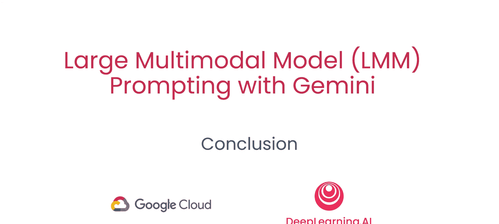

# 吴恩达《使用Gemini进行大型多模态模型提示｜Large Multimodal Model Prompting with Gemini》（豆包翻译 - P8：8.conclusion - GPT中英字幕课程资源 - BV11M4m1a75d

在本课程中，你了解了不同类型的双子座模型，探索了用文，本、图像和视频提示多模态模型，并研究了有效的多模态，提示的最佳实践。此外，你了解了涉及图像和视频的不同用例，例如提取特定，内容和解决大海捞针问题。

并使用函数调用整合实时数据，以增强语言模型。

