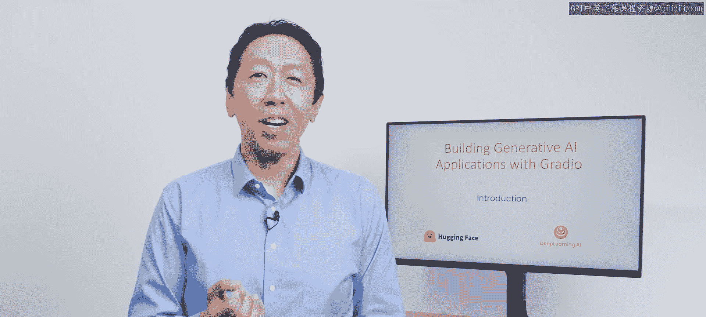
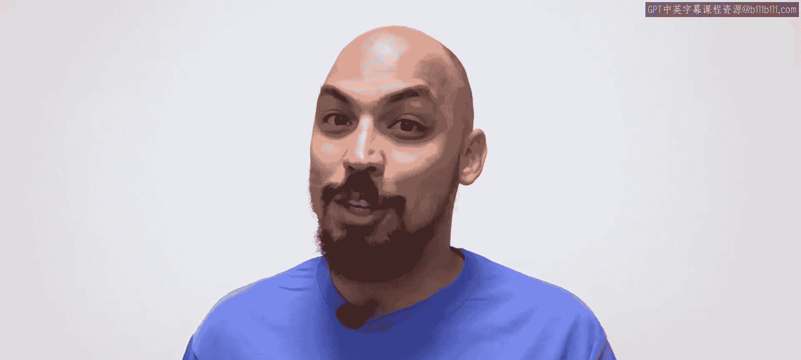
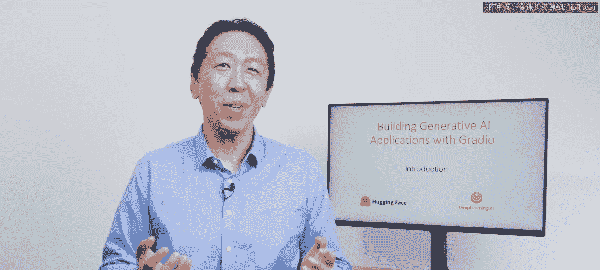
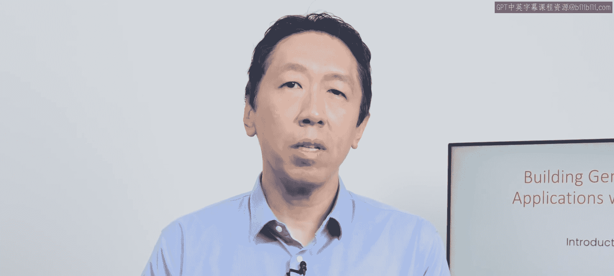
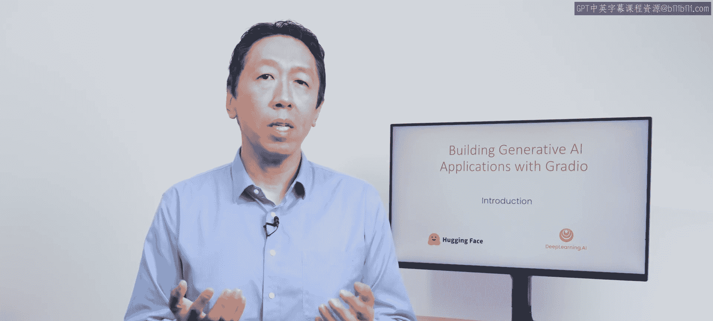
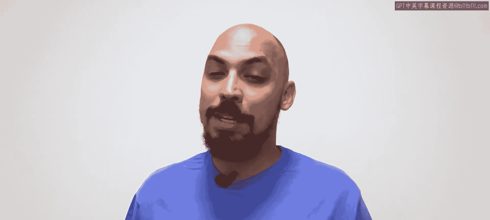
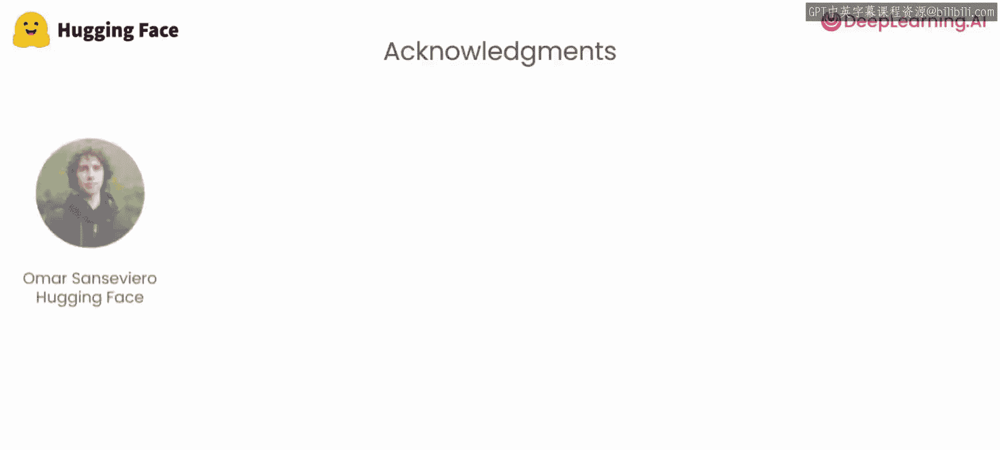

# 吴恩达《使用Gradio构建生成式人工智能应用程序／Building Generative AI Applications with Gradio》 - P1：SC-HuggingFace_Intro.zh - GPT中英字幕课程资源 - BV1rk4y137Ty

Welcome to this course buildinging generative AI applications with Gdio built in partnership with Huinpha I would like to introduce the instructor for this course。

 a polyarial puzzles who goes by polyly Thanks Andrew。

 happy to be here radiodio is a fast and convenient way to demo your machine learning model with a friendly web interface directly in Python In this course we'll learn how to use it to build user interfaces for generative AI applications After the building the machine learning or generative AI part of an application say you want to build a quick demo to show to others maybe to get feedback and drive improvements to your system or maybe just because you think the system is cool when you want to demo it Raio lets you do that quickly via Python interface without needing to write any frontend or web or JavaScriptscript code。

In this course， you see examples including text summarization， name entity recognition。

 image captioning， image generation using a diffusion model and an OM based chatbot for each of these applications。

 Polly will show how often you've built the machine learning part of it you can use radio to build a really cool demo quickly and let others interact with and experience what you built The first lesson will'll be building an app for simple NLP tasks。

 including summarization and name entity recognition。

We're grateful for the hard work of the many people that have contributed to this short course from the Huane Fa team。

 Omar Sanzaviiro Pedro Knka， Philip Schmidt， Amy Roberts， Sylvan Guier。

 Patrick Von Plain and Serj Patio， and on the Delenida AI side Eddi Su and Dila Ezein。

And with that， let's go on to the next video to get started。

