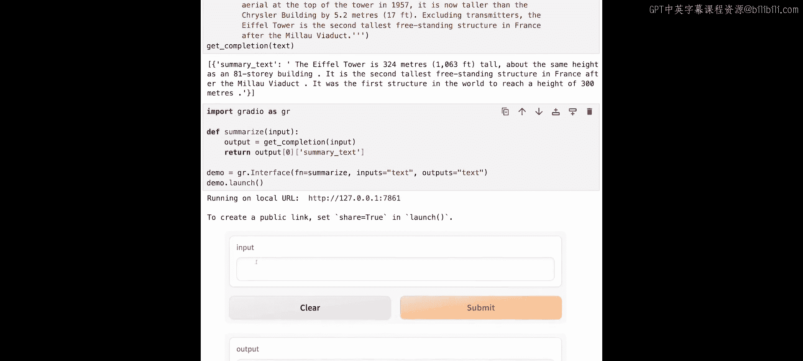
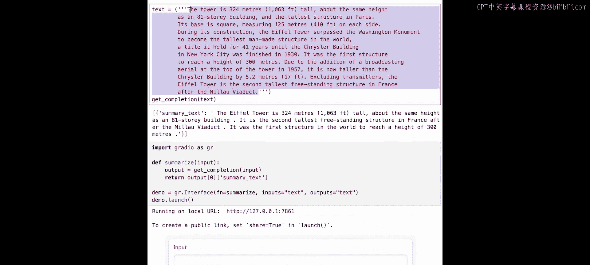
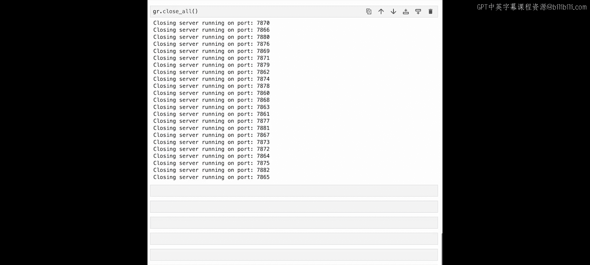

# 吴恩达《使用Gradio构建生成式人工智能应用程序／Building Generative AI Applications with Gradio》 - P2：SC-HuggingFace_L1.zh - GPT中英字幕课程资源 - BV1rk4y137Ty

In the first lesson， we're going to build two natural language processing apps。

 an app for text sumization， and an app for name entity recognition using the grad user interface。

That's diveing into it。Welcome to the first lesson of the course。

 Building generative AI applications with Radio。To get feedback from your team or community。

 it can be very helpful to give them a user interface that doesn't require them to run any code。

Graio lets you build that user interface quickly and without writing much code。

 When you have a specific task in mind， such as summarizing text。

 a small specialist model that is designed for that specific task can perform just as well as a general purpose large language model。

A smaller specialist model can also be cheaper and faster to run。

Here you're going to build an app that can perform two NLP tasks。

 summarizing text and name density recognition， using two specialist models that are designed for each of these two tasks。

So first of all， we're going to set up our API key。

 and then we're going to set up our helper function with the summarization endpoint。

Here we have an endpoint for the inference endpoint API that is going to work with the API key that is set on the course。

 and this API is essentially calling a function that if you were to run it locally。

 it would look something like this。So we're importing the pipeline function from the Huging face transformformers library。

 We're choosing the model to still bar CNNN for the text summarization。

 because it is one of the state of the art models for text summarization。In fact。

 if you use the transformer's pipeline function for the text summarization without specifying the model explicitly。

 it will defaultoe to the subbar CNN。Since this model is built specifically for summarization for any text that you fit into the model。

 it will output a summary of it。Since the speed and costs are important for any application。

 a specialist model， as opposed to a general purpose， large language model。

 can be both cheaper to run and provide a faster response to the user。

Another way to improve cost and speed is to create a smaller version of the model that has a very similar performance。

 This is a process， called destillation。Desolation uses the predictions of a large model to train a smallerer model。

So the model we're using the still Bart CNN is actually a distilled model based on the larger model trained by Facebook called Bart largege CNN。

For this course， we're running these models on a server and accessing them through API calls。

 If you were running the model locally on your own machine， this is the code you would use。

 But since we' are not running the models directly in this classroom， I'll delete this code。Okay。

 so here we have a little text about the Eiffel Tower and the history of its construction。

It's actually quite a bit of text。 I myself haven't read it all。

 but that's why we have a summarization task for us。 So we run the code， and we can see a summary。

So the Eiffel Tower is tall。 It was the tallest， but it was surpassed。

 It was the first structure in the world。 It's so cool。 It gives us a little description。

 So that's what we wanted。😊，But if you wanted people on your team or a beta testing community to try out your model。

 maybe giving them the code to run isn't the best user experience。

 especially if your users aren't familiar with coding， or maybe， as you'll see later。

 your model has some options that would make it hard to try out， even if your users are coders。

 That's why radio can help。So let's start by importing radiod SGR。Next。

 we will define a function called summarizemar。 It takes an input string。

 calls the Gt completion function that we defined earlier and returns the summary。Next。

 we'll use the gradio interface function。Pass in the name of the function summarize。

 which we just define， set the inputs to text and outputs also to text。

 then call demo La to create the user interface。So let's see how this looks like。Cool。

 we have our first demo， so here I'll copy paste the text from the Eiffel Tower。

And， here's the summary。And now that you have a nice user interface。

 it's now easier for you to copy paste any text that you want to summarize。 For example。

 if you go to Wikipedia's front page， you can find some text to summarize。

Here I found some text about this rock or mineral called Wolffinite。And let's summarize it。Nice。

 so here's the summary of all that text。 Feel free to pause here and go to your favorite website。

 copypy some text and paste it into the app。 This was our first demo。

 We can go ahead and try to customize the user interface。 For example， right now。

 it just says input and output。 We can customize this labels if we replace the input and output with the gra component text box。

 The Giarddot text box lets us put some labels on it。😊。

So we can label the input as text to summarize。And let's label the output as result。

Let's see how this looks。Feel free to pause here and choose your own labels for the input and output。

Okay， so we have a pretty nice app right here， but maybe you want to make it obvious that people can paste long paragraphs of text。

Right now， if a user sees a text box like this， they may think that the model can only take in one line of text。

 We can make this text box into a taller text field that can take in many lines of text to do that。

 We will use the lines parameter。If your satellite is equal 6。

 notice that the text field here is now a bit taller。

And we can also set the lines parameter of the summary to say3。 and this is what you'll get。

We can also add a title for this application， So let's call this text summarization with the stillbart CNN。

And we can add a description of what the app does。Right now。

 we are displaying these apps locally within the Jupiter notebook。

 But if you're trying this in your own machine and you want to share this app with a friend through the Internet。

 you can actually create a web link that your friend or colleague can use to view your app in their web browser。

To do this， update demo。t lounge with share equals through。It outputs running on public URL。

 followed by a web link。If you'll share this link with anyone。

 they'll see your app in their web browser and be able to test out your model that you're running in your own machine。

In this course， will be displaying the apps locally within the Jupyter notebooks。

 so I won't set share equals through。But when you are using radio on your own computer。

 feel free to set share equals through and share the public link with others。Next。

 we will build an app that performs name density recognition。 By that。

 I mean the model would take a text and label certain words as persons， institutions or places。

 We'll be using a bird based name density recognition model。

 B is a general purpose language model that can perform many N LP tasks。

 but the one we' are using has been specifically fine tune to have a state of the art performance on name density recognition tasks。

 It recognizes four types of entities， location， organizations， persons and miscellaneous。😊。

An open source model such as this can also be fine tune to recognize specific entities for your specific use case。

 and as with all of the models in this course， we're running these models on a server accessing them with an API endpoint。

So here we have the API endpoint， and here' is the input text。Now。

 let's call the get completion function。Pererometerters equals none and set the endpoint URL。

So when I run this， it outputs a list of dictionaries where each dictionary has an information of an entity。

 For example， it identified Andrew as a person。This raw output can be useful for downstream software applications。

 But what if you wanted to make this output more user friendly for a human。

 you can make the output more visually digestible using radio to do this。

 Let's define a function that the radio app will call in order to access the model。

 Let's call it N A R。 It calls the get completion function and returns both the original input text and the entities that are returned by the model。

😊，So here we are going to do a demo with a code that is very similar to what we did in the last section。

 where essentially we have inputs with a graio text box。 But here output has a different parameter。

 which is highlighted text， and we'll see in a second what that means。And we have a title。

 a description。And we add this allow flagging equals never， because if we go back here。

 you can see that by default， there is a flag button here。

Which lets the user flag inappropriate responses。 But if your application doesn't need that。

 we can hide that button with this code， and I'm also introducing here two examples of input text for your app so your users can click in one of the examples to input those into the model and see an example of how your app would work。

So for a gra demo， we'll have our named entity recognition function where it will take as input the gradio input。

 and then it will run the G completion function like we did before， and it will return the text。

 which will be just like the input and the entities。

 which is this whole entity list that the named entity recognition model returns for us。😊。

And here we have our gradio demo。 So let's run it and see how it looks。

 So we can see here that it's very similar to our previous demo on text sumization。

 We have the gradio text box function， like there。😊，But here we have a new kind of output。

 which is the highlighted text output。And what the highlighted text output does is that it can accept the entity's output。

 which is the entities of the named entity recognition model that we showed before。

And we also have the example。 so here we have this new area called examples。

 where essentially it helps the users of your app to understand with the examples how things work。

So let's use one of those examples and submit it。And you can see， oh， it worked pretty nicely。

 And now let's write this other example。So you can see here that it worked。

So here you can see identified Polly as a person and hugging faces an organization。

But you can also see that it broke down the words into these chunks。

 So you can see here that Polly has two chunks and hugging faces broken down into this chunks。

And those chunks are called tokens， and tokens are short sequences of characters that commonly occur in language。

 So longer words are composed of multiple tokens。 And the reason why the models want to do that is for efficiency。

So you want to have the model trained with as little tokens as it can get。

 So instead of having one word per token， which would be very inefficient。

 you have grouping of characters that can vary in size， depending on the model。

And here you can see the entity label starts with a letter B for a beginning token。

 And here we have this letter I， which indicates it's an intermediate token。

 So the organization entity hugging phase is identified by a beginning token and can be followed with one or more intermediate tokens while it may sometimes be helpful to see the individual tokens for a user facing application。

 you probably want to just show the organization hugging face as a single word。

We can write a bit of code to merge the tokens。So here。

 what you can see is that we have our merge tokens function。

 so to have each token visually as one word， we can use this function merge tokens here。

 So let's run our code and see what's going on。So now here I added some more entities。Oh。

 so this now joined Paul into a single word， and Vienna as a location and hugging face。

 And also I added a bit more context and you can see that it also connected all these words。

And how did I do this， Well， I created this merger tokens function that essentially takes our tokens from last time and checks if they start with the letter I。

This tokens merged with the previous token that was denoted with the letter B。

 There is also a small correction here that we remove。 If we go back here。

 you can see that in their intermediate tokens。 It adds these hashtag characters that we don't want to show the user。

😊，So the code here is removing them and then joining the tokens into a single string。

This code is also taking average of the score， but since the app isn't displaying the score。

 it can just ignore that for now。And that's it。 We have our named En recognition app。

 Congratulations on building your first two radio apps。

 I would encourage you to try to find a sentence or try to come up with a sentence that has some entities like maybe your name where you live or where you work and test a model on that and see how this behaves。

 And one last thing before you wrap this lesson。 because we open so many port with multiple radio apps。

 you may want to clean up your port by running radioio close all function。😊，In the next lesson。

 you go beyond text input by building an image captioning app that takes an image and outputs text that describes that image。

 See you there。

