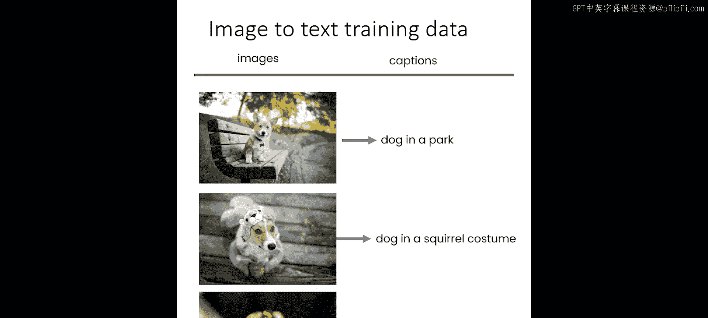
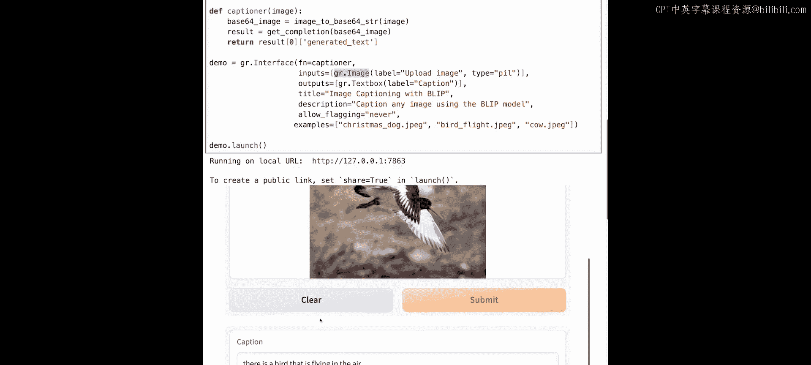
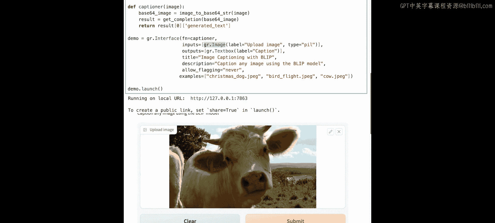
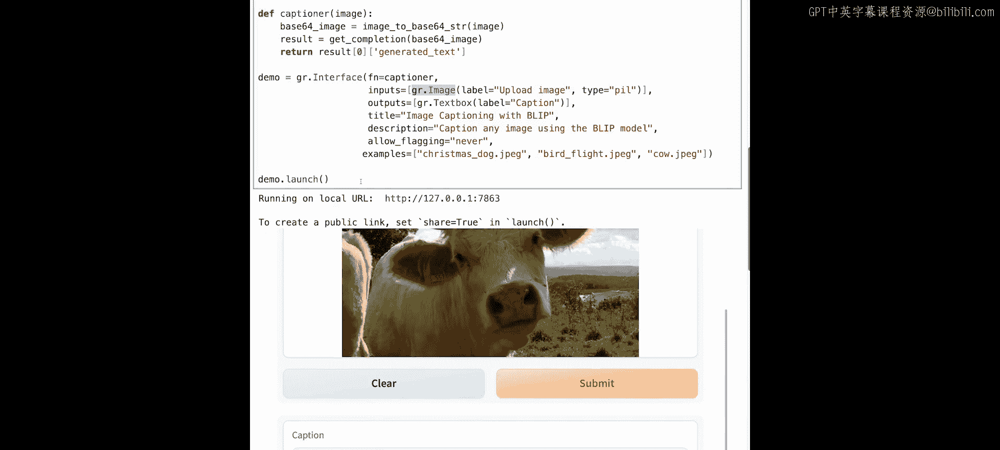

# 吴恩达《使用Gradio构建生成式人工智能应用程序／Building Generative AI Applications with Gradio》 - P3：SC-HuggingFace_L2.zh - GPT中英字幕课程资源 - BV1rk4y137Ty

Now we're going to build an image captioning app using an open source image to text model。

 So we'll set up our API key again and then。

We'll also set up our helper function in here we have an image to text endpoint。

Which is an endpoint for the Salforce Blip image captioning model。 Basically。

 it is a model that receives an image as an input and outputs the caption of said image。

 This was a model trained on a pipeline of image and its respective caption。

 So you can imagine there is a data set that has like， for example， a photo of a dog in the park。

 and then the caption say， a dog in the park。And the way this works is that this model is trained on millions of those images and text caption pairs in a way that they learn with the objective of predicting what is the caption if it sees a new image。

Okay， so let's test out our function。We're using a URL of a free image。

 you can see it displayed here。And yes， we can see that。

We took this image and the caption generated there is a dog wearing a Santa hat and scarf。

Sounds pretty good。 Let's show you how you can build a radio interface to build this image captioning app。

 We'll start by importing radio。😊，And here we'll have two functions。

Our captioner function that essentially will take an image and will run our get completion function and will return the generated text and in this particular example。

 we also have a helper function called image to base 64。

 which basically converts the our image into this base 64 format。

 which is the format required for API。 if you're running the model locally。

 you don't have to worry about that， but since we're running it in the API format。

 we need to convert it to page 64 and back to be able to。Run this properly。

So here in the same way that we had in our previous lesson， we have the exact same structure。

 so we have inputs， outputs， a title， a description， and some examples。

So here we have our image captioning example with Blip。

 we can see the app looks very similar to our previous one。

 but it has this nice upload image field and if we go back to the code。

 we can see that all our fields are the same as in the last lesson except that in the inputs field we have this gra image which is a new component that we haven't used before and when an image component is an input we can see that it turns into an upload image field。

 so feel free to upload photos of your paths or maybe your kids and see how it describes maybe something cute that you have around you you can maybe like take a picture right now if you'd like and put it here or you can just go through the examples here。

For example， let's go back to the dog that we saw before and see if it gives the same caption and it does。

How about this bird here， what it would say。There is a bird that is flying in the yard。 that is true。

And here we have this cow that is mad at you， but we hope it doesn't say that it doesn't。

 It says there are two cows。 So it haven't identified this odd cow here like this。

One tenth0 of the call as a new cow and it standing in a field with a lake in the background。

 so this was pretty complete， even though I'm not completely sure this is a lake。

 but overall it's done a pretty good job。And now we learn how to build a captioning app。

 and in the next lesson， we're going to learn how to generate new images。

