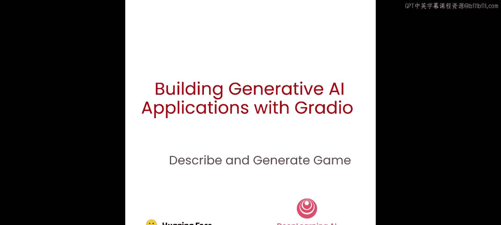
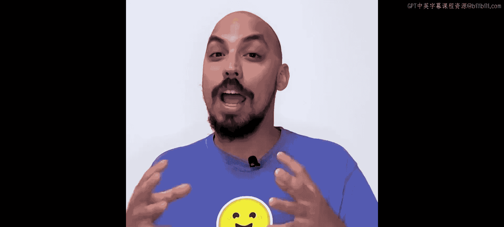
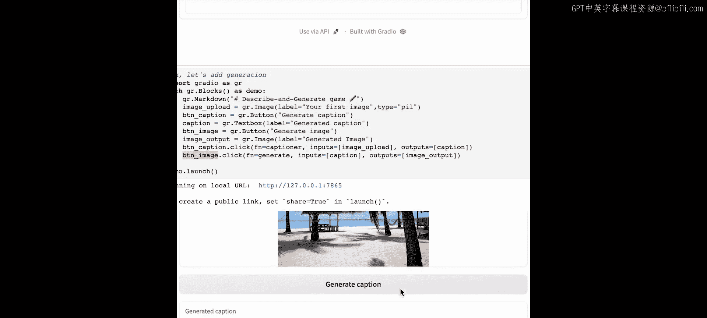
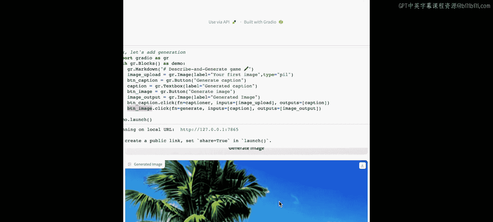
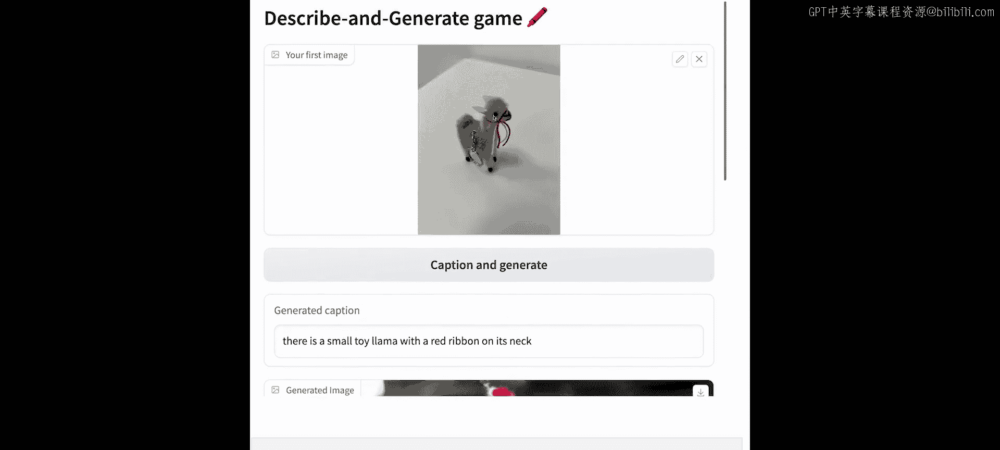
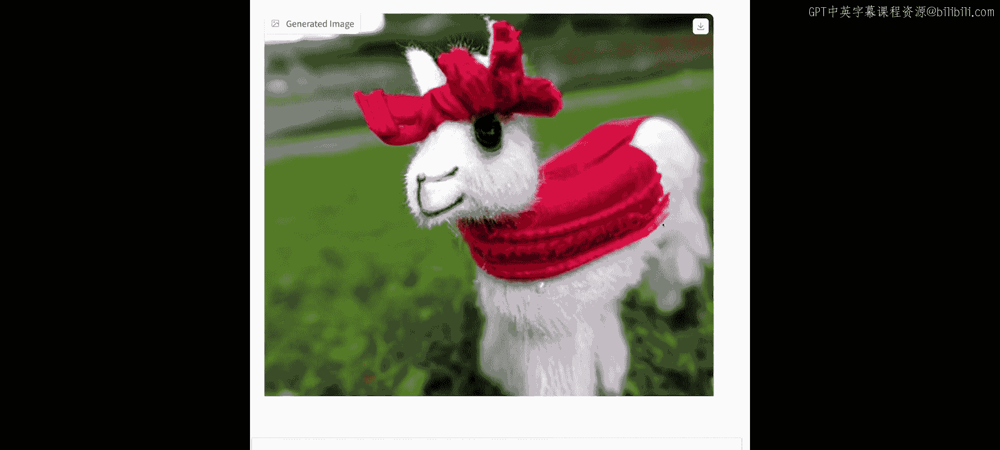
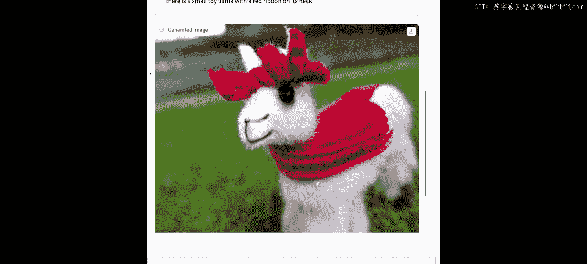
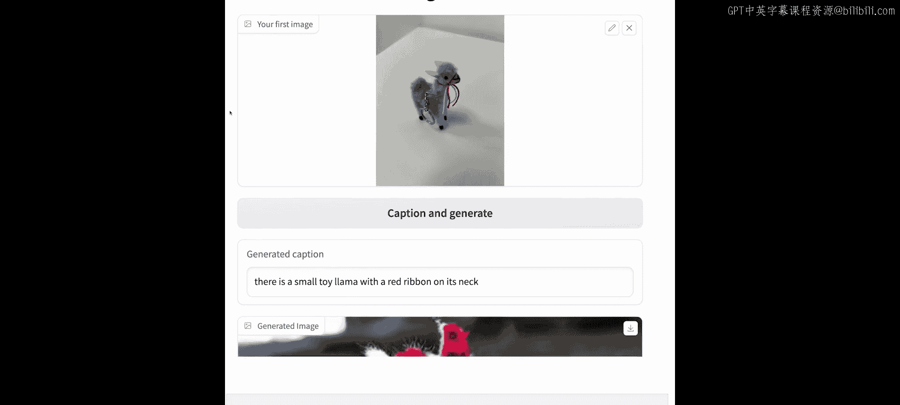
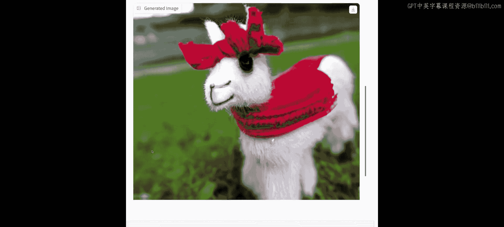
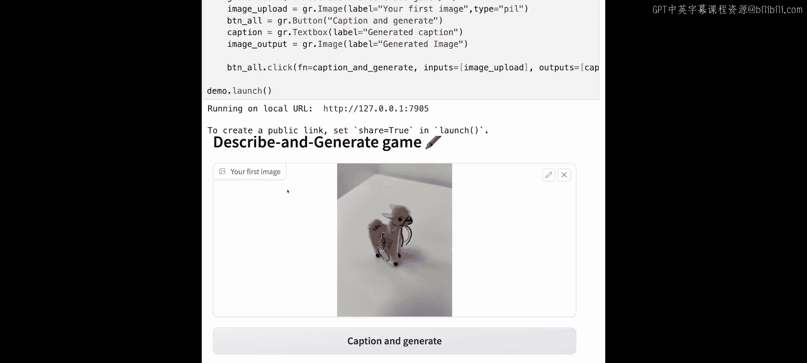

# 吴恩达《使用Gradio构建生成式人工智能应用程序／Building Generative AI Applications with Gradio》 - P5：SC-HuggingFace_L4.zh - GPT中英字幕课程资源 - BV1rk4y137Ty

In this lesson， we're going to take what we learned previously， text to image and image to text。

 and put them together in a single fun app that we can play with。

In the previous lessons， we learned how to build a radio app for NOP applications。

 how to build a captioning app， and how to build a T2 image app。

 So now let's join all the knowledge that we got in the other lessons and let's build a cool game。

 In this game， we're going to start with a captioning。 And then from that caption。

 we're going to generate a new image。So let's start by doing the regular imports。

And here in our helper function， you will see that we have an end to endpoint URL here and two end point variables。

 because basically in this lesson we'll be using two APIs。

 the text2 imageage API is the imageage to text API。So let's bring our functions from lessons3 and 4。

So we have the image to base 64， the base 64 to image。

 the captioner that takes an image and generates a caption。

 the generate function that takes a text and generates an image。So to get started， let's import Gd。

And let's build a simple captioning app。You can see here that we have the upload image。

 generated caption， then the generated caption output。 and then from that output。

 you have the generated image。 And how do we do that？ Well。

 essentially it's super simple with radio blocks。 So we use our two buttons。

 So button caption and button image and each button has its own function。

 So the button caption will essentially call the captioner function。

As the input will be the image upload and the output would be the caption。

 just like we did in the previous cell。But then the button image will take the output of our last function。

 which is the caption。 We'll put it into the generate function， and then we will output an image。So。

 let's see how it goes。So here we'll upload an image。Generate its caption。 And from that caption。

 when I click Gene image， it will then generate a new image from that caption。

So see we can do a telephone game。Where we upload an image， it will caption that image。

 we'll use that caption to then generate a new image。

 and you could then feed this image back into this and do a cool loop。

 So I would encourage you to try to do that。 So take the generated image that you got and feed it back into the first image。

 generate a new caption and keep doing that a few times and see if you'll get something different or if it always stays on team。

And that's cool。 But maybe we want something more streamlined。 So in a way。

 this is really nice because you can generate the caption。

 check how it looks and then click generate image。 But on another way， you have kind of two buttons。

 some people might think that's confusing or too much for Ui。 So it's really up to you。

 but I want to show you what a streamlined version would look like where you would have a single function that is called caption and generate that essentially calls the caption and the generation And then we do our game in a more streamlined way where you simply upload an image。

 press the caption and generate button and then get the caption and the generated image all at once。

 So let's see how that would look like。😊。

So let me upload this image of this Luma keychain that I have here in the office。

And let's see what it will caption and generate all at once。Okay。

 so there is a small toy lama with a red ribbon on its neck。 Sounds good。

Yeah， so it generated this cute little  lama with this kind of ribbon on under its neck。 And yeah。

 so I encourage you to maybe take a picture of something in your surroundings or just take a picture that is in your computer of something cute and see how the captioning model in the downstream image is generated。

 but。😊。

Essentially what I wanted to show you is the difference between a streamlined model that will do the two tasks at once and a bit more complex model which are two buttons where you can generate it in two steps。

 but congratulations you've built your first game using radio and you combine what you learned from text to image to image to text in one very simple streamlined application。

In our next lesson， you'll build a chat bo powered by a state of the art， large language model。

