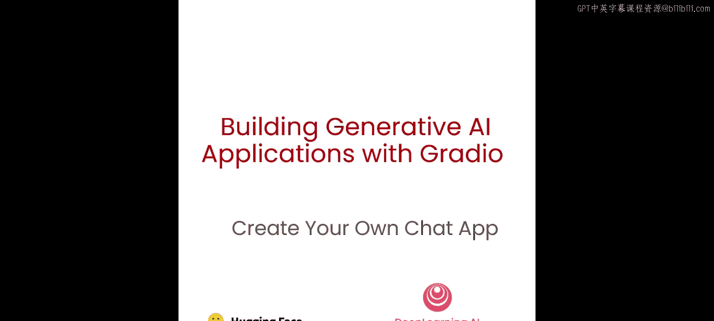
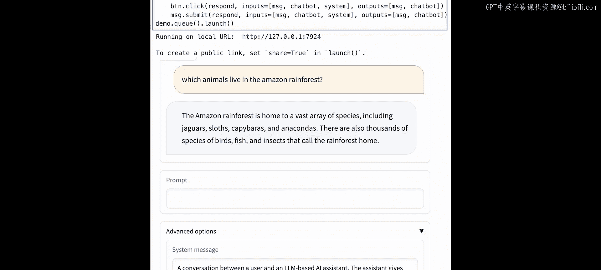

# 吴恩达《使用Gradio构建生成式人工智能应用程序／Building Generative AI Applications with Gradio》 - P6：SC-HuggingFace_L5.zh - GPT中英字幕课程资源 - BV1rk4y137Ty

In our final lesson， we're building an app to chat with an open source LLM， Falcon 40 B。

 one of the best open source models out there， I'm excited and I hope you are too。

In our final lesson， we'll build a chat bot app powered by an open source LLM。

 You probably already chatted with chat GptT， but running it can be costly and rigid。

 Custom LLMs can run locally， Be fine tuned in your own data or run cheaper on the cloud in this lesson will be used in inference and point running Falcon for a B instruct。

 One of the best open source La language models。😊，It is easy to run it locally with the text generation inference library。

 And of course， you can also use radio to create interfaces for API only based LLM。

 so not only open source， so can use radio as well to build Uis for Che GptT or cloud。

 but in the course， we're going to be focusing on the open source LLM Falcon 4 T。

So here we're setting up our token。And our help per function。

 and you can see that here we're using a different library so we're using a the text generation library。

 which is a streamlined library for dealing with the open source LLMs that enables you to load both APIs like we're doing here。

 but also to run locally your own LLM。So here we have asked the model。

 hass Mac been invented or discovered？Here is the completion of the model。

Where we asked that to have maximum of 256 tokens。 Sometimes if the answer is more concise。

 it may be less than the maximum tokens。Here he responded to our question。 That's nice。

 but we probably don't want just to chat with the LLM by updating its input variable。 And also。

 it's not a chat， right？ You cannot ask follow up questions if you just change the input here。

So back in lesson 2， we had a very simple grad interface with a text box input and an output。

 So here we'll have something very similar。For chatting with our LOM。And。Let's copy again。Are prompt。

 And here we can decide how many tokens probably let's get it to a bit less。

 So we just test this out。You can see cut the answer in the middle because I asked that you only have20 tokens。

 but I could change that。 So that's cool。 And that's a way to very easily question an LLM。

 but we're still not chatting because again， if we're asking a followup question。

 it will not be able to understand or keep this context So if if I were going to ask and why is that it won't know what I just said。

 it won't know what we just talked about。 So you see that it actually complains about this。

 It says I cannot provide a response without additional context And the reason why we can keep asking followup questions is because the model has no memory。

 The model doesn't know that we just sent it a question and then we're now asking a follow up So what we have to do in order to build a dialogue is that we always have to send the model the context of the conversation that we have So basically what we have to do is that we have to send the model our previous question its own answer and then the followup question but building all that would be a bit cumbersome。

And that's where the radio chatbot component comes because it allows us to streamline the process of sending the model the history of the conversation。

So we actually want to fix that。 and for that， we'll introduce a new radiod component that is Grio chatbot。

So let's get started with the Grdio chat bot component。

I instantiateated a radio chatbot component with a text box prompt and a submit button。

 So a very simple UI。 and here let's say hello。Cool， you can see that it responded something cool。

 but we're not chatting with an LLM yet。I just choose a random three preset responses and I append to the chat history。

 my message and the bot message。 So here you can see that I can say anything and it will basically look through this three responses at random。

 But here I wanted to show you how the graio chat bot function works。

 So now let's hook that up with our LLM。So here we have the same Ui。But this time。

 I'm calling our generate function and sending the message that the user is sending。

 So now if we ask， what is the meaning。Off life。Well， the model doesn't want to review its secrets。

 but that's fine。And let's ask the concern and why is that？Oh no， we went through the same issue。

 The model still doesn't have context of the previous conversation。 So what's happened here。

We can see that I sent to the model the message that the user sent。

 so here we can see that in the prompt， I send it to the model， an input as the message。

 so basically we're making the same mistake as we were doing before where I'm sending the model just the message that the user sent without sending the whole context。

So how do we fix that？Well， to fix that。We have to format the chat prompt。

I'm defining this format chat prompt function。So here what we want to do is that we want to format our prompt to include the chat history。

 So the LL M knows the context， but that's not enough。

 We still need to tell it which messages come from the user and which messages come from itself。

 the LLM itself that we're calling here assistant。So we set up our format chat prompt function。That。

In every turn of the chat history， it includes a user and an assistant message to exactly enable a model to answer to follow up questions。

 And now we are going to pass that formatted prompt to our。AI。小。😔，Here， let'll do this。

 And here just so we can see how this formatted prompt looks。 I'll also。Priinted on the screen。

So in our chat bot should be able to respond follow up questions， so if we ask it。

 what is the meaning of life？It gives us an answer， it's not the answer that I wanted。

 but that's fine， but I can ask follow up questions， but why？Cool， so we can see that。 we sent it。

A context。 So we sent it our message， and then we asked it to complete。

 And once we went in another iteration loop， we sent it our entire context。

And then asked it to complete。That's cool。 But if we kept going forever like this at some point。

 so we would reach the limit of how much the model can take in in one conversation。

 because we are always giving it more and more of our previous conversation in order to get the most out of the model。

😊，We can come here and set our max new tokens。To 124。

 which is the maximum that this model can take in the hardware that we're running in the API。

 and that allows for a conversation with a couple follow up questions。

 but at some point it will load up our contact window。So now we have our chat with 1024 tokens。

 so let's start a conversation。Which animals live in the savannah。Cool。

And which is the strongest of those animals。It kept going and it impersonated us。

 So it asked the question as a user， and it itself responded as an assistant。This may be cool。

 but it's not what we want。 So in order to prevent this kind of use case， we can add a stop sequence。

 So a stop sequence guarantees that when a new line user which is essentially what would indicate that it's a message from us and not from the model is trying to be generated。

 the model will stop So then we can guarantee that the model would stop in this example in this the strongest animal in the Savannah is the elephant And if we want。

 we could ask a follow up questions such as why is the elephant the strongest animal in the savannah or any other followup question that we choose the point is that the follow up questions should come from the user and not the assistant LLM。

So we built a simple， yet really powerful Ui for chatting with an LLM。

 But if you want to grab the best that radio can offer。

 you can build a Ui that contains a few more features。 So here we have advanced options。

 clean a system message that can send a mode to which the LLM will chat with you So in the system message you can say。

 for example， you are a helpful assistant or you can give it a particular tone。

 a particular intonation， you want it to be a bit more funny， a bit more serious。 and really。

 you can play with the system message， prompt and see how it affects your messages。

 And some people may even feel tempted to give the LLm a persona such as you are a lawyer giving legal advice。

 or if you are a doctor giving medical advice。 But beware that LLms are known to provide factually false information in a way that sounds realistic。

 So why it can be fun experiment in an exploring with Falcon 4 T。 in real world。

 scenarios further safeguard have to be in place for such。😊，Those cases。

And other advanced parameters， like temperature here。

 And the temperature essentially is how much variation you want in your model。

 So if you put temperature 0， the model will tend to always respond with the same responses for the same input。

 So the same questions， the same answers。 And the more you increase the temperature。

 the more variation it gives to your messages。 But if you go too high with your temperature。

 it can start giving nonsense answer。 So 0。7 is a good default full parameter。

 but we encourage you to experiment a bit。 And besides that。

 the U I is letting us do something very cool， which is streaming the response。 So if I ask here。

 which animals。😊，Live in the Amazon rainforest。So can that our model streamed our answer。

 so it sent it token by token and we could see it completely in real time。

 so we don't need to wait until the entire answer is ready。Here we can see how it was done。

 And don't worry if you don't understand everything that is in here。

 because the idea here is to wrap up the course with a very complete Ui with everything that is possible in the LLM side。

 So here in the format chat prompt， which is this function we had before， we added a new element。

 which is the system instruction。 So before we start to have that user assistant dial。

 we have a system on top that has that instruction。

 So basically in the beginning of every message sent to the model it will have that system message that we set up。

And here we're calling it generate string function from a text generation library and what the generate string function does is that it yields the response token by token。

 So in this loop， what is happening is that it's yielding the response token by token it's adding it to the chat history and is yielding that back to the function and here we just have a radio block with an accordion for the advanced options like we had learned before。

And a submit button and a clear button。And before I go。

 I'd like to suggest you to play around with it a little bit。 if you'd like to change maybe the UI。

 maybe you want to reposition things now that you know how to build radiod blocks with columns and rows and in this demo。

 I would encourage you to change the system message。

 Maybe you can make it respond in a foreign language， Would it be able to speak French， I don't know。

 Maybe you can ask it to give your responses in French or or since we're talking about animals and fors。

 maybe you can ask it to explain as if it was a biologist。

 would it increase the specificity of the messages。

 would it tell you the scientific names of the animals， I don't know。

 I encourage you to try and chat with your LLL。

