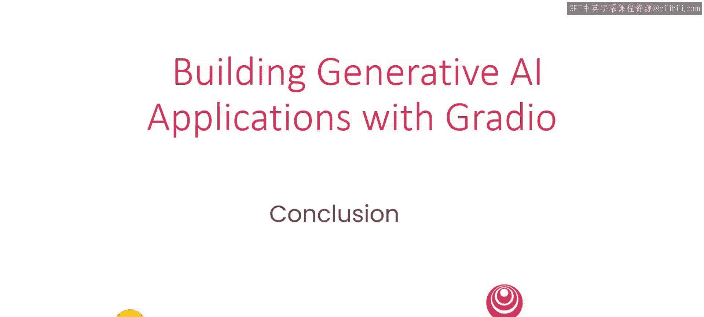

# 吴恩达《使用Gradio构建生成式人工智能应用程序／Building Generative AI Applications with Gradio》 - P7：SC-HuggingFace_Conclusion.zh - GPT中英字幕课程资源 - BV1rk4y137Ty

I hope this is just the beginning of your journey with radiodio。

 You can explore all its capabilities and join its vibrant open source community。

 Once you have apps you want to share with the world。

 Hgingface offers a platform called Spaces where you can deploy them。

 I'm excited to see what you build。😊。