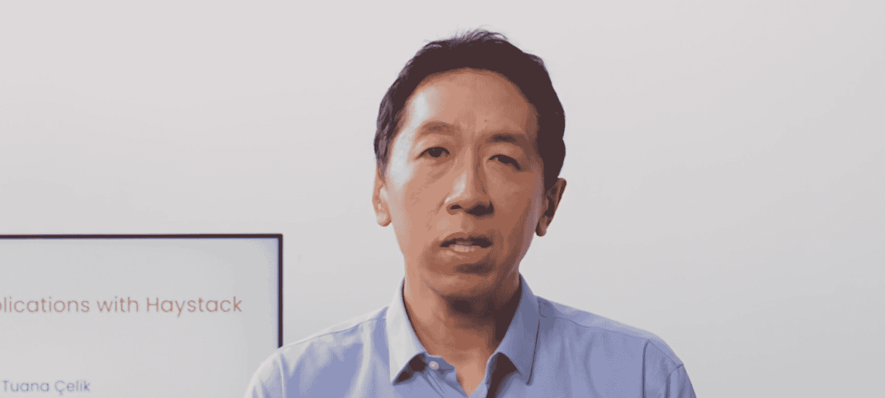
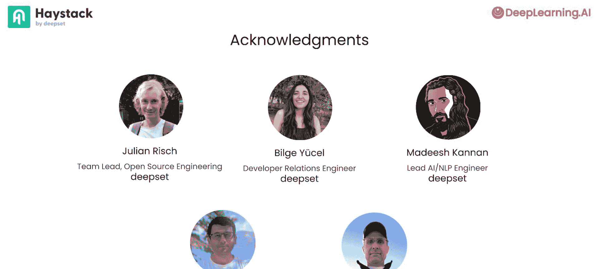

# 吴恩达《使用Haystack构建人工智能应用｜Building AI Applications with Haystack》中英字幕（豆包翻译 - P1：1.intro - GPT中英字幕课程资源 - BV1ZE4m197dH

欢迎来到使用海斯塔克构建人工智能应用，与海斯塔克的，创造者迪普赛特建立合作关系，由塔瓦纳·查利克授课。本课程将介绍一个流行的开源人工智能框架，称为海斯塔，克，描述其组件和语法。

并继续向您展示如何使用它来构建，多个人工智能应用。我经常听到人们的疑问，他们是否应该使用像海斯塔克这，样的人工智能框架，还是仅仅从头开始构建整个应用程序，完全从头开始构建是一次很棒的学习经历。

也能让您完全，控制每一步。但是使用框架可以帮助您更快地完成工作，并为您提供抽，象概念，使您的代码更易于维护和阅读。生成式人工智能技术发展迅速且复杂，它可以集成来自不。

同语言模型提供商、向量数据库、网络搜索等各种工具的， API。然后，将这些功能组合成您应用程序的自定义工作流程也，有很多工作要做。像海斯塔克这样的框架可以帮助管理这种复杂性，让您能。

够更专注于在更高的抽象级别上开发您的应用程序。例如，有许多向量数据库供应商，通过使用一个共同的接口，您的代码可以更容易地适应底层数据库技术的变化，而无，需对您的应用程序进行太多重构。

框架还可以直接提供通用功能，这可以加快您的开发过程，例如，海斯塔克支持分支和循环。通过分支，例如，您的管道可以在初始检索增强生成步骤没，有提供足够信息来回答用户查询时运行网络搜索。此外。

海斯塔克的管道可视化工具可以帮助您理解和优化，构建大型语言模型工作流程的过程。我很高兴本课程的讲师是塔瓦纳·塞利克，她是迪普赛特的，海斯塔克开发者关系负责人。

塔瓦纳一直在帮助许多开发人员使用海斯塔克构建自定义，人工智能应用。谢谢，安德鲁。这是使用框架的原因的一个很好的总结。然而，海斯塔克作为一个框架的重点不是提供您可能需要，的一切。

而是提供一个共同的接口和一个简单的抽象，您可，以根据自己的需要扩展框架的能力。例如，海斯塔克基于两个主要元素，组件和管道。它是围绕着拥有通过灵活管道连接的强大组件的想法构建，的。

我们有很多像嵌入器和生成器这样的组件，但在很多情况，下，海斯塔克可能无法提供您所追求的组件。例如，想想从特定的 API 获取数据的东西。将其添加到海斯塔克管道中，只需要创建自己的可以与该 。

API 交互的自定义组件，而海斯塔克只期望你将其包装成，一个组件。在接下来的一个小时的视频中，你将了解构成海斯塔克框，架的独特构建块，然后使用它们构建几个令人兴奋的大型，语言模型应用程序。

你将了解海斯塔克的核心抽象概念，包括组件、管道和文，档存储，并了解如何将这些元素组合用于各种人工智能用，例。然后，你将继续构建和自定义一个简单的检索增强生成管，道，并学习如何根据你的特定需求调整其行为。

然后你将通过构建一个黑客新闻摘要器来创建一个自定义，组件。此外，你将使用条件路由创建一个带有回退到网络搜索的，分支管道，当提供给大型语言模型的上下文没有响应用户，查询所需的信息时。

你还将使用海斯塔克的管道循环机制构建一个自我反思代，理，使代理能够迭代地完善其响应。最后，你将创建一个使用 OpenAI 函数调用能力的聊天代，理，这允许你将海斯塔克管道作为工具提供给大型语言模，型。

增强该代理的能力。所以在这门课程中你要学很多。很多人都为创建这门课程付出了努力。来自 DeepSense，我要感谢整个海斯塔克团队，特别是朱利，安·里奇、比尔吉特·乌卡尔和马迪什·坎南。此外。

来自 DeepLearner AI 的埃什莫尔·加尔加里和杰夫。

·洛德维格也为这门课程做出了贡献。我期待着你用海斯塔克构建许多令人兴奋的大型语言模型，应用程序。