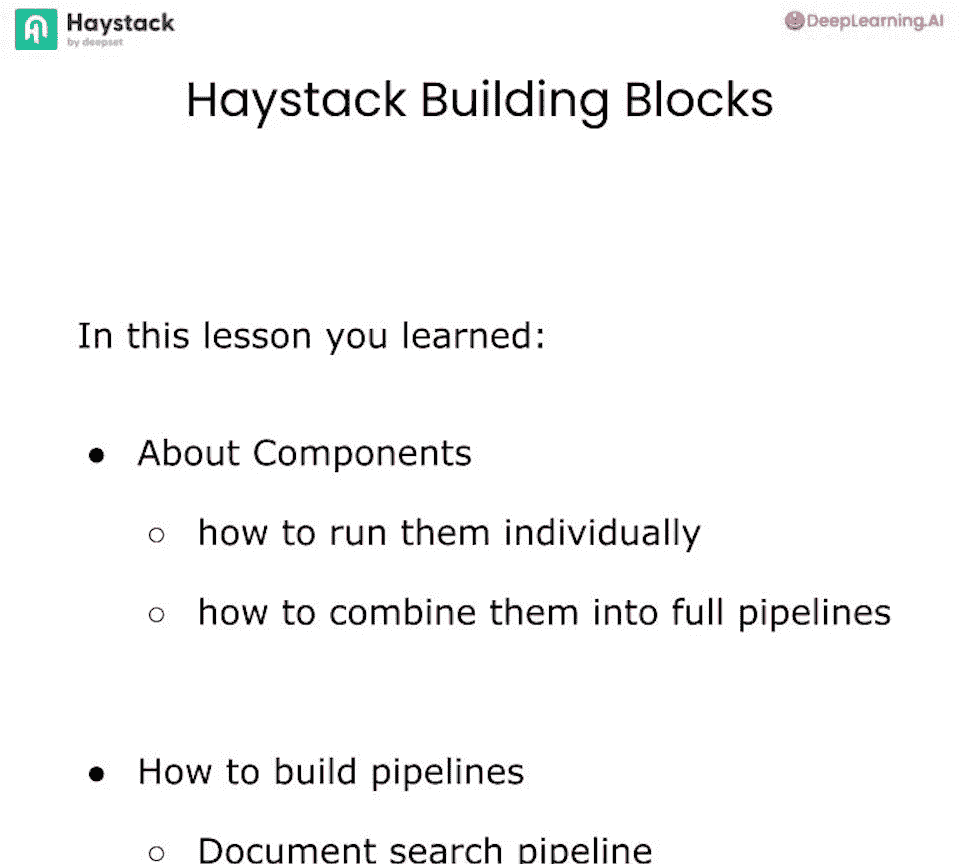
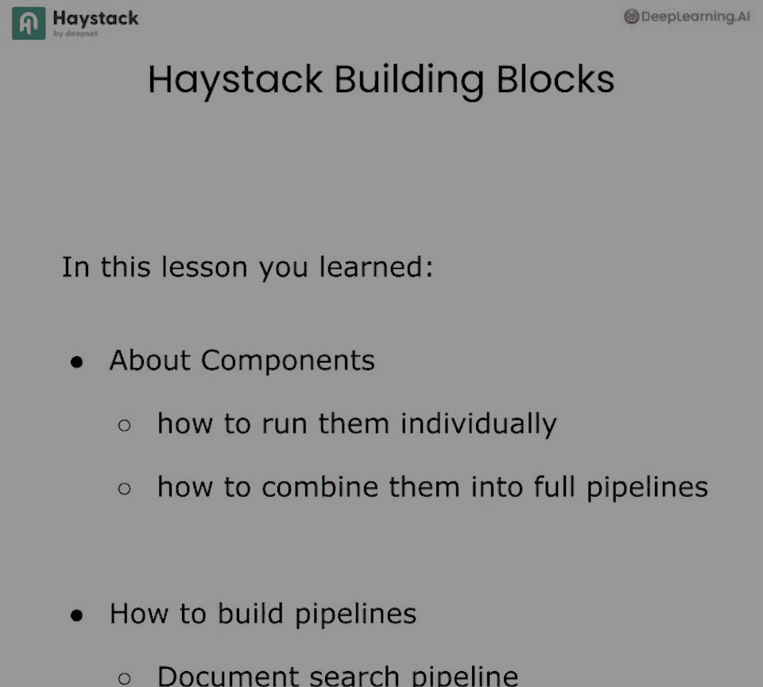

# 吴恩达《使用Haystack构建人工智能应用｜Building AI Applications with Haystack》中英字幕（豆包翻译 - P2：2.L1 Haystack Building Blocks - GPT中英字幕课程资源 - BV1ZE4m197dH

这第一节课是对海斯塔克核心抽象概念的介绍。你将了解什么是组件，它们如何工作，以及它们如何组合成，适用于许多人工智能用例的管道，还有什么是文档存储以，及管道如何访问它们。我们将首先创建一个简单的索引管道。

然后是一个文档搜，索管道。让我们开始吧。人工智能应用通常由多个协同工作以实现目标的步骤组成，例如，检索增强生成。这通常由两个步骤组成。检索步骤，即查看一个点数据库并从该数据库中提取最相，关的文档。

然后是生成步骤，它使用这些文档中的上下文来生成响应，但有时你可能不得不改变一些事情。例如，你可能不得不在检索和生成之间添加一个排名步骤，在一个完整的人工智能应用中，有较小的任务组合成一个，较大的用例。

在海斯塔克中，所有这些小任务都是通过组件来实现的。然后一个组件与其他组件组合形成一个管道。这些管道是实现我们想要构建的应用的实体。一个管道还可以访问一些数据库。在海斯塔克中，我们称这些为文档存储。

并且管道通过一些组件访问这些文档存储。例如，你可以在 Weaviate、Quadrant 或 MongoDB 中存储，数据，并让你的管道通过一些组件访问这些文档。

管道通过以实现人工智能应用的方式连接这些组件而组成，但一个组件可以接受任意数量的输入，也可以产生任意数，量的输出。例如，句子转换器文档嵌入器。这个组件期望一个文档列表，并返回相同的文档列表，其中。

嵌入了嵌入向量。它还返回元数据。这个组件使用句子转换器嵌入模型来创建这些嵌入向量。例如，让我们从这个句子开始，泰勒·斯威夫特是世界女王，吗？我们可能有一个组件，比如说一个嵌入器，它为这个查询生。

成一个嵌入向量。我们可能还有另一个组件，它期望一个嵌入向量或一个向，量，然后它生成一个文档。我们称这个为检索器。如果我们然后将这两个组件组合起来，我们就实现了一个，相当准确的文档搜索管道，例如。

海斯塔克有许多现成的组件。比如，访问不同模型提供方的生成器，做同样事情的嵌入器，我们有不同的能够从许多数据库检索的检索器。我们有转换器，但还有很多。你可能有排名器、路由器、预处理器等等。

我们构建管道来创建像问答、文档搜索、聊天、问题生成，、输出验证这样的应用，而且这个列表可以不断增加。我们用海斯塔克构建这些管道，但海斯塔克管道也可以分，支。这意味着我们可以有具有决策组件的应用。

管道可能会变得相当复杂。海斯塔克管道也可以循环，所以它会循环直到满足某个情，况等等。但最重要的是，如果海斯塔克没有你构建应用所需的组件，你可以继续并构建你自己的，并将它们放在有意义的管道，中。好的。

让我们在代码中看到所有这些，然后开始使用海斯塔，克组件、管道和文档存储。你首先要添加这一行来抑制我们不需要的任何警告。接下来，我们将使用一个辅助函数，它将允许我们导入我们。

在这个实验中需要的所有环境变量，比如 OpenAI、API 密，钥等等。现在，让我们开始创建我们的第一个组件并使用它。你将使用的第一个组件是 OpenAI 文档嵌入器。

这个组件使用 OpenAI 嵌入模型为文档创建嵌入。首先，你将导入文档嵌入器，然后你将初始化一个文档嵌入，器。在这种情况下，你将使用 TextEmbedding3Small 作为你的，嵌入模型。

你也可以检查这个组件期望什么样的输入和输出。比如，我们可以看到这个组件期望文档列表作为输入，它将，产生文档和元数据作为输出。我们已经知道这是一个嵌入组件，所以它产生的文档也将，有嵌入。现在。

让我们看看我们将如何运行这个组件。为此，我们创建了一些假文档。我们有两个文档的列表，并且这些文档中的每一个都提到，了关于海斯塔克以及你如何用海斯塔克构建 AI 应用的事，情。

因为我们知道嵌入器组件期望文档作为输入，我们可以用，这些文档运行它。当我们运行这个组件时，你会注意到它产生了文档列表作，为输出，并且元信息也告诉我们用于创建这些文档的是什。

么模型以及 1536 大小的向量。现在你知道如何单独使用一个组件了，让我们看看如何在，管道中使用它。首先，我们将从初始化一个文档存储开始，然后我们将构建，一个管道，该管道将文档及其嵌入一起写入文档存储。

目前，我们将使用内存中的文档存储。这是在 Haystack 中你可以使用的最简单的文档存储，并，且使用它没有任何要求。但如果你愿意，你可以将其切换为任何文档存储，如 。

Quadrant、Weaviate、Pinecone、Chroma 等等。现在我们有了一个内存中的文档存储，让我们将我们的第，一个 TXT 文件写入这个文档存储。

我们将首先导入你将用于第一个索引管道的所有组件。你将再次使用 OpenAI 文档嵌入器，但你也将使用一些预，处理程序和转换器。对于这个演示，我们将使用这些组件的所有默认变量，但你，也可以改变这一点。

我们将从一个转换器开始，因为我们将有一个关于达芬奇，的 TXT 文件，我们将其写入我们的内存文档存储。接下来，我们将使用文档分割器。文档分割器是一个将你的文档分块的组件。默认情况下。

它按 200 个单词分割，我们将使用这个默认，设置。然而，如果你愿意，你可以改变这一点。例如，你可以说按并决定按段落分割。这将按 200 个段落分割你的文档，例如，但让我们使用默，认值。接下来。

你将使用一个嵌入器。在这种情况下，我们将使用 OpenAI 文档嵌入器。你将使用的最后一个组件是一个文档写入器。你已经有了一个文档存储，所以在这里你将告诉文档写入，器它应该写入你的内存文档存储。

现在你有了所有的组件，接下来你要做的就是创建一个管，道并将这些组件添加到该管道中。你通过初始化你的管道来做到这一点，然后接下来你将添，加每个组件。这里重要的是要知道对于每个组件，你将提供一个名称。

你可以给你的组件取任何你想要的名字，但之后你必须确，保你接下来使用这个名字。现在你已经将组件添加到你的管道中，管道可以访问这些，组件，但它实际上还不知道这些组件如何相互作用。为此。

Haystack 使用组件连接。例如，你将从将转换器连接到分离器开始。这基本上是告诉管道转换器的输出应该交给分离器。让我们也连接所有其他组件。当你运行这个时，你也将看到你在管道中创建了什么样的，连接。

一旦你在管道中连接了所有组件，你还将能够观察到你的，管道可以访问哪些组件，以及这些组件之间的确切连接是，什么。所以我们基本上看到转换器的文档输出具体地被输入到分，离器文档输入。

你会记得之前嵌入器期望文档作为输入。所以它由分离器提供文档，但它也产生文档。只是这次它有嵌入。所以嵌入器的文档输出现在被给到写入器文档输入。Haystack 提供的另一个实用程序是一种可视化这些管道。

的方法。你只需在你的管道上调用显示。你将得到一个确切的你的管道样子的图表，包括所有的连，接。在这种情况下，我们知道我们的管道从一个转换器开始，它，期望的输入是源。

现在你有了你的管道并且你知道连接是准确的，你可以尝，试运行它。你已经看到那个管道中的第一个组件是转换器组件，并且，它期望一个源列表。对于这个实验，我们有一个关于达芬奇的 TXT 文件，我们。

将用它来索引到我们的内存文档存储中。所以我们在我们的索引管道上调用运行，并且我们告诉运，行方法转换器期望输入源。并且我们也提供了我们的 TXT 文件的位置。我们运行这个管道。

你会看到它用我们与 OpenAI 文档嵌，入器一起拥有的默认嵌入模型计算嵌入。它也让我们知道它已经将 47 个文档写入我们的内存文档，存储。为了检查，你现在也可以检查你的文档存储。例如。

我们可以用没有过滤器的方式过滤我们的文档存储，并且简单地检查索引为 5 的文档的内容。在这里我们有它。现在你已经用关于达芬奇的文档以及嵌入创建了你的内存，文档存储，你可以创建你的第一个文档搜索管道。

为此，我们首先导入我们将要使用的所有组件。然后我们开始创建我们想要使用的组件。这里重要的是，因为我们使用 OpenAI 文档嵌入器和默认，嵌入模型，所以我们知道必须使用相同模型来嵌入用户传，入的查询。

对于这个用例，那么，我们将使用 OpenAI 文本嵌入器，我，们称其为我们的查询嵌入器。接下来，我们需要一个检索器。我们使用内存中文档存储。所以对于这种情况，我们将使用内存中嵌入检索器，告诉它。

从我们的文档存储中检索文档。接下来，我们初始化我们的管道。我们称这个管道为文档搜索，并且我们简单地将我们拥有，的组件添加到该管道中。最后，就像我们之前做的那样，我们将连接我们的组件。

我将从一个实际上将是不正确的连接开始，或者确切地说，连接是什么并不非常清楚。所以如果你运行这个，你会注意到你得到一个错误。这些类型的错误实际上非常有用。这告诉我们有一个管道连接错误。

因为它不知道查询嵌入，器应该如何确切地连接到检索器，因为这两个组件有多种，连接方式。它还为我们提供了这些连接可能看起来像什么的一些建议，并让我们知道两个组件的输出和输入是什么。为了解决这个问题。

我们只需要让管道知道具体地说查询，嵌入器的嵌入输出应该给予检索器的查询嵌入输入。就是这样。我们现在有一个文档搜索管道。再次，你可以使用显示工具来确保你已经创建了你期望看，到的管道。

所以你可以看到第一个组件查询嵌入器期望文本。这将是例如用户正在问的问题。然后这个组件将输出嵌入到检索器，检索器然后将返回最，相关的文档。让我们运行我们的文档搜索管道。让我们从问题开始。

达芬奇去世时多大年纪？然后我们运行我们的管道并将结果分配给结果。我们也可以有一个循环，这样我们可以确切地看到检索到，了多少文档，并且还可以打印出这些文档的内容。如你所见，这里有相当多的文档。

并且因为我们使用默认变量运行我们的管道，我们有 10 ，个最相关的文档。你现在可以做的另一件事是运行这个管道，但在运行时修，改各个组件的输入。例如，与其要求 10 个最相关的文档，我们可以将其改为 3。

 个。我们唯一需要做的就是修改检索器的前 k 个输入。如你所见，我们现在正在向检索器组件添加输入并调用前 ，k 为 3。现在不是 10 个，而是 3 个最相关的文档。好的，在这个实验中，你了解了组件。

如何单独运行组件，以，及如何将组件组合成完整的管道。你已经构建了一个将文档索引到内存文档存储中的管道，以及一个文档搜索管道。你可以尝试围绕如何分割你的文档进行试验。例如，不是有 200 个单词。

你可以按不同长度进行分割。你也可以尝试修改你正在问的问题、你的文档搜索管道以，及检索器的前 k。在下一个实验中，你将使用这些知识来构建你的第一个检，索增强生成管道。并且，你还将定制这些管道的行为。

