# 吴恩达《使用Haystack构建人工智能应用｜Building AI Applications with Haystack》中英字幕（豆包翻译 - P3：3.L2 Build Customized RAG - GPT中英字幕课程资源 - BV1ZE4m197dH

在本节课中，你将学习如何构建一个非常简单的 RAG 管道，以及如何定制其行为。我们首先创建一个简单的问答 RAG 管道。然后，我们还将使其参考答案。好了，让我们深入代码。

让我们构建并定制一个 RAG 管道。检索增强生成主要有两个步骤。检索步骤，即获取一个查询，然后从数据库中为该查询检索，最相关的文档。然后是生成步骤。

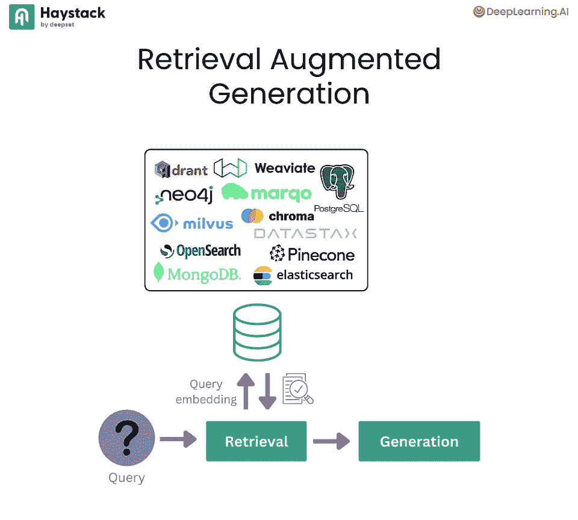

如果我们仔细观察，这就是它的样子。我们有一个查询，我们有一个数据库，我们还有一个指令。通常，我们在问答的背景下谈论检索增强生成。例如，我们的指令或提示可以是给定文档，回答问题。我们首先有检索步骤。

在那里我们检索最相关的文档。然后我们用文档的内容以及问题来扩充我们的提示。

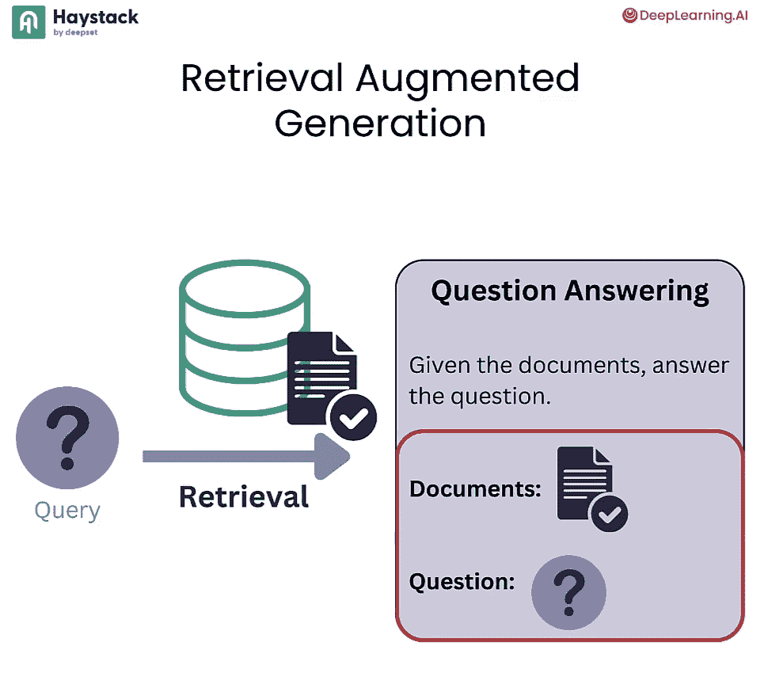

最后一步是生成步骤。生成步骤使用这个扩充后的提示来生成一个答案。

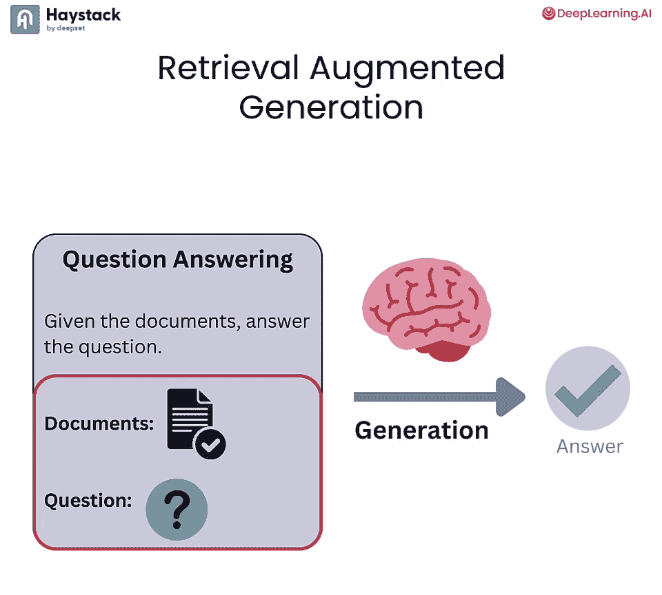

检索可以通过多种方式发生。最常见的检索步骤发生在嵌入检索或语义搜索中，我们为，查询创建嵌入，然后将该嵌入与数据库中我们所有文档的，嵌入进行比较，并根据语义相似性检索最相关的那些。

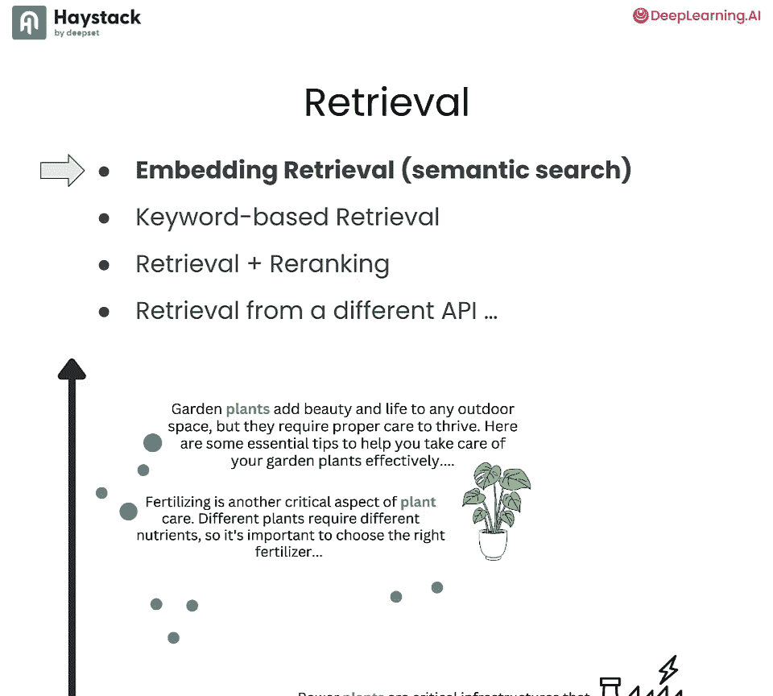

在 Haystack 中，该管道看起来有点像这样。我们有一个针对查询的嵌入器。然后我们有一个嵌入检索器。然后我们有一个提示构建器，我们将在实验室中看到。

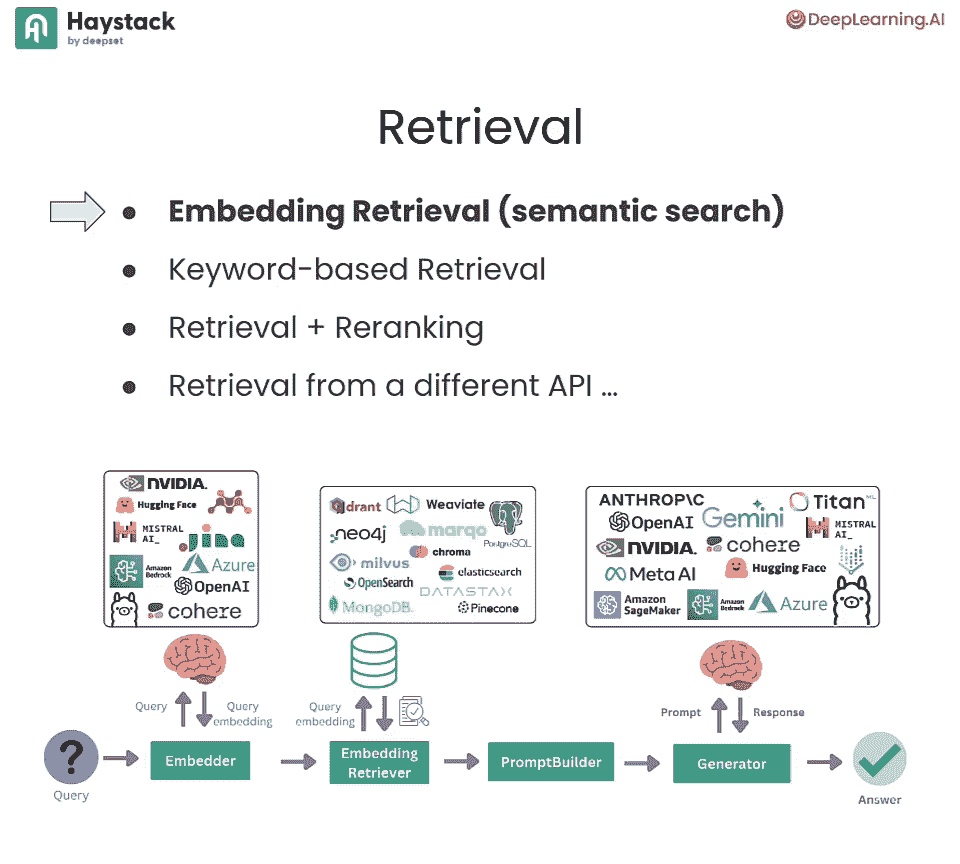

最后，我们有一个生成器。然而，检索步骤也可以通过基于关键字的检索，如 BM25 来。

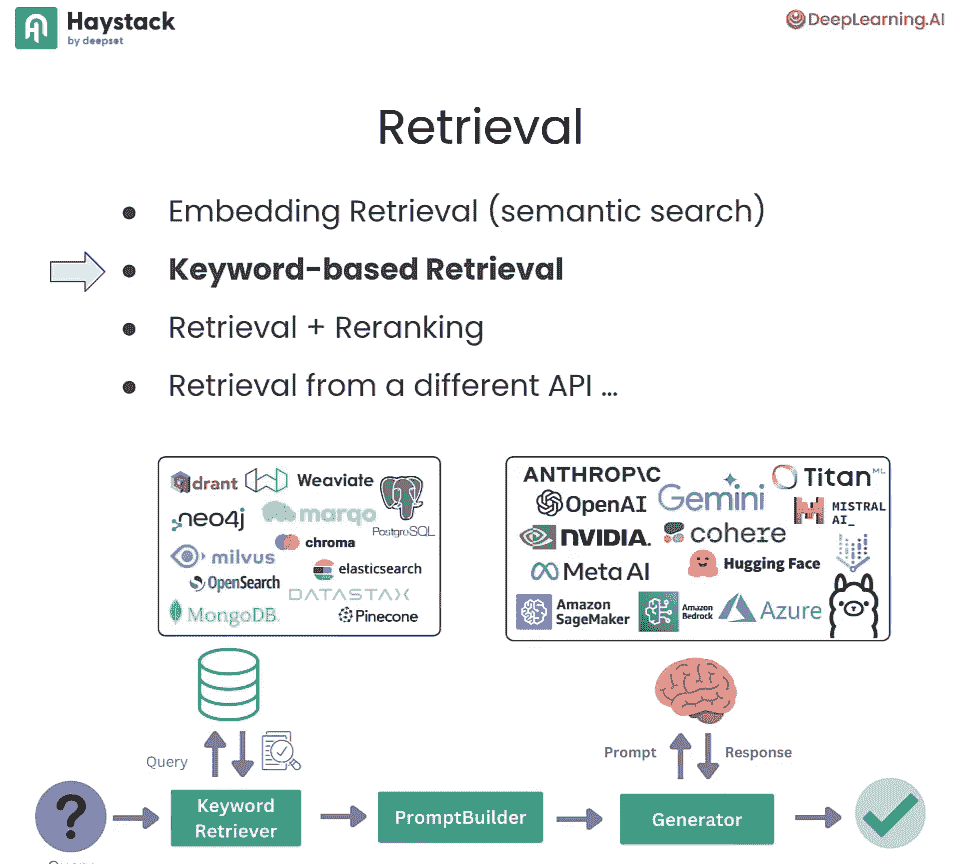

发生。有时，你会看到有检索后接着重新排序。我想提到的最后一件事是，通常在检索增强生成的背景下，检索实际上是通过一个完全独立的 API 发生的。例如，我们可能从网络或 Slack 或电子邮件等中检索数据。

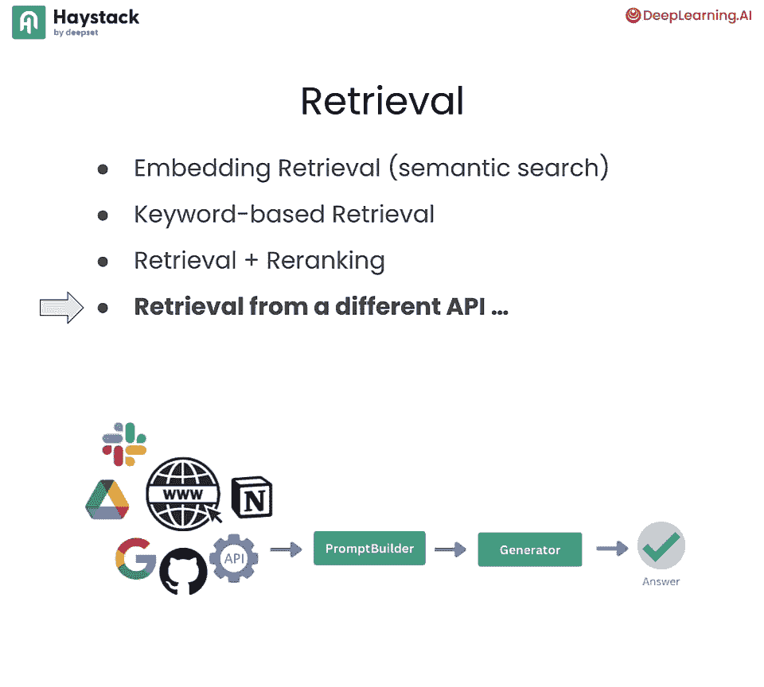

。我们将在接下来的一个实验室中查看这个。在这个实验室中，我们将构建两种类型的管道，一个索引编，制管道和一个 RAG 管道。索引编制管道通常进行清理、分割，然后将文档嵌入数据，库。但对于这个实验室。

我们将使用网络，所以我们将获取 URL， 的内容，转换它们并嵌入它们。我们将使用短网站，所以我们实际上将跳过分割步骤。

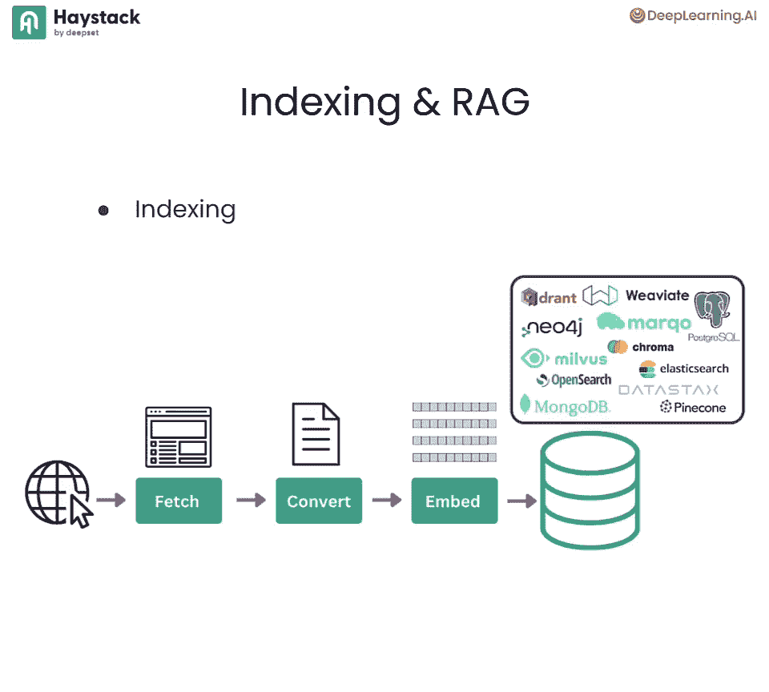

最后，我们将构建一个检索增强生成管道。

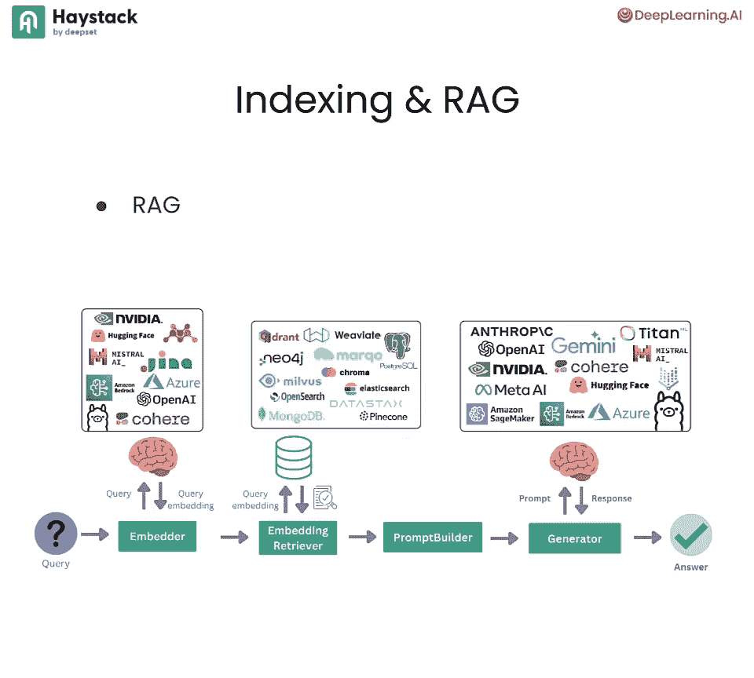

让我们在代码中看看所有这些。好吧，让我们首先构建和自定义一个检索增强生成管道。首先，让我们从抑制警告并再次加载我们的环境变量开始，接下来，我们将导入我们在这个实验中将要使用的所有依，赖项。

我们将使用不同的嵌入器，所以这里有很多事情要做。这里有很多导入，因为我们将构建不同类型的管道。我们要改变的一件事是，这次对于嵌入，我们将使用科赫尔。

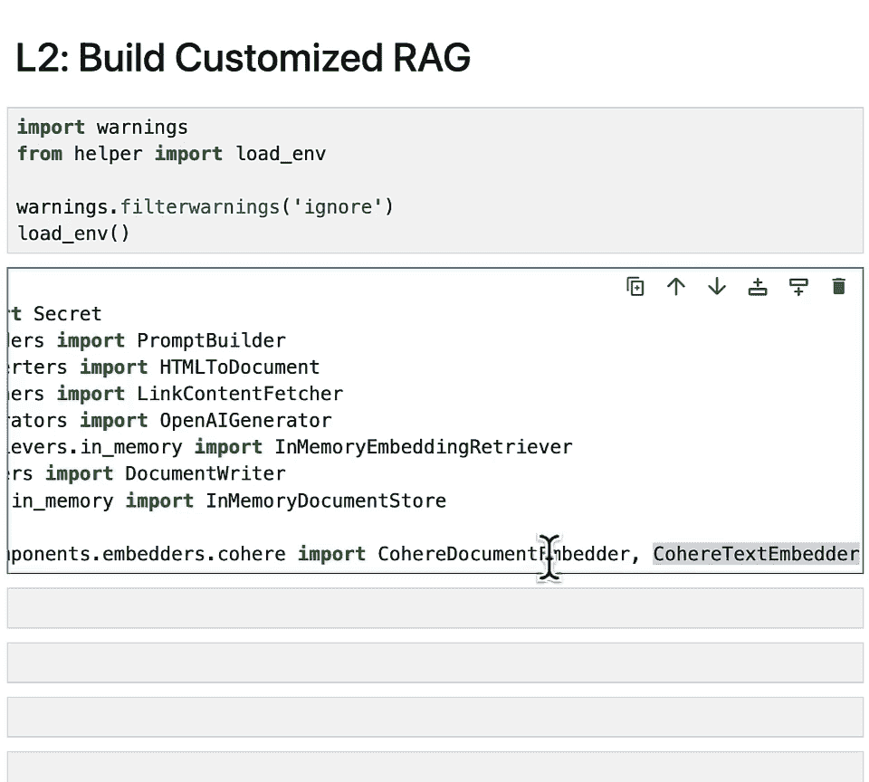

文档嵌入器和文本嵌入器。一些海斯塔克组件作为集成出现，所以在这种情况下，我们，将从海斯塔克集成中导入，并且我们将为科赫尔导入嵌入。

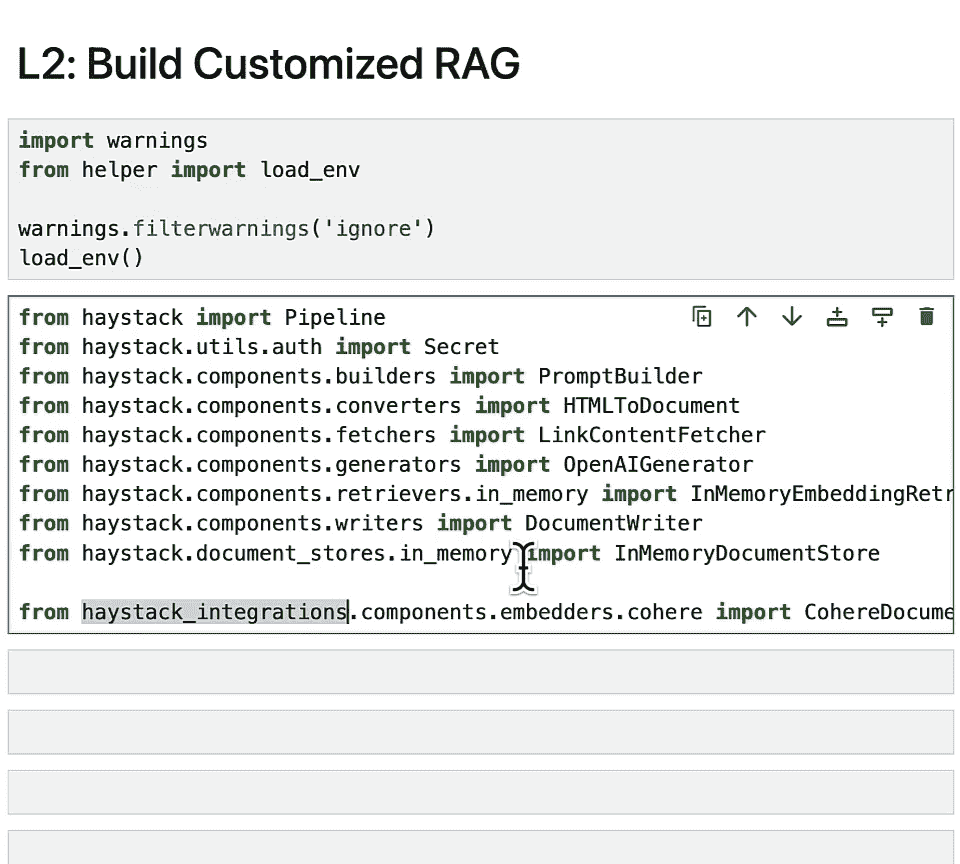

。让我们从索引文档开始。对于这个实验，我们正在改变索引文档的方式。以前，你已经将 txt 文件索引到你的内存文档存储中。这次，我们将使用一个称为链接内容获取器的组件。我们也会稍微作弊一下。

因为我们将使用没有太多数据的 ，URL，所以你可以在这里跳过文档分割步骤，但如果你愿意，你也可以添加它。让我们首先初始化我们的文档存储。再次，我们使用内存文档存储，然后让我们初始化我们将要。

使用的所有组件。首先，我们将使用能够获取 URL 内容的链接内容获取器。然后我们使用一个特殊的转换器，HTML 转文档，它能够将，这些 URL 的内容转换为海斯塔克可以理解的格式，所以它。

将把它们转换为海斯塔克文档。接下来，让我们使用科赫尔文档嵌入器。为此，我选择了嵌入英语 v3 模型。如果你愿意，你也可以改变这个。最后，我们使用我们可靠的文档写入器。接下来。

你将把这些组件添加到你的管道中并给这些组件，命名，最后，我们将连接这些组件。让我们首先将获取器连接到转换器。获取器输出流，转换器期望源，所以要非常清楚这一点。最后，让我们也连接其他组件。

现在我们有一个完整的索引，管道，能够获取 URL 的内容，用科赫尔嵌入模型嵌入它们，并将它们写入内存文档存储。

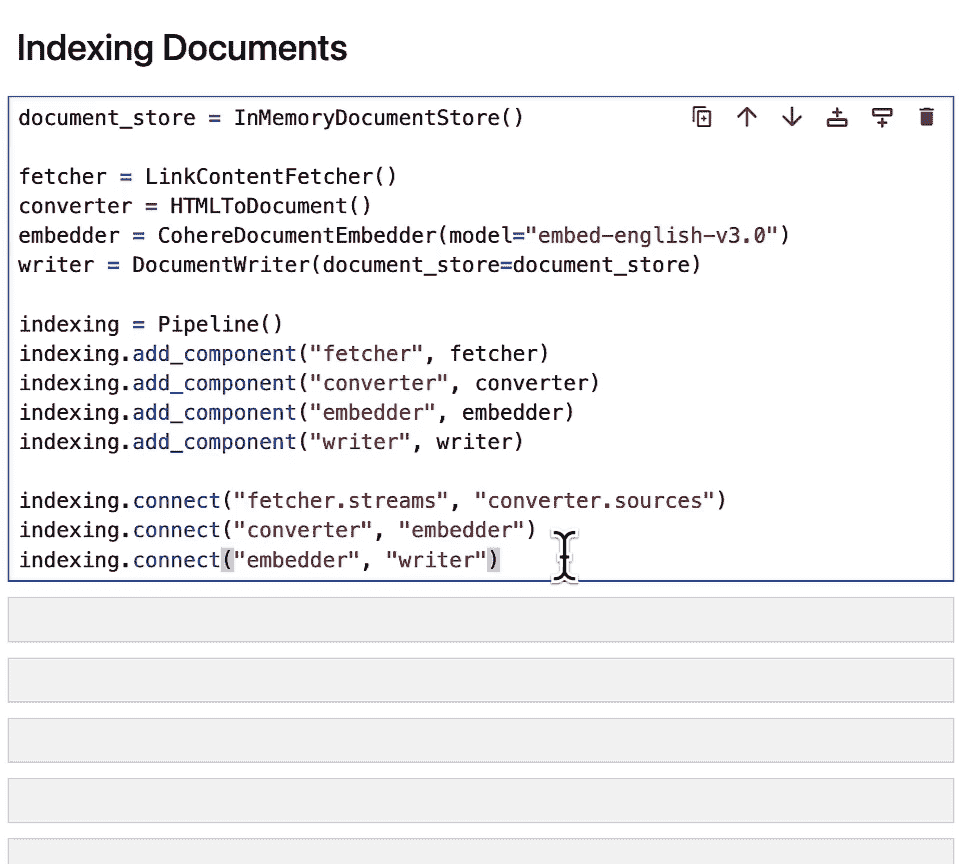

在我们运行我们的索引管道之前，我们也可以观察管道是。

什么样子。我们可以看到我们管道中的第一个组件是提取器，它期望，的是统一资源定位符，所以我们知道我们需要为提取器提。

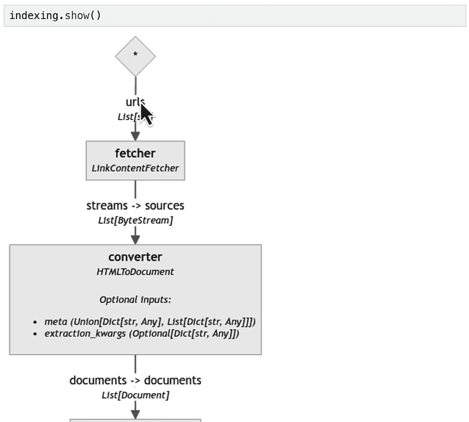

供统一资源定位符来运行这个管道。现在我们可以运行我们的索引管道。为此，我从海斯塔克网站选择了四个统一资源定位符。所有这些都是相当短的页面。你可以改变这个，但要确保如果内容相当长，你要添加一个。

文档分割器。这里我们有来自海斯塔克集成的四个页面，比如 。

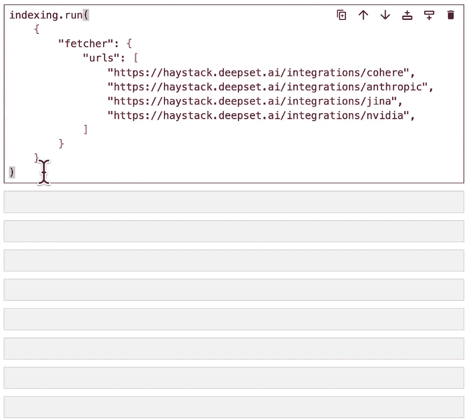

Anthropic、Cohere、Jina 和 NVIDIA。你会注意到你正在计算嵌入，我们也会得到通知说有四个，文档已经写入我们的文档存储。同样，你也可以检查你的文档存储的内容。例如。

我们可以看看索引为 0 的文档。

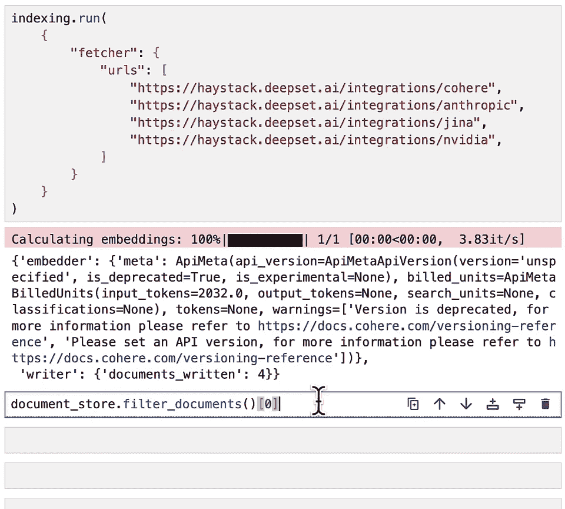

我想在这里强调的几件事是这个文档也带有元数据。我们使用链接内容提取器，所以我们有那些页面的内容作，为文档内容。然而，我们在这个文档对象的元数据中也有统一资源定位，符。我们稍后也会使用这个统一资源定位符。

现在你已经用各种统一资源定位符的内容填充了你的内存，文档存储，我们可以开始构建一个检索增强生成管道。我喜欢这样做的方式是首先决定一个提示。海斯塔克使用金贾进行提示模板化。金贾是一种模板语言，它非常有用。

因为它允许我们对我们，的提示做很多事情，也可以以很多方式修改我们的提示。例如，在这里你会注意到一个循环。我们使用这些模板与一个叫做提示构建器的组件，当我们，有这种类型的提示时。

我们本质上是说文档和查询是我们，提示构建器预期的输入。我们也能够循环遍历这些文档，并特别将那些文档的内容，添加到提示中。金贾允许像条件语句、循环等不同的事情。它也带有一堆默认函数，如截断、小写等。

这是一个非常好的可以使用的工具。现在我们已经决定了我们的第一个提示，即根据提供的上，下文回答问题，我们可以开始构建我们的管道。

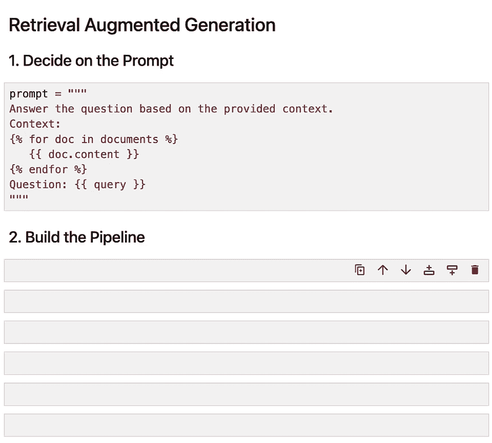

让我们从查询嵌入器开始。我们使用 Cahier 来嵌入文档，所以我们要确保我们对查，询嵌入使用相同的 Cahier 模型。接下来，你将使用内存嵌入检索器。在那之后，我们也将初始化提示构建器。

这个提示构建器基，本上将使用上面的提示作为它的模板。最后，我们需要一个生成器。为此，我将使用带有默认模型的 OpenAI 生成器，也就是 ，GPT-3，但如果你愿意，你也可以改变这个选择。例如。

你可以决定使用 TogetherAI 并用 TogetherAI 提，供一个开源模型，比如，然后它将使用这个模型与 OpenAI ，生成器一起，但我将使用 GPT-3。这完全取决于你。

如果你确实想使用它，别忘了导出 TogetherAI API 密钥，让我们开始初始化我们的管道。我将其称为 RAG，并且再次，我们将所有我们需要的组件添，加到这个管道中。最后，让我们也连接所有的组件。

就这样。

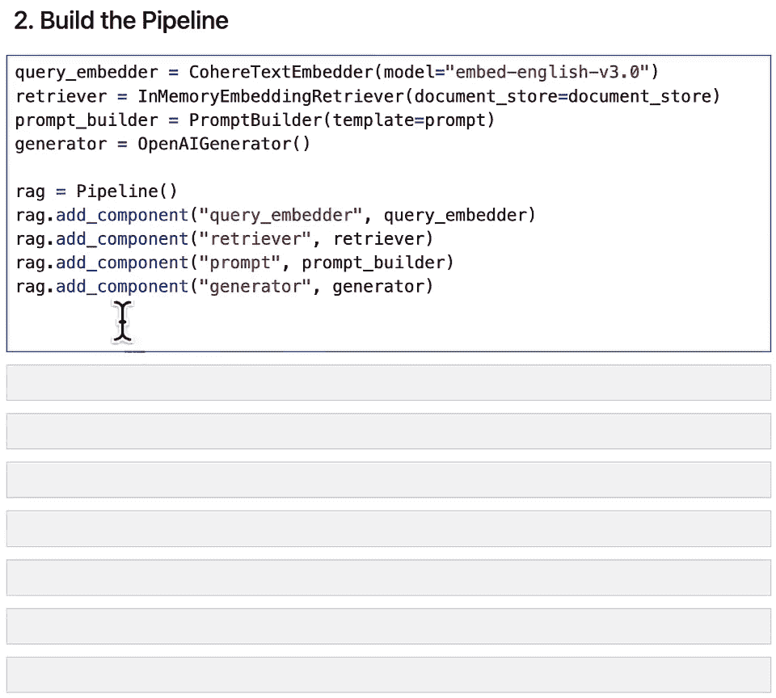

现在我们可以运行我们的检索增强生成管道。

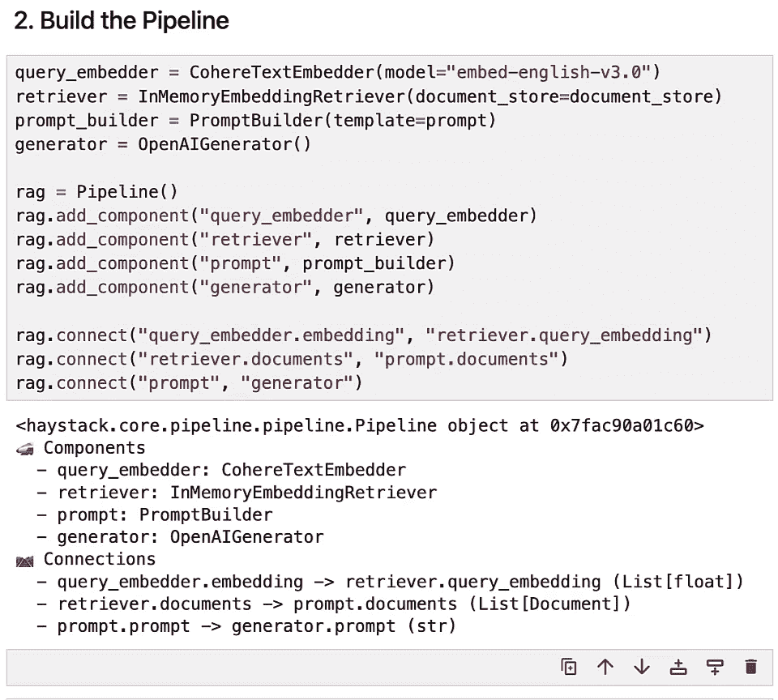

让我们继续并可视化这个管道。

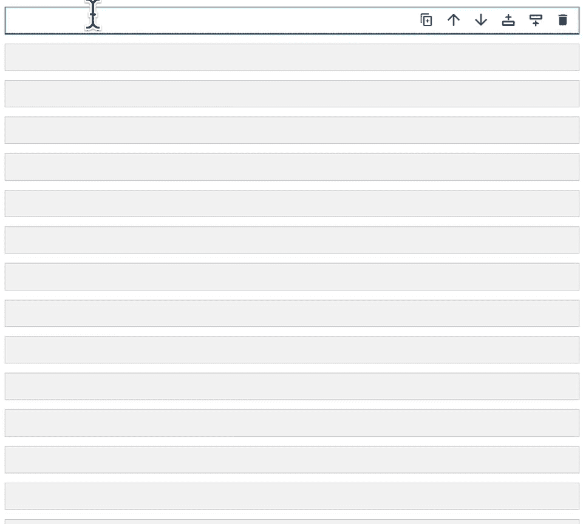

好的，所以再次，我们从一个期望文本作为输入的查询嵌入。

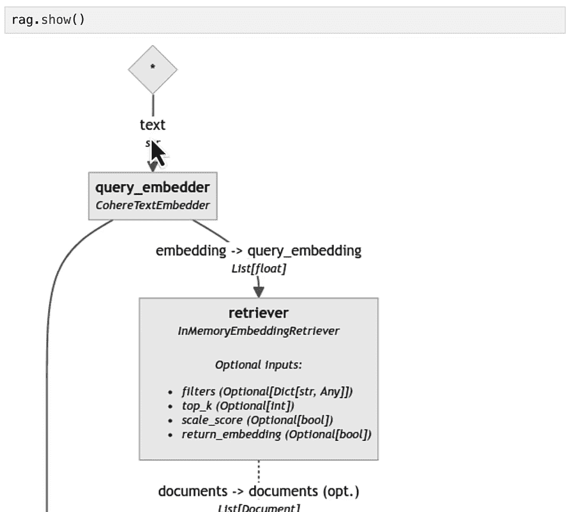

器开始，我们一路向下，生成器产生一个响应，并在回复中。

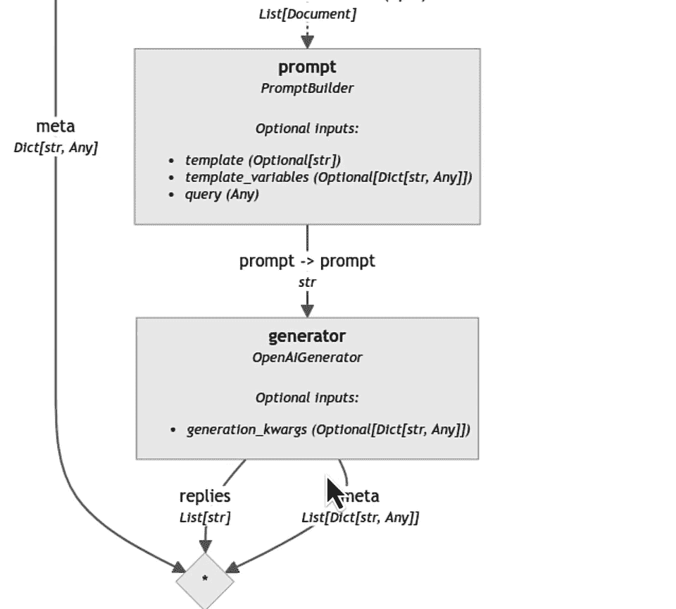

输出这些响应。既然我们知道了这一点，让我们运行我们的管道。让我们从这个问题开始，例如，我如何使用 Cohere 与 ，Haystack 一起？

我们已经知道我们嵌入了一个谈论 Cohere 集成的 URL。你会注意到不仅查询嵌入器期望这个问题，而且我们的提，示也期望这个问题。我也将修改检索器以仅检索一个文档。

你也可以对此进行尝试并改变前 K 个等的数量。最后，让我们打印出生成器的结果。你看到生成器输出了一个叫做回复的东西，所以让我们简，单地打印出来。

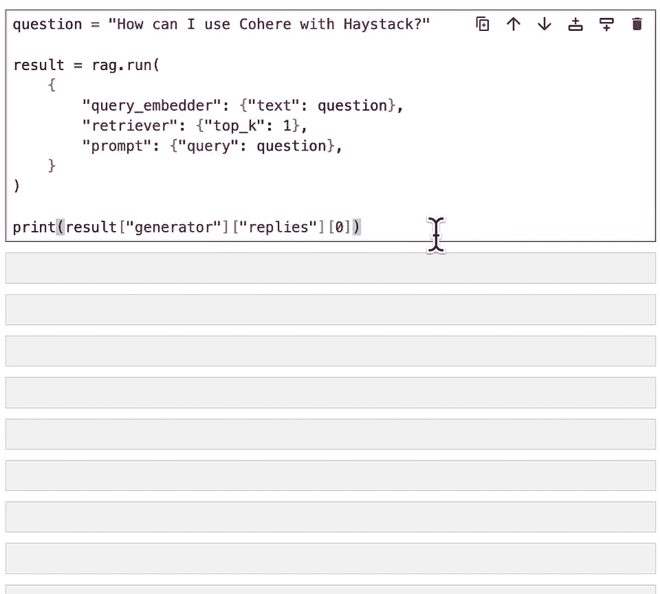

就这样。我们现在有来自 OpenAI GPT-3 的关于我们如何使用 ，Cohere 与 Haystack 的响应。接下来，我们可以开始研究我们如何定制这些 RAG 管道的。

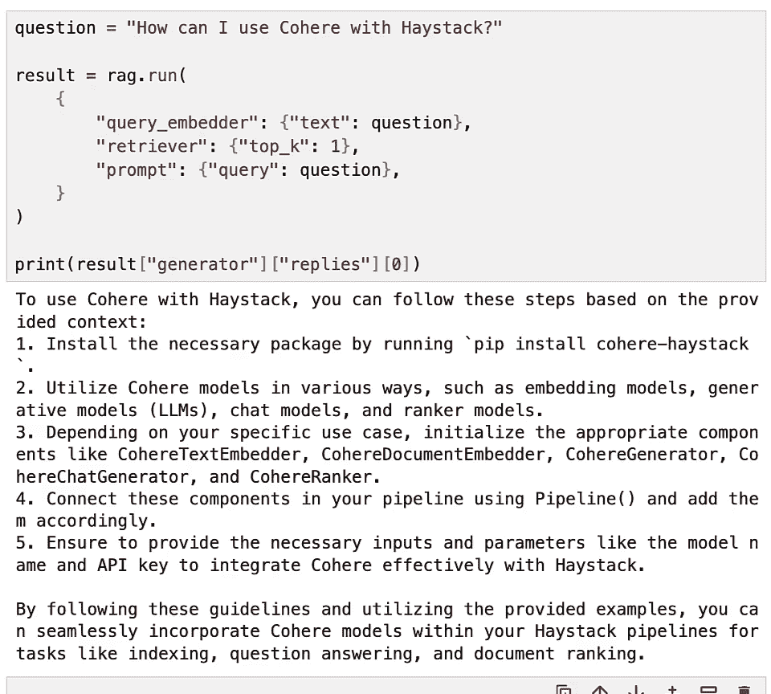

行为。在上面的用例中，你看到了一个非常简单的问答提示。你也会记得当我们将我们的文档索引到内存文档存储中时，我们强调了 URL 在元数据中。这是因为我们使用了链接内容提取器。

也许我们可以开始定制我们的提示以稍微不同的方式表现，所以对于这种情况，我将从一个提示开始，不仅说你将获得，上下文，后面跟着上下文来自的 URL，而且应该用特定的语，言回答。所以让我们开始编写这个提示。

我们已经说你的答案应该用语言，所以现在我们的提示也，期望语言作为输入。接下来，让我们开始改变添加文档内容的方式。我将创建相同的循环，我们再次添加文档的内容，但我们知。

道元数据在我们的文档对象中且它有 URL。我们也可以为添加到提示中的每个文档添加 URL。最后，让我们以问题结束提示并要求一个答案。现在我们有了这个定制的提示，让我们开始创建和之前完。

全相同的检索增强生成管道。

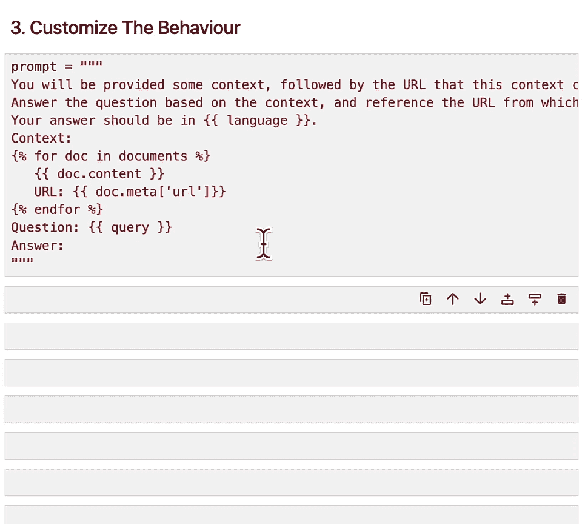

现在唯一不同的是我们的提示生成器正在使用我们的新模，板。现在我们创建了我们的检索增强生成管道，让我们运行这，个相同的检索增强生成管道，但要确保我们也提供了我们，的模型所期望的所有额外输入。

我将用完全相同的问题运行这个管道，但你可以改变这个。

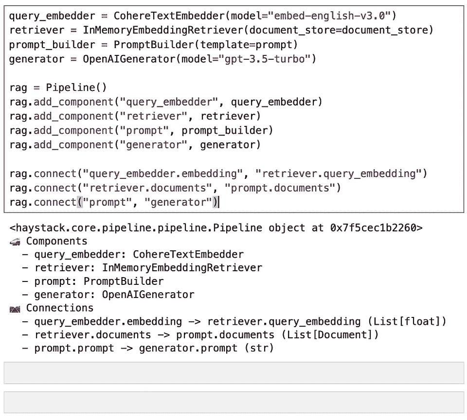

。我还将要求语言为法语，所以我告诉提示应该有一个输入，语言并且我提供了法语。让我们看看开放人工智能用法语回答问题而不是文档的语，言有多好。我们也应该注意到它引用了生成答案的 URL，因为我们的。

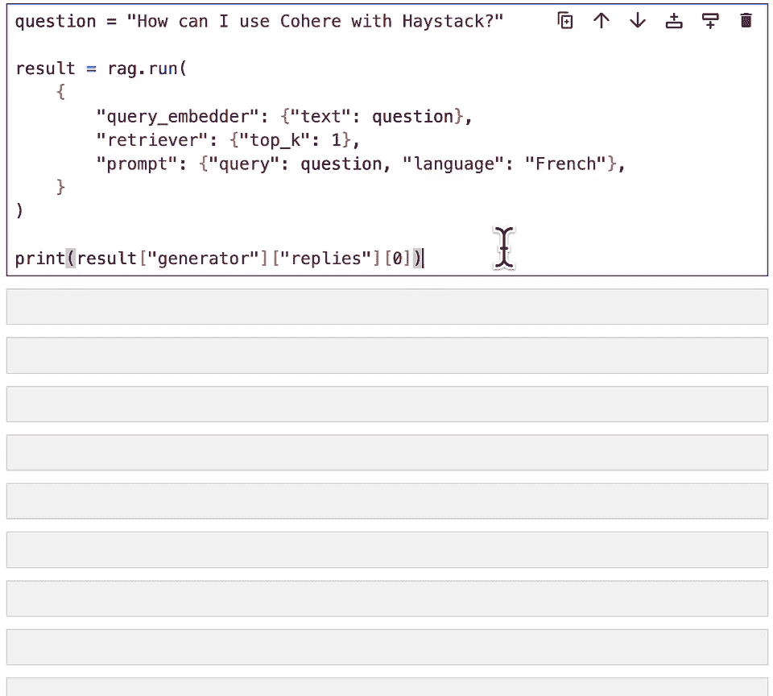

指令也有这个。就是这样。我认为这是正确的法语，你也会注意到 URL 也被引用了。这是因为我们在要求响应之前能够将 URL 专门添加到我，们的提示中。你可以尝试摆弄输入，甚至可以改变提示期望询问的内容。

摆弄检索器的 top K，也尝试询问不同的问题。

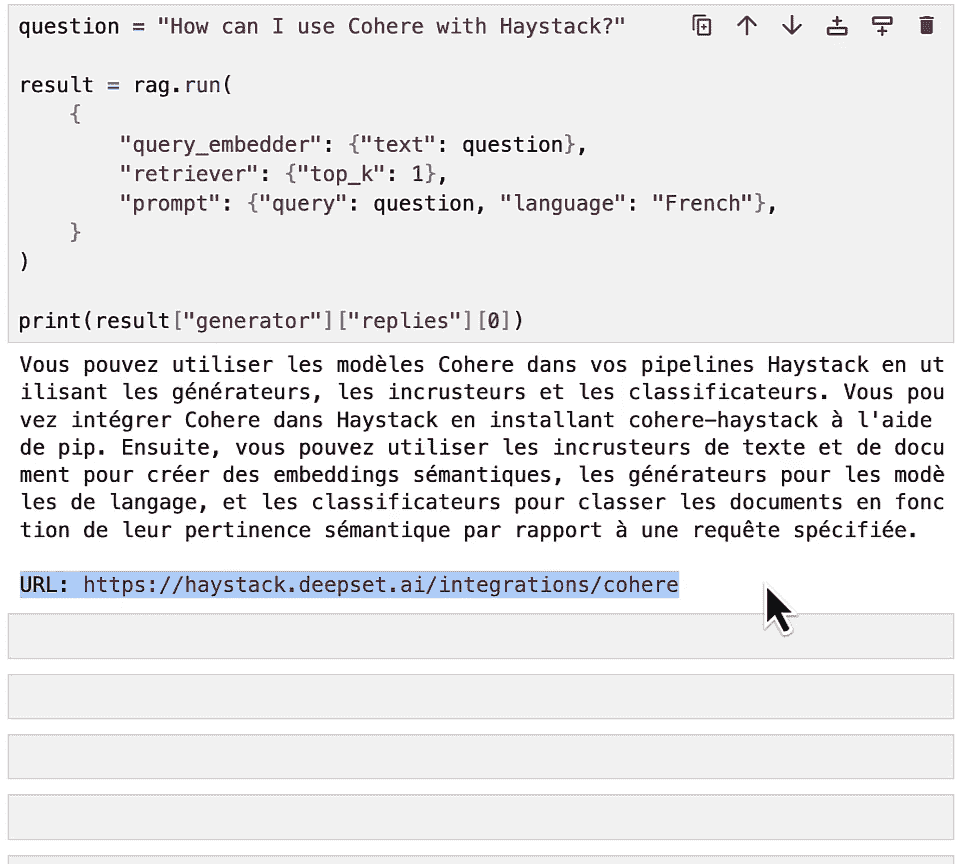

在这节课中，你学习了如何组合 Haystack 组件来创建检，索增强生成管道，但你也学习了如何通过简单地修改提示，来定制这些检索增强生成管道的行为。在下一节课中，我们将看看你如何也能创建你自己的 。

Haystack 组件。

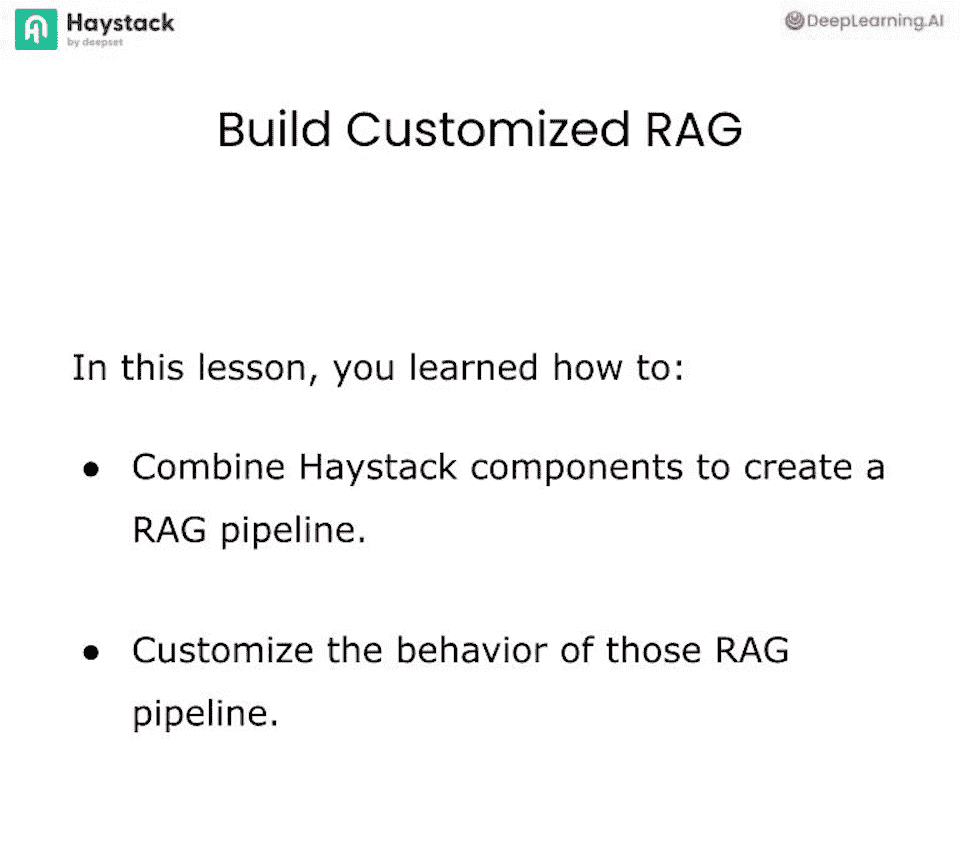