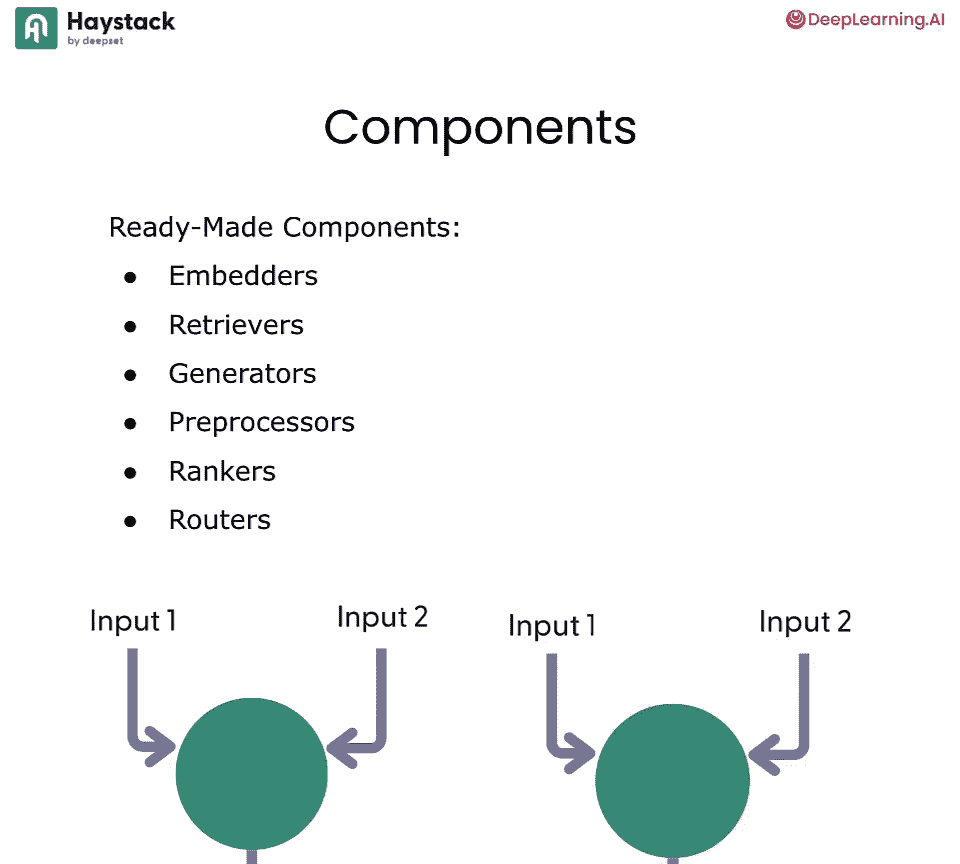
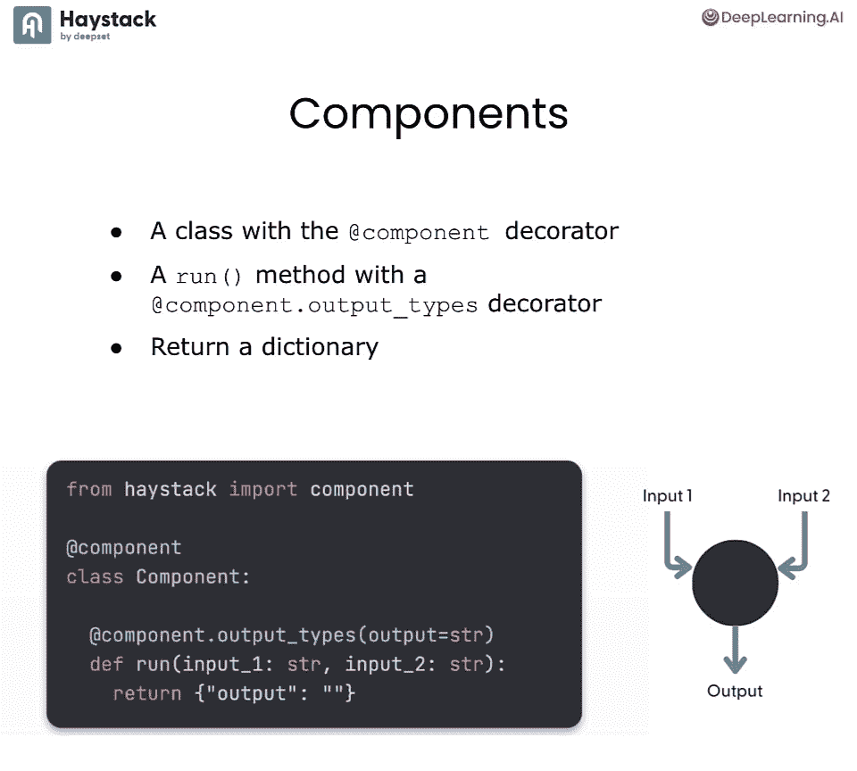
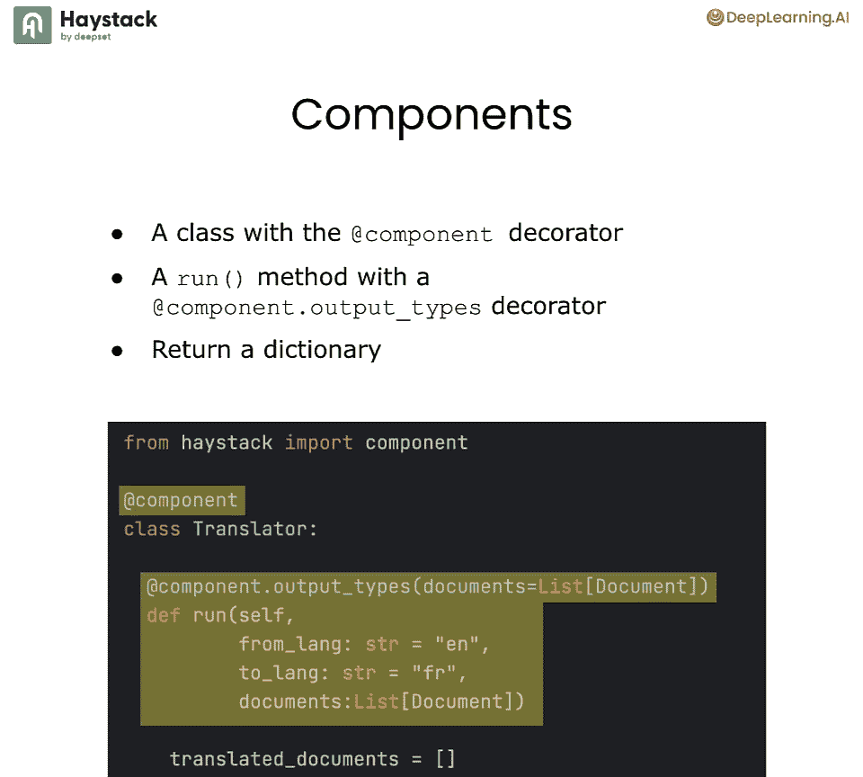
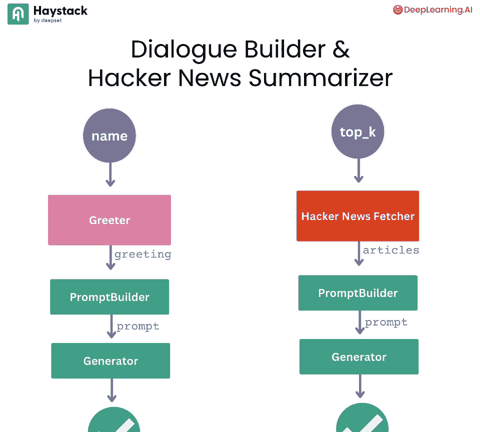
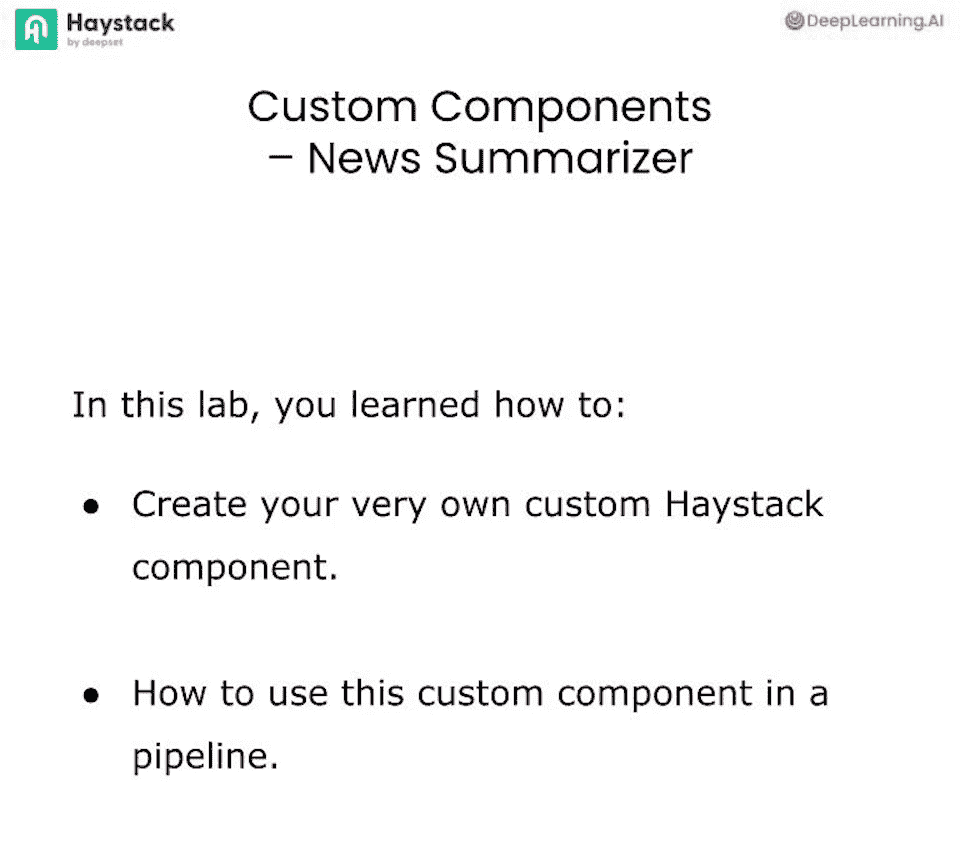

# 吴恩达《使用Haystack构建人工智能应用｜Building AI Applications with Haystack》中英字幕（豆包翻译 - P4：4.L3 Custom Components - News Summarizer - GPT中英字幕课程资源 - BV1ZE4m197dH

在本节课中，你将创建你的第一个海斯塔克组件。自定义组件是海斯塔克体验的重要部分。我们有很多组件，但不可能拥有你需要的一切。让我们深入并构建一个可以获取顶级黑客新闻帖子的组件，好的，我们开始吧。

在这个实验中，我们将构建我们的第一个自定义海斯塔克，组件，并且我们将创建一个新闻摘要器。具体来说，我们将创建一个黑客新闻摘要器。到目前为止，你已经使用了海斯塔克的现成组件，但这次你，将创建你自己的。

让我们回想一下什么是组件。海斯塔克中的一些现成组件是嵌入器、检索器、生成器等，等。它们中的每一个都期望一定数量的输入，并且它们也可以。

产生一定数量的输出。但对于某物成为海斯塔克中的组件，我们实际上只有几个，要求。例如，我们需要一个类的组件装饰器。那个类需要一个运行方法，并且它必须返回一个字典。最后，我们还必须提供组件输出类型。

我们稍后会看到原因。

例如，这里我们有一个翻译组件，这对于海斯塔克来说是一，个非常有效的组件。我们用组件装饰了它，并提供了这个组件正在产生的输出，类型。在这种情况下，我们告诉海斯塔克世界这将产生列表文档，类型的文档。接下来。

我们有一个运行方法。所以我们也说这个组件期望三个输入，从语言，到语言，和，文档。其中一些甚至有默认值。最后，我们返回一个字典。所以在这种情况下，我们告诉海斯塔克世界这返回文档。

如果我们正确地完成了我们的工作，在这种情况下我们应，该返回翻译后的文档。在这个实验中，你将构建两个独立的管道。你将从一个非常非常简单的开始。这个管道将是一个对话构建器，你将使用你自己的问候组，件。

它将以对话的问候开始。接下来，你将构建一个黑客新闻摘要器管道。对于这个管道，你将创建你自己的黑客新闻获取器组件。在实验结束时，你将拥有一个能够提供黑客新闻上顶级 K ，趋势帖子摘要的管道。

再次，让我们从通常的警告抑制开始，并且也让我们加载我，们的环境变量。接下来，让我们导入在这个实验室中将要使用的所有依赖，项。一旦完成，我们就可以开始编码了。让我们从构建我们自己的自定义组件开始。

自定义组件非常有用，不仅因为有时你可能会注意到海斯，塔克没有完全提供你所需要的，而且你可能还想要有自己，的组件来访问特定的 API。在这种情况下，让我们从一个玩具示例开始，我们需要有一，个问候组件。

让我们首先创建一个名为问候器的类，并为其提供组件装，饰器。接下来，我们需要一个运行方法。在这种情况下，我决定我的组件应该期望用户名，并且它应，该返回一个问候，说，你好，用户名。

这里我们只剩下添加输出类型装饰器了。我们必须告诉海斯塔克管道和海斯塔克世界，这输出了一，个叫做问候的东西，并且它是字符串类型。这在以后的管道验证中会用到。我们基本上是在告诉海斯塔克管道。

这个问候组件只能连，接到期望字符串作为输入的东西。现在，让我们看看如何使用这个组件。让我们首先初始化我们的问候器。对于这种情况，我决定构建一个基本上是对话构建器的管，道。让我们开始并创建我们的提示模板。

在这种情况下，我创建了以以下陈述开始的提示模板。你将得到一个对话的开头。使用这个作为戏剧的开头创建一个简短的剧本。对话开头，对话。我知道我的提示生成器将会期望一个叫做对话的东西。

让我们将这个模板添加到提示生成器中。然后，最后，再次，我将使用带有默认模型（即 GPT-3）的 ，OpenAI 生成器。现在我们可以开始创建对话构建器。首先，你将初始化你的管道。并且，像往常一样。

你将开始添加你的组件。现在，在这个管道中与以前的管道略有不同的是你如何将，你的问候器连接到提示生成器。你的问候器输出一个叫做问候的东西，这是一个字符串。而你的提示生成器期望一个叫做对话的东西。

所以我们可以从对话的一个问候开始。接下来，让我们简单地将提示连接到大型语言模型。就这样。再次，让我们展示我们的管道，只是为了确保我们得到了我，们期望的正确管道。太好了，现在我们看到问候者是第一个组件。

我们期待用户，名。所以如果一切顺利，我们应该能够用像特瓦纳这样的用户，名运行这个管道。希望我们能得到一个以“你好，特瓦纳”开头的对话。让我们运行我们的对话构建器并将输出分配给对话。

并且让我们也打印出对话本身。就是这样。我们有一个简短的戏剧，有两个角色，玛丽和特瓦纳。玛丽以“你好，特瓦纳”这句话开头。你可以在这里尝试更改用户名。希望你会得到一些以你的名字或其他人的名字开头的对话。

现在你已经看到了如何创建你自己的海斯塔克组件，以及，如何将其添加到完整的管道中，让我们开始构建一个更复，杂的组件，也许更类似于你在现实世界中看到的。对于这个用例，我们将构建一个用于黑客新闻摘要的组件。

所以我们将构建一个叫做黑客新闻获取器的组件。我们可以通过一个应用程序编程接口访问当前流行的黑客，新闻帖子，就像这样。如果你愿意，你也可以从询问流行帖子改为最新帖子。在黑客新闻上有各种各样的事情。

比如新帖子，问黑客新闻，等等。这是在询问最流行的帖子。但如果你愿意，例如，你可以把这个改为新故事。新故事变化更频繁，顶级故事变化不那么频繁。我将使用顶级故事。这个请求得到各种顶级故事。例如。

我们现在可以看看当前的顶级故事。重要的是要注意，你会看到与我看到的不同的内容，因为你，将在不同的日子运行这个。好的，你会注意到这个故事有一个网址。大多数情况下，黑客新闻有故事的网址。但在某些情况下。

你会注意到这实际上是文本，而不是网址，当你运行这个时，你应该注意当前哪些新故事是流行的，这，可能需要你进行一些编辑或更改你的组件，如果你愿意。好的，所以让我们从一个最基本的黑客新闻获取器组件开，始。

它基本上什么都不返回。在这种情况下，我们创建了一个黑客新闻获取器类。它期待一个整数作为输入。现在它返回一个空列表。它返回一个叫做文章的东西。这是一个非常有效的海斯塔克组件。但正如你所看到的。

它还没有返回任何东西。那么让我们开始填写这个。我们将从填充文章列表开始。并且我们将使用你之前看到的完全相同的请求。我们现在有一个黑客新闻获取器，但我们正在做一些有点，不同的事情。因为大多数文章都有网址。

我们将添加一个 HTML 转换管，道，这是你在这个类的第二个实验的初始化中看到的东西，接下来，让我们开始构建运行方法。同样，让我们从一个空的文章列表开始。但现在我们将不得不填充这个空的文章列表。

让我们从我们的 API 获取趋势列表。然后让我们要求将前 k 篇文章添加到我们的文章列表中，为此，我将添加一个循环。然后让我们看看循环中有什么。对于前 k 个帖子，我们遍历趋势列表。如果有一个网址。

我们实际上要求我们的 HTML 管道运行，并且我们将内容添加到我们的文章列表中。我在这里还添加了一个额外的语句。正如我提到的，一些黑客新闻帖子没有网址。相反，它们有文本。在这种情况下。

我们只是将该文本的内容添加到我们的文，章列表中。最后，我们可以返回我们的文章。好的，现在我们有我们的黑客新闻获取器。现在让我们尝试单独运行这个黑客新闻获取器。为此，我决定要求前三个趋势黑客新闻帖子。

我将它们分配给结果。并且因为我们知道结果在文章中，让我们打印出来。如你所见，有三个文档。并且它们中的每一个都有网址。并且它们中的每一个也都有那些网址的内容。

我们现在能够在一个完整的海斯塔克管道中使用这个组件，来要求对前趋势黑客新闻帖子的总结。现在我们有我们的黑客新闻获取器并且我们能够获取趋势，帖子，让我们开始创建我们的总结器管道。我将首先创建我的提示模板。

在这个提示模板中，我已经表明我们将提供黑客新闻中的，一些顶级帖子。对于每个帖子，如果可能的话，请提供一个简短的总结。然后最后，我们正在遍历文章并且我们将那些文章的具体，内容添加到我们的提示中。

现在我们有了这个提示模板，我们可以创建我们的提示生，成器。我们也想要我们的获取器。并且再次，我们想要一个大型语言模型。再次，我将使用 GPT-3，但如果你愿意，可以随意更改。让我们创建我们的管道。

我把它叫做总结器管道。并且，我再次把我需要的所有组件添加到我的管道中。最后，让我们开始连接这些组件。我们知道我们创建的抓取器输出文章，我想让它进入提示，文章。最后的连接和往常一样。

我们把提示连接到我们的大型语言模型。就是这样。我们也可以再次展示我们的管道，只是为了确保我们创建，了我们期望看到的管道。所以这个管道从我们的抓取器开始，我们首先期望的是一，个整数。将会抓取那么多文章。

然后我们希望为它们创建总结。让我们运行这个管道，并要求现在获取前三个黑客新闻帖，子的总结。你可能会看到和我看到的完全不同的东西，这是预期的。当你自己运行这个实验时，你会看到当天排名前三的帖子，的总结。

在我们结束这个实验之前，让我们也开始定制这个提示来，做一些稍微不同的事情。你可能还记得链接内容抓取器，我们在我们的自定义组件，中也使用它，它会把网址添加到元数据中。那么为什么不仅要求总结。

还要求帖子来源的网址呢。那么让我们再次开始创建我们的自定义提示。我们在这里唯一要改变的只是把文章的网址也添加到提示，中。对于每一篇帖子，提供一个简短的总结，后面跟着完整帖子，的网址。

我们把网址文章元网址添加到我们的提示中。现在我们只需创建和你之前看到的完全相同的管道，使用，完全相同的组件。在这种情况下唯一不同的是提示构建器使用我们的新提示，模板。现在我们有了我们的自定义提示。

让我们要求总结。在这种情况下，是黑客新闻上的前两篇文章。一旦你运行这个管道，如果一切顺利，你应该会看到你在 ，top K 中要求的那么多总结，后面跟着它们的网址。如果这并不完全如你所期望的那样。

你可以开始考虑是否，应该编辑你的提示使其更加精确。甚至在某些情况下，你可能想要实现自我反思，我们要求语，言模型改进其结果。你将在接下来的实验中看到这样的一个例子。在这个实验中。

你不仅看到了如何创建你自己非常独特的 ，Haystack 组件，还看到了如何在管道中使用它。如果你想访问像我们在这里对黑客新闻所做的不同的应用，程序编程接口，这不仅很有用，而且如果你想访问干草堆尚。

未提供访问的模型提供方，这也可能有用。或者也许只是在一个组件中实现你自己非常独特的行为。这真的很好，因为我们也有社区成员将他们自己的自定义，组件添加到干草堆集成中。所以你可以滚动浏览那些。

看看是否已经有人为你创建了，一个。如果你愿意，你也可以将你自己的自定义组件添加到干草，堆集成中。我会在笔记本中包含一个指向干草堆集成的链接，供你滚，动浏览干草堆社区或深度集创建的集成。在下一个实验中。

我们将看到你的第一个实现分支的干草，堆管道。并且我们将使用分支来实现一个回退机制。

