# 吴恩达《使用Haystack构建人工智能应用｜Building AI Applications with Haystack》中英字幕（豆包翻译 - P6：6.L5 Self-Reflecting Agents with Loops - GPT中英字幕课程资源 - BV1ZE4m197dH

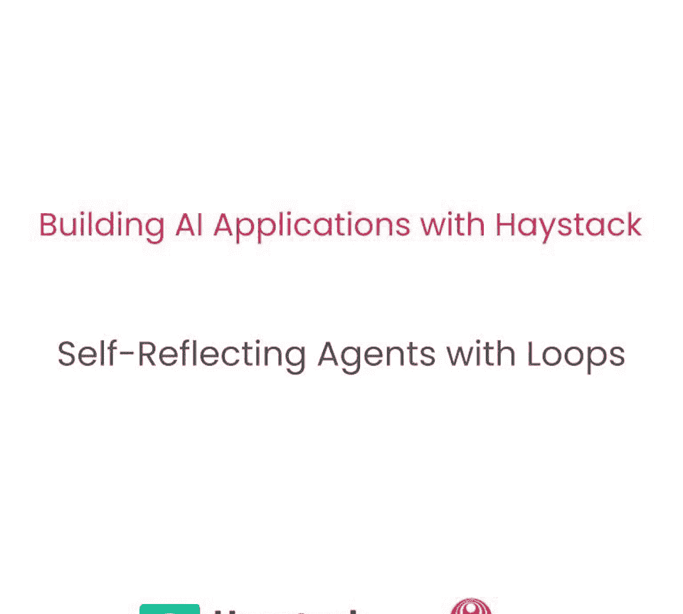

让我们构建我们的第一个智能体管道。在这节课中，你将通过构建一个能够循环的海斯塔克管道，来构建一个非常简单的自我反思智能体。这种循环机制将允许你实现自我反思。作为一个非常简单的例子。

你将让一个大型语言模型从非，结构化文本中生成命名实体，并通过自我反思迭代改进其，响应。让我们深入研究代码。自我反思是一种自我评估和纠正的机制，它允许我们通过，提供更可靠和准确的信息来改进输出。

有了自我反思，我们允许大型语言模型为自己提供反馈以，用于未来的试验。我们可以让模型为自己提供一个成功状态，或者让一个外，部来源这样做，但然后我们让它自己制定具体的反馈。我们甚至可以更进一步。

让大型语言模型反思它可以采取，哪些行动来改进响应，甚至为它提供一些需要注意的标准，然后它可以口头说明哪里出了问题以及在接下来的迭代中，如何改进。

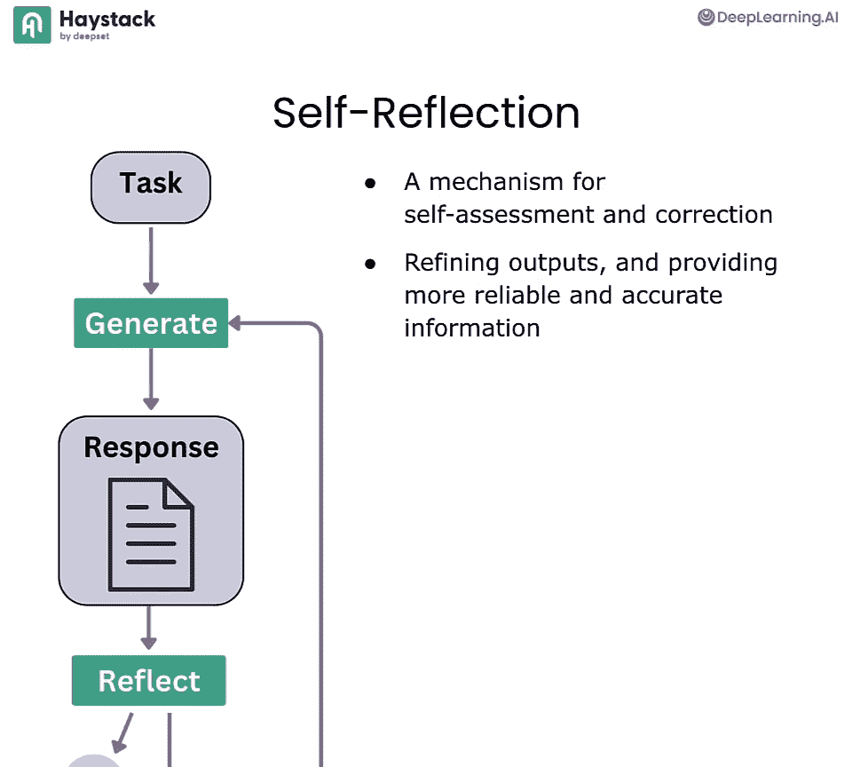

在这个实验中，我们将构建一个非常简单的自我反思智能，体，在那里你将要求一个大型语言模型从非结构化文本中，生成实体。在每次迭代中，大型语言模型要么声明它完成了，所以它对，输出进行了反思并且对结果满意。

要么它将反思并批评关，于提取的实体应该改进的地方。

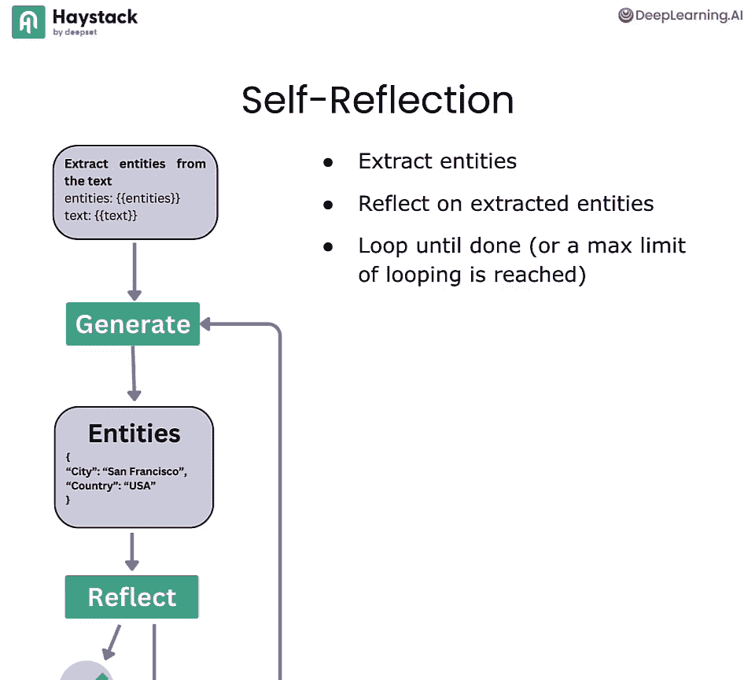

我们将借助自定义组件的可用性来构建这个，并且我们将，创建一个我们称为实体验证器的组件，它将简单地评估生，成器是否决定它完成了。并且直到生成器决定它完成了，它将继续循环。

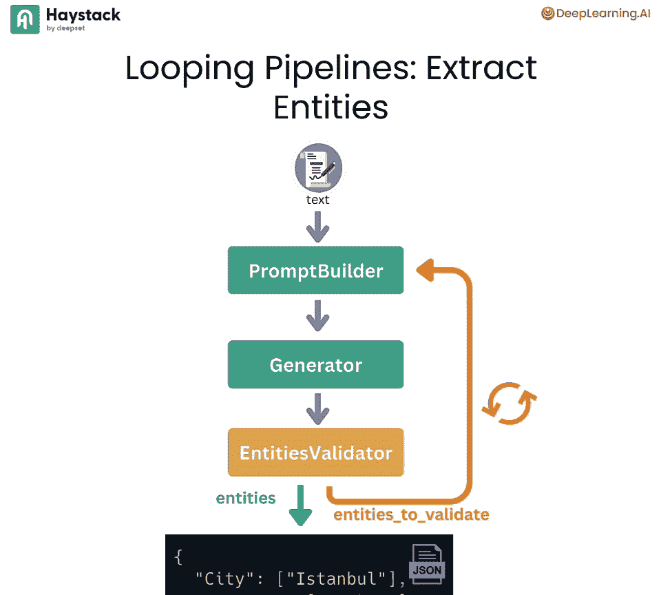

这些类型的循环管道的另一种非常有用的方式是验证输出，例如，我们以 JSON 格式提取数据，但我们希望它符合一定，的模式。在某些情况下，我们可以实现输出验证器，返回无效回复和。

我们从验证器（如派迪克）获得的错误消息，在那里我们可，以验证一个输出是否符合我们的 JSON 模式。让我们看看如何在代码中创建实体生成器。

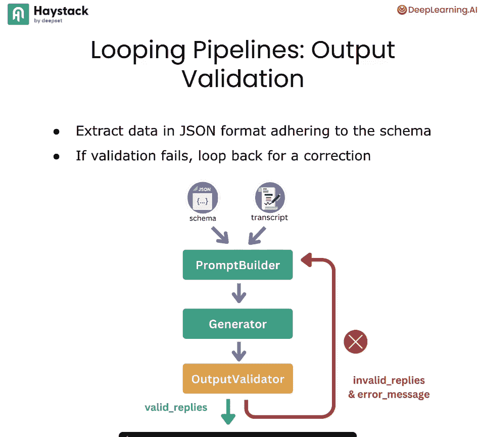

让我们从通常的警告抑制开始，并确保我们加载所有的环，境变量。接下来，让我们导入我们在这节课中将要使用的所有依赖。

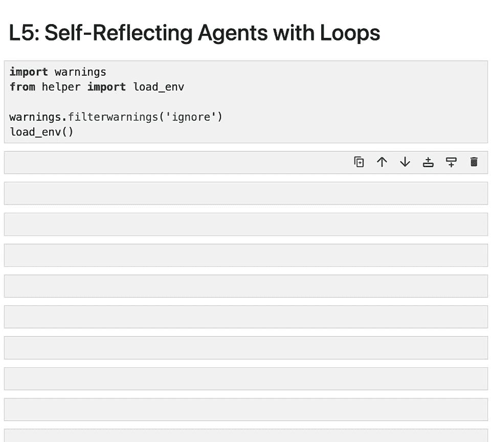

项。作为第一步，我们将首先创建一个非常简单的自定义海斯，塔克组件，我们将称之为实体验证器。让我们看看这个组件做什么。让我们首先创建我们的类。我们称它为实体验证器，让它有一个期望回复的运行方法。

这些回复将来自一个大型语言模型。我们在这里想做的非常非常简单。我们将让这个组件输出两种输出之一。如果回复包含“完成”这个词，我们将输出实体。然而，如果它不包括“完成”，我们将做两件事。

这意味着大型语言模型决定它还没有完成创建实体。我们将把大型语言模型仍在思考的实体用红色打印出来。这将使我们能够轻松看到和可视化循环，但它也将在一个，名为“要验证的实体”的输出中输出实体。

我们要做的最后一件事是确保我们用装饰器为运行方法提。

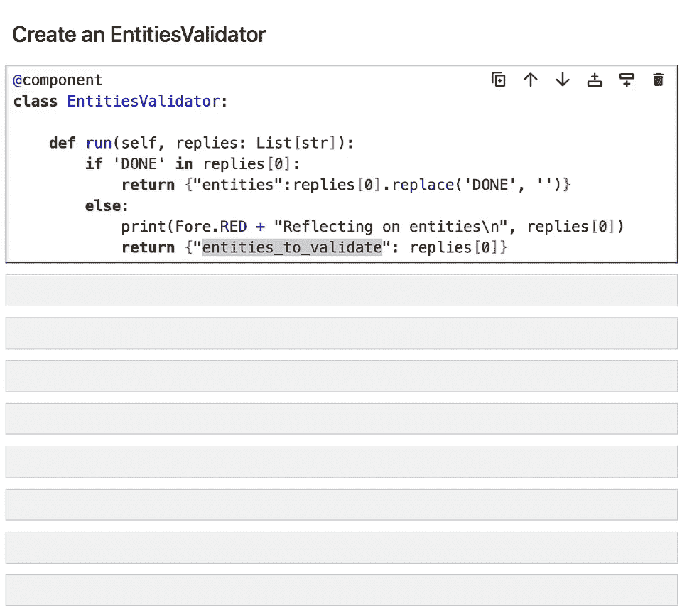

供这些作为输出类型。在这种情况下，你会注意到它有两个输出，“要验证的实体”，和“实体”，两者都是字符串。让我们看看如何使用这样一个组件。例如，让我们创建一个实体验证器。再一次。

让我们复制一个我们可能从大型语言模型得到的，回复。例如，让我们用来自大型语言模型的包含实体名称“特瓦纳，”的回复来运行这个实体验证器。如你所见，在这个回复中没有“完成”这样的东西。

所以希望我们将用红色打印出这些实体并将它们作为“要，验证的实体”返回。太好了。如果我们有一个包含“完成”这个词的回复呢？让我们试试。在这种情况下，实体验证器在“实体”中输出实体。

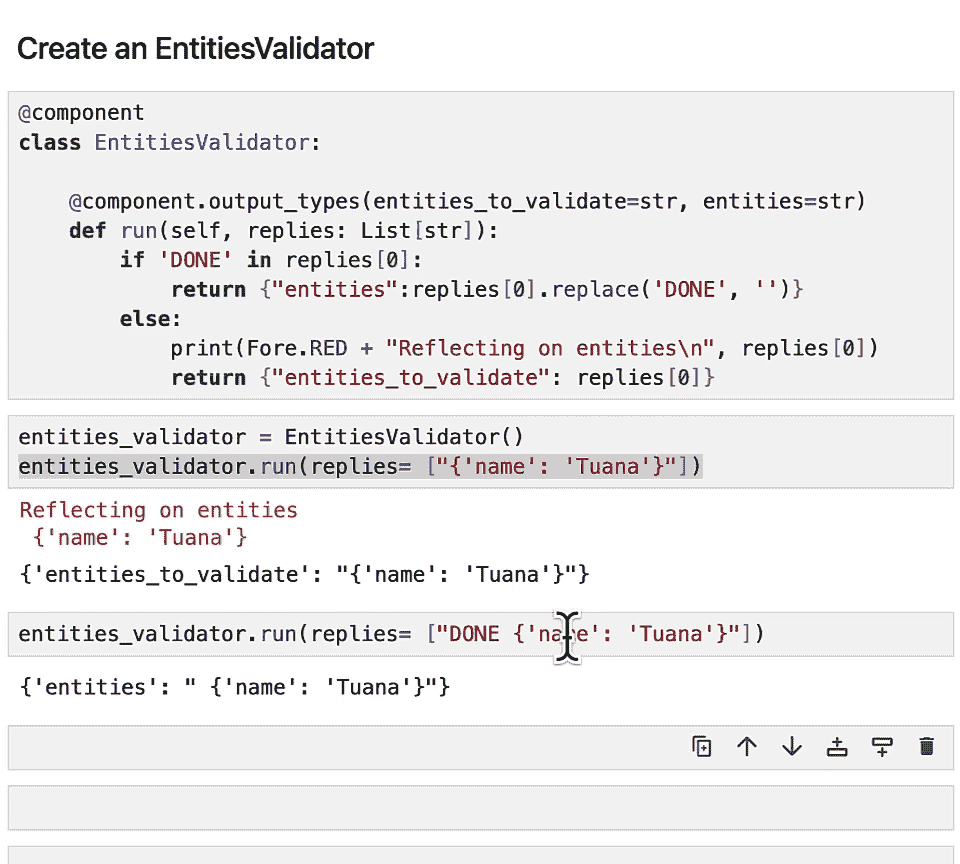

现在让我们开始创建一种特殊类型的提示模板。在这个提示模板中，我们将有一个 if 块。你会明白为什么。让我们首先创建我们想给大型语言模型的第一个指令。

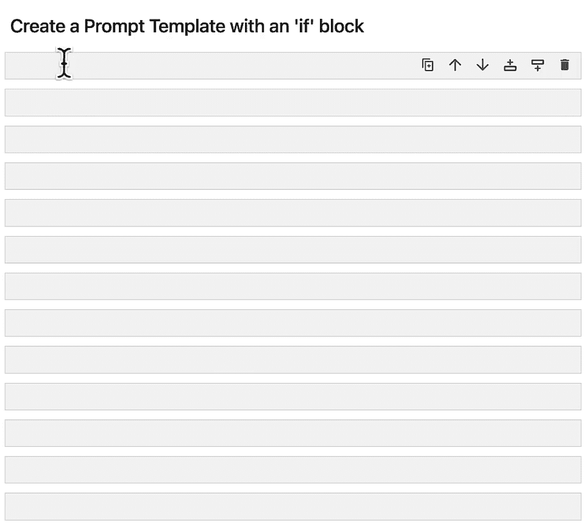

这个模板包括“从以下文本中提取实体”的指令。如你所见，我们的提示构建器将期望一个名为“文本”的输，入。我们也为它提供了我们想从这个文本中提取什么样的实体，的一些信息。实体应以键值对的形式呈现。

我们告诉它提取人、地点和日期。我们还告诉它如果对于某个特定类别没有可能性，返回一，个空列表等等。现在这很好，但它只允许大型语言模型产生一次回复。而且它没有给我们机会在这个回复上进行迭代。

所以我们将使用 Jinja 模板附带的 if else 块功能。那么让我们开始吧。让我们把这个放在我们的 if else 语句的 else 块中。你会看到我们在 if 语句中添加了什么。

现在在 if 语句中，我们想给大型语言模型提供指令，如果，它有要验证的实体。所以我们要给它提供一些它应该注意的例子，以改进它的。

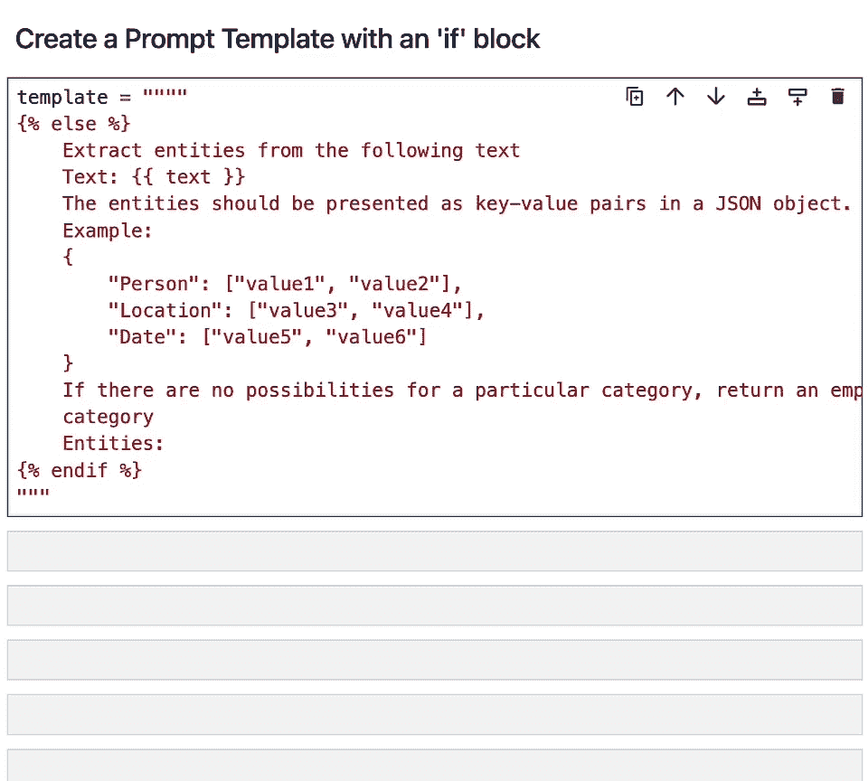

回答。在这种情况下，我们的提示构建器将检查它是否有要验证，的实体作为输入。然后我们将添加更多它可以用来改进其答案的信息。我们再次迭代，这是提供给你的文本和提供的文本。这是你之前提取的实体。

然后我们给它一些要点，关于它可以思考的和可以改进的，这也是我们告诉语言模型如果它认为完成了就可以说我完，成了的地方。这是在这些类型的管道中实现自我反思的一种非常非常简，单的方法。

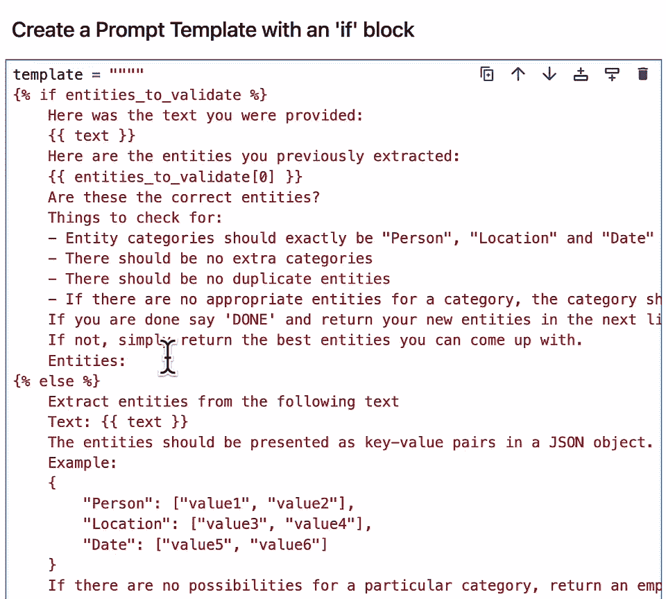

让我们看看这个是如何工作的。现在我们有了能够接受要验证的实体（如果存在）的提示模，板，我们可以开始创建我们的自我反思代理。让我们先创建我们的提示构建器。这个提示构建器将使用我们刚刚创建的模板。

接下来我们想要有我们的生成器。在这种情况下，同样，我将使用带有默认模型的 OpenAI 生，成器。所以它将是 GPT-3。最后，我们希望能够以某种方式使用我们的实体验证器。

这里另一个需要注意的重要事情是，因为这个管道将循环，我们也能够提供我们允许管道拥有的最大循环次数。这允许你确保你不会向像 OpenAI 这样的模型提供商发出，比你想要的更多的请求。在这种情况下。

我们告诉它它最多可以进行 10 次循环。如果语言模型在 10 次循环内无法创建一个它满意的答案，我们的管道将失败。但这也意味着我们不会产生比我们想要的更多的成本。接下来我们要做的是。

我们将简单地将所有这些组件添加，到我们的管道中，但让我们看看我们如何连接它们。所以我们简单地从将我们的提示连接到我们的语言模型开，始。这次我们有点具体。你不需要在每种情况下都提供提示，但如果你愿意。

你可以，然后我们将把这个语言模型的回复提供给我们的实体验证，器。现在实体验证器有来自语言模型的一个响应，它可以评估，并查看语言模型是否认为它完成了。然而，如果它确实有要验证的实体，我们希望这些实体能反。

馈到我们的提示中。注意这里，如果从我们的实体验证器输出中有要验证的实。

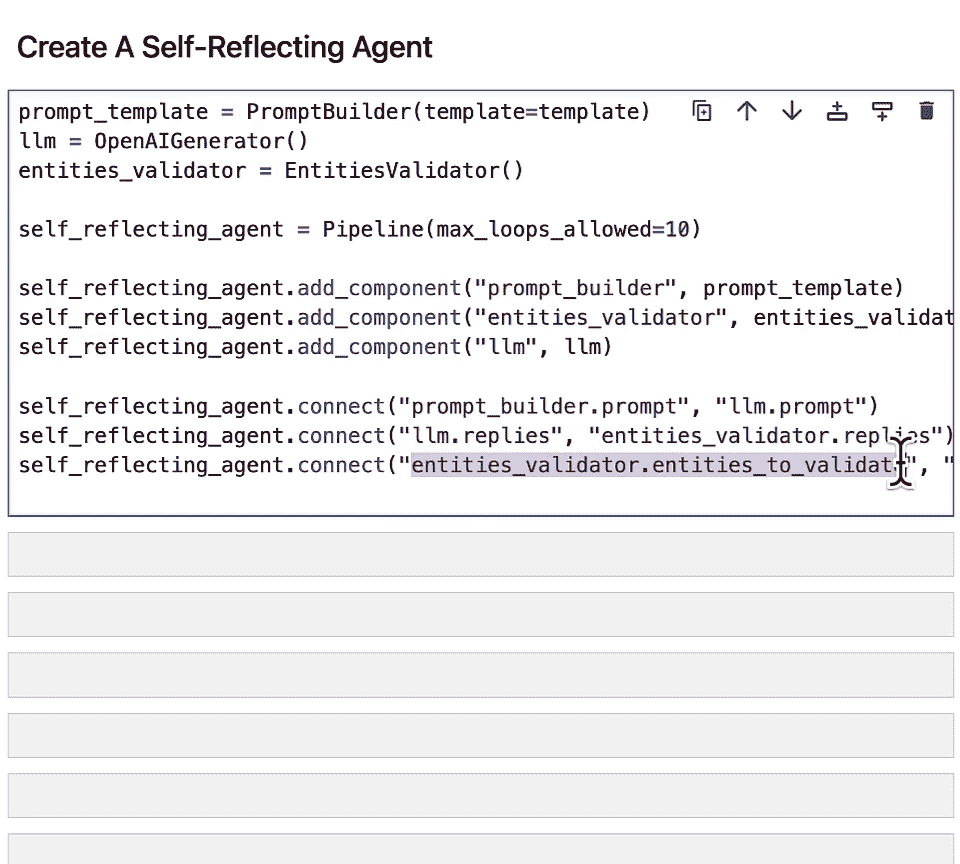

体，它们将被添加到提示构建器要验证的实体中。记得我们提示中的第一个 if 语句是如果有要验证的实体。

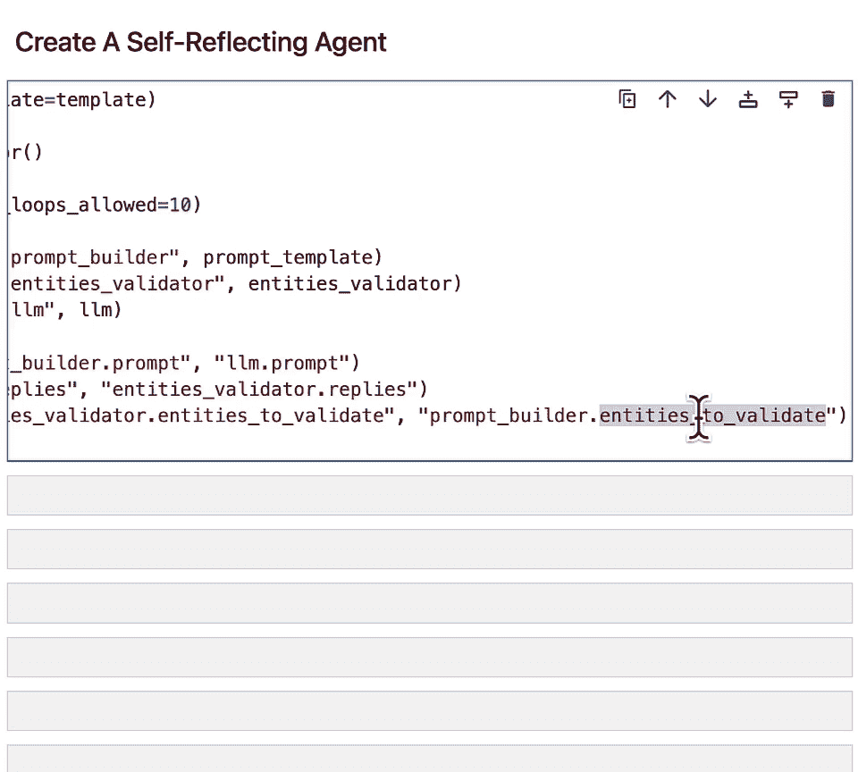

。这就是那个循环发生的地方。现在这是我们的第一个循环管道。

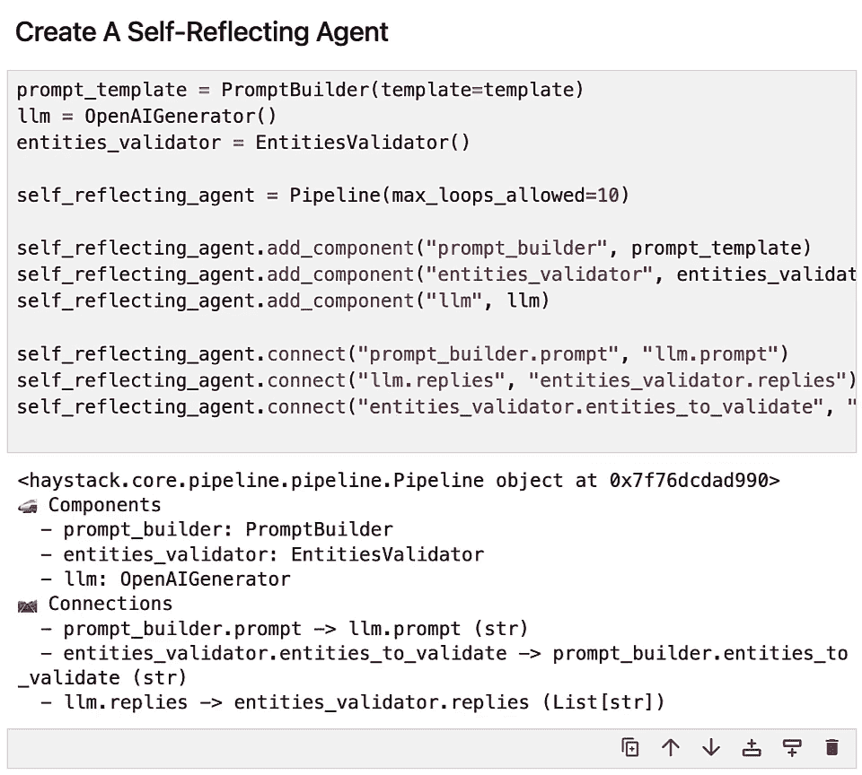

所以，再一次，让我们使用展示工具来看看这里发生了什么，比如说自反代理。show。正如你所看到的，在这种情况下我们注意到了一个循环。我们的提示构建器向我们的大型语言模型提供了一个完整，的提示。

然后该模型将其回复转发给实体验证器。而实体验证器要么用实体回应，要么带着要验证的实体反，馈回来。这个循环会一直持续，直到我们达到 10 次循环或者语言，模型的回复中有“完成”这个词。

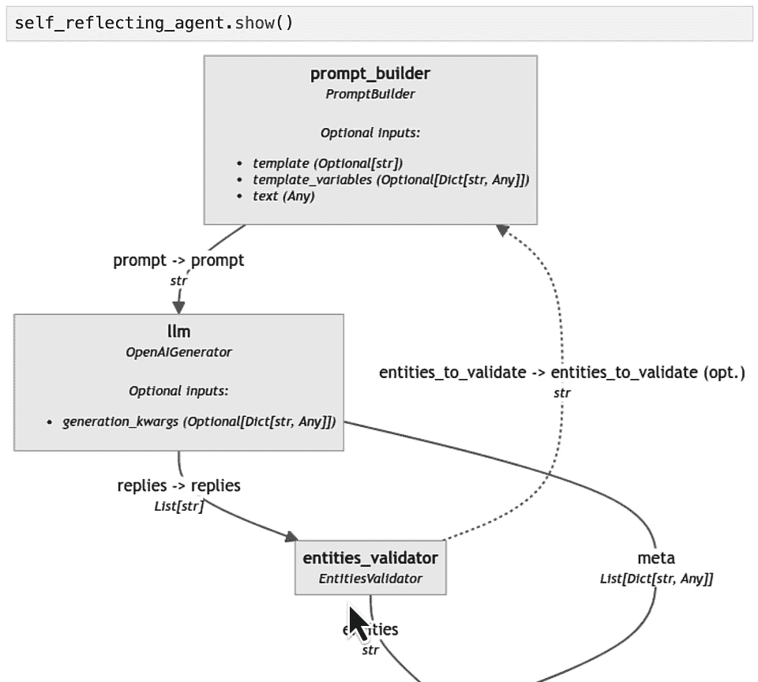

现在我们有了我们的管道，让我们向提示构建器提供一些，文本，看看我们的语言模型是否能生成命名实体。

在这里我提供了一个虚拟文本。是关于伊斯坦布尔，伊斯坦布尔的人口等等。让我们通过向提示构建器提供这个文本来运行我们的自反，代理。我们知道我们的实体验证器会用红色打印出任何仍需验证，的实体。

作为一个额外的步骤，我们也可以在循环完成后用绿色打，印出最终的回复。所以注意这里，每次你看到红色，它仍然在反映那些实体。最终结果将用绿色打印出来。

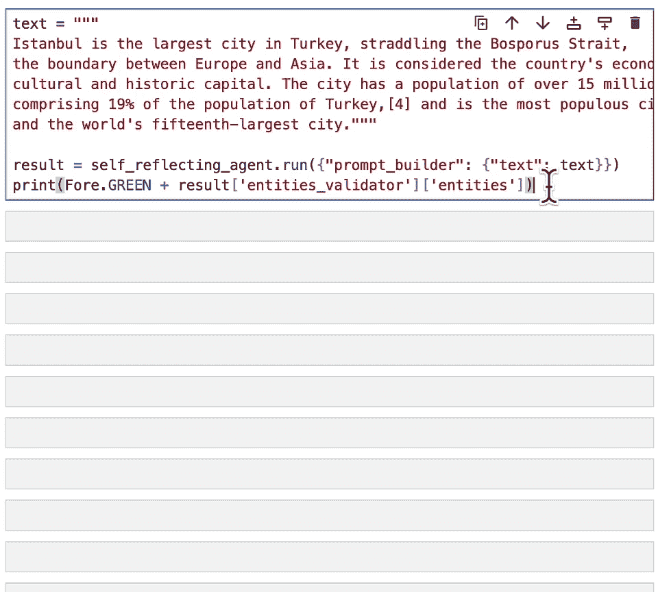

好的。正如你在这里看到的，语言模型第一次创建实体时，有位置，但没有人和日期，即使我们要求包括人和日期，即使没有，要提取的实体。我们要求有一个空列表。然而，在第二次迭代时，当它完成时，它实际上确实创建了。

人和日期作为实体。

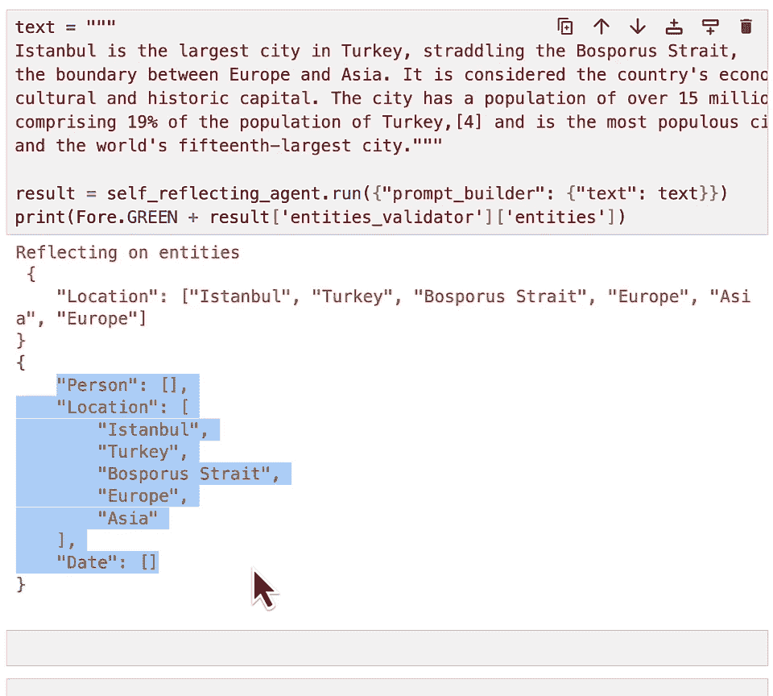

让我们再试一个例子。在这种情况下，我提供了另一段虚拟的文本，但这次是一个。

会议记录。会议包括一些人，有与会议相关的日期等等。再一次，让我们用这个文本作为提示构建器的输入来运行，这个管道。当我们对回复满意时，用绿色打印出来。

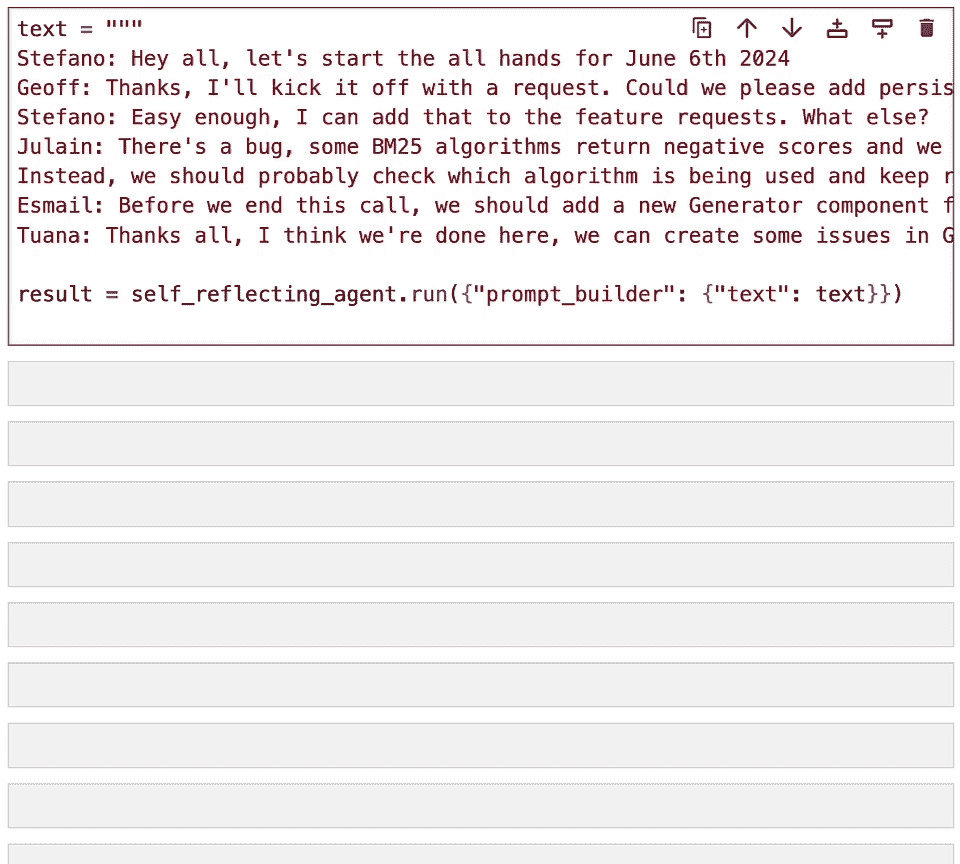

再一次，我们注意到语言模型第一次创建实体时，有人、日，期，但它也有技术。技术不是我们要求它提取的实体之一。然而，在第二次时，我们注意到它提取了人物、地点和日期，这很棒。在这个实验室中。

你学习了如何实现能够循环的管道。在这种情况下，你构建了一个用于自我反思的循环管道。这是一个关于如何实现自我反思的非常简单的例子，但你，可以尝试用不同类型的输入，也可以要求它产生不同类型，的输出。

你不必局限于命名实体。在下一个实验室中，我们将创建一个能够使用函数调用的，聊天代理，并且我们还将使其中一个函数成为海斯塔克聚，合管道。

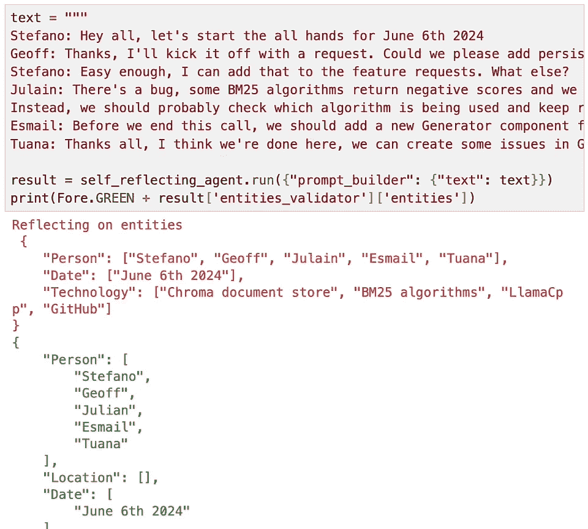