# 吴恩达《使用Haystack构建人工智能应用｜Building AI Applications with Haystack》中英字幕（豆包翻译 - P7：7.L6 Chat Agent with Function Calling - GPT中英字幕课程资源 - BV1ZE4m197dH

函数调用是模型提供商最令人兴奋的发展之一。如果你有多个像 RAC 管道这样的管道，你想将其用作函数，呢？在本节课中，我们将使用 OpenAI 的函数调用能力来创建。

一个可以使用干草堆管道作为工具的聊天代理。让我们看看这是如何进行的。让我们构建我们的第一个可以使用函数调用的聊天代理。

在本节课中，我们将使用我们称之为聊天生成器的组件来，构建，并使用它们来构建聊天代理。有了这些组件，我们处理消息，消息可以来自用户、代理、，系统或函数。我们也可以为这些生成器提供工具。例如，用户问。

马克住在哪里？而生成器简单地回答，我不知道。但是生成器可以配备能够帮助它完成这个过程的工具。这些工具可以是从干草堆管道到不同的应用程序编程接口。

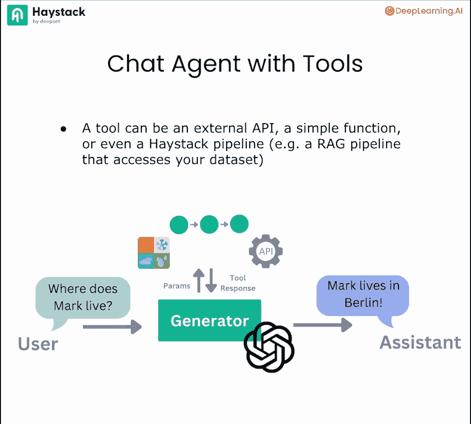

等等任何东西。让我们开始构建我们自己的。让我们从通常的警告抑制开始，并确保加载我们在本节课，中将要使用的所有环境变量。接下来，让我们导入所有的依赖项。

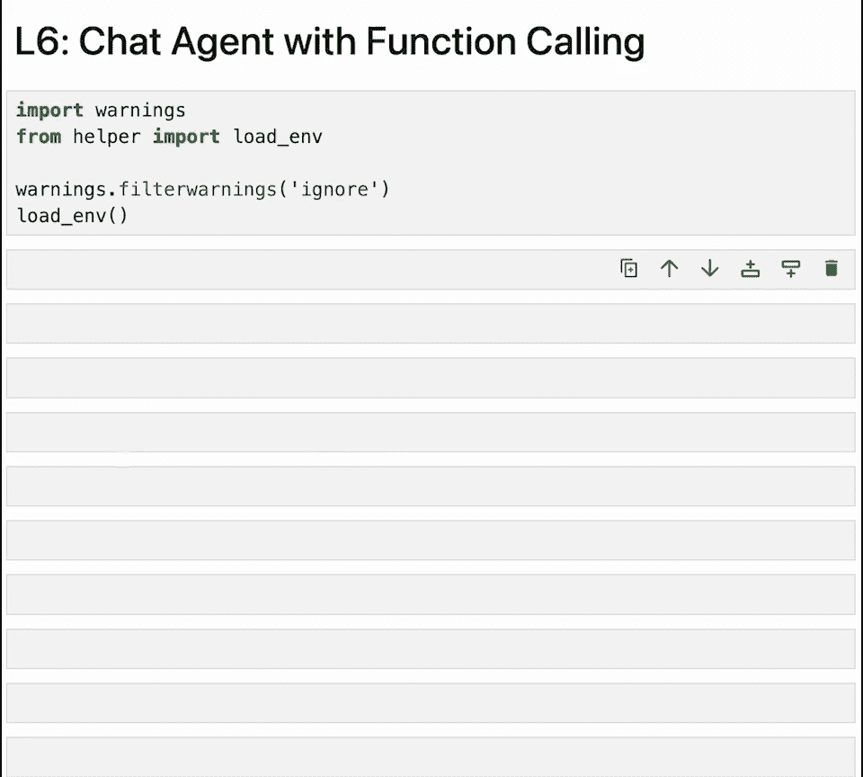

现在我们可以开始创建一个 RAC 管道并将此 RAC 管道作，为一个函数提供。对于这第一部分，我们将创建我们通常的 RAC 管道。并且我们将使用默认的 OpenAI 生成器模型，即 GPT-3。

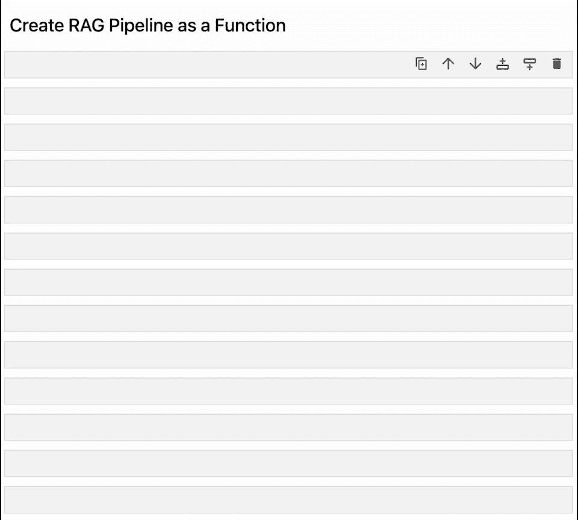

到现在为止，你已经习惯了这些类型的管道。但这里发生的事情，简而言之，就是我们只是要求大型语言，模型对一个查询做出响应。现在我们也将把这个管道包装在一个函数中。

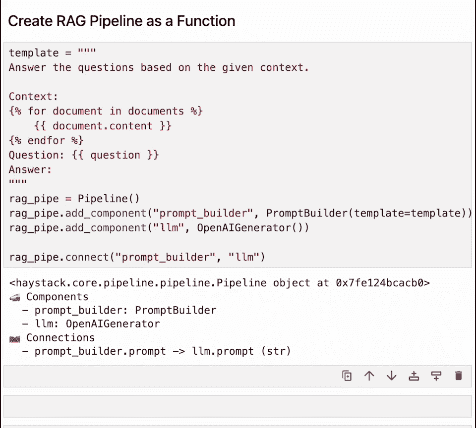

现在我们有了这个管道，让我们定义一个普通的 Python ，函数，我们称之为 RACPipelineFunc。它期望查询。在这个 RAC 管道中，我们将走一个捷径，我们将提供假数。

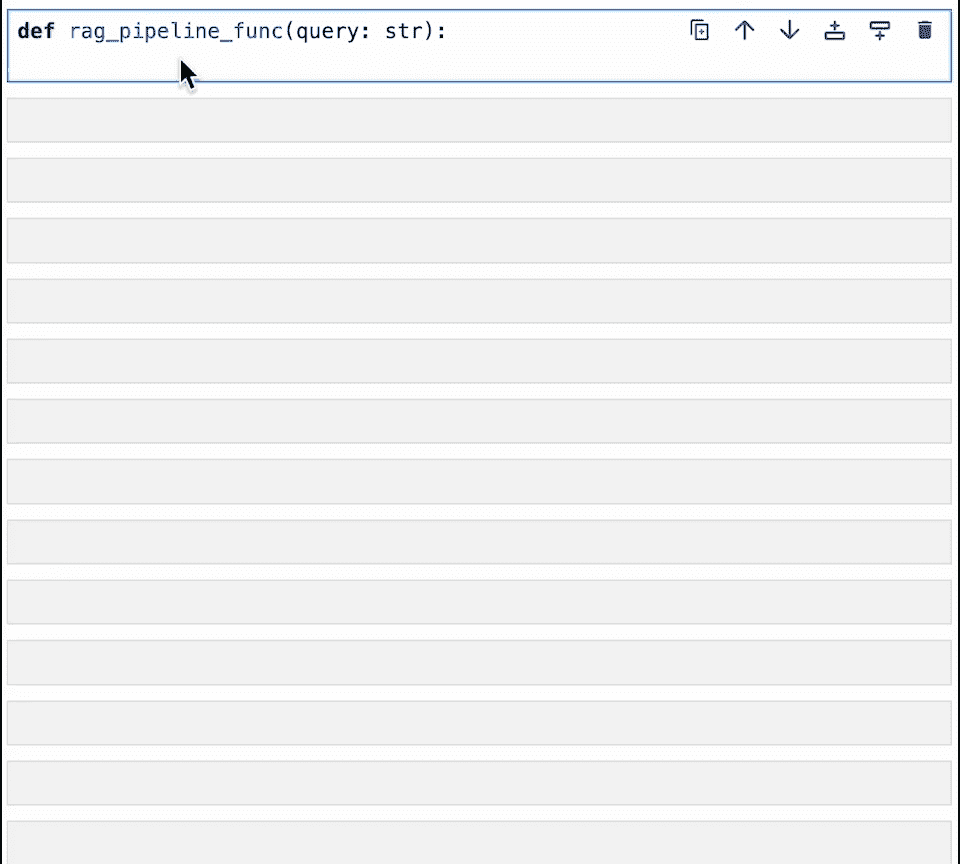

据。所以我们知道这个 RAC 管道将要生成响应的文档是这些，文档。如你所见，这些都是关于谁住在哪里的文档。例如，马克住在柏林，乔治住在罗马等等。当这个函数有一个输入时，我们想要运行我们的管道，并且。

我们想要根据我们上面创建的文档为我们的提示生成器提，供文档。我们也想要将查询作为一个问题提供给我们的提示生成器，这个函数然后将在回复中返回管道的结果。现在我们有了我们的干草堆管道作为一个函数提供。

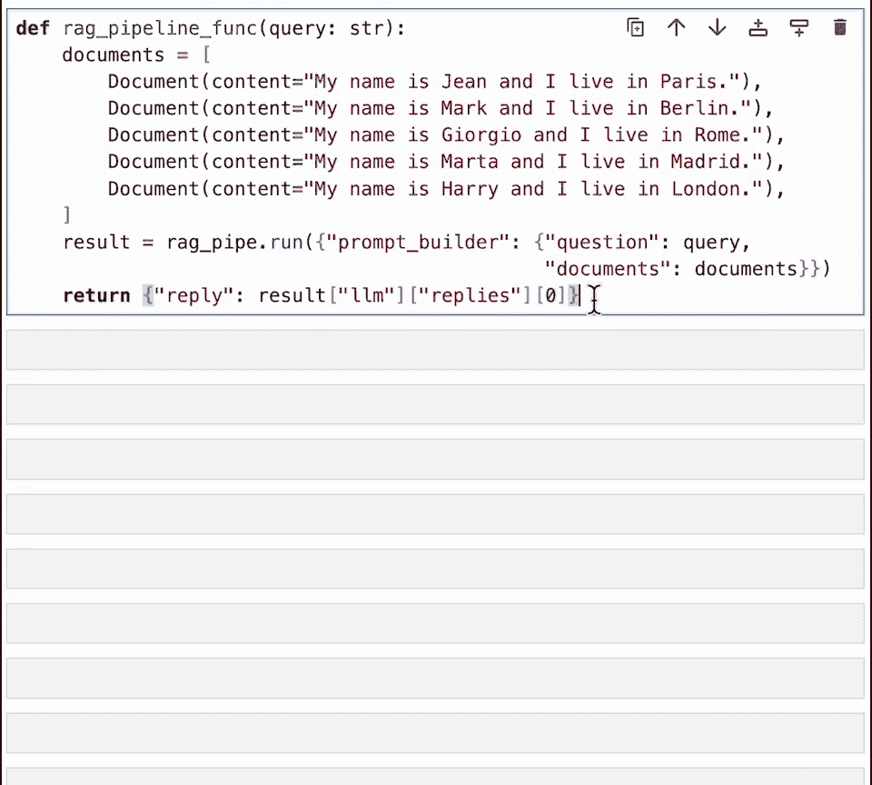

接下来，你将创建一个天气函数。这次，你将模拟一个天气函数，但你可以想象这实际上是从，另一个 API 获取实时的实时天气数据。在这种情况下，同样，我们将提供虚拟数据。

你将提供柏林、巴黎、罗马、马德里和伦敦的天气情况信。

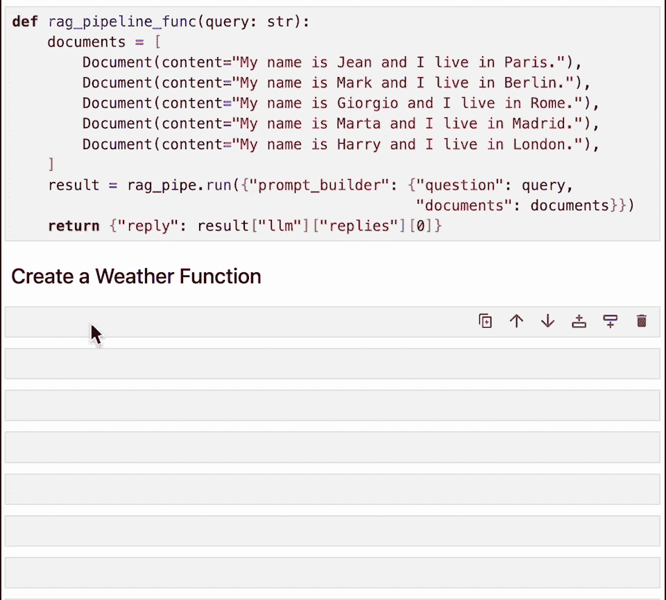

息。如你所见，我们编造了这些。大多是晴天，大多是多云，晴天或多云等等。这也是 OpenAI 在其文档中提供的用于解释函数调用的相，同示例。

现在让我们在一个 getCurrentWeather 函数中提供这个，同样，这次我们将有一个函数期望位置，并且它将返回天气，数据。我们首先会查找位置是否在我们的天气信息中存在，但如，果不存在。

我们在这里也会有一个后备。我们只是要编造一些东西。如果我们的天气信息中没有列出这个城市，我们将简单地，返回晴天，温度为 21。8 华氏度。现在你有两个函数。

其中一个是能够响应人们居住地点的 Haystack RAG 管道。

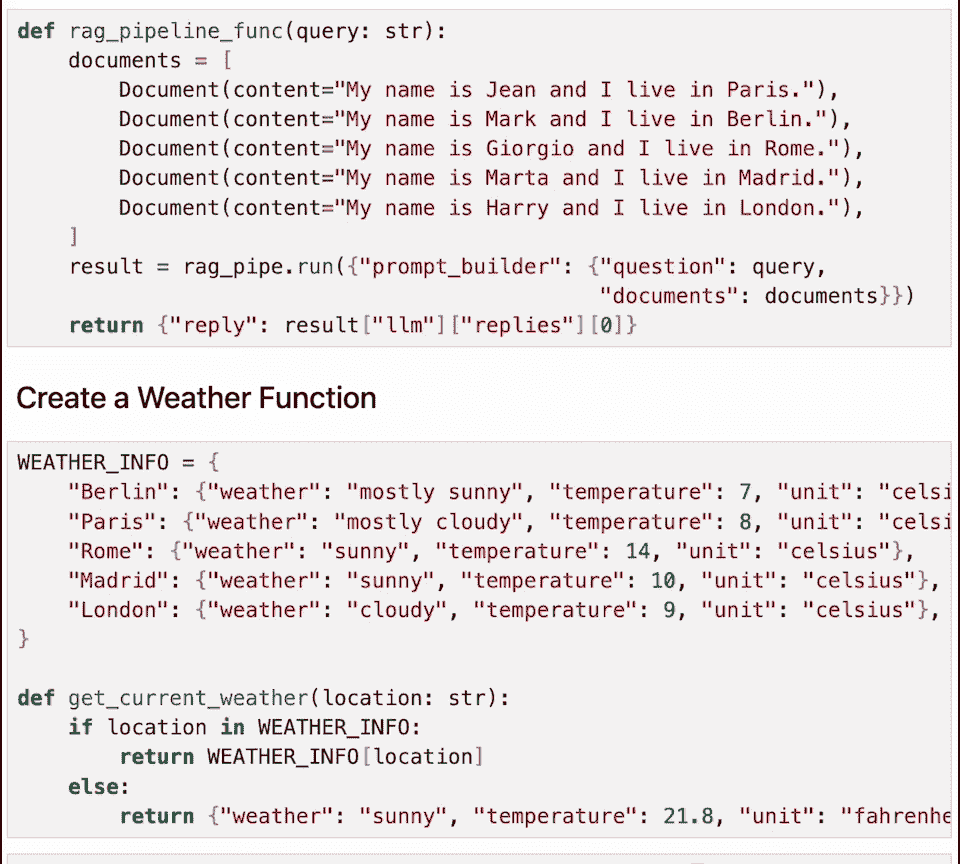

，另一个是天气函数。现在我们已经准备好了我们的函数，我们必须将它们作为，工具提供给一个生成器。在这个用例中，我们将使用 OpenAI，所以我们必须以 ，OpenAI API 期望的方式描述我们的工具。

那么让我们看看这可能是什么样子。这将是大量的数据，但让我们逐步查看。

工具将是一个工具列表，我们提供我们函数的名称，以及大，型语言模型可以用来决定这是否是它应该使用的函数的描，述。每个工具还描述了它们期望什么样的输入。在这种情况下，我们的 RAG 管道函数期望查询。

我们也提，供了对该查询是什么的描述。例如，在搜索中使用的查询，我们还告诉它从用户的消息中，推断出来等等。我们对 getWeather 也这样做。我们将 getWeather 函数描述为获取当前天气。

我们也描，述了它如何期望位置。现在我们有一个工具列表。我们可以将这些工具列表提供给我们所谓的 OpenAI 聊天，生成器。

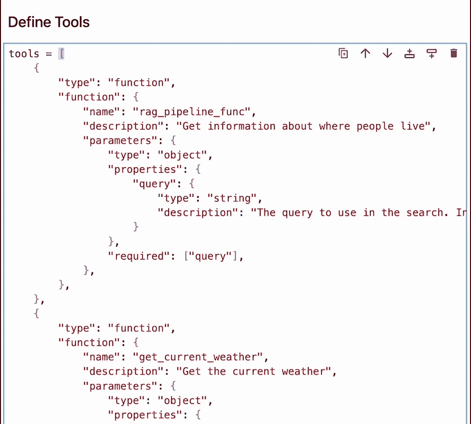

让我们看看那个。让我们首先创建我们的 OpenAI 聊天生成器。这个组件不仅能够处理模型名称，而且我们还可以在生成，夸克中提供工具。所以我们要创建一个生成器，我们称之为聊天生成器，并且。

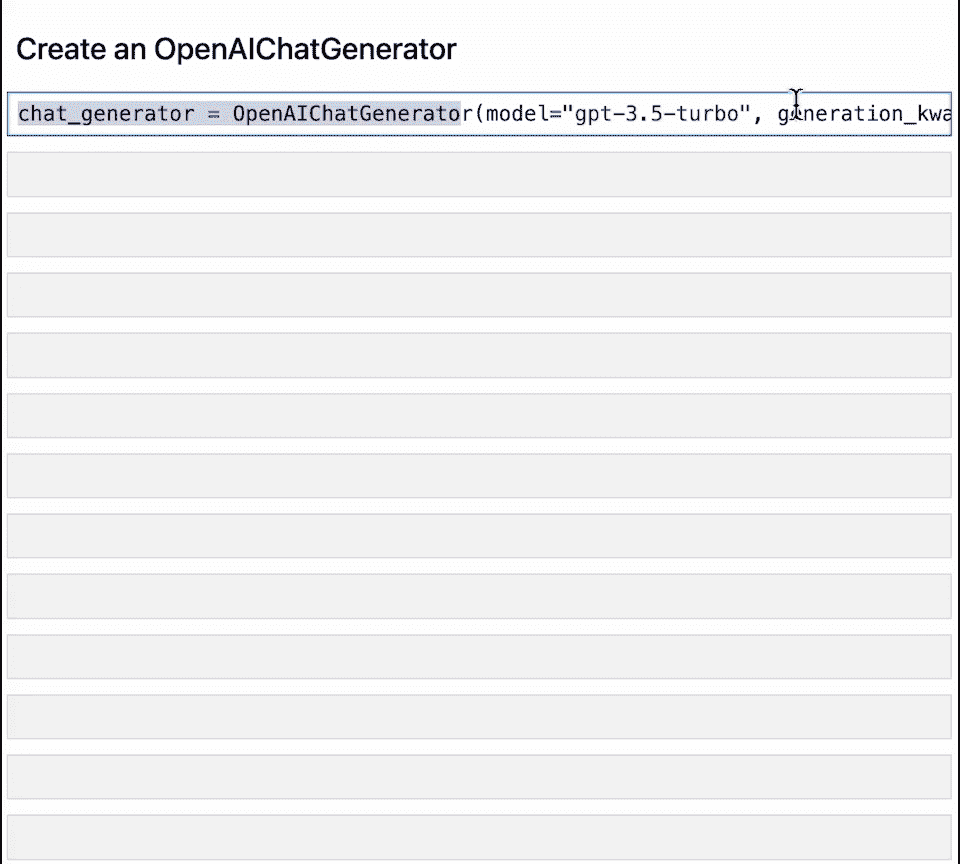

我们要把我们的工具作为工具提供。接下来，让我们看看当我们运行这个组件并带有消息时会，发生什么。这个组件的特别之处在于它期望一个消息列表，我们还可，以描述消息来自哪里。在这种情况下。

我们将提供来自用户的聊天消息，问题是，马克住在哪里？我们将大型语言模型的回复分配给回复。让我们看看回复包含什么。

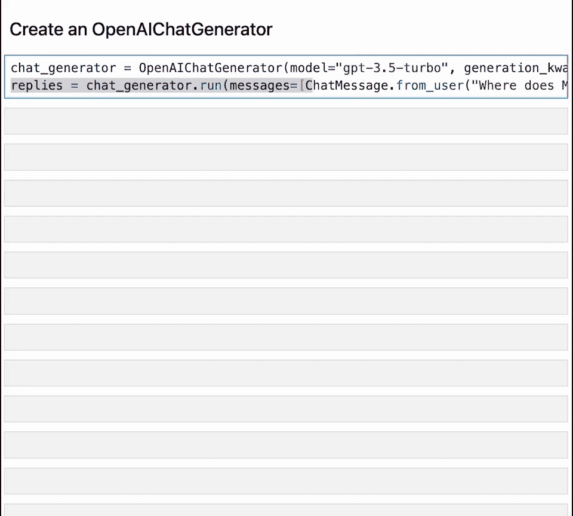

如你所见，这又是一个聊天消息，你可以注意到聊天消息来，自一个助手，并且它说它应该用查询运行一个函数，马克住，在哪里？那个函数的名字是 RackPipelineFunc。这里要注意的重要一点是。

你从这些模型得到的响应不是，函数的结果。更多的是关于运行哪个函数以及如何运行。接下来，让我们看看如果我们想调用这些函数会发生什么，为此，我们将使用一个名为 OpenAI 函数调用器的组件，它。

实际上来自 Haystack 实验包。这个组件在初始化时期望可用的函数，它将运行我们的聊，天生成器要求运行的函数，并将这些函数运行的响应添加，到消息队列中。首先，让我们初始化我们的函数调用器。

并让我们提供我们，的可用函数。接下来，让我们用我们之前的消息运行这个函数调用器。我们之前的消息队列包含我们想用马克住在哪里来运行 ，RackPipelineFunc 这个事实。让我们将其分配给结果。

然后让我们打印出这些结果，看看，这个函数调用器是如何反应的。

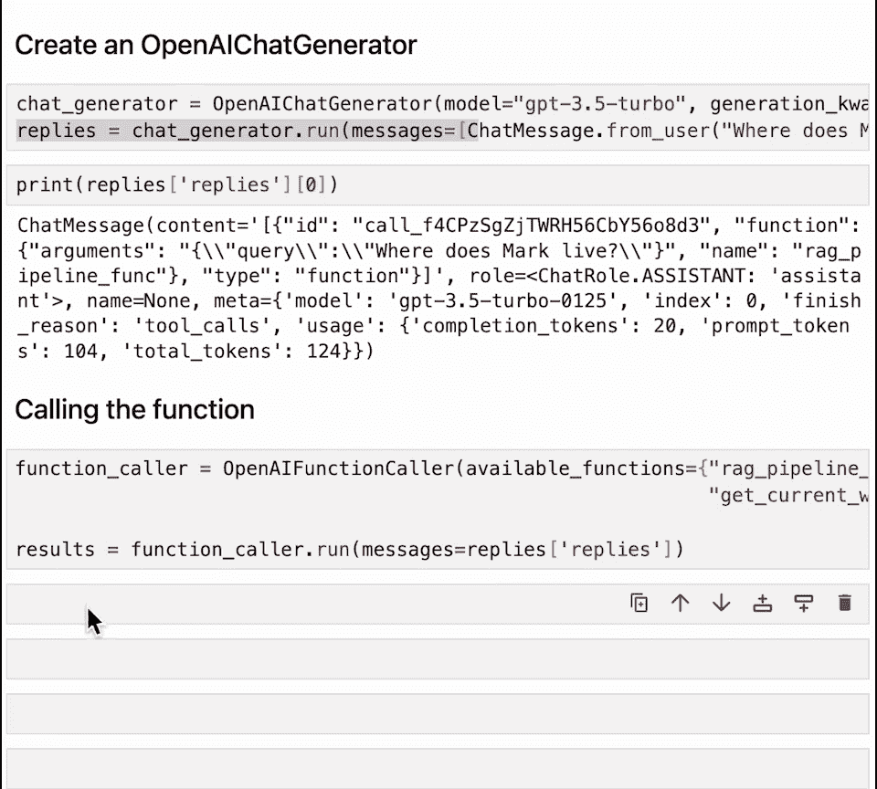

好的，在这种情况下，注意我们现在队列中有两个消息。第一个消息是助手要求用马克住在哪里来运行 ，RackPipelineFunc。然而，第二个是函数的响应，函数的响应是马克住在柏林。

原因是我们现在实际上已经运行了 RackPipelineFunc，我，们的 Rack 管道已经用我们提供给 Rack 的文档中的一个，文档做出了响应。马克住在柏林。

现在我们有一个能够访问工具的 OpenAI 聊天生成器，还，有一个 OpenAI 函数调用器，我们可以创建一个访问工具。

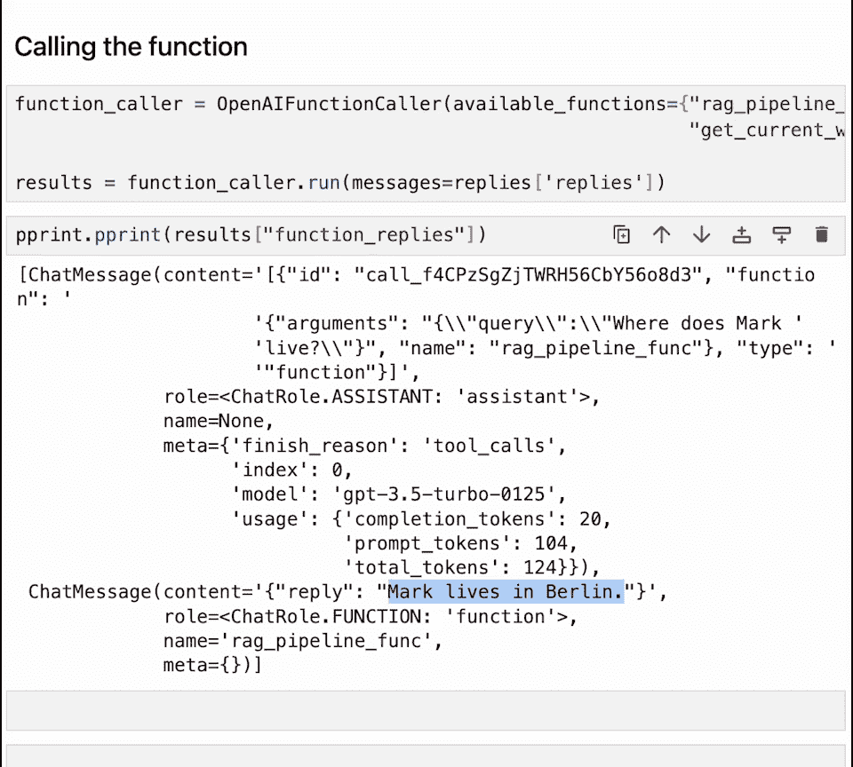

的聊天代理。对于这个管道，我们将从一个我们以前没有用过的组件开，始。我们将从一个分支连接器开始，它将把来自多个组件输出，的消息合并到一个中。我们稍后会看到为什么要这样做。接下来。

我们将使用我们相同的聊天生成器，为其提供工具。

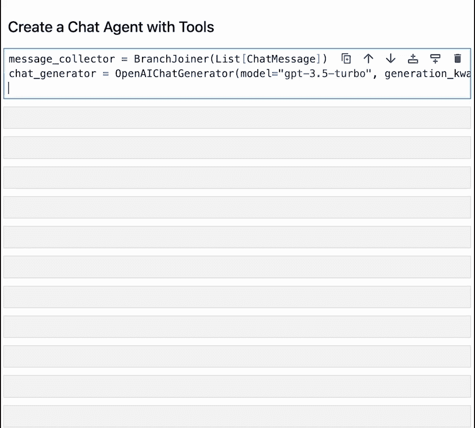

，最后，我们将使用我们的函数调用器。同样，我们为我们的函数调用器提供我们现有的函数。现在让我们看看如何将这些组件添加到我们的管道中以及，如何连接。这次，我们创建了一个名为聊天代理的管道，并将我们所有。

的组件添加到这个聊天代理中。最后，我们将把消息收集器的输出连接到生成器消息。接下来，我们将要求生成器的响应通过函数调用器。只有当助手要求调用一个函数时，函数调用器才会调用函，数。如果不是。

它将只是用它所拥有的消息进行响应。接下来，这就是我们实际实施另一个循环的地方。函数调用器的回复将返回到消息收集器。如果你愿意，你可以跳过这一步，但我喜欢有这一步，因为，这意味着如果有来自一个函数的响应。

我们不是简单地提，供该函数的原始响应。我们要求一个大型语言模型再次从中生成一个人类可读的。

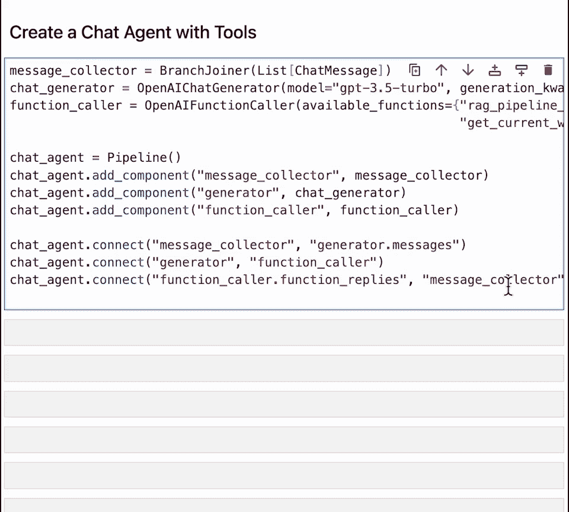

响应。现在我们有了这个管道。让我们将其可视化并看看发生了什么，我们也将看看为什，么我们使用这个分支连接器作为我们的消息收集器。好吧，在这种情况下，我们有一个消息收集器，这非常有用。

因为生成器期望一个消息列表，但我们希望这些消息要么，来自函数调用器要么来自用户。然而，这个组件只能从一个东西获得输入，所以消息收集器，充当了一种连接者，这些消息的组合者。消息现在要么来自用户。

要么来自函数调用器的回复。

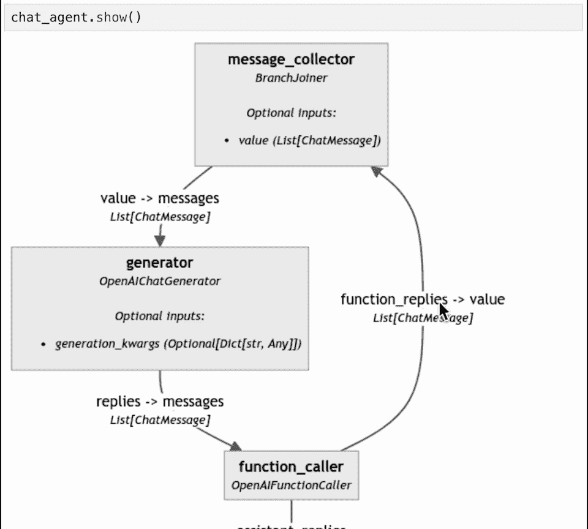

现在我们有了我们的聊天代理，让我们实际看看它的行动，让我们用一个系统消息开始我们的消息队列。

这个消息指出，如果需要，将用户的问题分解为更简单的问，题，不要对要插入函数的值进行假设等等。接下来，让我们开始一个 while 循环并开始请求用户输入。

这就是我们开始要求用户开始与我们的聊天代理交互的地，方。我们也将在这里添加一个中断语句。所以如果你愿意，你可以输入退出或离开，然后你可以退出，聊天。接下来，我们想将传入的用户消息附加到我们的消息队列。

中，并且我们想根据该消息从我们的聊天代理获得响应。同样，我们想将所有我们可能从聊天代理获得的响应扩展，到消息中。最后，让我们打印出响应。

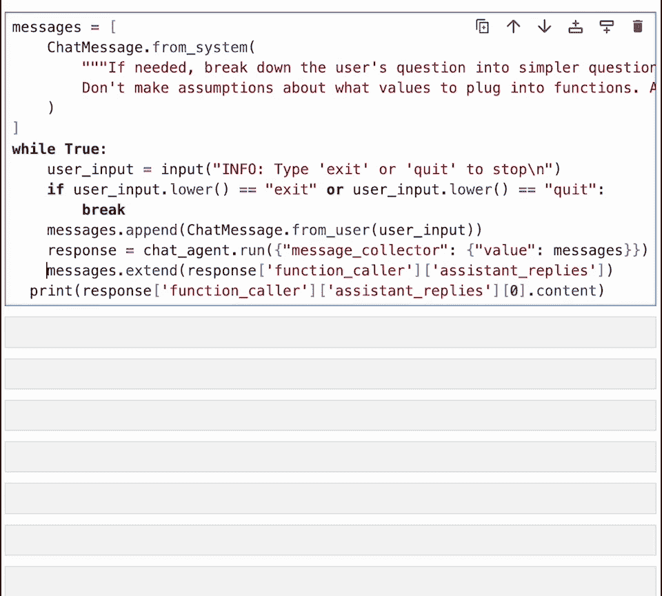

好的，我们已经开始聊天了。让我们先问，马克住在哪里？马克住在柏林。现在，因为我们有一个消息队列，这里有某种原始记忆，所，以我们可以在上下文中提问，大型语言模型仍然应该能够，响应。那么让我们问。

那里的天气怎么样？柏林当前的天气主要是晴天，温度为 7 摄氏度。这很棒，因为我恰好记得这正是我们的获取天气函数应该，响应的。好的，让我们停止这个，看看我们还能做什么。如果你愿意。

我们可以提供与梯度应用程序完全相同的应。

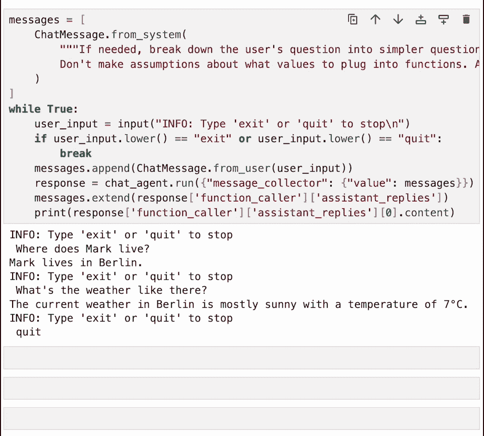

用程序。让我们从消息队列中的相同系统消息开始，然后让我们定。

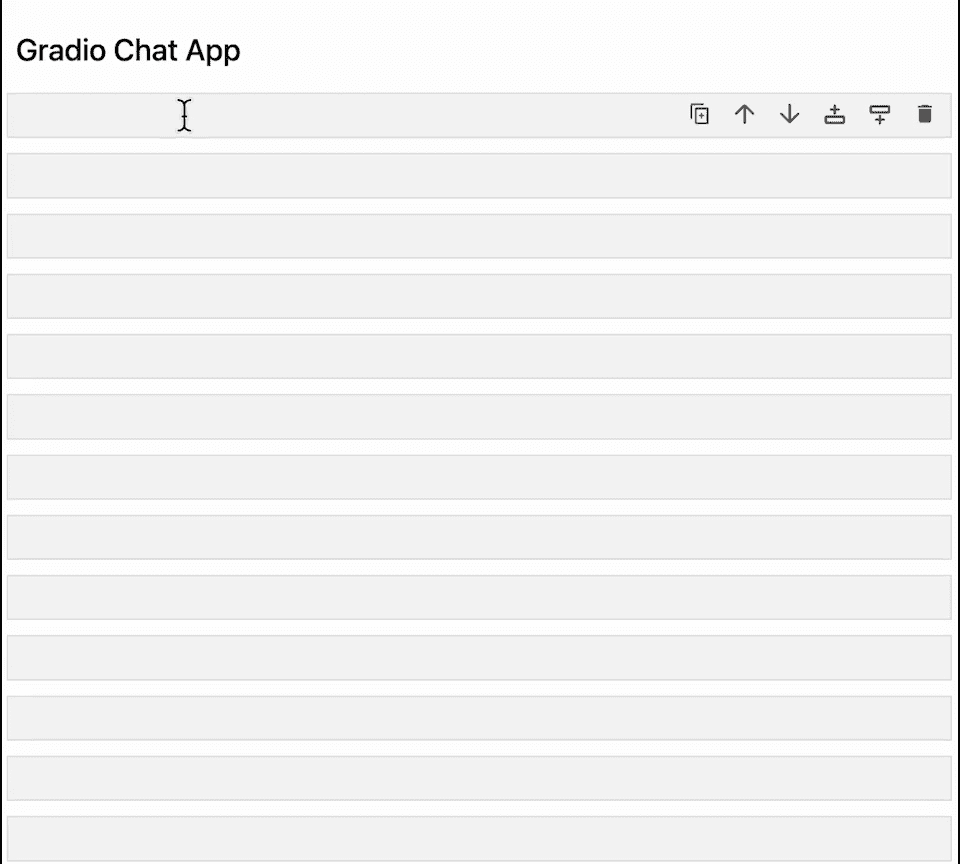

义一个聊天函数。这将被梯度用来创建一个聊天界面。

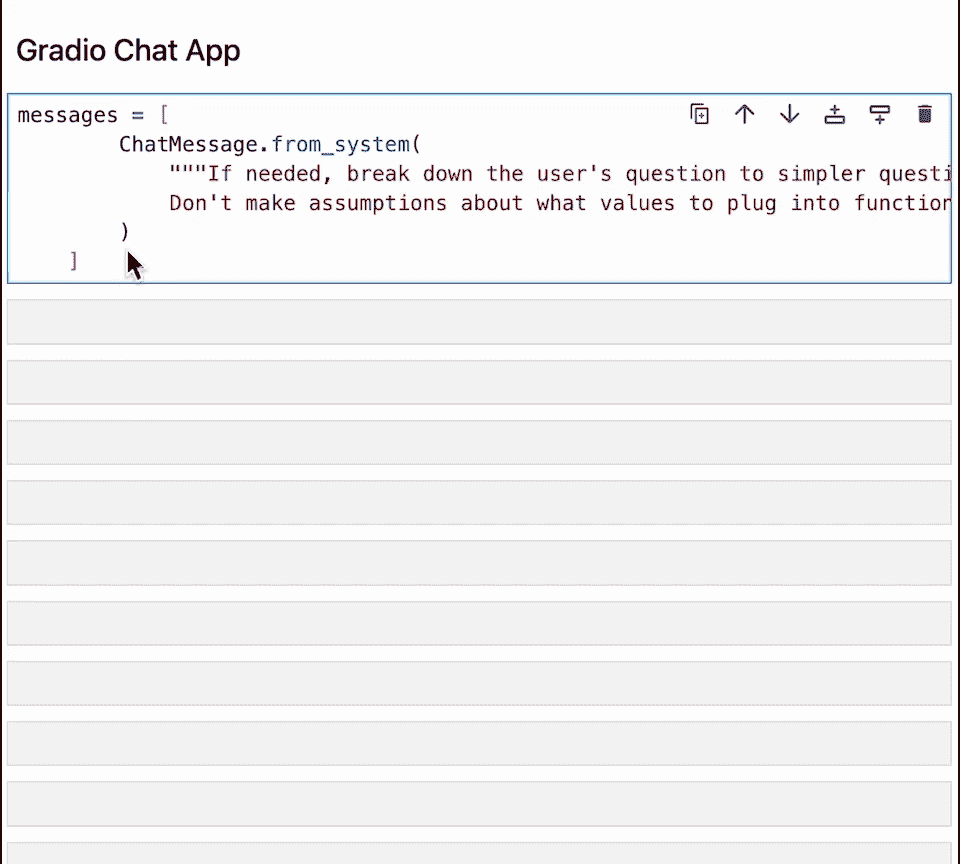

接下来，我们提供聊天界面作为演示。我们也可以提供一些我们可以问这个聊天代理的例子。最后，让我们启动我们的演示。

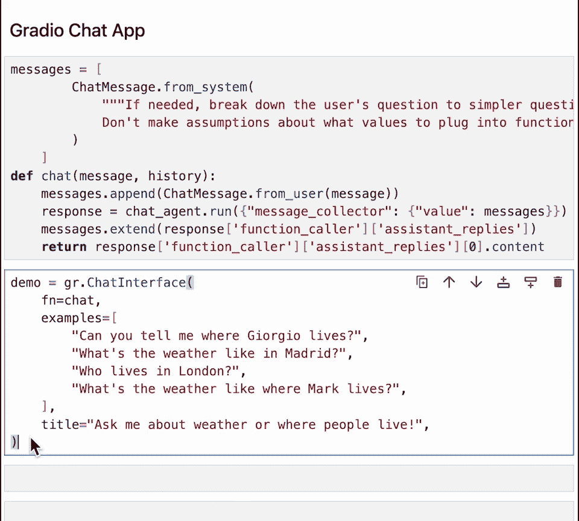

你现在也应该看到这种类型的界面，在这里你可以开始与，你有权访问你创建的工具的代理聊天。让我们开始问一些问题。例如，马克住在哪里？太好了，马克住在柏林，我们也知道这是准确的。接下来，让我们问。

那里的天气怎么样？注意我们不必指定柏林，因为模型可以访问消息队列，所以，它应该能够推断我们在问柏林。让我们问另一个后续问题。例如，他今天适合穿什么衣服？就是这样。

我们根据柏林当前的天气和他今天可能穿的衣服得到一个，答案。你可以尝试玩转这个聊天应用程序，甚至可以提供你自己，的一些工具。在这里，我们模拟了一个天气函数，例如。

你可以尝试看看你是否可以用获取当前实时天气信息的东，西来代替它，甚至可以用完全不同的东西来代替你的 RAC ，管道。例如，你可以实现你自己的网络搜索管道，你也可以使用在。

整个课程中到目前为止你创建的所有管道，并将它们作为，工具提供给我们的聊天代理。

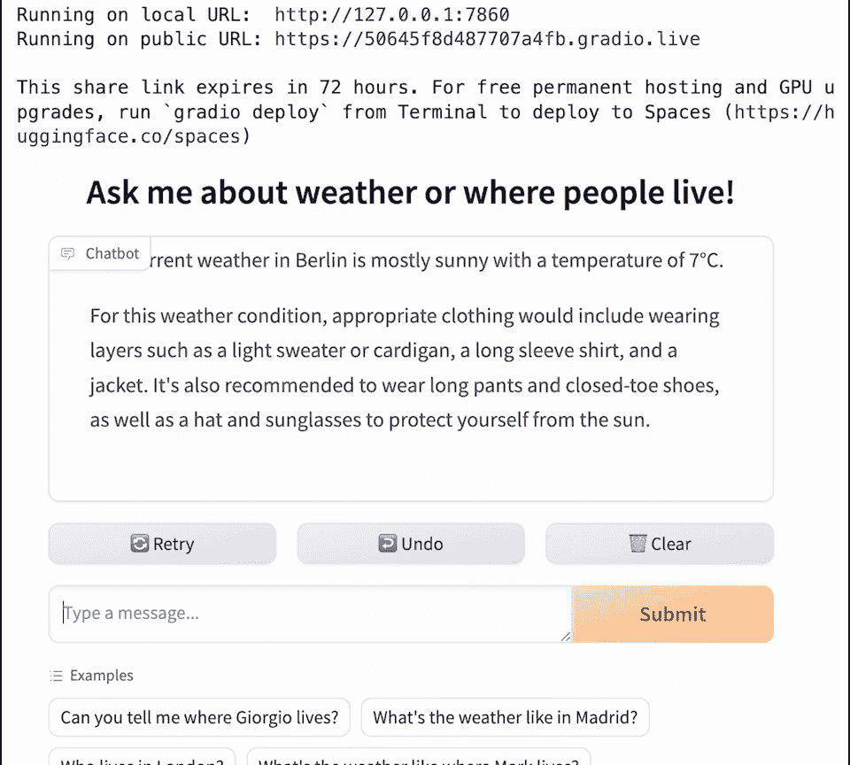