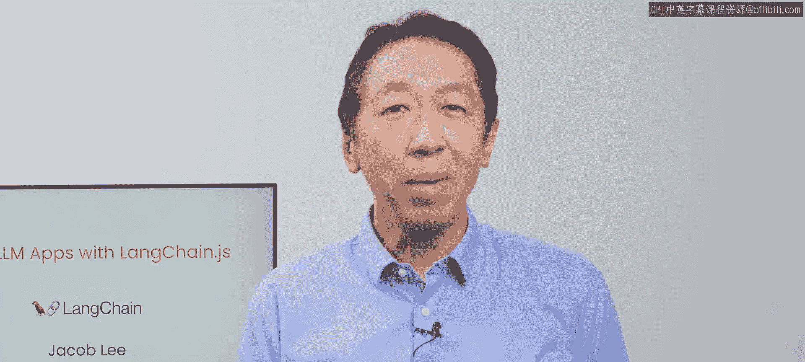
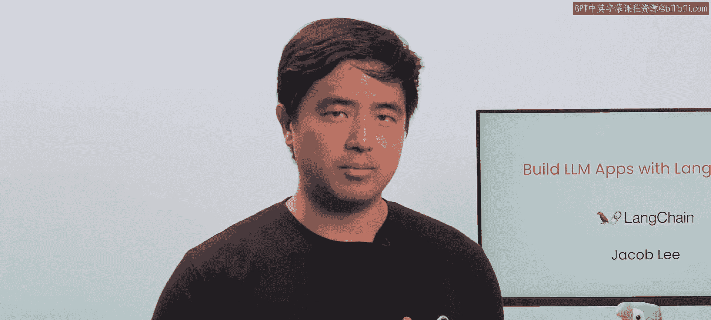
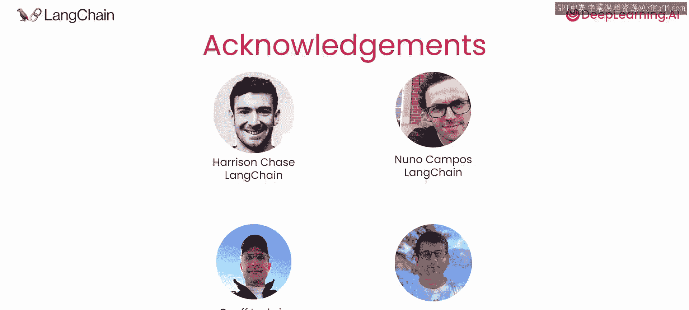
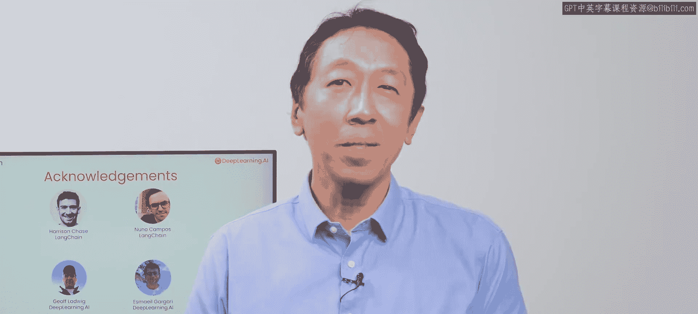

# 吴恩达《使用LangChain.js构建LLM应用程序｜Build LLM Apps with LangChain.js》中英字幕（英字可关闭） - P1：1.Introduction.zh - GPT中英字幕课程资源 - BV1d5411v7em

Of applications are becoming so important and so mainstream。

 I think it's important for JavaScript developers to really use these tools and build them into your applications as well。

 And I hope that this course will help you with that。

 when building applications using large language models。

 there are common steps that many developers use La A make these steps much easier for JavaScript developers。

😊，For example， if you're building a retrieval augmented generation or RAG application。

 you'd have to choose an LM to perform your task， figure out how to retrieve relevant text that fill the LMSMS context。

 tune the prompt and， maybe also pause the LM's text output into something more structured for the downstream steps of your application。

Tools that help you connect these steps and also enable you to quickly tune this workflow。

 for example， swapping out 1 om for another， these tools are called orchestrators。

Langchain is a very popular open source orchestrator for L M applications and will help you to build your LM applications much more quickly。

 The instructor for this course is Jacob Lee， founding softwareware engineer at Landcha and the maintainer for the open source Landcha J S。

Jacob has worked with many developers to help them integrate Oms into their web and mobile applications。

Thank you， Andrew。And I'm really excited about what you'll be able to learn in this course。

 you will learn about a number of elements which are common in LLM applications like data loaders。

Which make it convenient to pull data from common sources such as PDFs， websites， databases。

 and more to augment the LLM's generation。There's parsers。

LLMs operate with natural language while programming languages operate with formatted data。

Psers extract and format natural language output to create structured forms for your downstream code to process。

There's prompts， which are used to provide the LLM context。

Models which provide an abstraction layer on top of specific LLMs。

So that you can write applications that are themselves not vendor specific。

And then there are other modules to support rags such as text splitters and integrations with vector St。

You will also use the Lnk chain expression language or LCCEL for short。

To easily compose complex chains of these modules， quite a few people had contributed to make this course possible。

 were grateful to Harrison Chase， founder and CEO of Landchain。

 as well as No Comfor also from Landchain and on the Deep blend Di side Jeff Ludwig and Ashmo Gagari also contributed to this course so lots of great stuff to learn here and after this course。

 I hope you will have built some really cool L based applications in JavaScriptscript。

Jacob， what's with the Paris in the L chain logo You know， Andrew， I'm not really sure。

 but it's become part of the uniform。