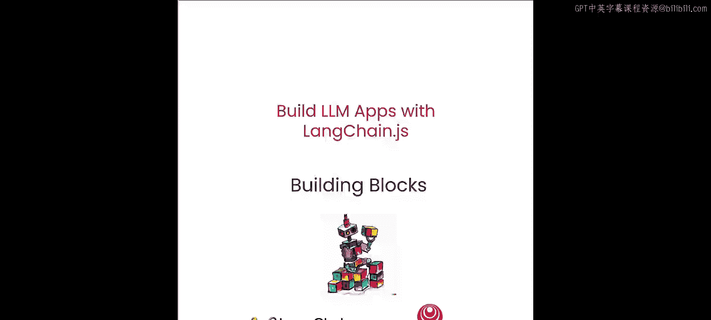
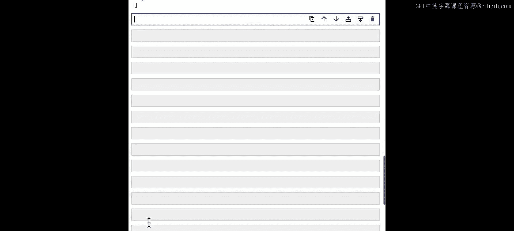
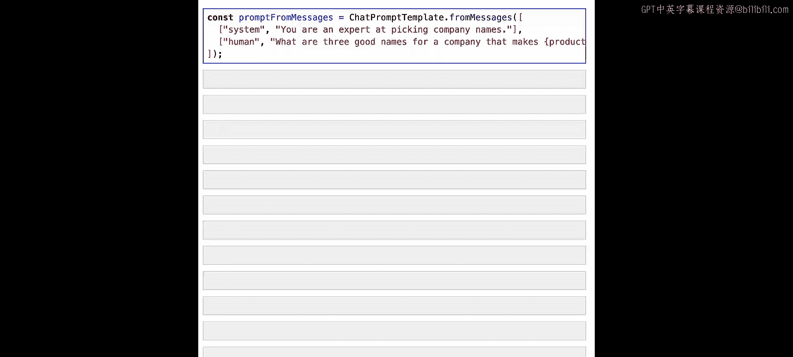
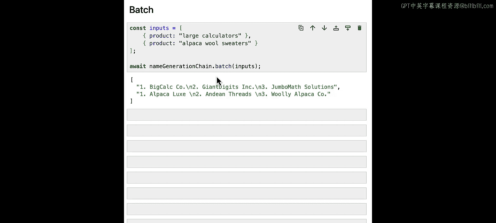

# 吴恩达《使用LangChain.js构建LLM应用程序｜Build LLM Apps with LangChain.js》中英字幕（英字可关闭） - P2：2.Building blocks.zh - GPT中英字幕课程资源 - BV1d5411v7em

In this lesson， you'll learn some of the basic building blocks of LLM applications。

 namely Pro templates， models and parss。

And you'll learn a bit about how to combine them together to create chains with laang chain expression language Let's dive in。

Before we get too far in， let's tackle the elephant in the room Why Langchanjs Well。

 JavaScriptscript is the biggest ecosystem of developers in the world and many of them prefer surprisingly to use JavaScript。

 you also might choose it for some of the easy deployment tools and powerful scaling features of frameworks like NCs Cloud offerings like for edge functions or Cloudflare workers and generally the advanced tool chains that come with them you also might want to be built for multiple platforms or different platforms if you're building directly in the browser for Chrome extensions or mobile apps with react native desktop apps with electron environments like that。

 Another housekeeping note， this notebook uses the Dno， Jupyter or kernel。

 which is a JavaScriptscript runtime with slight differences from node and web environments。

For the most part， you'll be able to copy paste code directly into different environments and when there are differences we'll call them up so a bit about Lang chain expression language。

 Langchain uses this to compose chains of components together and components that implement and are usable with this language are called runnables。

 they define some core methods and in allowed set of input types。

And output types and allow you to use methods like invoke stream and batch right out of the box。

 which are all common methods used when building and using LLm applications。

 There's also means of modifying parameters of runtime with the bind method So concrete example of this is the prompt LLm output parser trio that willll be going over in this lesson and some other benefits of the runnable protocol are that you get fallbacks and parallelism right out of the box with our batch method as well as logging and tracing built in via Lsmith are tracing and observability tool throughout the course we' link to a few exploreorable traces in Lsmith that illustrate how different chains work。

 Let's start with one of the most fundamental pieces of L chain。

 the language model and L chain supports two different types of language model In fact。

 there are text LLMs which take a strings input and return a string is output so string。

To string and then there are chat models which take a list of messages and input。

And return a single message。Output。And examples of text models are things like popular apps like chatGT and GBT4 so because they look like strings。

 text LM inputs and outputs are easy to visualize so let's look at what calling a chat model directly looks like so we'll import some environment variables we using OpenIs GT 3。

5 Trbo for the majority of the course。Wwhich is a chat model and we'll import the L chain wrapper for it as import chat Open AI from Lang chain chat models Open AI。

And it'll report a human message class that we'll use to wrap and create our chat model inputs。

 and then we'll initialize our model like so。And again， be using GT turbo。

And we'll use the latest version time Fing， which was from。November 6th。

And then let's try querying it。Or invoking it。With a list of messages。

 which in this case will just be a single human message corresponding to our input。Tell。Me a joke。

We'll also be testing Cha GBT's humor here， or rather opening eyes humor。Cool， let's give it a try。

Why don't skeletons fight each other？They don't have the guts。Hlarious。

 so one thing you'll notice about the message output from the chat model is that it contains a content field containing the text value of the message and an associated role that corresponds to the N sending the message。

 In this case， we started with a human sending the original message which is us and the AI responded with an AI message And again while we're using G 3。

5 turbo L chain supports models from any different providers and you can try swapping the provided class in any of the code examples。

 So here's a good place to pause and try editing the prompt yourself or the message yourself rather to sell a specific joke perhaps out parrots or even change the input message to ask about something else entirely。

Give it a shot。Okay let's move on to another building block， the prompt template。

 so while calling models in isolation can be useful as you saw above and you can do some pretty advanced things with that。

 it's often more convenient to factor out the logic behind model inputs into reasonableable parameterized components rather than typing out the full query each time and for this La includes prompt templates which are responsible for formatting user input for later model calls let's see what that looks like。

 we'll import a chat prompt template class here and initialize it like so。

What are three good names for a company that makes product。 One thing to note here。

 we've denoted an input variable using curly braces in this case。

 product and anything we pass into the prompt will be injected and formatted into this part。

 Pro templates are also useful for smoothing over some of the differences in model input types here we construct a prompt template directly from a string。

 But we can use this prompt template to generate both string input for an LLM using the format method like this。

 And this is how coincidentally we pass input variables。 So we'll say。😊，Colorful socks for a product。

 and that'll get injected your prompt right here。What's how the question mark so it's not。

There we go。And if you run this。We get a string output with a human prefix because we've created a chat prompt template。

 we get what are three good names for a company that makes colorful socks and we get a string output which is also our input variable here。

 so this is output we could pass directly to an LLM。

 but we can also format our prompt to output a message array useful for calling chat models so wait prompt format messages this time and we'll give it the same product because who doesn't love colorful socks colorful socks and this time we get a single human message within an array that we can pass directly to our chat model and you'll notice that if we use this from template method with a string is input for convenience we turn that into a human message here but we can also create a prompt template for messages directly for finer grain control over what types of messages are passed to the prompt。

For example， many models and model providers rely on a system message to define certain behavior。

 and this is a great way to format your input。So here's an example。

 we'll import some other methods here and then we'll create our prompt slightly differently using these new message prompt templates。

 so prompt messages will be a chat prompt template from these messages and now this time instead of constructing our prompt template from a string or can construct it from a system message prompt template and a human message prompt template such that our output and our formatted output rather our output will be multiple formatted messages instead of just a single one let's try it with a product shiny objects and this time we get a system message which remains the same because we didn't have any template variables here and a human message what are three good names for a company that makes shiny objects A and some nice shorthand for this by the way。

 so you don't have to import those message prompt template classes。

 it's just use to topple with the role of the template so for example。

 we can initialize it like this the same exact output is before。

 but instead of using those message prompt templates。

 we to topple with the role and then the template string。

And if we run format， we get the exact same output。

 so this will be useful later for passing around history because you can inject history messages directly into the prompt。

Though we can pass these formatted values directly into a model。

 there's actually a more elegant way to use prompts and models together that will go over next。

 and we've already mentioned it。 That's right。 It's expression language or LC CEL for short。

 LC CEL is a composable syntax for chaining lane chain modules together。And again。

 objects that are compatible with LC CEL are called runnables。

 We can construct a simple chain from the prompt and model we declared above like this leavess pipe method。

 and what this is going to do is it's going to create a chain where the input is the same as the first step in the sequence or prompt here。

 which in this case will be an object with a single property called product The prompt template is vote with this input and passes the properly formatted result as input into the next step of the chain。

 the chat model here。Here's what it looks like in action， there we go， weight chain， dot and Vo。Oops。

Write it too soon。Product。Colorful。Sos。If you recall the prompt Ask the LM to describe three fun names for a company that makes this product and if we run it。

That's exactly what we'll see a single chat message response with three。

Fun names for a company that makes colorful socks， chromromooc， bright step， Color vibe So co。

The final consideration we'll go over in this lesson is formatting our output， for example。

 it's often easier to work with the raw string value of a chat model's output rather than an AI message and the line chain abstraction for this is called an output parser。

 so' import it like this。This is one that will take our chat model up， put a single message。

 and coerce it into a string， so let's initialize that output cluster。

And let's redeccllar our chain like this。Awesome。😊，Now， if we run this chain again。

Perhaps with a more fun name。Or a different product， rather。

Let's see if we can generate some good names for a company that makes fancy cookies and this time you'll see we get three names like before。

 but this time instead of a chat message output， we get a string， delicate crumbs。

 gourmet cookie creations。An elegant sweet scope。 These three pieces form the core of many complicated chains。

 So it's important to get a good handle on them now。 And if you're more of a visual person。

 you can check out this lasmith trace illustrating what's going on internally and I'll paste it here and let's go look at it。

 So we see that we have a runnable sequence here， which corresponds to our chain。

And that wraps a few steps here。First， our chat prompt template where it takes in our input fancy cookies。

 that's a product and injects it into the prompt。 It outputs a single human message wrapped in an array and that's the format that our chat model expects here。

 So our input， what are three good names for company that makes fancy cookies and the output。

An AI message with three good names for a company that makes fancy cookies。 and then finally。

 a string apple parser converts that from an AI message into a string。 And by the way。

 while these pipe operations are convenient for small numbers of outputs。

 they can get a little unwieldy for more complicated chains for this。

You can use the runable sequence dot from method to construct a chain from an array of runables。

Here's how it works。 We'll import it here。And we'll reconstruct our chain above using that method。

 and it's as simple as prompt model。Output parser。And that's equivalent to the pipe operation above。

So it's in v。And yep， we get three names for a company that makes fancy cookies。

And let's go over some of the other methods that we get for free with expression language here One is streaming that's a very important one for many of you in the Web dev community and we'll take great advantage of that later。

 but all these runables and sequences of runables themselves are also runables by the way。

 get a dot stream method which returns output from the chain in an iterable stream and because LLM responses often take a long time to finish。

 this is useful in situations where showing feedback quickly is important and here's an example with the chain we just composed you'll see here that we call this dotstream method instead of dot andvoke with a different product name this time really cool robots and we can use this async iteration syntax for a weight cons chunk of stream。

To loop over the return and stream chunks from our stream above。 And when we run it。

 you' see we get three names for companies that make really cool robots。 But this time。

 instead of a single chunk back， we get individual string chunks containingtain part of our output robot tech innovations。

 future bot solutions and mechanicchano works unlimited and we could show these in the frontend application much more quickly than waiting for the entire response。

 you'll also note that the output parsor transforms those chunks from the model as they are generated。

 resulting in string output chunks rather than models。 And finally， let's look at batch。

 This is useful for performing concurrent operations and multiple generations simultaneously show what this looks like will define a set of inputs as an array。

 and each one of these should match the syntax that our prompt template takes。 So products will be。

Some new product， let's say large。Callic youulatorators， a little whimsical。And。

Product alpaca wool sweaters。And this time， instead of using Stamer andvoke。

 we'll use the dot batch method what we expect to see。

Our two string outputs corresponding to names for two different companies。

 the first ad make large calculators， so we have big Calalco， giant Diits ink and jumbo Ma solutions。

And a second that would make alpocaable sweaters， which you can see here。Were not too bad。

So now you've seen some of the fundamental modules behind Laang chain and langching expression language。

 the glue that holds them all together， feel free to pause before going on to the next lesson and try modifying some of these prompts and templates and even expression language chains for yourself to get a better sense of how they fit together we'll see you in the next lesson where we'll go over the basics of retrieval augmented generation and talk about loading and preparing our data。

