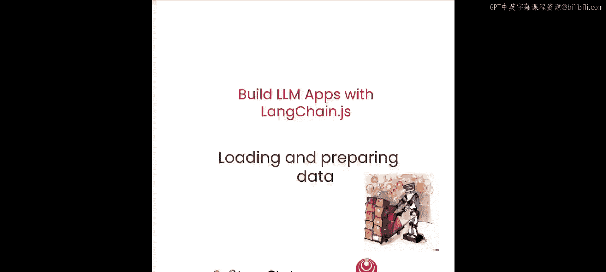
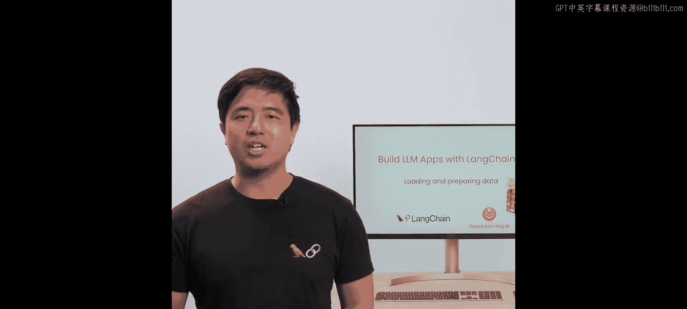
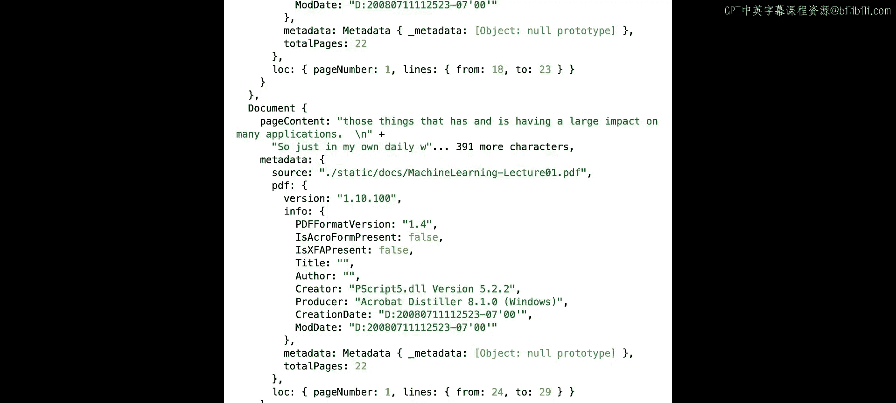

# 吴恩达《使用LangChain.js构建LLM应用程序｜Build LLM Apps with LangChain.js》中英字幕（英字可关闭） - P3：3.Loading and preparing data.zh - GPT中英字幕课程资源 - BV1d5411v7em

Retrieal augmentmented generation or RAG is a very popular application of LLMs。

You'll learn a bit about that in this lesson， as well as some La chain modules which make them easier to build。

Document loaders and splitters。

Let's get started。So now we have some fundamentals down for chaining modules together。

 we'll continue on our journey to construct a chat with your data application by going over some techniques to store our own documents for later retrieval to ground the LLMs generation with that context This is generally called retrieval augmented generation or rag for short。

 The basic flow is as follows First will load documents from a source These could be Pdfs databases or the web。

 then we'll split those docs in the chunks small enough to fit into an LLms context window so as to avoid distraction then we'll embed those chunks in a vector store to allow for later retrieval based on those input queries。

 and then when a user wants to access some data， we'll retrieve those relevant previously split chunks and a final output with those chunks as context and this lesson will cover the first two steps in this flow to form the first step we'll use some of Lang chain's document loaders Lang chain has a variety of document loaders that bring in data from various sources across the web or from proprietary companies and then we'll get into splitting where we'll use some of L chain's text splitting。

ions to format our text in a way legible to the L。 So we'll start with loading an example of one of the many L chain loaders is Github so we can paste it in import here and this particular loader requires a peer dependency You support get ignores in textex called ignore once we've loaded it will instantiate it with a Github repo in this case。

 of course， Lang Js we won't go too deep into the packages for demo purposes so we'll turn off the recursive option and then we'll ignore certain paths like documentation in the form of markdown files and the very long yarn lock file Next after instantiating it will load it so。

To find the output and then run loader dot load， all the arguments we need are in the constructor above。

 and then let's log some of the outputs。So doc， dot slice， zero to three。And run it。

 and then we can see that we are indeed returning a few of the files from the LaChas repo at the top level。

 So theres a editor config file， Git attributetroacies are mostly meta and then it GitI so these are going pulled directly from La chains Gitthub repo and we can see the contents here as well so the definition of data can be pretty loose。

 It doesn't have to be only structured PDFfs， it can be Gitthub files code， it could be。SQL rows。

Very broad， but Ps are a pretty big use case。 so let's see what it would look like to load a PDF And of course。

 given that this is a deep learning AI course， why don't we use a transcript of Andrew Aang's famous CS229 course on machine learning so much like in the Github example above we will import it with a peer dependency in this case PDFf parse and then I've already prepared a copy of this transcript on file in the notebook file system under。

This file path， so I'll run that， I have to initialize it and then run that same loader dot load command CS 229 docs equals a weight loader dot load。

And then let's log just the first three pages that we will get。 And this time we see that we get。

The title of the transcript Maine learning lecture 01 with our famous instructor Andrew A and then pages after that。

 so this loader splits by pages， page one page two page three。

 page four and finally page5 there are many pages after this we're just showing the first five loaded documents but also the metadata which is useful for more advanced querying and more advanced filtering which will be a bit beyond the scope of this lesson。

Now that we've loaded some data let's get into splitting and the idea here and the goal as a reminder is to try to keep semantically related ideas together in the same chunk so that the LLM gets an entire self-contained idea without distraction you notice the previous example with the CS229 transcript there are many many pages with a lot of text and our LLms only have a fixed amount of attention to give to each chunk So there are many different strategies for splitting on data and it's going to really depend on what you're loading so for the Gitthub JavaScriptscript example and we may want to split on codespecificters because those tend to group input documents into function definitions or classes that the Lm can work with rather than splitting somewhere in the middle so show what this looks like well import a text splitter and then we'll initialize it like this and you'll notice that we've set a few parameters here using a initializer from language and expectinging for the JavaScript language that knows to use some of the common G language features as separators between chunks we set a small max chunk size for demo this is third。

Chaacters， which is much smaller than you'd probably want to use in practice。

 but we'll get the point across here and we set a chunk overlap of zero this can be useful in some cases to sort of like chunks flow into each other and get cut off at more natural points but again for demo purposes we'll set this to zero so after initializing it。

Let's give it some code and we'll use a simple hell of world function here， the declaration。

 and then a call with a comment。And let's try splitting on that code and you can see the result here is four chunks with pretty natural splits。

 so we get a function definition， hellello world， the log statement all on online。

 the comment on online and then the call online as well。

 and to show kind of like the alternative here if we split naively for example。

 using something like spaces as a separator we may get chunks generating for example。

 half a log statement which makes the LLM's job more difficult on final generation and to show what this looks like。

 what's important more naive character splitter。And we'll set some of the parameters here where。

Small chunk size and no overlap and then a pretty naive separator just spaces。

 and we'll leave this on screen for comparison's sake， we'll give it the same code。

And then let's just see what happens when we call split on it。 And as you can see。

 we did get the function definition online online， which is something。

 but we split the arguments of the function。 So you can imagine if the LLM got a chunk with half a function call。

 it wouldn't really know necessarily what was on the other half and lose some context and then we've also split more common block and yeah just made this a little bit harder for the LLM to deal with and just quickly to show off some of the ways you can tune this to improve performance here。

 let's say we want to get some of the definition into the declaration because it's nice that we have a function declaration on its own and that's useful but maybe we also want to get some of the function body as context as well。

 So we can try something pretty similar to the above where we use our cursive text splitter but let's turn up the chunk size a little bit and let's also give it some overlap So let's try it with some tuned parameters where we increase the chunk size and make the chunk's overlap a little bit。

 So I a little bit more split naturally and this time you can see that even this's a little bit less efficient in terms of how much and that we're sort of putting redundant information into these。

ChsWe do get the entire function definition and function body in the same chunk。

 which means in LLM receiving this data would have full context into the entirety of the function。

 So Lank includes several different options for different types of content including markdown H jascript which you just saw Python and more But for generic written text。

 the recursive character text splitter is a great place to start since it splits chunks on paragraphs as natural boundaries for people split up their thoughts and points。

 So let's initial one that we'll use on our previously loaded CS 229 class and it'll be a text splittter this time with a little bit bigger chunks。

 So we're going to use 512 characters maximum and then a 64 character overlap。

 and there we go let's split up our previously ingested。

Transcript of and Angs course and see what happens。 And let's log the result。 will again。

 take the first five so that our。Output doesn't get too long here。

 And this time we can see that we get a chunk on page one and then another chunk on page one as well。

 So you know， smaller than one page。And should still ideally be self-contained ideas that we're going to pass the LLM so we get some info on what Paul Bom Stark is doing with machine learning some other folks Daniel Rammage applies learning algorithms to problems in natural language and some thoughts on engineerings daily applications of the deep learning so yeah I think that looks like a pretty good start so in the next section we'll show how to embed and add these chunks to a vector store for easier search and query。

