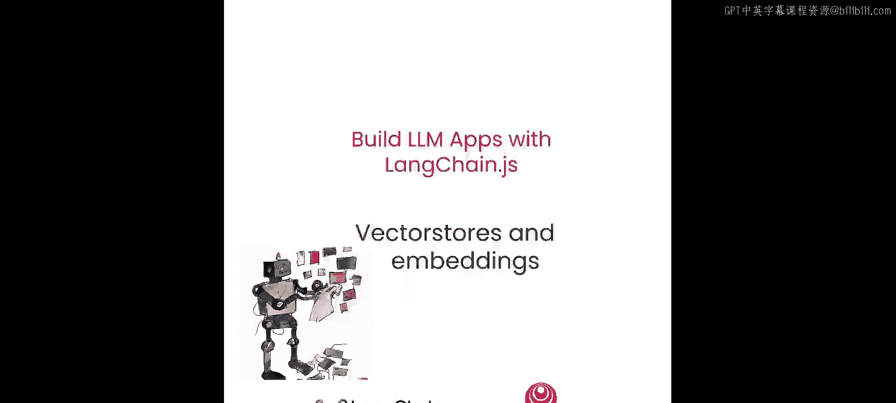
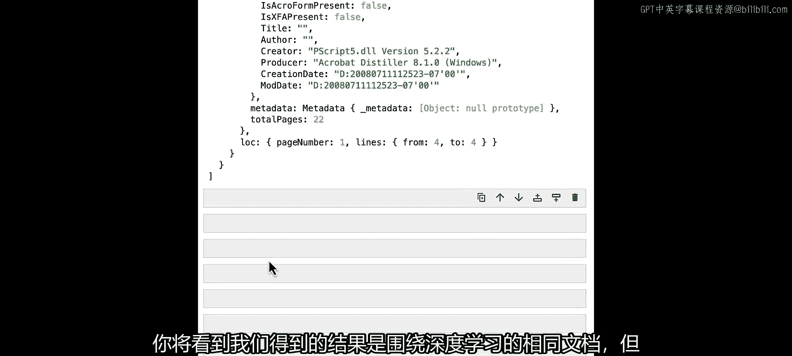

# 吴恩达《使用LangChain.js构建LLM应用程序｜Build LLM Apps with LangChain.js》中英字幕（英字可关闭） - P4：4.Vectorstores and embeddings.zh - GPT中英字幕课程资源 - BV1d5411v7em

Another key element in RAG applications is the vector database。

Let's see how you'll now integrate one into your retrieval flow。

So in this lesson， we'll continue walking through the steps of a flow to set up retrieval augmented generation as a refresher。

Some steps we previously outlined first， we'll load the documents from a source like Andrew Eng's CS29 PDF transcript。

We'll split those chunks small enough to fit into an LLM's context window and avoid distraction with our text splitters and now we're onto embedding those chunks and storing them in a vector store to allow for later retrieval based on an input query and to do that we'll use what's called a text embedding model well use opening eyes hosted model in this demo but again you can swap them out for any embedding provider of your choice a vector store is a specialized type of database with natural language search capabilities and when the user comes in with a query we'll search the vector store for an embedding which we'll get into just a moment similar to the query that they're asking and then return relevant chunks for the LLM's final generation and we'll show off how to embed our previously split document chunks that we can take advantage of these capabilities so the first step of adding documents to the vector store is called ingestion and again uses a embedding model which is a specialized type of machine learning model to convert document contents into representation called a vector which our vector store can then search over and we'll be using opening eyes hosted embedding so we'll need to import our environment variables to get。

KAnd for the demo， we'll use an in memoryory vector store。

 which you wouldn't want to use in production， but you can easily swap out for a provider of your choice。

 So let's import our embedding model。And instantiate it like this。

 and then let's try embedding a small query to see what it looks like。Cool。

 the result is a vector in the form of an array of numbers。

 and you can think of these generated numbers as capturing various abstract features of the embedded text。

That we can later search over to find closely related chunks and to show what this search process looks like concretely。

We can use a JavaScriptscript library to compare the similarity between some different embedding。

 So let's take one vector here that will create using。By embedding this query。

What are vectors useful for in machine learning？And then we'll take an unrelated query that we'll search against to show the score。

So now let's calculate the score between them。And you can see we get a score of 0。69621。

 so now let's try this with a more closely related vector so we can see the difference in score。

And the metric we're using here is called cosine similarity and is one of many ways that you can compare。

Similarity between two vectors so in this case we'll use a more similar vector vectors are representation of information and let's see how that scores against our initial vector what are vectors used for in machine learning so we'll use the same similarity。

Our cosine function。Der one， and this how we use similar vector。

And we can see the result is significantly higher than our dissimilar vector comparison。

Since both texts contain similar information。Great。😊。

So we'll prepare our documents using the techniques covered in the previous lesson。

And let's set the chunk size small for demo purposes。As you can see here。

 we're using the same PDF loader that we used previously with the same peer dependency and then a text splitter。

 which we reported in the previous lesson， a chunk size of 128 and let's split some documents。Great。

Now let's initialize on our vector store。And again。

 we're going to use a in memoryory vector store for the demo。

 but in production you can use whichever implementation you'd like。And we'll initialize it。

With our embedding model already built in here and you'll notice we're passing the embeddings model in on initialization。

 and that's because the L chain vector store implementation will use this embeddings model to generate those。

A rayse of numbers as vectors that you saw earlier for each added documents contents Now let's add our split documents to the vector store。

Oh， I didn't run the whoops， let's run that。And now let's add the documents and this time it should work。

There we go， we've got a populated searchable vector store。

Because Lang chain vector stores expose an interface for searching directly with a natural language query。

 we can immediately try it and see what results we get。

 so let's use the similarity search method with a query what is deep learning？

We'll return four documents and then we'll make the page content of each document a little bit easier to read using a simple formatting function。

So we would expect to see here。Is what we get， which are four small chunks。

With content related to deep learning， machine learning， learning algorithm。

Machine learning and machine learning， so pretty reasonable Now let's talk about retrievers。

So we've just shown how to return documents from a vector store using similarity search directly。

 but that's actually just one type of way to fetch data for an LLM of many。

 and L chain encapsulates this distinction with a broader retriever abstraction that returns documents related to our given natural language query conveniently we can instantiate a retriever from an existing vector store with a simple function call as retriever just like that and one nice trait of retrievers is that unlike vector store is they implement the invoke method and are themselves expression language runables which we learned about in the first lesson。

And can therefore be changed with other modules。So to show this， we'll run。

This retrier we just instantiated with the same queries before with the invoke method and you'll see the results we get are the same documents around deep learning。

 but this time we'll be able to use it within a chain with other modules like LLMs of presors and prompts。

 which will use great effect in the next lesson on constructing a retrieval chain。

