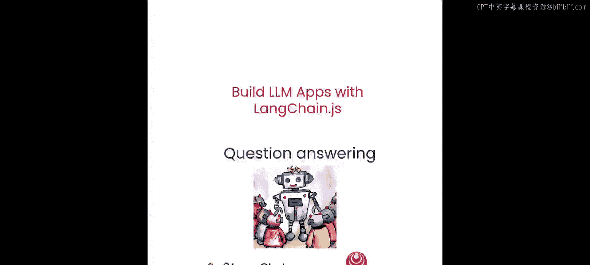
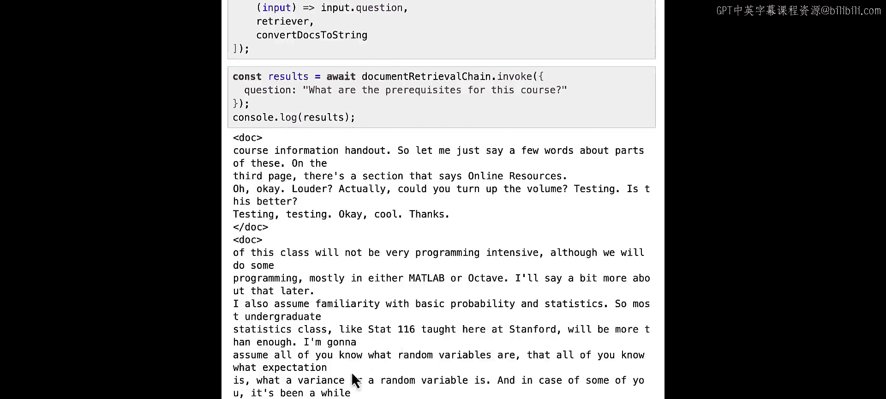
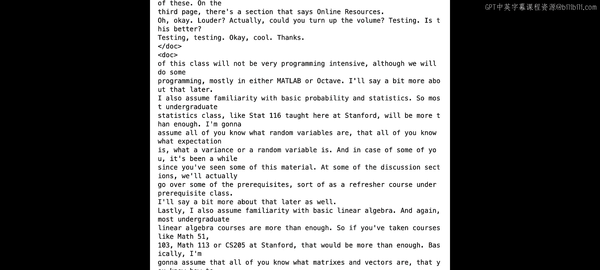
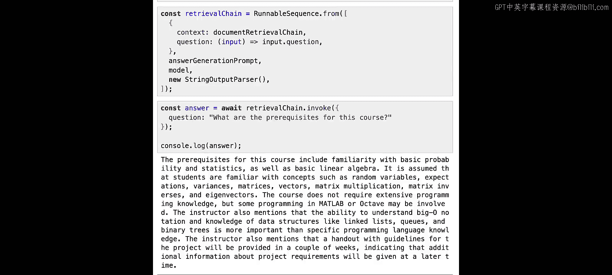
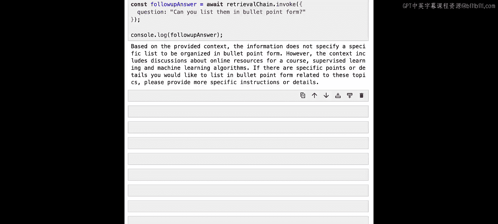
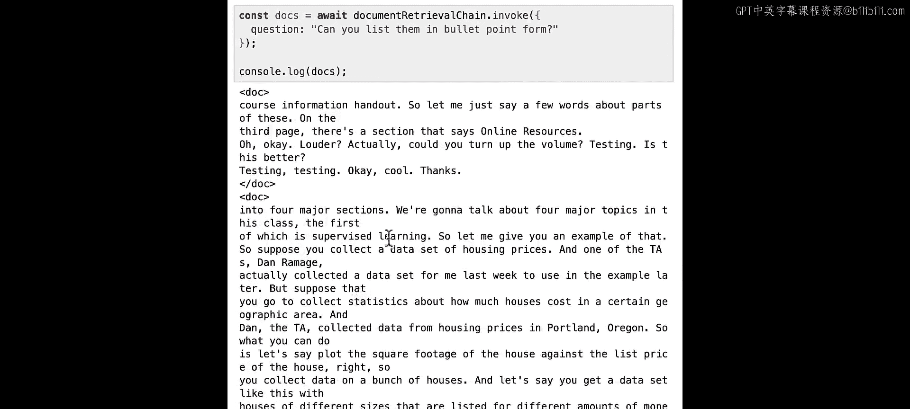
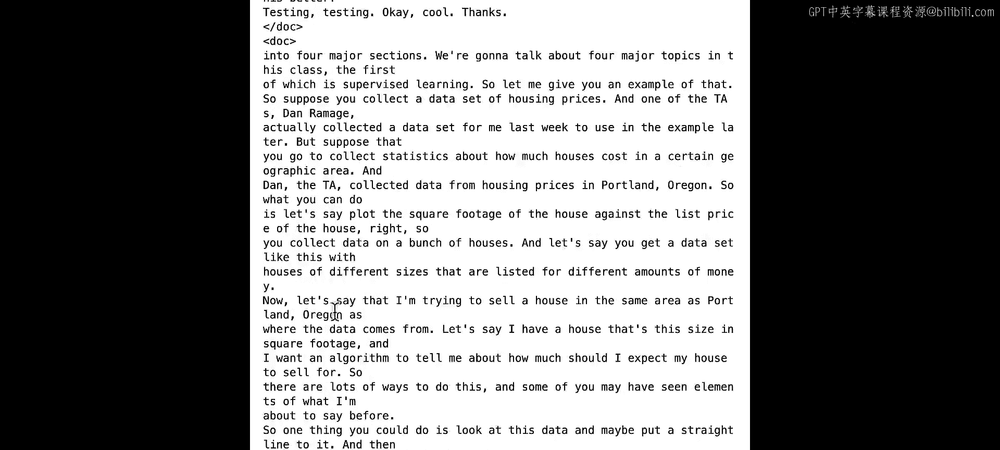
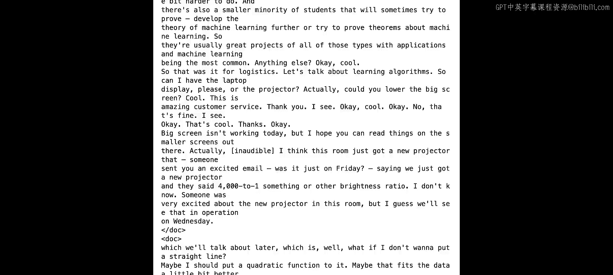

# 吴恩达《使用LangChain.js构建LLM应用程序｜Build LLM Apps with LangChain.js》中英字幕（英字可关闭） - P5：5.Question answering.zh - GPT中英字幕课程资源 - BV1d5411v7em

In this lesson， you'll tie together the pieces in the previous lessons to build a conversational question answering。

 LLM application capable of using external data as context。

Let's go。So our chain will retrieve chunks that are most similar to the input query via。

vectorctor's similarity search。And then we'll present them to the LLM as context to ground the LLM's generation of a final answer。

 so to start。Let's load our v variables of course， and then let's split and load the CS229 lesson than PDF transcript from earlier。

For brevity， I factored out the vector stored initialization code into a helper function that takes arguments for chunk size and chunk overlaps。

You'll use bigger chunks this time。The more simulate a production environment， 1536。

And we'll use us an overlap of。王重你。Characers Now let's load those docs into a vector store the same way we did in the previous lesson using open AI embeddings。

We have this helper function， and even though we're not explicitly initializing the open A embeddings。

 that's all happening within this initialized vectors or with documents method。

And we'll pass in the documents we split in the previous cell。

 then we'll create a retriever as before from that vector store that will fetch the documents for given natural language query Awesome。

 so now we're ready to start constructing our retrieval chain and there are a few pieces here the first we'll get into is a wrapper around our retr that formats the inputs and outputs for the other steps and we'll call this step document retrieval。

In that chain。So again retrievers take string natural language input。

 but we often find it convenient to have chains take an object parameter for flexibility so let's start by creating a simple sequence that will take an object with a field called question input and then format the resulting documents page content as strings and we'll import a few things here you might recall a runable sequence from our first lesson and we'll define a small function that format the document content as output thatll look and be par by an LLM so if each document we're going to try these XMLS tags to separate separate documents content to help the LLM distinguish between different ideas now let's define our chain so we'll start。

With this。Again， we want our chain here to take a object as input， but our retriever take a string。

So to get around this。You'll add this。Little extraction function here that will take the object input。

Which again will look something like this， and we're going to extract this question using this little lambmbda function here。

And you'll pass it directly to the retriever after that。Now the retriever can take that string input。

Extracted from this question field in the input object， do its thing and return some documents。

 then we'll pipe that output into our little helper function up here cool。

So that's our chain and let's try invoking it now and we can see we get some document content separated by these doc tags。

 each with some prerequisites for the CS229 course so we can see that there is some familiarity with basic probability and statistics and maybe stat 12 what 16 you need to know a bit about what random variables are and。

Some other requirements here Co， so this looks like it contains the information that we need Now let's construct a chain that synthesizes all this into a human legible response。

 so we'll start with a prompt and we'll report our familiar chat prompt template。

And let's define a quick。Promps ti， template rather。You're an experienced researcher。

 expert in interpreting and answering questions based on sources。

And answer the question using only those resources。Cool。And we'll wrap this in a chat pro template。

Using the from template method from earlier。And one thing to note here is that our prompt requires an object。

 the context properties as an argument， and our previously defined document trival chain actually outputs a string。

 so there's some input coercion and output coercion that we need to deal with and to do that we'll use something called a runnable map。

So。Show that off here。Importantport a class and when a runable map is invoked。

It calls all the runables or runnable like objects that it has as properties here。

 context in question corresponding to our document retrieral chain and then a simple extraction function here in parallel。

 and it'll call each of those。Functions or runnables。With the same input。

Then the output is an object whose properties are the results of those calls。So show this off。

 Let's try。 What are the prerequisites。For this course。

And we can see the output is that the question has been preserved。

 so we can pass this along to a later step in the chain。

And we get the context from the document treat chain here。The same thing you saw above。

 and that's the exact format coincidentally that we need to pass our prompt。

So let's see what this looks like in sequence， this is the augmented generation step。

So let's take our map that we defined above and combine it with some models and app pars。

And let's do that just a little bit clear。So we'll import a few classes here from earlier。

We'll initialize our model。And then we'll construct a sequence again， using our map from before and。

Our answer generation prompt that we declared above， so it's going to look like this。

 and you might notice that we're not wrapping our object here in a runtable map constructor。

And that's because objects are automatically converted into runable maps when they're in this runnable sequence up from initializer。

 and then we want to pass our question all the way through to our answer generation prompt。

 which if you'll recall， looks something like this。

 it requires variables for context and question so do that we extract the input as a question and pass the entire object。

Which looks like this output from the runable map into our prompt generated out pass that to the model and then parse the output as a string All right。

 now let's try invoing it so we'll ask for an answer。And say。

What are the prerequiites for this course with our new retrieval chain？And it'll log the answer。

And give it a shot。So we get the prerequisites for this course include familiarity with basic probability statistics as well as basic linear algebra and assumes that you're familiar with various concepts。

 which seems pretty reasonable and seems like a much more human readable response than that list of documents that we got before。

 awesome， but what if we want to ask a follow-up question？So。

Let's say you know it's a little bit more readable。

 but still not maybe quite as readables as you want， so we might ask。

 can you list them referring to the prerequisites of the course in bulletpoint form and let's see what we get。

So we get based on the previous context， the information does not specify a specific list to be organized in bullet point form。

 which。You didn't do so all there did it and this occurs because LLMs do not have an innate sense of memory and since we're not passing in any chat historytories context。

 the LLM doesn't know what them refers to， you can update the prompt to take chat history into account as well。

 but then you have a more fundamental problem which is that our vector store needs to return relevant documents related to this reference full query to illustrate the problem here's what happens if we try to query our vector store with that follow up question directly and we'll use our document retrieval chain to show this and we get some docs that don't look like they have anything about prerequisites。

 you can see some stuff about supervised learning， something about selling a house in Portland Oregon and some other information that really doesn't contain much relevant about prerequisites to the machine learning course and that's because our query the vector store itself has no concept of what them is either。

All right， you've just gone over the basics of LLM powered question answering。

 augmented by retrieval。 We will look at how we can fix some of the shortcomings around conversation history in the next lesson on conversational question answering。

 I'll see you there。

