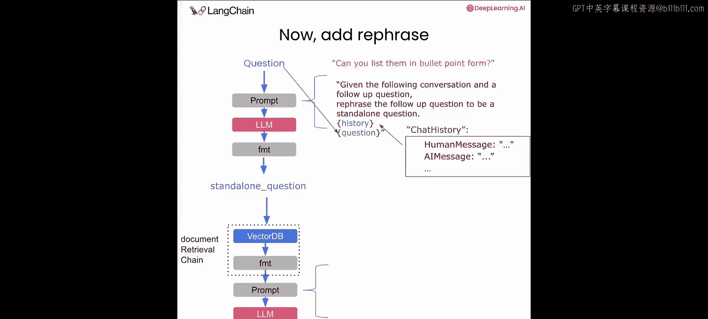
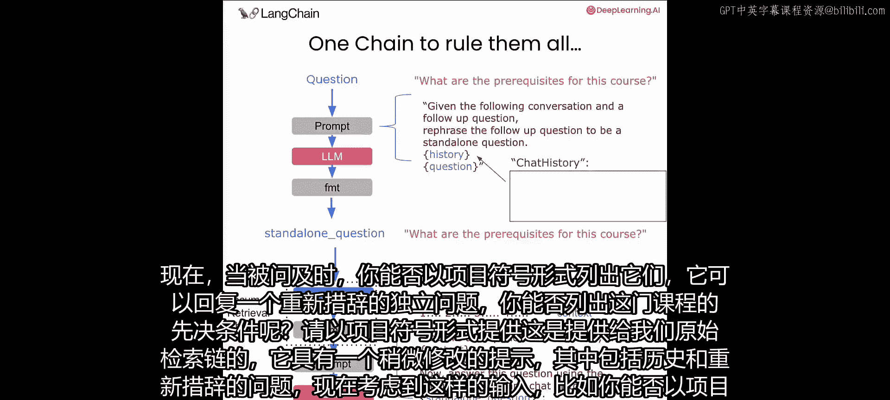
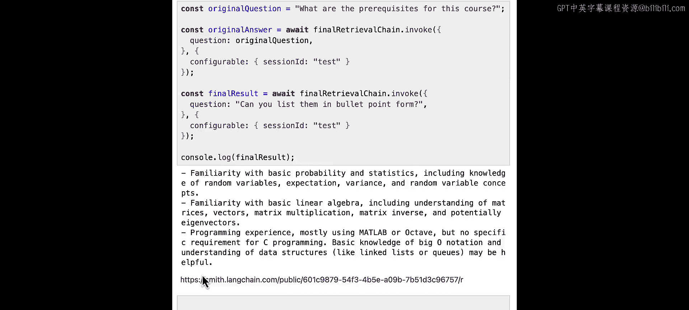
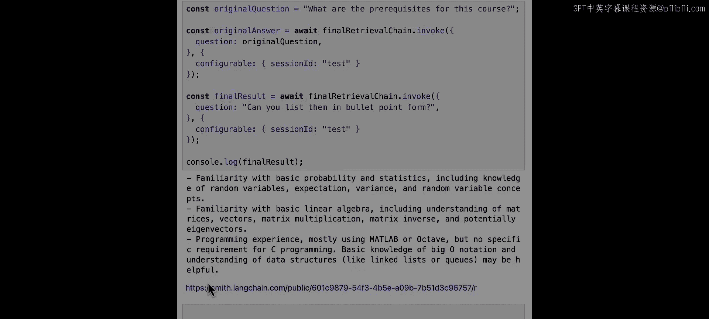

# 吴恩达《使用LangChain.js构建LLM应用程序｜Build LLM Apps with LangChain.js》中英字幕（英字可关闭） - P6：6.Conversational Question answering.zh - GPT中英字幕课程资源 - BV1d5411v7em

In the last lab， you built a question answering chain。

 but discovered at the end that it did not have memory of past questions or results in this next lesson。

 you'll learn about some techniques you can use to remedy that by adding conversational capabilities to your chain。

This can get a bit involved。 So we'll go through the steps here before jumping right into the code。

 The chain you built in the last lesson would go through the steps shown in the diagram here。 First。

 the chainqueries a vector database with a question。

 The vector database returns four relevant documents referred to as context。 and that context。

 along with the question would be added to the prompt and sent to the L M here。

 we asked for the prerequisites of the course。 and it provided a good answer Gred by the retrieved context。

Then we try to do question。Can you list them in bullet point form？

And the LLM replied that it didn't see a specific question or prompt。So what went wrong here？Well。

 the question is referencing past information， but the LOM has no memory of that past information and can't answer。

So how do we fix that One way is to rewrite or rephrase the new question while being aware of the past chat history into a standalone question。

 free of external references。 If we did that， the LL M might rewrite the question to be something like。

 Can you list the prerequisites for this course in bullet point form。

 The chain above could fetch the correct data from the vector Db， given that input。

 And the LL M could generate a good， suitable answer。 So how do we do this。

 The first step is to save the chat history。 You'll see how to do this in code a bit later。

 But the basic idea is that each time we pass through the chain。You'll store in a history variable。

 the question being asked as the human message and the LLM's formatted response as the AI message。

 Later， you can make this available in a prompt for the LLM to have as additional context。 Now。

 you'll need to add some logic to rephrase the question。You'll do this with an LLM， of course。

 let's first clean this up。And make room for the new start to this chain。Now you'll add a prompt LLM。

 and output parsing chain that will form a standalone question。The prompt will be something like。

 given the following conversation and a follow up question。

 rephrase that follow up question to be a standalone question。

This property now includes our chat history and the original question Now， when asked。

 can you list them in bulleted form， it can reply with a new rephrase standalone question。

Could you please list the prerequisites for this course in bullet point form。

 This is provided to our original retrieval chain， which has a slightly modified prompt that includes the history and the rephrase standalone question。

 Now， given an input like， can you list them in bulleted form。

 it can provide an answer like the one below。Note here that we're creating a chain that we can use repeatedly for question after question。

 even for the first question where we don't have any history yet。

 we can see that our steps will work on the first question。 It just won't be reformatting much。 Okay。

 let's jump into the code and get started。

So to start with， you'll need to rebuild some of the components from your previous lab。

 you'll start by loading your configuration， then you load your text splitter。

 then you'll load your vector store with your documents。And then you'll define your retriever。

 and then you'll build a document retrieval chain that extracts the input questions。

 sends that to the retriever。And finally， converts the output to a string。

Then you can build your retrieval chain， which will call an LLM with a question and the results of the vector database lookup。

First， you'll build a prompt template。Notice it has an input variable for context from the vector database。

And a spot for the question。Now you initialize your model。And then you build your tri chain。

It gets the context from the document retrieval chain。And the input question。

And passes all of that to the prompt。And finally， to the model and the output parser。Great。

 so now we are ready to make our new chain。So we'll make a new chain that's going to be purely responsible for rephrasing the user's input that may contain references to past chatt history into a question free of references that both our vector store and later LLM calls can follow and to do that we will define a new prompt。

Using something called a messages placeholder and this is what we use to pass around history。

 so we're going to use a more complicated way of declaring our template from messages because we want to pass again history in as a series of messages and。

We'll show that here so you can see here we've declared a system prompt template up here given the following conversation in a follow question rephrase the followup question to be a standalone question that's going be a system prompt and we're putting this placeholder where we're going to pass messages actual chat messages as history and then we're gonna have a small human prompt where we ask it to rephrase that question as a standalone question and pass the question itself Great now let's create a chain that uses this prompt and you'll see our familiar runnable sequence from method here and let's paste in our prompt from above a model and an apple parser cool now let's try running this chain on our followup question from before and you'll note that message placeholder is itself a parameter in our prompt history that we' need to pass the chat messages making up the history so to start let's import and ask it in original question so what are the presites for this course as above。

We'll store the answer as this original answer property， and let's log that。Original answer。

 and we'll log this original answer and we see that we get。

The prerequisite this course has outlined to be the instructor include familiarity with base probability etc so a pretty good answer Now let's create a chat history that's going be again an array because that's these are going to be the messages that are injected into that messages placeholder area that you saw earlier and that's going have two messages because weve as the human have asked the first question which was what are the prerequisites for this course as original question and the AI has responded with its first answer then we'll take this chat history and invoke our rephrase question chain with both our followup question which if you recall was can。

You list them in bullet point form。And。That chat history as history so as you can see。

 our rephraed question chain has taken this input， can you list them in bullet point form？

And rephrase it to say list the prerequisites for this course in bullet point form and that's something that LLMs and vector stores can handle on their own Now let's put all of that together with a new chain so putting it。

Alto so as a reminder here's our previous document retrieval and formatting chain that we defined earlier。

 and then let's define our answer generation prompt to also use a messages placeholder for chat history so it's going to look pretty similar to our existing answer chain but with the system template and we're going to use that same from messages method so that we can have a placeholder for the chat history and this lets our final answer generation chain also take into account chat history so you can see。

You're an experienced researcher like before。Using the provided context and chat history this time。

 answer the user's question to the best of your ability。

And then we have our messages placeholder for chat messages and then a human prompt at the end here for。

The final question。And you'll also note that this time around this final prompt and what we're to use for our final generation requires those three inputs instead of two。

Let's try running that on its own and get a sense of like what we need to pass this final answer generation chain to get a good output。

So we're just going to format the prompt purely。With some。Dummy context。

 this is going to be a pretend output from the rephrase question chain and then some sample chat history。

 and if we invoke it。Oops， answer generation chain prompt。Oh， I forgot tovo this previous line。

 whoops。Now let's try it。Cool。And this time around we get a list of messages again。

 if you recall to lesson one， these are the inputs that the chat model expects formatted。

 so you're an expert researcher based on provided sources。

 we've injected a few messages here for the chat history so you can imagine a conversation that starts with how are you and then fine thank you。

And then now I answer the following question using the previous context in chat history why is the sky blue so this is roughly the data we need to pass to our final generation chain so let's assemble our conversational capable retrieval chain by passing that history cleanly through until the final prompt。

We'll be using a new type of runnable here。 And it's one that's nice to describe visually。

 There are times when a processing step in the chain may want to pass through some of its inputs unchanged to the next step。

 One method of doing this is with the convenience runnable pass through dot assigned method in the diagram。

 step 1 is taking a history and a question and outputting a standalone question。

 But our prompt in step 2 also needs to receive that original input history。

 as well as the revised standalone question。 that was the output of step 1。Essential。

 we want to pass through the old properties， while assigning a new one to the current state of the chain。

 Let's describe this again， looking at the code。So you'll notice we were using a couple of new things here there's this runnable pass through do assigned method which I think I have to import here and what this is going do is because of this pattern of basically extracting one property from the input and passing it through to the next step it's going to be equivalent to something like this just this placeholder because this pattern is so common for something like where we extract one property of the original input so we can pass it as a object property to the next step here which is going to be our document retrieval chain so you can think of it as just taking the original input and adding one additional field to it useful little shortcut so we're going to go through the steps here where we first rephrase our question and make it a standalone question free of references to chat history then we're going to pass that dereference question into our vector store to get the context documents relevant to the query and then we're going to take all of that and generate an answer with this last step here so we could pass history back and forth here but we can instead streamline chat history tracking and sessions using a message。

objectject。Then wrap our chain in a managerger that will automatically update the history called Rununable with Message History。

Let's take a closer look at this runable with message history class。 It wraps another LC C。

 E L chain and adds persistent state by both updating and injecting chat history。

 It automatically updates the chat history by saving part of the input to the chain， which。

 in your case is the user defined question field in the input as a new human message。

 It also saves the output of the chain as a new AI message。 Additionally。

 it adds the current history messages to the input of the rap chain under a history messages key。

 which we'll use as history。 Note that in a rag application。

 The results of the vector Db lookup are not stored in the chat history。 Let's describe this again。

 looking at the code。So it's important that plus a chat history object and you can again think of this as tracking chat sessions。

 will'll initialize it like this。And then we'll take this conversational retrieval chain that we just defined。

And wrap it in this new class， so it'll automatically add an additional property given by this history Me is key。

 which this history， which you will call is what our answer generation prompt expects for history。

And it stores and updates the chat history in this chat message history object with the value passed in as input message key in this case question。

 so the question will be appended to the chat history as a human message and the final output of the chain will be appended as an AI message in this message history object and then get message history here is a function that returns a new chat history object based on the past session ID。

Whi is here in this case for the demo we're just gonna to be using the same message history object every single time。

 but in production environments you'd want to assign a new object here for each session to avoid mixing up conversation histories because many people can be using your endpoint at the same time Co so let's try the finished version you'll take your original question here what are the prerequisites for this course and we're going to invoke our final retrieval chain to get an original answer to our original question because we're using this message history with runnables class we need to give it a session ID even though we're not using it quite yet and soll just but test then we'll invoke it again with a followup question。

Can you list them in bullet point form？And let's log the result so it's gonna be thinking for a bit。

 it's a few model calls in a row now， but eventually we get familiarity with basic probability and statistics。

 linear algebra and some program experience on nice bullet point form here and this is an example of where tracing really comes in handy and to get a visual sense of like what is going on here because you know we have multiple call is going back and forth and a lot happening behind the scenes we can look at a length with trace to explore visually。

So here you can see visually what's going on internally。

 we have this runable with message history class wrapping our runable sequence here。

 which is our conversational retrieval chain。And it's going insert and load those history messages as parameters to that chain So the first thing we're going to do is do this rephrasse question step where we take the loaded history from the manager run with message history as a reminder and you can see the first couple of the first question here what are the prerequisites for this course。

 the initial answer and then our followup question can you list them in bullet point form so let's shrink that down and then you can see the user question as well。

 and we can see that the output from this rephrase step is could you provide a bullet point list of the prerequisites for this course which is something that is free of references to the chat history and is something that our vector store and LLM can handle then we go into the next step of our chain which is going to be retrieving the documents relevant to that standalone question so the history you've already seen the question is can you list them in bullet point form and then could you list a bullet point list of the prerequisites for this course and you can see that here So some documents relevant to the prerequisites for this course。

And we can see that。We have our basically linear algebra， matrix inductor stores， et cetera。

 And finally， we have a synthesis of our final results where we pass all this information in。

 so here's the context from the。D your store right there and all the documents。The chat history。

 and then a final list of this generation。Retrieval is a very deep topic and there's no one size fits all approach for loading splitting and querying your data。

 it's going to really depend on the format， how information dense it is and other factors so you're encouraged to modify the above prompts and parameters for different models and data types and the next lesson we'll show how to put this retrieval chain into production。

Including showing off some interactions with Common Web APIs and HP。

