# 吴恩达《使用LangChain.js构建LLM应用程序｜Build LLM Apps with LangChain.js》中英字幕（英字可关闭） - P7：7.Shipping as a web API.zh - GPT中英字幕课程资源 - BV1d5411v7em

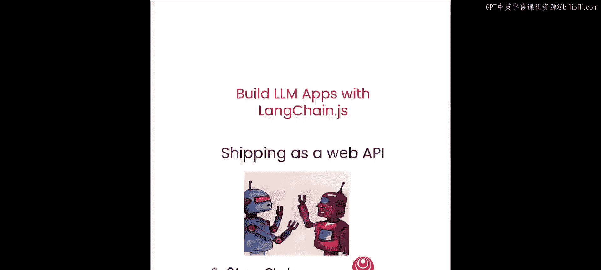

Now that you've composed your chain， let's ship it in this lesson you'll go over some considerations for using it as a live web API like streaming and personalized chat sessions。

 away we go。

You'll pick up where you left off in the last lesson with loading and splitting our CS229 transcript into a vector store for brevity。

 the previous steps have been factored out into this helper method and will perform the same process of loading splitting and then initializing our vector store with those documents。

And then converting the vectorstore to retriever for use with our expression language chain and as a reminder we're using the open AI embeddings internally within this helper function Cool so let's load the pieces of our conversational chain afterwards and again we've factored out the document retrieval and rephrasse chains into their own helper functions as well just reduce the amount of kind of boilerplate。

So now let's load our document chain， let's wrapping our retriever。

 let's load our rephrase question chain， which will take our followup questions and rephrase them as standalone questions free of references And if you recall the final subcomponent of your conversational retrieval chain was this answer synthesis chain where we take all the previous steps and all the information we've gathered and turn it into a final output and we're going to change something very small about this so we're going to construct it from scratch using the same prompt template there you're an experienced researcher expert in interpreting and answering questions based on provided sources and then our prompt template where we have a place hold for chat messages a place for the standalone question from the rephrase step and our document context from the retriever So before you assemble all these pieces together。

 note that the native web response objects used to return data in popular frameworks like Next JS except a readable stream that emits bytes directly rather than a readable stream that emits strings So previously our chain outputed those string chunks using the string output。

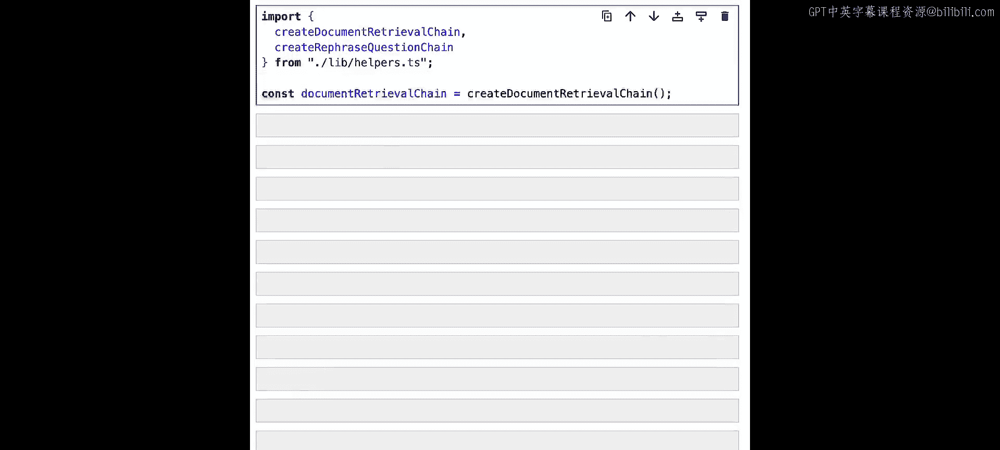

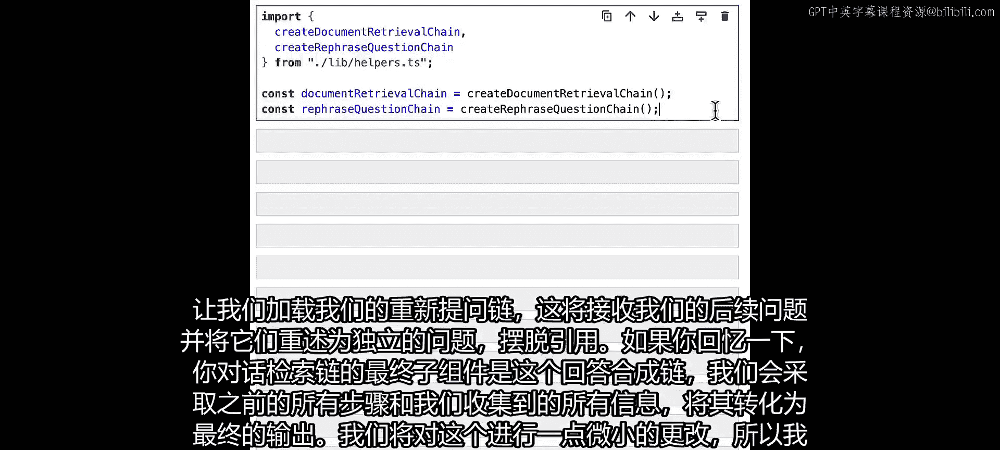

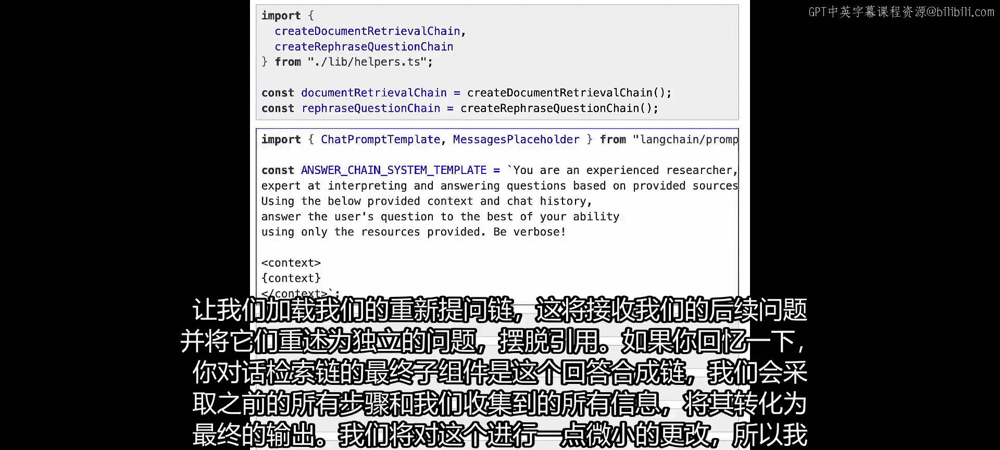

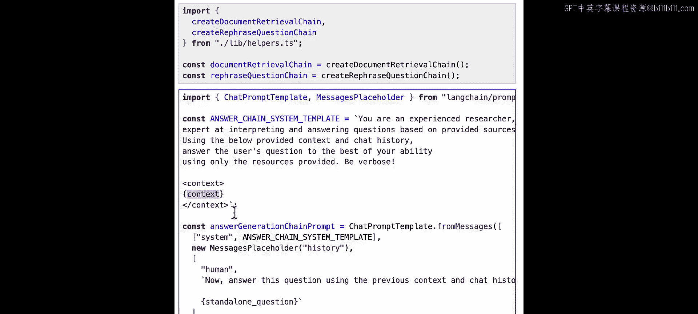

But it would be convenient to be able to directly stream bytes so we could pass our Lnk chain stream directly into the response from our server and fortunate Langchain provides an HTTP response output parser that pares chat output from chat models into chunks of bytes that match a variety of content types so to use it let's construct our conversational retrieval chain as before but skip that final string output parser step so we'll import our modules and then。

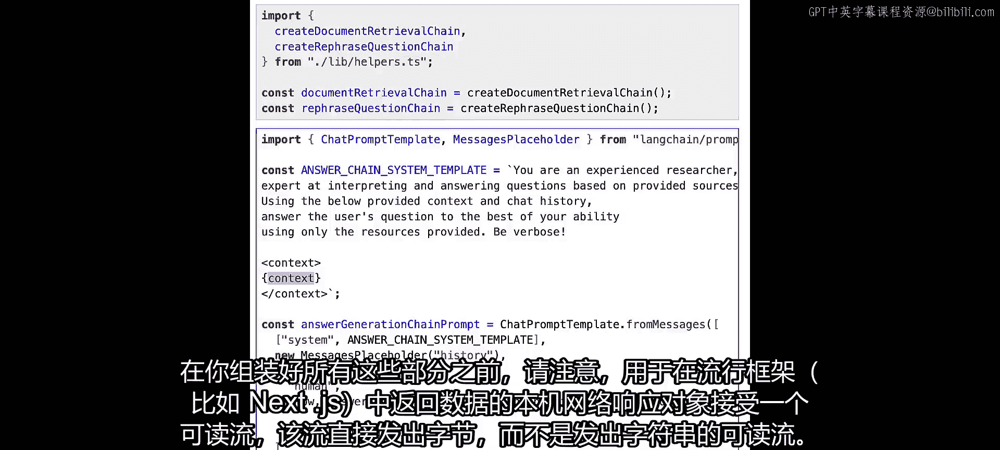

Create a runnable sequence exactly like the one in the previous lesson rather。

 minus that last step of parsing these chat output into a string。

 so now we'll create that HTP output response parser， HTP response output parser rather。

 and we'll create our final retrieval chain that takes into account message history。Cool。

With the H response alpha of parsel， we're going to pipe the final。

Output of our message history handler wrapped conversational retrieval chain。

 but we're going to pipe the output through to this new response parser which will stream back bytes for our server and the reason we're piping this into the output parsel at the end rather than in the middle of our conversational chain is because our history manager here requires。

Either a string or chat message to the final output rather than the bytes that this will convert our final stream into。

 So the other thing to consider here is because we're gonna to be running this chain in a web environment where many users could be accessing our endpoint at the same time and streaming responses。

 we're going to want to not reuse the same message history like we did in the demo in the previous lesson。

 but instead create a new message history per session I for each individual user this way。

 messages from different users will not get mixed up。 So additionally。You'll want。12。

Dear in mind that users should not share chat histories。And we should。Create a new。

Object per recession。So to do this， we'll define and override this get message history function here。

With one that takes into account previous sessions like this。

 if there is a right message history to existing for the session ID already。

We'll just return it and if not we'll create a new one。

 signifying that it's a new user and we shouldn't take into account any messages from other users。

 and then we'll recreate our final chain with this new method。Just like that。Same wrapped runnable。

 just with a different get message history function here。 wonderful。

 So now let's set up a simple server with a handler that calls our chain。

And let's see if we can get a streaming response。So we'll set a port here and。So 880， let's try 80。

 87。And then we'll create a little handler here that wraps and calls our chain in streaming fashion first parsing our question from a body。

An H request body and a session ID also from the body。

 and then it' will create a stream using the dot stream method from expression language on our chain and then pass that directly to a response so that our server will stream back a response in a true production deployment you'd likely want to set up authentication or input validation via submitalware but we'll skip that for simplicity for now now let's start our server since we're running in Dno we use a Dno built in HTP method but this general concept is shared by many Js frameworks and we'll run it on our port and a run our handler whenever we get a request here。

 A and now we're live on local host 8087 So a few more housekeeping things before we get too far into it。

 let's make a little few helper functions that will make handling streaming response is a little bit easier from our server one will be to allow us to re chunkunks in a asynct iteration fashion so we're gonna keep reading based on a pastin reader until there are no more chunks to be read and a sleep function to ensure that our notebook doesn't shut down execution before the request finishes。

Read need to call her endpoint。We'll use the Web native fetch function。

Here to make an HTP request to that server， we just spun up a weight fetch and we're gonna give it our port we'll type in there and we'll make the method post and if you're familiar with the web or kind of dealing with requests and responses this will look familiar to you but we need to specify the type of body that we're gonna to pass and because earlier if you recall we expect a JSON body。

 we need to make sure that our header here has a content type of application JSON and then our body is going to be a parameter for question。

 a parameter for our session ID which in again in prod we would do a little bit differently。

 we wouldn't just hard code this we assign it somehow based on the user accessing our endpoint and we stringify it to match web standards now let let's call our let's add some code to consume the streaming response so we get a reader from the readable stream return from the server and then we'll use this async iteration syntax to get each chunk and log it and finally。

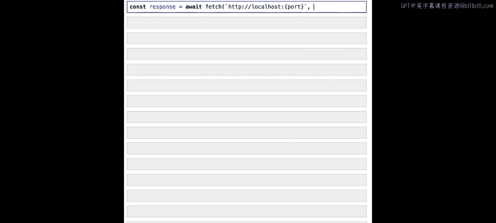

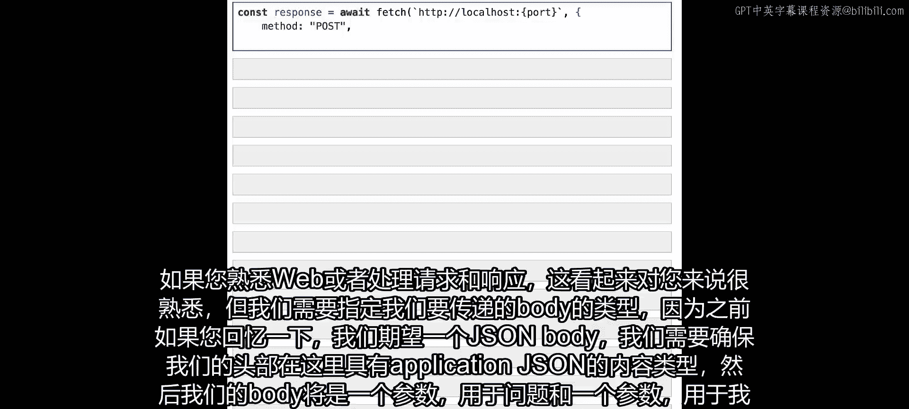

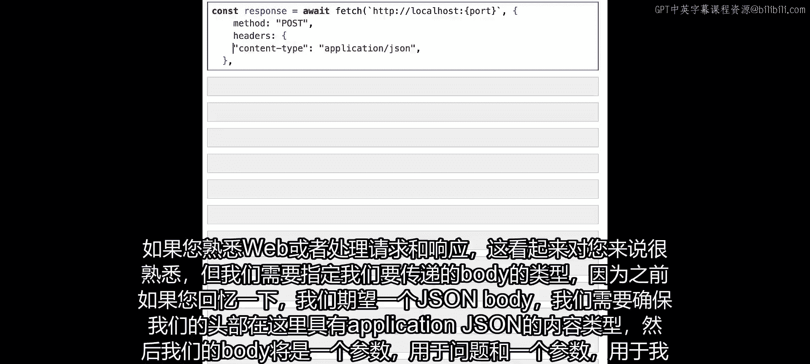

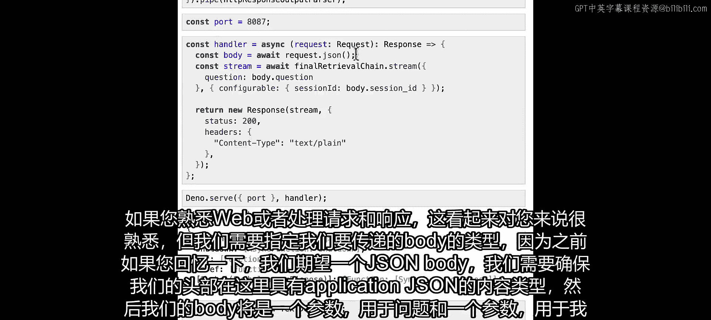

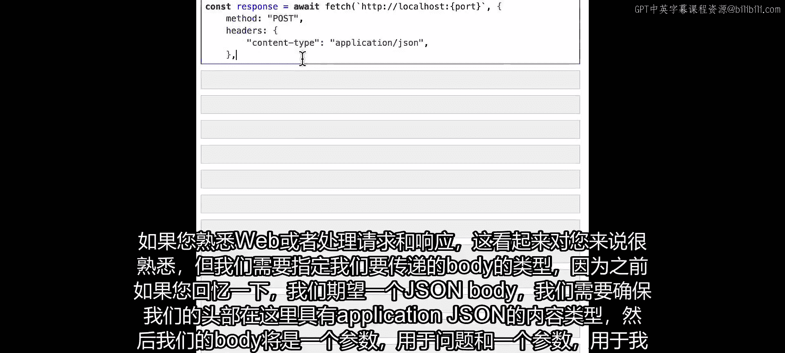

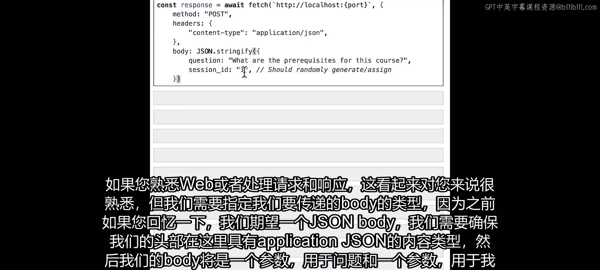

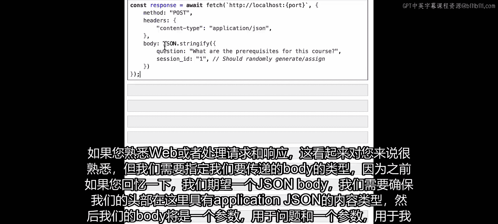

The housekeeping bit because we're in a Jupyter notebook。

 we want to make sure that a request finishes before the notebook cuts off cell execution now we're ready to call the endpoint。

Let's do it。And because we use a similar question here， what are the prerequisites for this course。

 we get a similar answer， the prerequisites for this course encompass a few fundamental areas of knowledge。

 solid grasp of basic probability statistics， which you might recall were in the source material and some other reasonable looking outputs。

So this is great， but now let's test the memory by asking a follow up question。

So we'll use the same sort of fetch patterns before where we await fetch and we'll plug in the port properly with the same method。

 headers and body just with a slightly different follow up question。

 so instead of asking directly what are the prerequisites we'll ask the follow up。

 can you list them in bullet point format and we'll use the same code as before to read the readable stream and parse it via this asynct iterator and we'll log the individual chunks and then we'll do the housekeeping step of sleeping。

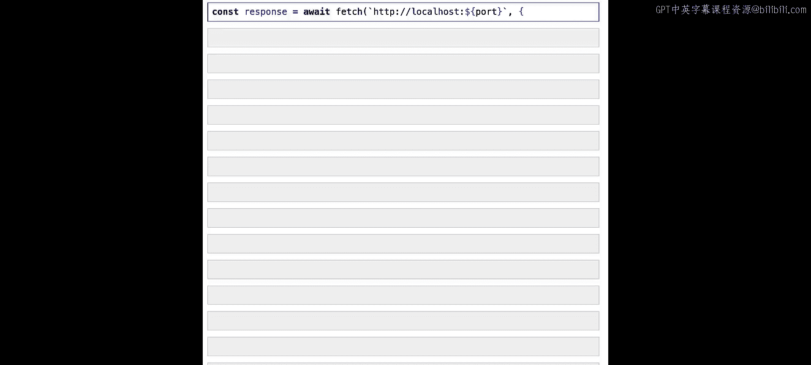

To make sure that the request finishes before， our notebook shuts things down。

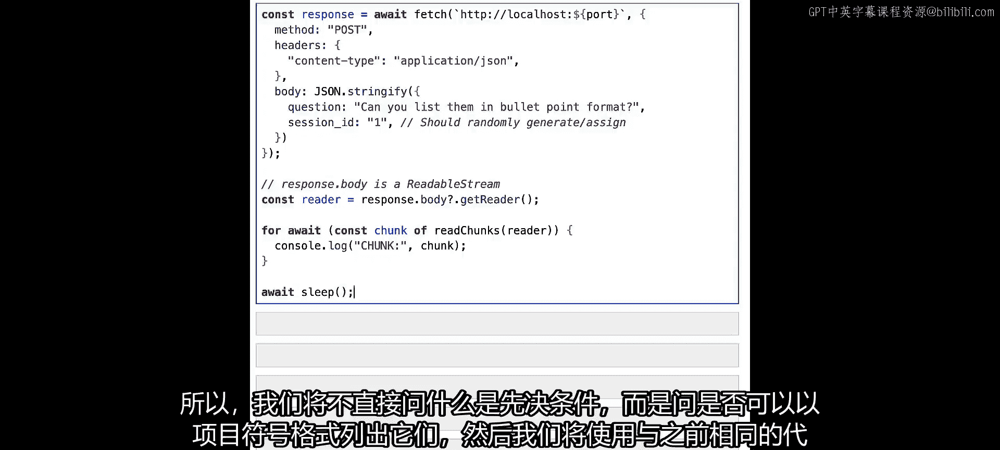

Let's run it。Sweet and now we see a nice conversational follow up where it rephrased the prerequisites through the course in bullet point format familiarity with basic probability statistics。

 assumed knowledge of concepts like random variables etc in bullet point format as prefixed by this dash so the great this is a key step in making client apps more responsive because you can start showing these chunks in the front end before the entire response finishes and let's try again with a different session ID to make sure that we're not going to get crossconaminated messages so again very similar fetch request format here local host to our port and instead。

Of our previous session ID as a body parameter we're going to pass in a new session ID and we're going to ask what did I just ask you So in this case we should not expect to get any kind of reference to a previous chat history with the first session I and let's see if that works based on the provided context and chat history it seems you did not ask a specific question as explicitly mentioned in with of text Awe so we didn't pull in anything from the previous conversation that is unique to that user and in this case we get。

A separate wholly new chat history that's the end of the lesson。

 but I would encourage you to play around with what we've built by asking different questions。

Trying out different session IDs and getting a sense and comfort level for how you can implement this lesson in your own projects。

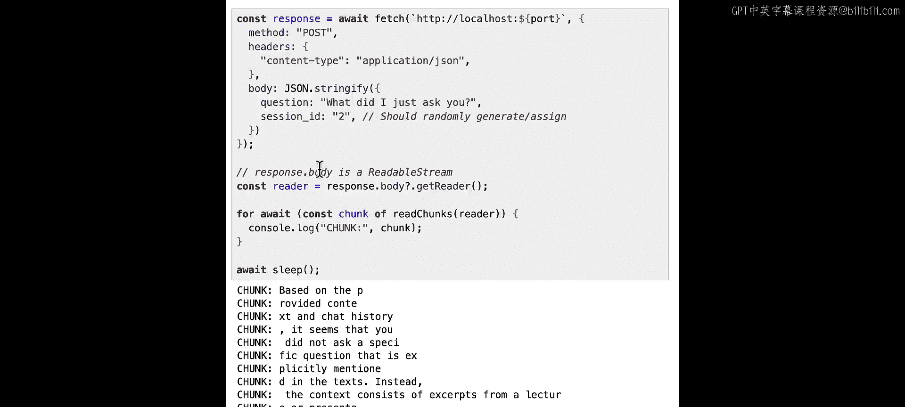