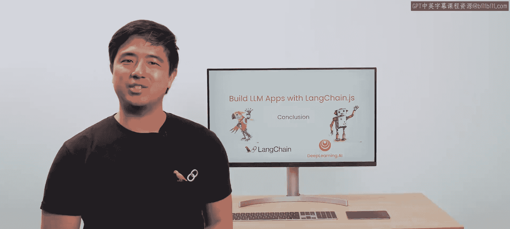
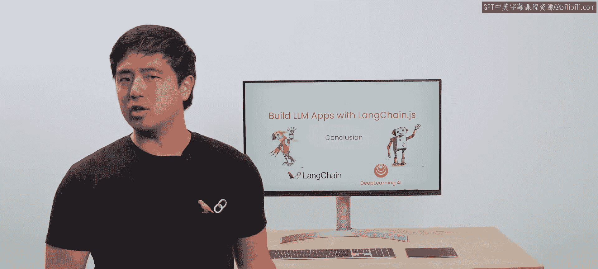
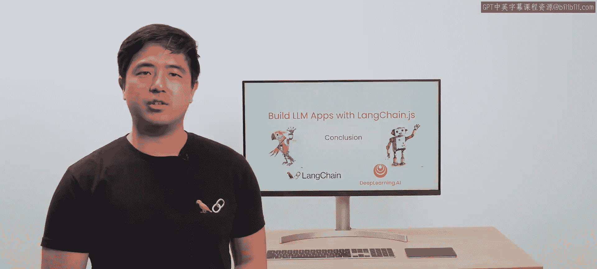
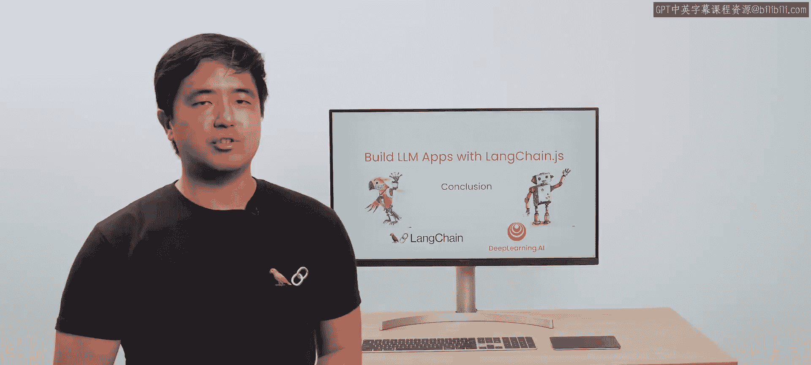

# 吴恩达《使用LangChain.js构建LLM应用程序｜Build LLM Apps with LangChain.js》中英字幕（英字可关闭） - P8：8.Conclusion.zh - GPT中英字幕课程资源 - BV1d5411v7em

Congratulations on completing this course by now you've gained some experience around the fundamentals needed to build sophisticated context aware applications with large language models。

And you've learned a bit about putting them into production。

There's a ton of potential for the Web devev community to leverage their unique skill sets。

 ship amazing things with these amazing models。

And I hope this course helps you in your journey。

Thanks again for watching and happy Chaing。