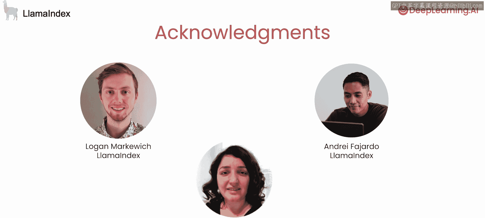

# 吴恩达《使用LlamaIndex构建主动式RAG｜Building Agentic RAG with LlamaIndex》中英字幕 - P1：1.introduction.zh_en - GPT中英字幕课程资源 - BV18m421u7zD

Welcome to building a gen rag with Lama index。 I'm joined by Jerry Liu。

 who is cofounder and CEO of Lama Inex and the instructor for this course。 Thanks， Andrew。

 I'm super excited to be here with you In this course， you learn about agent rag。

 a framework to help you build research agents capable of advance to use reasoning and decision making over data。

 For example， whether if you have a set of research papers on some topic and you want to pull out the past relevant to a question you want to ask and get a synthesis of what the paper say。

 This is a complex requests that require multiple steps of processing。 Further。

 earliest steps of processing， like maybe identifying a theme from one paper might also change the later steps that are needed。

 like retrieving additional information from other papers about that theme。😊，In comparison。

 the standard Ra pipeline， which is very popular， is mostly good for simpler questions over a small set of documents at works by retrieving some context。

 sticking that into an OM prompt and then just calling the OM a single time to get a response This course will take the idea of chatting over your data to the next level and show you how to build an autonomous research agent you learn the progression of reasoning ingredients to a building a full agent First routing where you add decision making to route request to multiple tools。

😊，Next toUs where you create an interface for agents to select a tool as well as generate the right arguments for that two and then finally multistep reasoning with to use will use an LM to perform multistep reasoning with a range of tools while retaining memory throughout that process You will learn how to effectively interact with an agent and use its capabilities for detailed control and oversight This will allow you to not only create a higher level research assistant over your ragg pipelines but also give you more effective ways to guide its actions specifically you'll learn how to ensure debugability of the LLM We' look at how to step through what your agent is doing and how to use that to improve your agent。

One additional very powerful tool is to let the user optionally inject guidance at intermediate steps For example。

 if you see it searching the wrong document， a little nudge to search a different document from human input much like an experienced manager that's you giving a more junior employee a nudge to consider a new piece of information can give much better performance many people have worked to create the course I'd like to thank from Lama Index Logan Markowch and Anja Farjado from DeepL AI Dila Eadin also contributed to the schools In the first lesson you will build a router over a single document that can handle both question answering as well as summar。

That sounds great， let's go to the next video and get started。😊。

