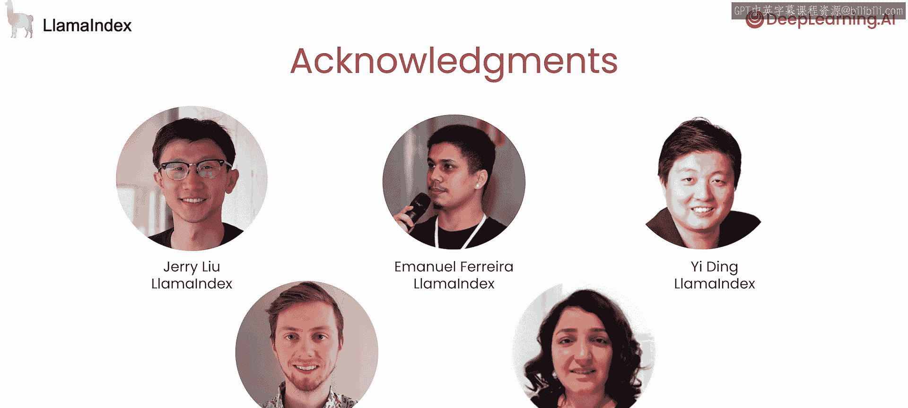

# 吴恩达《使用LlamaIndex构建RAG全栈Web应用｜JavaScript RAG Web Apps with LlamaIndex》中英字幕 - P1：1.introduction.zh - GPT中英字幕课程资源 - BV1N1421D7dS

Welcome to Javascript Rag web apps with Lama Inex built in partnership with Lama Inex I'm joined by Lori Vos。

 VP of developer relations at Lama index and the instructor for this course。 Thanks， Andrew。

 I'm super jazzed to be here with you and to teach this course。

 Ra applications are in very high demand across multiple businesses right now is one of the most common things I hear people wanting to build on top of LMs In this course。

 you learn the deep technical details behind how you can build a full stack rag web application。

 including how to set up your backend and frontend workflow in jascript This course uses jascript But if you're familiar with coding but just not the ja language youll still be able to follow along In parallel。

 you will learn step by step how to build a full stack web application。

 you will start by building a backend web API and learn how it gets called and how to integrate Lama index into that API。

 then you will build an interactive。😊。

1 componentonent in react that calls your API and displays the responses to your queries In one of the lessons。

 lesson3， you also dig further into RA techniques by building an intelligent agent that's capable of selecting between multiple data sources and of using functions as tools to take action to gather information。

 This is a very powerful technique that can be used to create highly flexible。

 highly capable software。 You also dive into production ready techniques for your web app where you learn how to persist your data and how to load the game。

 So you are constantly reindexing your data。 Then you move from simple oneoff queries to ongoing chat and switch from waiting for answers to getting realtime responses or streaming。

 Lori will go through these concepts in detail and also show you how to set up the create Lama come line to from Lama index that generates fullsac web app templates and helps you get all this into production。

 Many people have。😊，To create this course I'd like to thank from Lama index Jerry Leo。

 Emmamanuel Ferreira Eating and Logan Markkoch from Deep Bal AI。

 Dila Eadin also contributed to this course。 In the first lesson。

 you'll start with building a Lama index rag system in jascript。 That sounds great。

 Let's go on to the next video and get started。😊。

