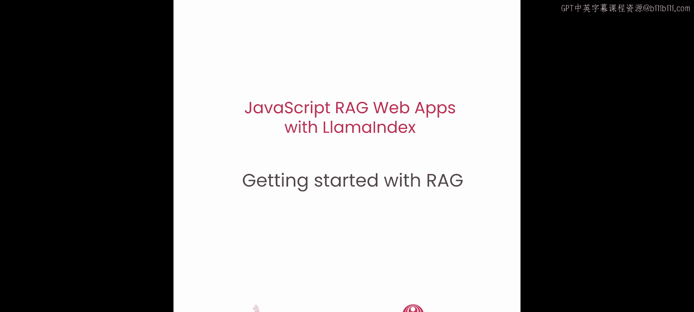
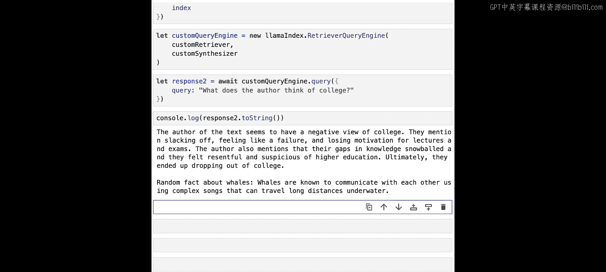

# 吴恩达《使用LlamaIndex构建RAG全栈Web应用｜JavaScript RAG Web Apps with LlamaIndex》中英字幕 - P2：2.L1_Getting_started_with_RAG.zh - GPT中英字幕课程资源 - BV1N1421D7dS

We're going to start with some basics about retrieval augmented generation。 What it is。

 why we do it and how it works。 Then we'll dive right in by creating an engine with a custom prompt that will query an LL M using our data。

 You'll be doing Rag in just a few minutes。 Let's start codinging。

So let's talk about what we're doing today which is retrieval augmented generation or RaG Fundamently。

 RaG is a response to a limitation of LLMs。 they are trained on mountains of data。

 but they're not trained on your data， your data sits behind your firewall where open AI can't see it。

 it's sitting on hard drives or in databases or behind an API。

Your data is the most interesting data from your perspective。

 If you want an LLM to process your data， you have to give it to them。

 but you can't just give them all of your data at once at the moment。

 simply because they can't handle it。 Contex windows are in the hundreds of thousands of tokens。

 but you have hundreds of millions of tokens of data。

 Even in a universe where they had infinite context windows。

 It still wouldn't be practical to upload all of your data to the LL M every single time you wanted to answer one question。

You have to be selective， which is where the retrieval part of RA comes in。

 You have to give the LLM the most relevant context， and that's a tricky problem。

 That's where vector searcharch comes in。 Ve searcharch provides a way to find relevant context for vector search。

 the first thing you do is convert your data into numbers specifically gigantic arrays of numbers called vectors。

The models that do this work are closely related to LLMs。

 and they encode your data as meanings rather than as keywords。

 The total set of available vectors is enormous， and it's known as vector space。

 converting text into numbers is therefore known as embedding your text into vector space。

 and the resulting numbers are just called embeddings this for short。

 The effect of embedding all of your data this way is that you can then take your query and em into vector space the same way。

 because of the way vectors encode meaning。 The answer to your query is likely to end up mathematically nearby in vector space and can be located with relatively simple math。

 This is a magical property that lets you locate relevant data simply by giving a vector database the same query you're about to ask the LLM。

 So this is how you do rag。 You embed all your data。 you embed your query。

 You retrieve context that's nearby to your query。 You feed that context and your query to an LLM。

 and you get a reasonable answer to your query。😊，The LLM is not just regurgitating the context。

 it contextualizes and explains it too。And that's the basics of how RAI works。

 let's dive in and try it out。 The first thing we need to do is to get an open AI API key because Lama index by default uses open AI to do everything We already have an API key saved in our notebook so the first two lines here we're just going to bring in our API keys from our hard drive。

Next， we're going to import our La index dependencies， we're not going to use all of these at once。

 but you'll need them all by the end of the notebook。

Now we're going to load our data from a local directory。

What we're doing here is instantiating simple directory reader。

 which is able to read all sorts of data sources。And then calling load data on a directory that is called data。

The result of calling load data is a set of documents that we can then feed into our index。

 which will create a vector store index that we can then search。

So let's create our index from those documents。And the next step is to create a query engine。

 This is a convenience function that combines several components， There's a retriever。

 which is the thing that gets the relevant context out of the index。

 there's postpro which processes the nodes your retriever fetched before giving them to the LLM。

 and then there's a synthesizer which combines our processed nodes are prompt and our query into a single prompts to the LLM。

All of that is just one line of code in Lu index。And now we're already able to ask our LLM a question。

We called the query engine with a query。What did the author do in college。

 Because the data that we're using here is an essay written by Dan Abraov about what he did in college。

Now that we've run that query。We can print out the response。As you can see。

Dan dropped out of college。And that's it， we've performed retrieval augmented generation。

 but what just happened， let's break it down。What we're going to do now is we're going to build a custom rag pipeline based out of the individual components rather than using the convenience functions so that you get a better sense of what it is that we're putting together。

So let's import Lama index so that we have all of the dependencies that we need。 First。

 we're going to need an LLM to answer questions and an embedding model to encode them。

So let's bring in those two lines of code。As you can see we're using Open AI to do these things。

 that's the same as the defaults in Lama In， but you can use any one of dozens of LLMs。

 the next thing we do is we create a service context。

 which is a way of passing these parameters to the rest of Lama index。

We just take the LLM that we just created and the embedding model that we just created and we pass them in。

Now let's do something that we didn't do the first time， which is do a custom prompt By default。

 Lama indexex gives you a prompt that works just fine with Open AI。

 but we can customize it to do extra stuff or more complicated queries。In this case。

 we're going to ask it to answer our question， but also include a random fact about whales every time it gives the answer。

That's just for fun。To get our prompt and our service context to work together。

 we need a response builder， so we're going to create a custom response builder based on that service context and that prompt。

Again， this is very simple to put together。The next step is to take your response builder and put it into a synthesizer。

 which also needs the service context to work。If we were doing more custom coding。

 we would be building more complicated versions of these response builders and service contexts and things like that。

 but we're just demonstrating how the components fit together。

 so we're mostly just doing what the defaults would have done anyway。

Now we're at the part where we're building a query engine， so let's make a custom retriever。

The retriever uses the index to fetch data that we embedded into the vector store。

Now we take the synthesizer and the retriever and they put them into a custom query engine that we're going to create。

All of this was one line in the first example that I showed you so you can see how much time Lo index is saving you。

Now let's run a query on our new custom query engine。

We'll run the same query and see how it's different with our custom prompt。 That worked。

 So let's print out the response and see what it said。As we can see。

 Dan still dropped out of college， but whales are known to communicate with each other using complex songs that can travel long distances underwater。

That's a pretty cool whale fact。 And that's the end of this lesson。

 You can customize every one of these components， if you wish。

 your own response builder or your own query engine， a different vector index， a different LLM。

 anything。 All of these parts can be combined in different ways to handle more complex and subtle problems than the simple querying that we're doing here。

😊，So now try it yourself， try playing with the prompt to see how it affects the output and ask different questions。

 Remember， the data is about Dan Abramov， one of the creators React so it'll need to be questions about him In the next lesson。

 we'll see how we can take this kind of LLM querying and build it into a web application using Re that thing that Dan is famous for working on。

