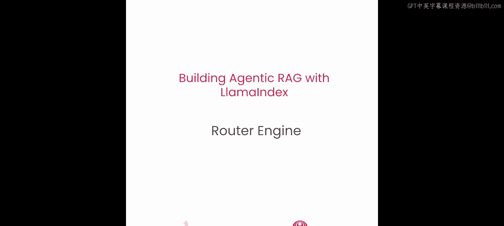
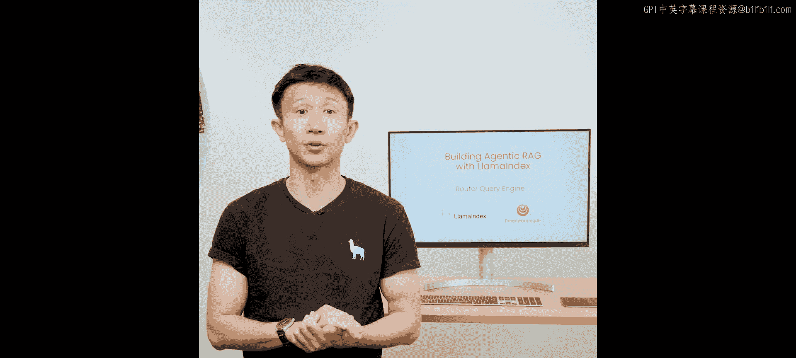
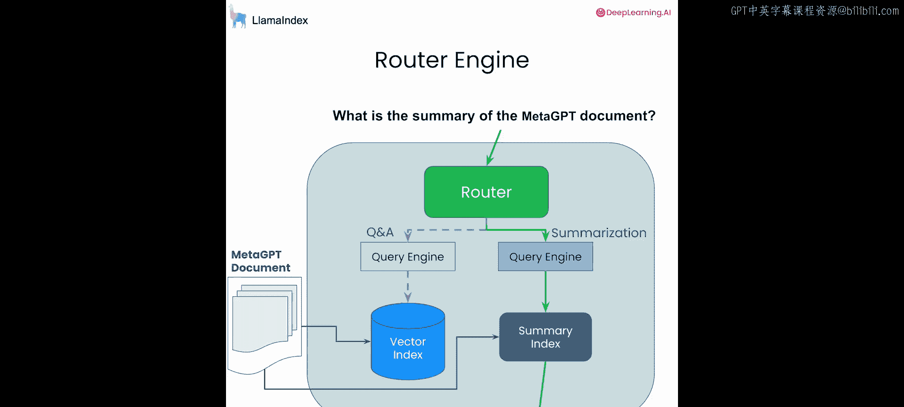
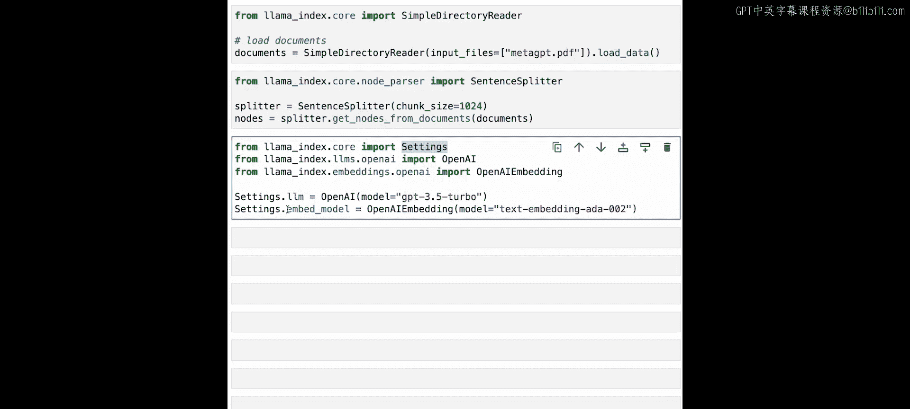
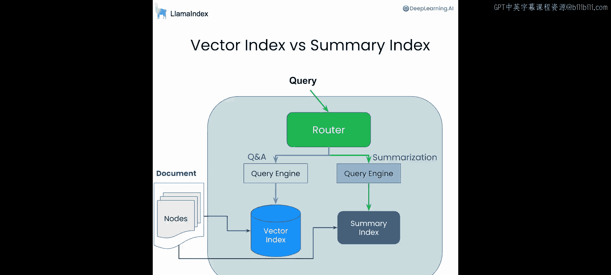
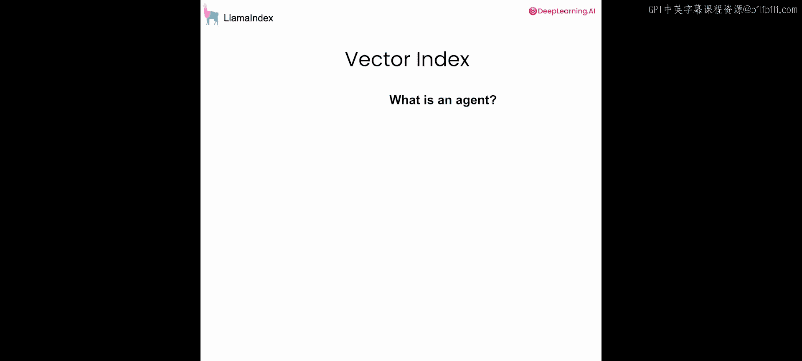
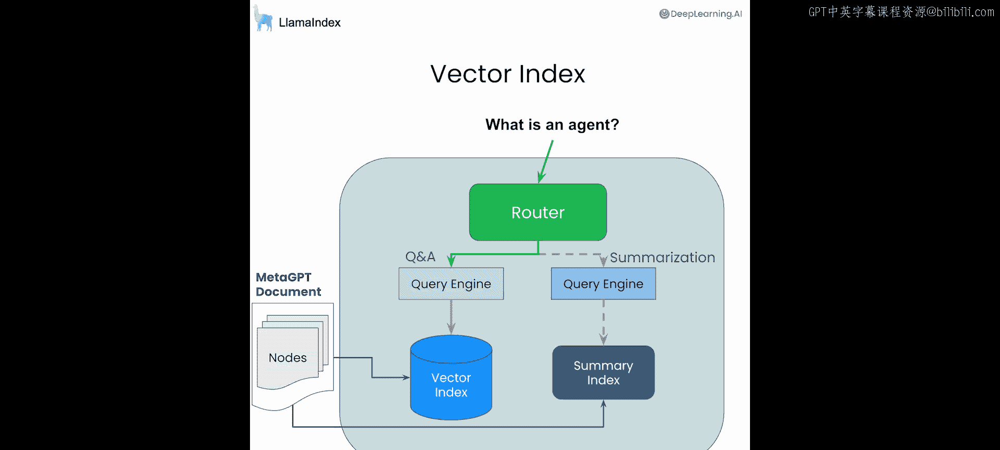
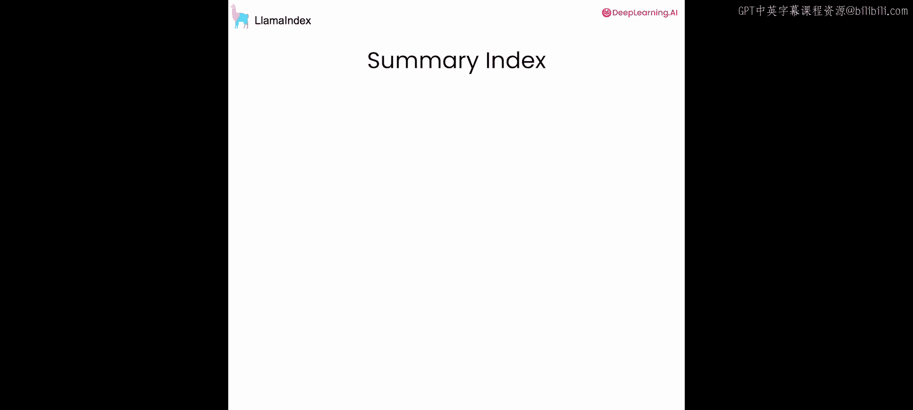
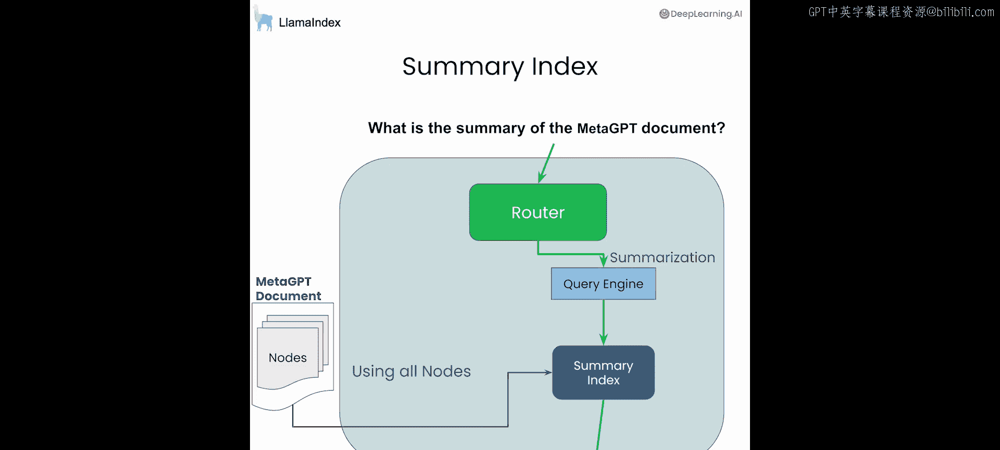
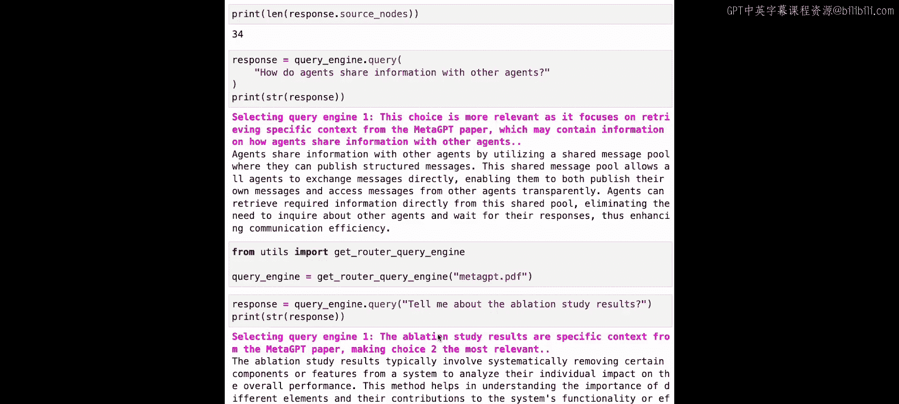

# 吴恩达《使用LlamaIndex构建主动式RAG｜Building Agentic RAG with LlamaIndex》中英字幕 - P2：2.Router Engine.zh_en - GPT中英字幕课程资源 - BV18m421u7zD

In this lesson， you will start with the simplest form of a gentic rack， a router。 Given a query。

 the router will pick one of several query engines to execute a query。

 You will build a simple router over a single document that can handle both question answering。

 as well as summarization。

Let's dive in。

Given a query， the router will pick one of several query entrances to executecut query。

 so this gives you some dynamic query understanding capabilities。

We'll show you how to build a very simple router over a single document that can handle both question answering。

 as well as summarization over that document， the first three lessons show you how to build agentjuta capabilities over a single document and the last lesson will show you how to build a multidoment agent。

So let's get started。The first thing we'll do is to import our open AI key。

 and to do this we'll define a helper function。Next。

 we need to import a special module called Nest Async IIio。

The reason for this is that Jupiter runs an event loop behind the scenes and a lot of our modules use AsInc and to make AsIync play nice with Jupyter notebooks we need to import this The next step in terms of setup is to load in a sample document。

Here we use metaGPT， a recently accepted oral paper at ICclR 2024 on a cool new multiagent framework。

You should definitely check out the paper if you're interested。

 or if you're interested in uploading your own documents， please feel free to do so。

Next we'll import the sentence split from Lama In， the next piece here is we are going to use our simple directory reader module and Lama index to read in this PDF into a parse document representation。

In order to split these documents into even sized chunks and will split on the order of sentences。

 so we set the trunk size to 1024 and we call splitter get notess from documents to split these documents into nodes。

The next step is optional and this allows us to find an LLM and embedding model and you can do this by specifying a global config setting where you specify the LLM and embedding model that you want to inject as part of the global config by default we use 3。

5 turbo and tax embedding 8 to 02 in this course， but of course this allows you to have the groundwork to basically inject your own LLMs as well as embeddings。

So we define the settings object and Se。 Lm equals OpenaiI and Se embedding model equals Open AI embedding。

Now we're ready to start building some indexes。Here we define two indexes over these nodes。

This includes both a summary index and a vector index A refresher is that we can think of an index as a set of metadata over our data。

 you can query an index and different indexes will have different retrieval behaviors。A vector index。

 for instance， indexes nodes via text embeddings and as core abstraction in Lo index and a core abstraction for building any sort of ragG system。

Quing a vector index will return the most similar nodes by embedding similarity a summary index on the other hand。

 is also a very simple index， but querying it will return all the nodes currently in the index。

 so it doesn't necessarily depend on the user query。

 but will return all the nodes that's currently in the index。

To set up both the summary and vector index， it's a matter of importing these two simple modules。

Now let's turn these indexes into query engines and then query tools。

Each query engine represents an overall query interface over the data that's stored in this index and combines retrieval with LLM synthesis。

Each query engine is good for a certain type of question。

 and this is a great use case for a router which can route dynamically between these different query engines。

A query tool now is just the query engine with metadata。

 specifically a description of what types of questions the tool can answer。

So here we define the summary query engine equals summary index as query engine。

 and then also vector query engine equals vector index。

We can see that the query engine is derived from each of the indexes。

 we can see that for the summary query engine we set use async equals S to basically enforce faster query generation by leveraging ASync capabilities。

Next， a query tool is just the query engine with metadata。

 it's specifically a description of what types of questions the tool can answer。

And we'll define a query tool for both the summary and vector A query engines。

Through this code snippet right here， you see that the summary tool description is useful for summarization questions related to metaagGBT。

 and the vector tool description is useful for retrieving specific context from the metaagGBT paper。

Now that we have our query engines and tools， we're ready to define our router。

 LaMma Index provides several different types of selectors to enable you to build a router。

 and each of these selectors has distinct attributes。The LLM selector is one option。

 and it involves prompting an LLM to output a JSON that is then parsed。

 and then the corresponding indexes are queried。Another option is to use our pyantic selectors instead of directly prompting the LLM with text。

 we actually use the function calling APIs supported by models like OpenAI to produce pyantic selection objects rather than parsing raw JON for each of these types of selectors we also have the dynamic capabilities to let you select one index route2 or actually multiple let's try an LLM powered single selector called LLM single selector。

So we import two modules， we import a router query engine， as well as the LLM single selector。

You see that the router query engine takes in a selector type as well as a set of query engine tools。

The selector type you see is just the LLM single selector。

 which means that it prompts the LLM it makes a single selection。

 and the query engine tools include the summarization tool as well as the vector tool。

Now let's try testing out some queries。The first question we'll ask is what is a summary of the document？

The verbose output allows us to view the intermediate steps that are being taken。

We see that the output includes selecting query Engine zero。

 useful for summarization questions related to metaGBT。This means that the first option。

 the summary tool is actually picked in order to help answer this question。And as a result。

 you're able to get back a response， the document introduces metaGputT。

 a meta programming framework for LLM based multi Asianian collaboration。

And this gives an overall summary of the paper and is synthesized over all the context of the paper。

So the response comes with sources and to inspect the sources。

 we can take a look at response source nodes。When we take a look at the length of response source nodes。

 we see that the length is equal to 34。Coincidentally。

 this is exactly equal to the number of chunks of the entire document。

 and so we see that the summary query engine must have been getting called because the summary query engine returns all the chunks corresponding to the items within its index。

Let's take a look at another example， we'll ask the question。

 how do agents share information with other agents。

 so let's ask this against the overall router query engine and take a look at both the verbose output as well as the response。

Here we see that we actually select query Engine1 and the LLM gives some reasoning as to why I actually pick the vector search tool as opposed to a summary tool。

It's because it focus on retrieving specific context from metaGPT paper where agents sharing information with other agents is probably located within a paragraph of that paper and you see that it's able to find that context and generate a response so you're able to utilize a shared message tool where they can publish structured messages。

And that basically helps to conclude lesson one。To put everything together。

 all the code above can be consolidated into a single helper function that takes in a file path and builds the router query engine with both vector search and summarization over it。

We've included this as a helper function for you to try out。

 and if you want to load in your own PDFs by all means， do so and take a look at the results。

So this is in a u's module called Gt router query Engine。

 and we just do query engine equals Gt router query Engine， MattgbT。pdf。

And we can test out an example question。So our example question is。

 tell me about the ablation study of results， we query the query engine and get back the response。

In this case， you see that we also look at query Engine 1 because the ablation study results reference specific context from the metaGPT paper。

 and so we want to do vector search。And we're able to get back a final answer。

So that's basically it for lesson one， and we'll see you in lesson two。

