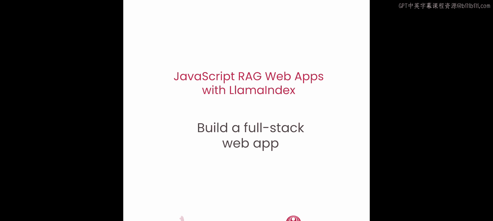
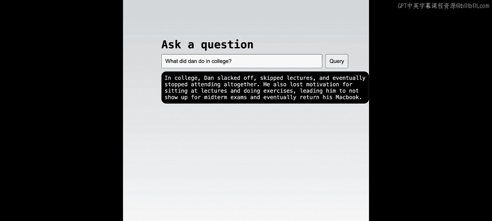

# 吴恩达《使用LlamaIndex构建RAG全栈Web应用｜JavaScript RAG Web Apps with LlamaIndex》中英字幕 - P3：3.L2_Build_a_full-stack_web_app.zh - GPT中英字幕课程资源 - BV1N1421D7dS

Now we're going to switch gears to web development。

We'll show you step by step how to build a backend Web API。

 how it gets called and how to integrate Lama index into your API。

 Then we'll build an interactive frontend component in react that calls your API and displays the results to your queries。

 All right， let's dive in。 The first thing we're going to do is create a very simple web server。

 This server will act as a web API。 taking responses from the web and responding with our data。

 As you can see， the handler takes a request。 That's the rec object。

 Our response this time is going to be the classic string of text Hello world。

 which we need to encode using a text encoder。 That's the second line。😊。

Then we return the text in a response object which is built into our environment。

 and we set it to HtP status 200， which means that the request was successful。

 Now that we built our web server in Dno， this is very easy to do。

 we just use the Dno do Ser object and we start on port 8001 and we give it the handther This starts at listening on local host 8001 but how do we know that that's working Let's make a request to the server to do that。

 we're going to use the builtin Fech command This is a web API that's also available inside of Dno。

Now that we've made our response， let's get the text of that response and see what it is。드라。

We've got our server， we've made a request to it and we've got responses。

So let's shut down that server。And do something more complicated。Remember。

 every time you run a server， it's going to occupy the port that you tell it to occupy。

 so if you don't remember to shut down your server。

 you won't be able to start a new server on the same port。

So if you get an error trying to start up on port 8001， tryport 8002。

 What we're going to do now is build a more complicated server that runs rag queries just like we did in the previous lesson。

 but respond to them as a web API To do that， we're going to bring in all of the code from the previous lesson where we brought in our depths we brought in our keys We set up our documents。

 our index and our query engine。 We're going to do this all at once because it's exactly the same as we did in the last lesson。

Now we're going to create a new handler that accepts a query's input and responds from the query engine that we just created Let's go through this line by line。

As you can see， we're going to call request method equals post。

We'll expect the incom inquiry to be adjacent object。With the key query containing the data。So。

We inspect the request objects and we get JSON out of it。Then。We use data。

 queryry as the query to our query engine。And the answer becomes a JON object。

 we can now create a response object that contains the response key using the string version of our answer。

 and we pass that as our response， so just like we passed Hello world last time we're going to pass some JON。

 which contains the string of our answer。If the request method isn't post just to be tidy。

 we'll respond with not found and a 404 code。Finally， we set up a server on port 8002。

 just like we did last time。Now let's make a query to our new fancy Web API。First。

 we'll set up the query。And next we'll do a fetch request just like we did before。

 instead of being a get request like it was last time this one is going to be going to port 8002 and it's going to be a post request because that's what we set up in our handler to respond to。

We're also going to set our content type of application JSON so that it knows that what we're sending is a JSON request and not just text。

 then we encode our query as JSON and we send it to the API。Let's see what we got out of the API。

We'll create a response object which takes JON from the response and then outputs it as a string。

As you can see， we get more information about Dan's unpleasant experience when he went to college。

 and now that we're done， just to be tidy， we'll shut down the server。

Before we start our next section， try modifying the code above a bit to get the feel for it。

 try returning different strings， and try running different queries just like you did in lesson one。

In thisnag section， we're going to jump from making simple web requests on the command line to using a real browser to do this。

 We're going to use a development version of a web app。

 which we've already set up for you In this video， you're just going to see the web app shown on the screen In your lesson。

 The notebook will output a link that you can click to open it in your browser to get all this going。

 We're going to use some utility functions that we've set up for you You don't need to know too much about what these are doing。

 but you can inspect the code if you're interested to see how they do it。😊。

We'll run our front end server。And then we'll run our backends server。

Now that we have our front end and back end running。

 let's create a react component that increments a counter。 We'll start doing this step by step。

 We'll first create the simplest possible react component that just shows a counter that's set to0 and a button。

In react all components are functions。 you can see that this function is doing something very simple。

 It's returning this stuff， which looks like HTML。 as you're going to see in a bit it gets a little bit more complicated than regular HTML。

 but it gets compiled it down to HTML eventually It's called JSX at the moment all we're doing is to providing an H1 called counter and a button。

Let's see what that looks like in our browser to insert it into our web app。

 we're going to be using another utility function called add to frontronend。As you can see。

 the JSX has been rendered as very simple HTML， we've got our counter set to zero and we've got a button called increment that doesn't do anything yet。

In the next step， we're going to modify our existing function to add a variable。

 We're going to create a variable called count， set it to 10。

And insert that variable where the counter is currently set to zero， let's see what that looks like。

As you can see， we've created a variable called 10 and here where it used to be set to zero。

 we're getting it to display the value of the variable。

We'll call add to front end and then we'll see what that looks like in our browser。Today。

 the counter is set to10。Now let's add some actual interactivity。In this iteration of the function。

 we have changed count into a pair of functions called count and set count that use U state。

 you don't need to know how U state works， but it's fundamental to the way that react。

 handles variables and changing them。We've also created a function called increment that simply adds one to the number every time it's called and then calls set count to update reactact on the value of that variable。

 we've also modified our button so that when we click it， it calls the function increment。

Just as before， we'll call add to frontron end and then see what it looks like on our web app。

The counter set to zero， but now when we click the button， ta， the number goes up。

 we've built an interactive react component。So at this point you've made a real react app you're well on your way to becoming a web developer The next step is to make an app that asks a question to our server instead of just incrementing a button。

In this version， we're going to create a component calledQury sendender instead。

 it'll provide a text input and a button and a place where the answer will go。

Let's see what that looks like。In this iteration of our function， it's now called query centerer。

 we have an H1 just like we did before， and we've created a form， the form has two elements。

 one is a text input and one is a button just like before， we've also created a div called answer。

 which is where we're going to put the answer when we get it。Let's call add to front end。

And see what that looks like。All right， we've got a very basic web app going。

 nothing really happens when we click the button。That's okay。

 We're going to add the interactivity next you might be wondering how all of this styling is coming in。

 what's making the box black， what's making the background gray。

 that kind of stuff we've taken care of that stuff for you in the background。

Just like we did when we were adding interactivity the first time we're going to add some variables in a function that changes them。

 we'll create query and set query and combine them with use date。

So you can think of these as just like the count except instead of the count。

 they contain the string that is our question， just like before where we had increment。

 we now have handle change， which is going to set our query to the E dot target。 value E do targetrg。

 value is the value of the text string that people put into that text box What we're going to do when they click the button is put that answer into the query variable which will then show up where the answer will be。

So basically， when somebody clicks this button， it's just going to put the question as the answer。

 not very helpful， but it gets us along the way to building an interactive web app。

We call add to front end and now let's see what the web app looks like。That's answered question。

As you can see， as we type stuff into the box， it shows up where the answer should go。

So that's not too impressive， but we're making progress。

Let's create a new pair with answer and set answer and put that value where the answer will go。

Then we'll add a new handler handle submit that will get called when somebody submits the form by hitting enter or clicking the query button。

As you can see， our functions is getting a little bit bigger。

 we have query and set query like we did before， and we have answer and set answer。

 Let's see how all of this connects together。Here in the form when we have handle submit。

 handling when people submit the form， When Hand submit gets called。

 you'll see that E dot prevent default happens。 This prevents the form from reloading the page。

 which is the default thing that happens when you submit a form。 Instead。

 we set the answer box to be the query that they asked and the string is the answer。

 Everything else is the same as before。 on change is handling that the changes to the value of the text input and the answer contains the answer string instead of the query string。

We'll call add to front end just like we always do and now see what happens。

It's no longer automatically updating， it waits until we hit the query button。Now。

 the answer is being filled in as our question plus the phrase is the answer。Again。

 this isn't really very impressive， but we're going to get there。

 so we're all set if you click the button it's going to expect an answer at the moment Hand Submit just takes the question and echoes it back to them。

 but we can expand Hand Submit to call that backend that we created earlier。

Just like in the first lesson， we'll make a fetch request to do this。In a real app。

 we'd do a whole bunch of error checking， what if the server is down。

 what if it doesn't know the answer， but we're going to skip all of that for the moment。

 Let's go through all of this line by line。Much of this is familiar， query and set query。

 answer and set answer， those are there like before。Handle change is doing what it always does。

 which is just setting the query to the value of the text box。

And the on submit and the handle change functions are the same。

 and the answer is still set to the answer string。What's changed is handle submit。

 We call preventvent default like we did before， and the very first thing we do is we set the answer to the string thinking。

 That's because the answer can take a while and we want the user to understand that something has happened while the answer is set to thinking。

 we're going to call our server with a post with application Json just like we did in the first lesson with a JsonN string containing our query。

We're going to await the answer from their server， and then we're going to set the answer to that answer。

Excellent， you can see that we've entered a question， we've hit the query button。

 it said thinking for a second， and then it gave us the answer from our RAG application we're done。

 we've written a full stack web application， we built a frontend that calls a backend。

 we built the backend that answers the question and we are set， you've made a web app。

In the next lesson， we're going to make our RAG application more capable。

 including building a semi autonomous piece of software called an agent。

