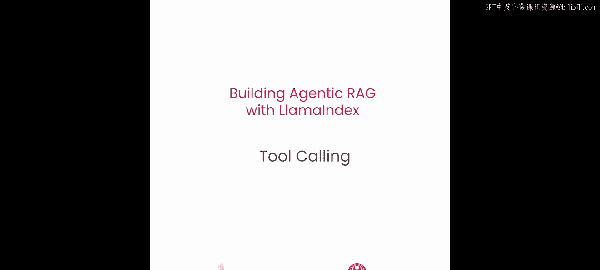
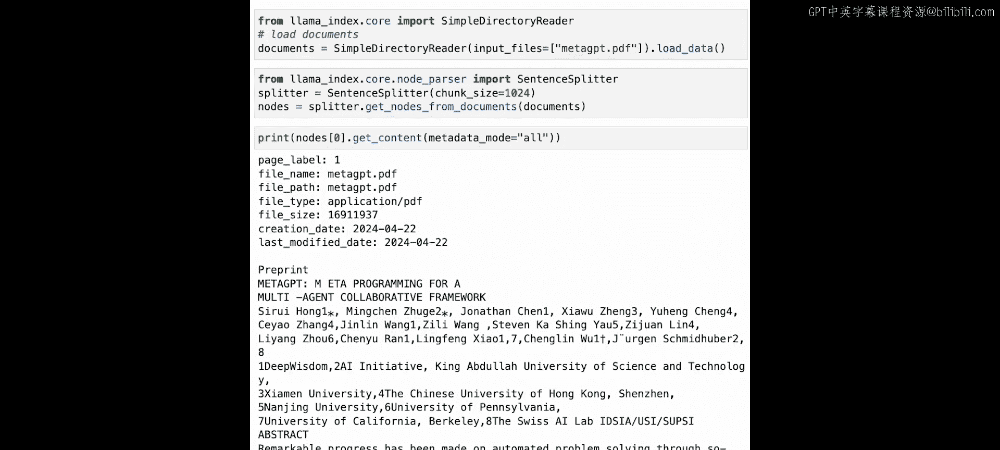
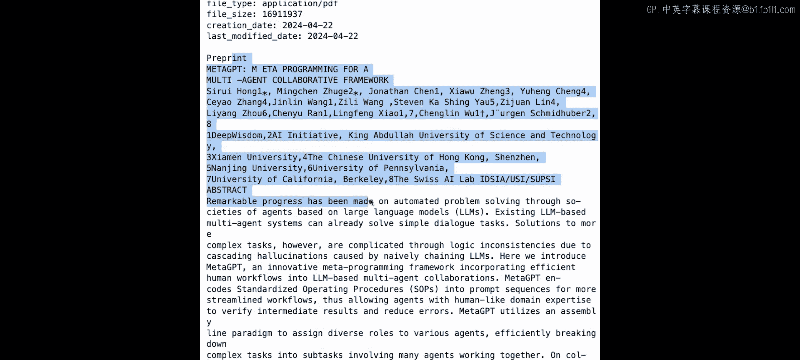
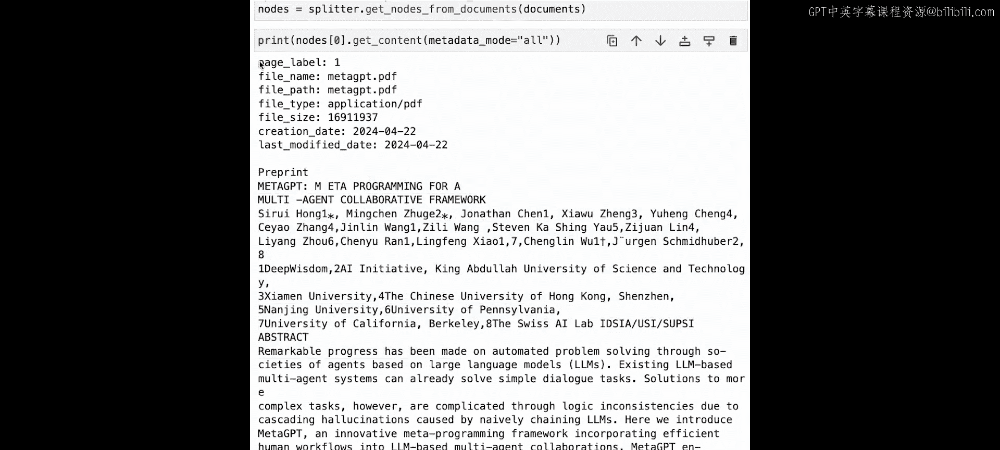
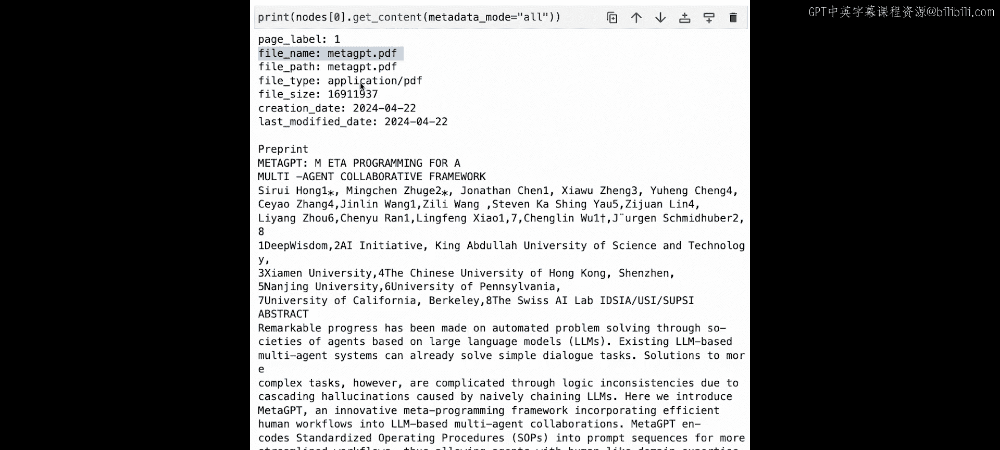
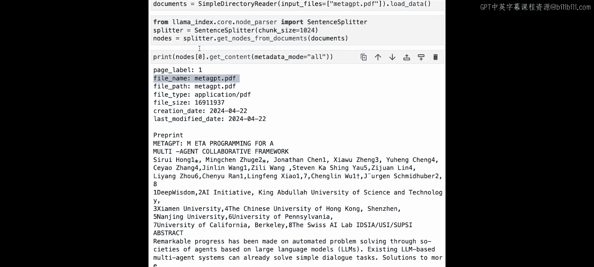
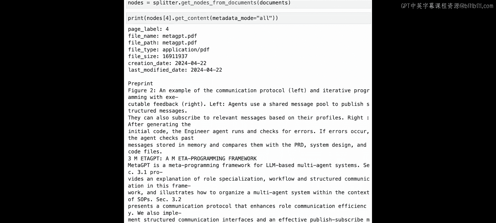
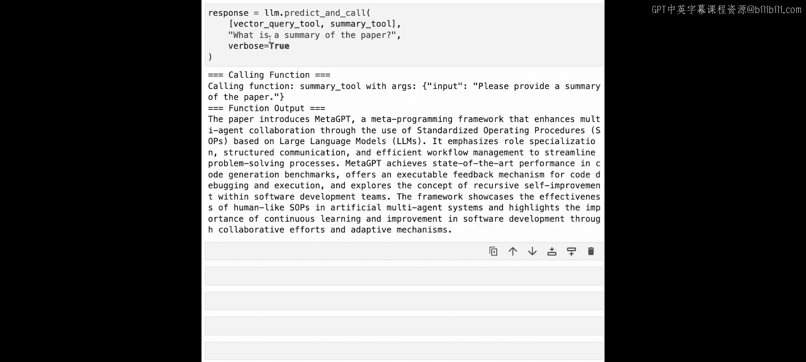

# 吴恩达《使用LlamaIndex构建主动式RAG｜Building Agentic RAG with LlamaIndex》中英字幕 - P3：3.Tool Calling.zh_en - GPT中英字幕课程资源 - BV18m421u7zD

In a basic rag pipeline， LLMs are only used for synthesis。

 The previous lesson showed you how to use LLMs to make a decision by picking a choice of different pipelines。

 This is a simplified form of tool calling， and in this lesson we'll show you how to use an LLM to not only pick a function to execute but also infer an argument to pass through the function。

All right， let's start coding。

One of the promises of LEs is their ability to take actions and interact with their external environment。

A necessary component to make this possible is a good interface for the AllLM use。

 we call this tool calling。In a basic rag pipeline， LLMs are only used for synthesis。

The previous lesson showed you how to use LLMs in a slightly more sophisticated manner by using it to pick the best query pipeline to answer the user query。

This is a simplified form of tool calling。In this lesson。

 we'll show you how to use an LLM to not only pick a function to execute。

 but also infer an argument to pass to the function。

This allows the LLM to figure out how to use a vector DB instead of just consuming its outputs。

 and the final result is that users are able to ask more questions and get back more precise results than standard dragG techniques through tool calling。

So let's get started。Similar to before， we are first going to set up our Open AIQ。

We are also going to set up and import our N AsynGo module next we'll give you a basic overview and introduction to tool calling。

We'll show you how to define a tool interface from a Python function。

And the LLM will automatically infer the parameters from the signature of the Python function using Lama index abstractions。

To illustrate this， let's first define two toy calculator functions to show you how tool calling works。

 well define an add function and also a mystery function。

The core abstraction in Lama index is the function tool。

This function tool wraps any given Python function that you feed it。

 and so we see that the function tool takes in both the add function defined here。

 as well as a mystery function， which is just x plus y times x plus y。

You see that both add and mystery have type annotations for both the X and Y variables as well as a dock stream。

This is not just for stylic purposes， this is actually important because these things will be used as a prompt for the All。

Our function tools integrate natively with the function calling capabilities of many AllLM models。

 including Open AI。To pass the tools to an LLM， you have to import the LLM module and then call predict and call。

This code snippet imports the Open AI module explicitly。And you see that the model is 3。5 turbo。

 and then we call the predict and call function on top of the LLM。

What Preic and call does is it takes in a set of tools as well as an input prompt string or a series of chat messages。

And then it's able to both make a decision of the tool to call as well as call the tool itself and get back the final response Here we see the intermediate steps calling function mystery with the arguments you know x equals2 y equals 9 so we see that at least I call the right tools and also infer the right parameters。

And the output is 121 and 11 times 11 is 121， so we got back the right answer。

 note that this simple example effectively is an expanded version of the router。

Not only does the LM pick the tool， but also decides what parameters to give to the tool。

 let's use this key concept to define a slightly more sophisticated agent layer on top of vector search。

Not only can the LLM choose vector search， we can also get it to infer metadata filters。

 which is a structured list of tags that helps to return a more precise set of search results。

We'll use the same paper metaGBT as before， and this time let's pay attention to the nodes themselves or the chunks because we'll take a look at the actual metadata attached to these chunks。

Similar to the last lesson， we'll use simpleimple directory readerer from Lama indexd to load in the parse representation of this PDF file。

Next， similar to the last lesson， we'll use the sentence splitter to split these documents into a set of even chunks with a chunk size of 1024。

Each node here represents a chunk， and let's actually take a look at the content of an example chunk。

So we'll take a look at the content of the very first chunk。And we can do this from doing node。

gap content。We set metadata mode equals all， which is a special setting to actually not just enable you to print out the content of the node itself。

 but also the metadata attached to the document， which is propagated to every node。

Here we see that once we print this out， we not only get back a parse representation of the front page of the paper。

We can also see the metadata attached at the very top。

So this includes a few things， this includes page label equal to1， this includes file name metagbT。

pdf， the file type， file size and created an end dates。

 we'll pay special attention to the page labels because you know for instance if we actually go in and try out a different node we see that we actually get back a different page number and so we actually add a page number annotation to average chunk。

Next， we'll define a vector store index over these notes。Similar to the last lesson。

 this will basically build a RA indexing pipeline over these nodes。

 it'll add an embedding for each node and it'll get back a query and。Differently from last time。

 we can actually try querying this rag pipeline via metadata filters just to show you how metadata filtering works so we import this object called metadata filters。

And then we simply specify a filter where the page label is equal to the value2 in addition to top K equals2。

So once we define this as a query engine and we call one or some high level results of metGBT。

If we take a look at the source nodes。Once we run this and we call what are some high level results of MeGBT and we get back a response。

 we'll first take a look at the response string。Which outlines the overall results of metGBT。

But crucially， we'll take a look at the page numbers。

And we see that as we iterate through the source nodes。

 we can actually print out the metadata attached to these source nodes。

 and we see that here the page label is equal to two。

 and so we see that it's able to properly filter out the page numbers to only restrict the search to the set of pages where the page label is equal to two。

The last section of this lesson will allow us to wrap this overall retrieval tool into a function。

This function takes in both a query string and page numbers as filters。

The LLM can actually then infer the page numbers to filter for the user query instead of actually having the user manually specify the metadata filters just a quick note over here is that the metadata is not only limited to page numbers as you've seen you can define whatever metadata you want like section IDs。

 headers， footers or anything else through Lo and index abstractions。

The ability to use many metadata filters is especially prominent and better models like Jupy4。

 so we highly encourage you to check that out here we'll define a Python function that encapsulates this we define a function called vector query which takes in the query as well as page numbers。

This allows you to perform a vector search over an index。

 along with specifying page numbers as a metadata filter。At the very end。

 we see that we define a vector queryie tool equals function toolol。 from defaults。

So we pass in the vector query function into the vector query tool。

 which allows us to then use it with a language model。So let's try calling this s with an LLM。

 specifically 3。5 turbo。We'll find that the LLM is able to infer both the string as well as the metadata filters。

We do print and call on the vectorqueries tool。And ask the same question。

 high level results of metaGBT as described on page2。

Here we see that the LLM is able to formulate the right query， high level results of metGBT。

 as well as specify the page numbers， which is two。And we get back the correct answer。Similarly。

 as before， we can just quickly verify the source notes。

And we see that the page label of the source nodes。

 there is one source node returned and it has a page label of two。Finally。

 we can bring in the summary tool from the router example in the first lesson。

 and we can combine that with the vector tool to create this overall tool picking system。

So this code just sets up a summary index over the same set of notes and wraps this in a summary tool similar to lesson one。

Now let's try a tool calling again， so the LLM has a slightly harder task of actually picking the right tool in addition to inferring the function parameters。

We asked what are MeGbT comparisons with Cha dev on page8？

We see that it still calls a vector tool actually， with page number equal to eight。

 and it's able to still give back the right answer。We can verify this by printing out the sources。

Lastly， we can ask a question， what is a summary of the paper to show that the LLM can still pick the summary tool when necessary。

And we see that it gives back the right response。So that's it for lesson two and in the next lesson we'll show you how to build a full agent over a document。

