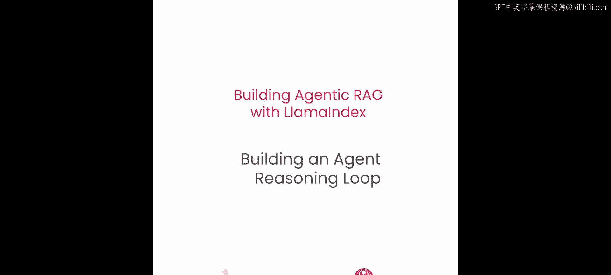
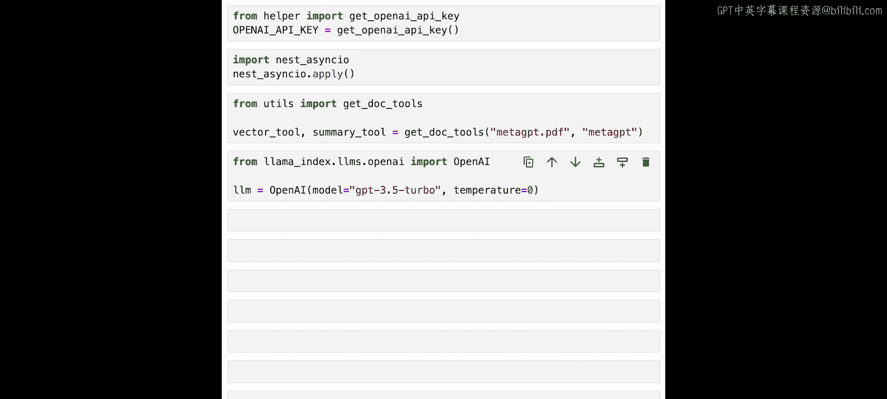
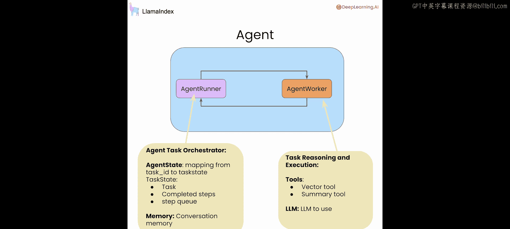
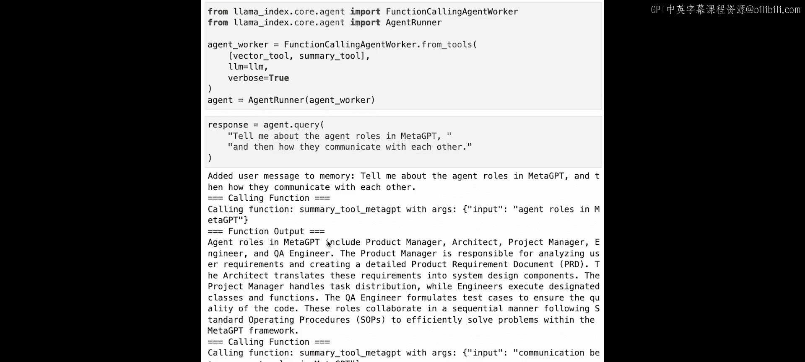
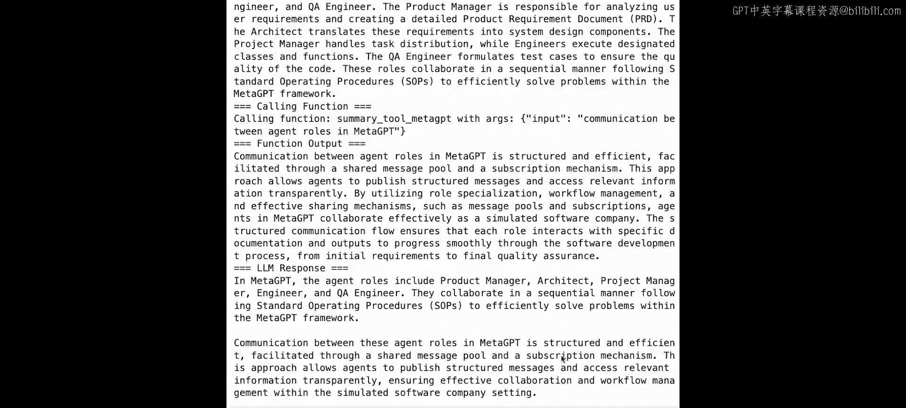
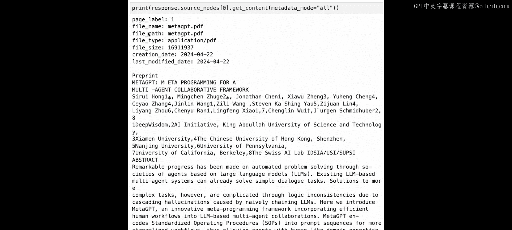
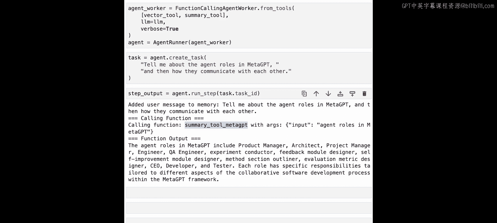
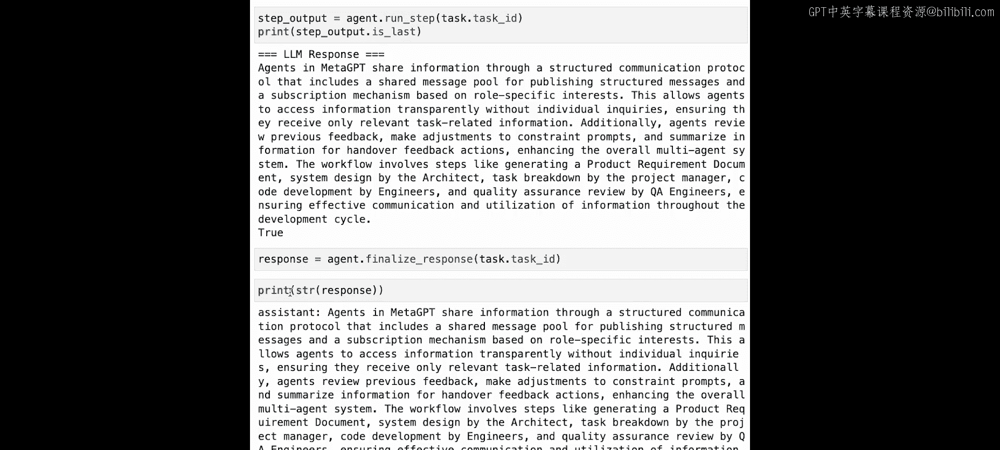

# 吴恩达《使用LlamaIndex构建主动式RAG｜Building Agentic RAG with LlamaIndex》中英字幕 - P4：4.Building an Agent Reasoning Loop.zh_en - GPT中英字幕课程资源 - BV18m421u7zD

So far， our queries have been done in a single forward pass， given the query。

 call the right tool with the right parameters and get back the response。

 but this is still quite limiting。 What if the user asks a complex question consisting of multiple steps or a vague question that needs clarification In this lesson。

 you will learn how to define a complete agent reasoning loop instead of tool calling in a single shot setting an agent is able to reason over tools and multiple steps。

You will use the function calling agent implementation。

 which is an agent that natively integrates with the function calling capabilities of Allys。

All right， let's have some fun。

To get started， we'll set up our opening IK。And then we'll set up and import essay in Gaio。For now。

 we use the same metaGBT paper as the previous two lessons。

In the next lesson we'll expand to the multidoc setting and we will also set up the auto retrieval vector search tool and the summarization tool from the last lesson to make this more concise。

 we've packaged this into a single line of code they can just import from the Us module。

We now set up our function calling agent。As with the previous notebooks， we use JuPT 3。

5 Trbo as our LLN。

We will then define our agent。In Lama In， an agent consists of two main components， an agent worker。

 as well as an agent runner。Think of an agent worker that's responsible for executing the next step of a given agent and an agent runner is the overall task dispatcher。

 which is responsible for creating a task， orchestrating runs of agent workers on top of a given task。

 and being able to return back the final response to the user。

So we import both function calling a worker from Lama index and also the a runner。

And for the function calling Hron worker， we pass in the two set of tools， the vector tool。

 as well as the summary tool。We also pass into the LLM and set verbose equal to true to look at the intermediateta outputs。

Think about the function calling agent workers' primary responsibility as given the existing conversation history。

 memory， and any past state， along with the current user input。

Use function calling to decide the next tool to call， call that tool。

 and decide whether or not to return a final response。

The overall agent interface is behind the agent runner。

 and that's what we're going to use to query the agent。We'll first ask this question。

Tell me about the agent roles and Me Juity and then how they communicate with each other。

So let's trace through the outputs of this agent。We see that the agent is able to break down this overall question into steps。

 so the first part is asking about agent roles and MAGBT。

 and it calls the summary tool to answer this question。

Now a quick note is that the summary tool isn't necessarily the most precise you could argue that the vector tool will actually give you back a more concise set of context that better represents this relevant pieces of text that you're looking for。

 however a summary tool is still a reasonable tool for the job and of course more powerful models like for Turbo or Cloud3 Sonet or OPus might be able to pick the more precise vector tool to help answer this question In any case we see that we're able to get back the output。

 the agent roles of MeagjuputT include product manager， architect， project manager， QA engineer。

 etc and then it uses this to perform chain of thoughtt to then trigger the next question which is communication between agent roles and MeagGputT。

We see we're able to get back an answer about that too， you know。

 communication between agent roles and metaGBT is structured and efficient。

 and we're able to combine this entire conversation history to generate a final response。

Communication and metaGPT the agent roles include these。

 they collaborate in a sequential manner to follow standard operating procedures。

And they use a shared messageable and subscription mechanism。

When you run a multistep query like this， you want to make sure that you're actually able to trace the sources and so luckily。

 similar to the previous lessons， you're able to look at response that source nodes to take a look at the content of these nodes。

So this allows you to， for instance， inspect the content of the first source node that's retrieved。

 which is just the first page of the paper。

Callingagent。query allows you to query the agent in a one off manner， but does not preserve state。

 so now let's try maintaining conversation history over time。

The agent is able to maintain chats and a conversational memory buffer。

The memory module can be customized， but by default it's a flat list of items that's a rolling buffer depending on the size of the context window of the LLM。

Therefore， when the agent decides to use a tool， it not only uses a current chat。

 but also the previous conversation history to take the next step or perform the next action。

So instead a query， we'll do Ad。tchat。The first thing we'll ask is tell me about the evaluation datasets used。

Here we see that it uses a summary tool to ask， what are the evaluation data sets used in metaGPT？

And we see the EVL data sets used include Human EVL， MBVPP， and Soft Devev。

You'll see an example of this ability to maintain conversation history because we'll ask a follow up question。

 tell me the results over one of the above dataset sets。

 obviously to know what the above datasets are， you have to have that stored in the conversation history somewhere。

So let's run this。And it's able to translate this query plus conversation history into a query on the vector tool actually。

 and it asks results over the human EVval dataset set。

 which is one of the EVval dataset sets that are used。And it's able to give you back a final answer。

So we just provided a nice high level interface for interacting with an agent。

In this next section we'll show you capabilities that let you step through and control the agent in a much more granular fashion this allows you to not only create a higher levelvel research assistant over your RA pipelines but also debug and control it some of the benefits here include greater debugability into the execution of each step as well as stability by allowing you to inject user feedback Having this lowlevel agent interface is powerful for two main reasons。

The first is the bug ability if you're a developer building an agent。

 you might want to have greater transparency and visibility into what's actually going on under the hood。

 especially say if your agent isn't working the first time around。Then you can actually go in。

 trace through the execution of the agent， see where it's failing。

 and actually try out different inputs to see if that actually modifies the agent execution into a correct response。

Another reason why this could be useful is to actually enable richer UXs where you're building a product experience around this core agententa capability for instance。

 let's say you want to listen to human feedback in the middle of agent execution as opposed to only after the agent execution is complete for a given task。

Then you can imagine creating some sort of async queue where you're able to listen to input from humans throughout the middle of agent execution and if human input actually comes in。

 you can actually interrupt and modify the execution of an agent as it's going on through a larger task as opposed to having to wait until the agent task is complete。

So we'll start by defining our agent again through the function calling agent worker as well as the agent runner setup。

 and then we start using the low level API we'll first create a task object from the user query。

And then we'll start running through steps for even interjecting our own Now let's try executing a single step of this task。

So let's create a task for this agent and we'll use the same question we used in the very first part of this lesson。

 tell me about the agent roles in metaGBT and then how they communicate with each other this will return a task object which contains the input as well as additional state in the task object。

And now let's try executing a single step of this task。We'll callag。runstep task。t taskask ID。

And the agent will execute a step of that task through the task ID and give you back a step output。

We'll see that it calls a summary tool with the input agent roles in MeGPT。

 which is the very first part of this question。And then it stops there。

When we inspect the logs and the output of the agent。

 we see that the first part was actually executed。So we call Ad Do gapap completed steps on the task ID。

 and we're able to look at nu completed for the task。We see that one step has been completed。

 and this is the current output so far。We can also take a look at any upcoming steps for the agent。

 and we can do this through agent。get upcoming steps。Again， we pass the task。

 task ID into the agent and we're able to print out the number of upcoming steps for the task。

We see that it's also one and we're able to look at a task step object with a task ID as well as an existing input this input is currently none because the way the agent works is actually just autogenerates action from the conversation history and doesn't need to generate an additional external input the nice thing about this debugging interface is that if you wanted to pause execution now you can you can take the intermediate results without completing the agent flow。

But let's keep going and let's run the next two steps and actually try injecting user input。

So let's actually ask， what about how agents share information？As user input。

 this was not part of the original task query， but by injecting this。

 this can actually modify agent execution to give you back the result that you want。

We'll see that we added the user message to memory。

And that the next call here is how agents actually share information and metaGPT。

And we see here that is able to give back the response。

The overall task is roughly complete and we just need to run one final step to synthesize the answer and to double track that this output is the last step。

 we just need to do step output。 is last。So we see we're able to get back the answer about how agents of Meegyptity share information。

 and this is indeed the last step。To translate this into an agent response similar to what you've seen in some of the previous notebook cells。

 then all you have to do is call response equals agent。finized response。

And we're able to get back the final answer。So that's it for lesson three。

 you've learned both about the high level interface for an agent as well as a low level debugging interface。

 and in the next lesson we'll show you how to build an agent over multiple documents。

