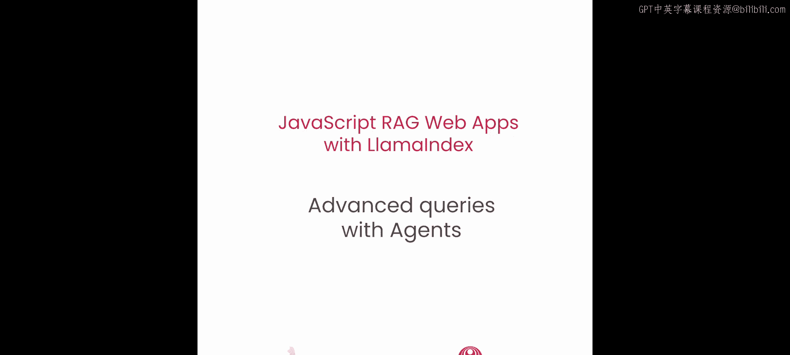
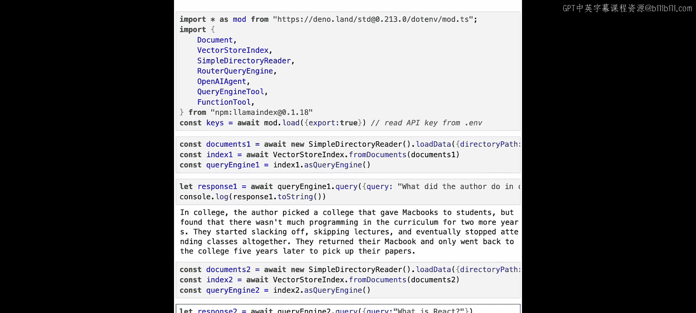
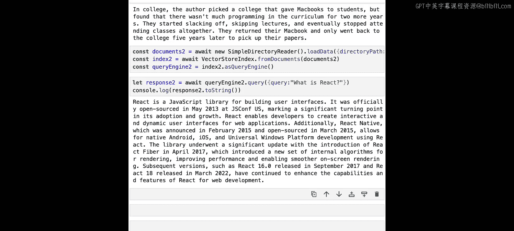
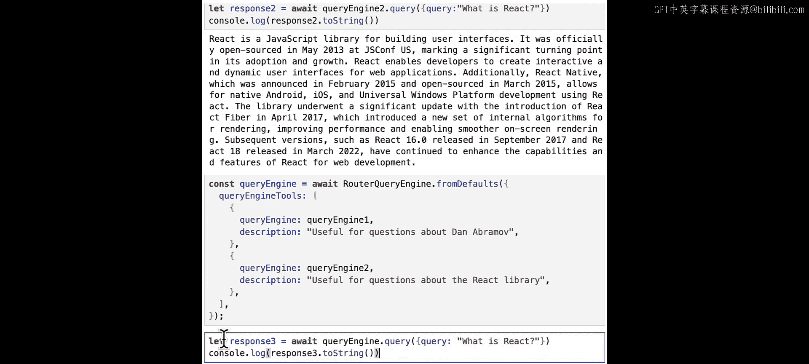
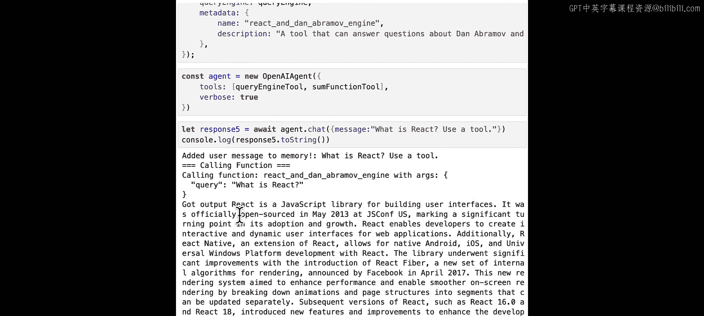
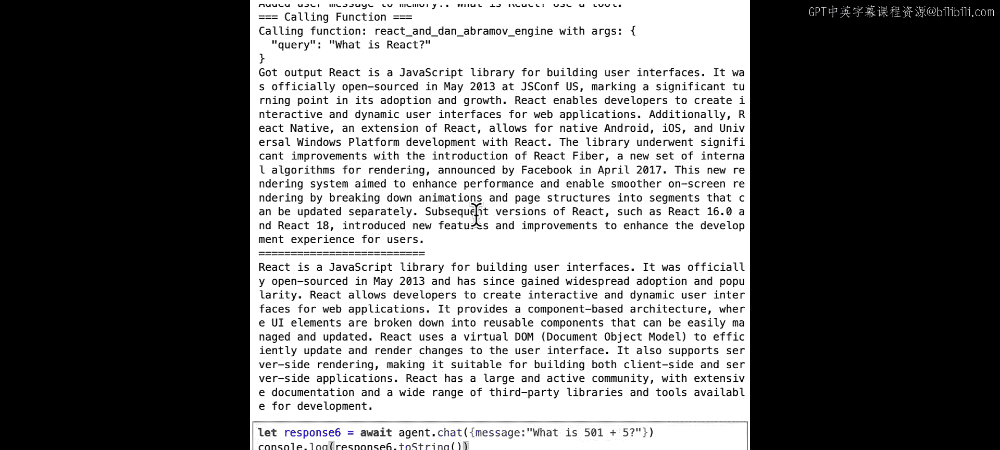
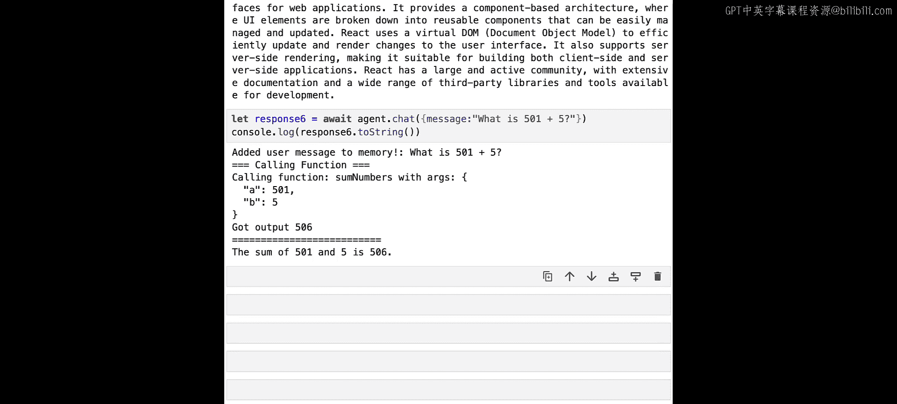

# 吴恩达《使用LlamaIndex构建RAG全栈Web应用｜JavaScript RAG Web Apps with LlamaIndex》中英字幕 - P4：4.L3_Advanced_queries_with_Agents.zh - GPT中英字幕课程资源 - BV1N1421D7dS

We've already got a basic rag app running in a full stack web app。 So what's next。

 Let's talk about the limitations of basic rag and some of the ways that we can improve it。

 including semi autonomous L LM powered applications called agents。

 We'll build our own agent and fire off some queries at it to see it in action。 All right。

 let's have some fun。😊。

In this lesson we're going to do more advanced querying in a real application you're not going to have one big pile of data。

 you're going to have multiple data sources that are focused on different types of answers。

One of the amazing things that LLMs can do is you can create each of those data sources separately。

 tell the LLM what each data source does， and the LLM can make the decision about which data source to query。

This is tool use and it's one of the most astonishing things that LLMs can do Lama indexdex builds tool use right into the library in a feature we call the router query engine。

 because it takes a query and it routes it to the right tool。

Let's see how to build one first we pull in our depths and our API key just like we did before。

There are a few more depths this time because we're going to be doing some more complicated things。

Now we're going to create two different data sources that answer different types of questions。

The first is the same example as we used before， an essay by Dan Abraov about his career。

You'll recognize these three lines of code from our previous two examples。

 we're creating a set of documents， we're creating an index from that document。

 and we're creating a query engine from the index。Because it's just an index like all of the other indexes that we've created。

 we can query it and get a response just like we did before。

We get our very familiar answer about how Dan didn't like college very much。Now。

 let's create our second index。 It's going to be exactly the same in terms of code。

 but it's going to point to a different data directory where we have a text version of the Wikipedia page about react。

 This is exactly the same code as before， except documents 2。

 index 2 and query engine 2 are what we're using as the variable names so that these two sets of data can exist at the same time。

And just like before， we can query it。 However， because this data is about something else。

 we have to ask it a different question。 In this case， we're going to ask it， what is react。

As you can see， it gives a nice， wordy answer。Now we're going to do the new thing。

 We're going to create our router query engine。 A router query engine can take an arbitrary number of query engines and use them as tools。

Each query engine has to come with a description， and that description is what the LLM will use to decide which tool to use to answer a specific type of question。

Let's see what that looks like。Here you can see we're creating a router query engine and we're passing at an array of query engine tools。

The first engine is query Engine 1， and we're going to say that it's useful for questions about Dan Abermov。

 and the second is query Engine 2， and we're going to say that that's useful for questions about the react library。

That's all the LLM needs。 Now we can give our new router query engine a question that only one of the data sources knows a question about react。

嗯。It thinks for a little bit， and then it gives us the perfect answer。

So we've not had to tell the query engine which tool to use。 It's figured that out on its own。

 It knows the answer having correctly picked the right tool。 If we ask about Dan Abramov。

 it does the same thing， but using the other data source。As usual。

 we get the answer about Dan not liking college very much excellent。

 you can easily imagine scaling this up to lots of different data sources full of data。

But let's take tool use to the next level。 In addition to query engines。

 we can define arbitrary functions and create what's called an agent that knows how to use them to demonstrate this。

 let's define a really simple function to demonstrate that just adds two numbers。To use a function。

 we have to tell the agent what the arguments are going to be。

 just like you would explain to a person how to use them。

We can put this explanation into a special JSON structure。 Let's see what that looks like。

You can see that we have defined the properties of our tool as having a， which is a number。

 which is the first number to add and B， which is a number， which is the second number to add。

 And we have defined them both as being required to use the tool。 Now。

 we can turn this function into a tool that can be used by the agent by combining our function and that explanation plus a description of the tool。

 just like we did with router query engine。There's the function name。

 there's the description which the LLM is going to use to decide whether or not to use this tool。

 and there is that description of how to use the tool。

To make this more fun we'll also turn our previous router query engine into a tool， As you can see。

 we can make agents upon agents and using tools that use other tools to create really complex and subtle pieces of software。

So now we have a query engine tool that takes our query engine and has metadata。

 including the name of the tool and the description of when to use it。

Now we're going to create an open AI agent and give it these two tools。

 we'll tell it to be verbose so that we can see what it's doing。

You can see there's a toolss array containing the query Engine tool and the some function tool and the command to be ver both。

Now let's do something that we know that it already knows how to do。

 We're going to ask it again about react。 We're going to ask it to use a tool because we have to cheat a little bit here because the LLM is really smart and the LLM has already been trained on a huge body of data。

 including react because Re is pretty famous So if you don't tell it to use the tool。

 it might not use the tool， it might just answer from its training data。

What we're doing here is we're watching it work in real time。

 You can see it calling the function with the query and getting the output。

 and then it turns that output into the answer that it gives back to us。

 But that part's not interesting。 Let's give it the thing that it couldn't do before。

 which is adding two numbers together。

LLMs are usually really bad at math， so asking in a question like what is 501+ 5 would usually get you the wrong answer if you were just using a basic LLM。

Here you can see it's calling the function。 It's using some numbers。 It's using A And B。

 like we told it， and it's added them together correctly using the function。 Great。

 we've taught L Lms how to do math。 This is a very simple tool。 Obviously。

 but your function can do anything。 Try creating another function that does something else and adding it to the array of tools in our agent In our next lesson。

 we're going to switch back to web development again， getting closer to real production applications。

 We'll show you how to persist your data and how to load it back in again。

 so you don't constantly reinex your data。 We'll also move from simple one off queries to ongoing chat and switch from waiting for answers to getting answers streamed back to us in real time。

 Then we'll take all of that and wrap it up in a web app again。😊。

