# 吴恩达《使用LlamaIndex构建主动式RAG｜Building Agentic RAG with LlamaIndex》中英字幕 - P5：5.Building a Multi-Document Agent.zh_en - GPT中英字幕课程资源 - BV18m421u7zD

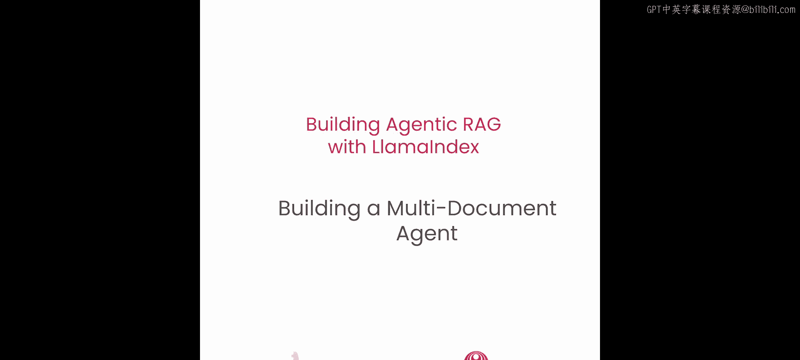

In the previous lesson， we built an agent that can reason over a single document and answer complex questions over it while maintaining memory。

In this lesson you will learn how to extend that agent to handle multiple documents and increasing degrees of complexity。

 let's get coding。

We'll start with a three document use case， and then we'll expand to an 11 document use case。

We'll set up our Open I key as well as importport NasA S Io。

And then the first task is to set up our function calling agent over three papers。

So we do this by combining the vector summary tools for each document into a list and passing it to the agent so that the agent actually has six tools in total。

So we'll download three papers from ICLR 2024， this includes MeGPT from last time。

 but this also includes long Lauraura as well as self ragG。Next we'll convert each paper into a tool。

So if you remember from lesson3， we have a helper function called get Doc Tos which automatically builds both a vector index tool as well as summary index tool over a given paper and so the vector tool performs vector search and the summary tool performs summarization over the entire document。

So for each paper， we get back both the vector tool and summaryum tool。

 and we put it into this overall dictionary， mapping each paper name to the vector tool and summaryum tool。

Next， we'll simply get these tools in a flat list。We'll define 3。

5 Trbo from Open AI as our Llum of choice。If we quickly take a look at the number of tools that are going to be passed to the agent。

 we'll see that the number is six， thats because we have three papers and we have two tools for each paper。

 a factory and a summary tool。The next step is to construct our overall agent worker。

And this agent worker includes the six tools as well as the LLM that we pass through。

And now we're able to ask questions across these three documents or within a single document。For now。

 let's quickly ask a question about long glra。Tell me about the EVL data using in L Lauraura。

 and then tell me about the EVL results。

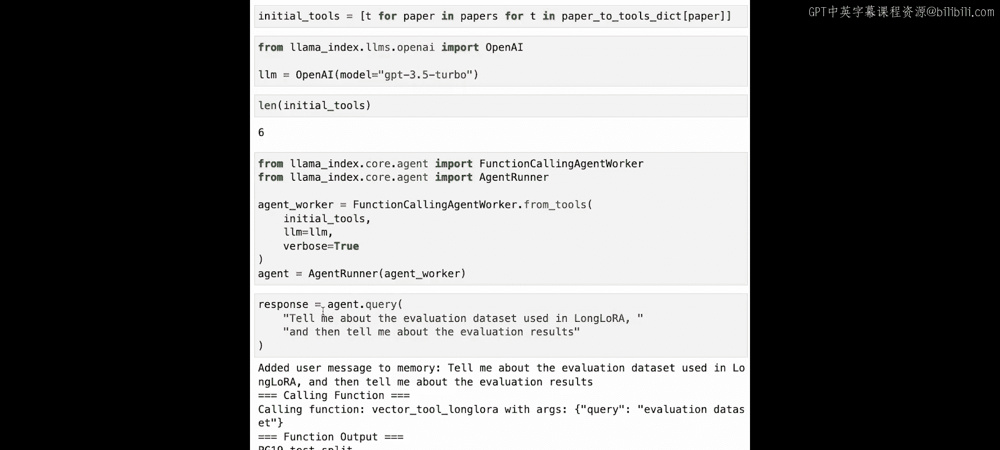

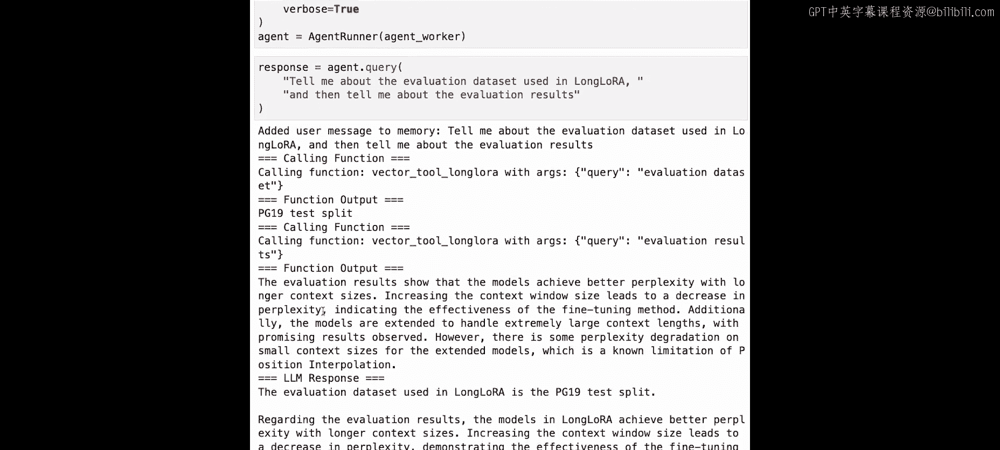

We get back the answer that one of the EvalL datasets use is a P 19 test split。

And then we're able to look at the E results for long chloral models The next question we can ask is give me a summary of both self rag and long Gra。

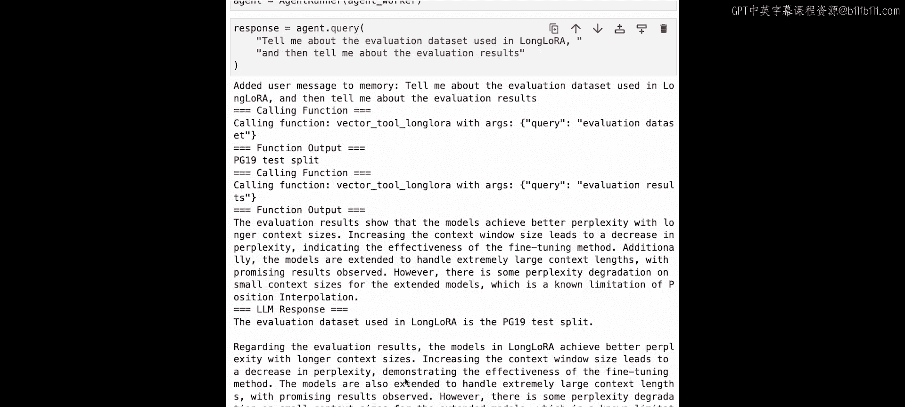

So this will actually allow us to do summarization across two papers。So first。

 we call the summary tool for self rack with the input of its name。

 and we're able to get back the output describing what the paper is about。

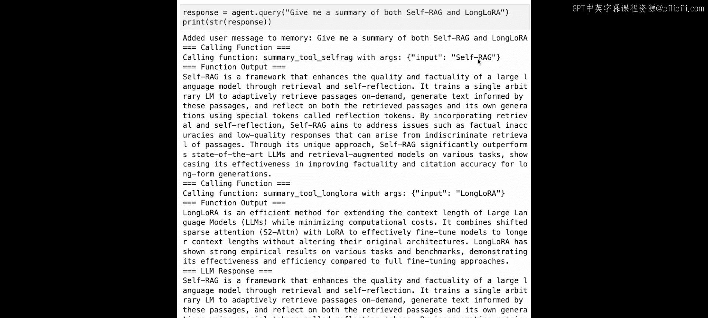

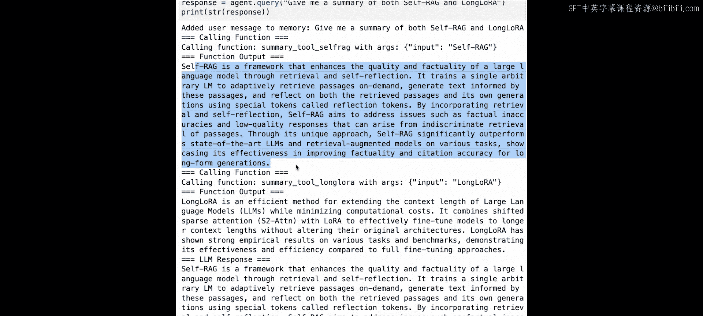

We see that the agent then calls the long Laura summary tool with the input long Laura。

 and then we get back an overall summary of long Lauraura。

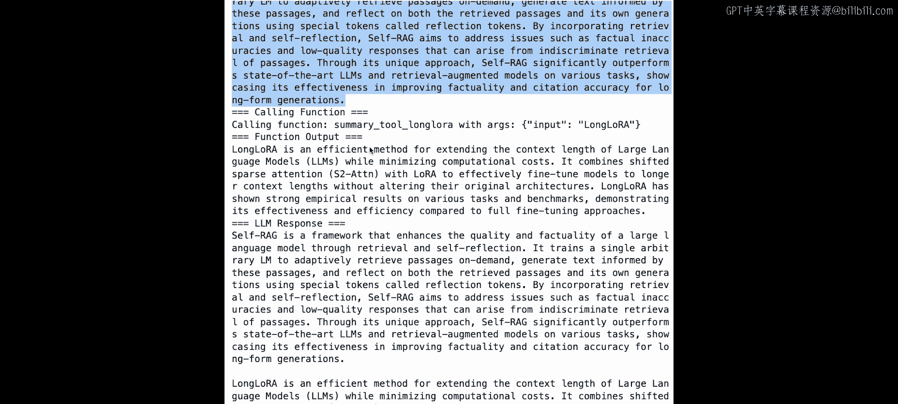

The final response is that we're able to get back both a summary of self rag as well as long Gora。

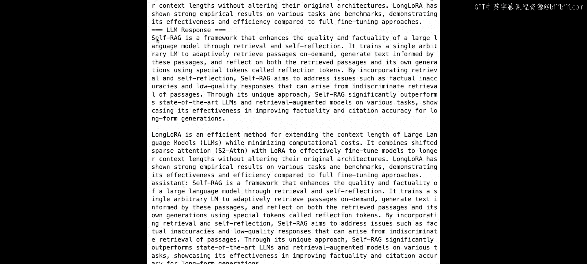

If you want to try out some queries on your own， you can try out any combination of these two papers or even three papers and ask for both summaries as well as specific information within the papers to see whether or not the agent is able to reason about the summary and vector tools for each document。

Now， let's expand into a more advanced use case。Here we'll actually have 11 ICclaiA papers。

 and so we'll download 11 research papers from ICLaiR 2024。This includes papers like MeGPT。

 Long Lauraura， Loft Qe， Sbench， selflf Ra， as well as a few others。Similar to the previous section。

 we will now build a dictionary mapping each paper to its vector and summary tool。

This section can also take a little bit of time since we need to process， index。

 and embed 11 documents。Now let's collapse these tools into a flat list。

This is the point at which we need a slightly more advanced agent and tool architecture。

The issue is that let's say we try to index all 11 papers， which now includes 20 tools。

Or let's say we try to index 100 papers or 1 thousand0 papers or more。

Even though LLM context windows are getting longer。

 stuffing too many tool selections into the LLM prompt leads to the following issues。

One is the tools may not all fit in the prompt， especially if your number of documents are big and you're modeling each document as a separate tool or a set of tools。

 cost latency will spike because you're increasing the number of tokens in your prompt。

And also the LLM can actually get confused， the LLM may fail to pick the right tool when the number of choices is too large a solution here is that when the user asks a query。

 we actually perform retrieval augmentation， but not on the level of text。

 but actually on the level of tools。We first retrieve a small set of relevant tools and then feed the relevant tools to the agent reasoning prompt instead of all the tools。

This retrieval process is similar to the retrieval process used in RAG Add it simpleims。

 it can just be topK vector search， but of course you can add all the advanced retrieval techniques you want to filter out the relevant set of results Our agents let you plug in a tool retriever that allows you to accomplish exactly this so let's show you how to actually get this done。

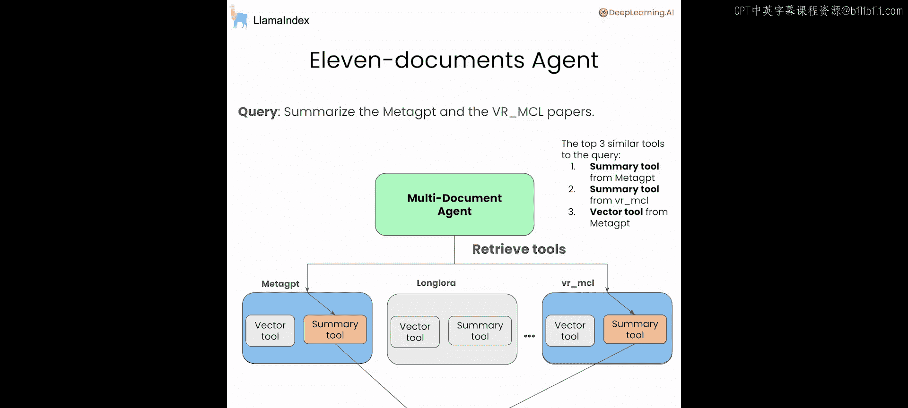

First， we'll want to index the tools。Lob Index already has extensive indexing capabilities over general text documents。

But since these tools are actually Python objects， we need a way to convert and serialize these objects to a string representation in back。

 this is solved through the object index abstraction in Lama index。

So we'll define an object index and retriever over these tools。

 we see that we import a vectorso index， which is our standard interface for indexing text。

But then we wrap this with the object index。And to construct an object index。

 we see we directly plug in these Python tools as input into the index。

You can retrieve from an object index through an object retriever。

This will call the underlying retriever from the index and return the output directly as objects。

In this case， it will be tools。Now that we've defined the object retriever。

 let's walk through a very simple example。Let's ask， tell me about the EVL dataset， use the metaGBT。

 and also Sbench now let's take a look at the first tool in this list。

We see that we actually directly retrieved a set of tools and that the first tool is the summary tool for Meagjuity。

If we take a look at the second tool， we see that this is a summary tool for a unrelated paper to meta Juputee and Sbench。

 so of course the quality of retrieval is all dependent on your embedding model。

 however we see that the last tool that's retrieved is indeed the summary tool for a sweetbench。

Now we are ready to set up our function calling agent。

We note that the setup is pretty similar to the setup in the last lesson， however。

 just as an additional feature， we show that you can actually add a system prompt to the agent if you want。

This is optional， you don't need to specify this， but you can， if you want just additional guidance。

 if you want to prompt the agent to output things in a certain way。

 if you want it to take into account certain factors when it reasons over these tools。

And so this is an example of that。Now let's try asking some comparison queries。We ask。

 tell me about the EvalL data set use MeGBT and compare it against SB。

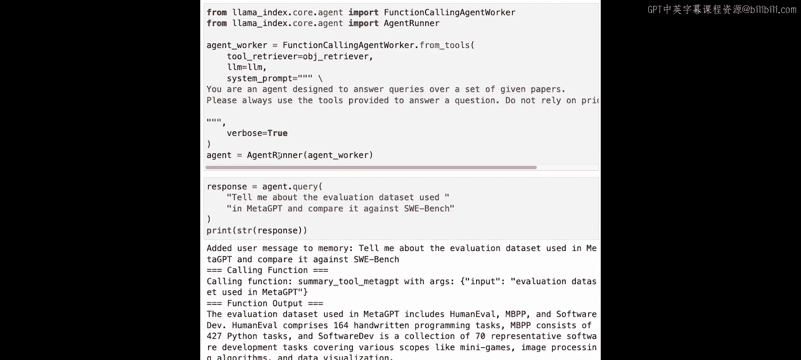

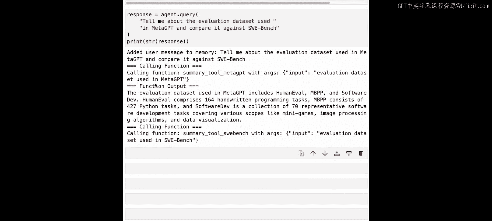

We see that it calls both the summary tool for metagerPT。As well as the summary tool for Sbench。

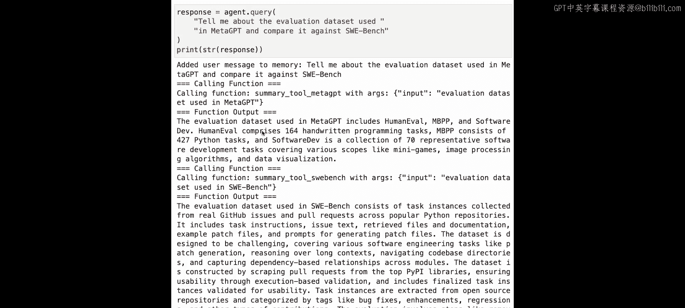

It's able to get back results for both。And then it generates a final response here。

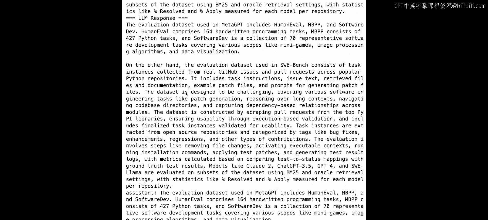

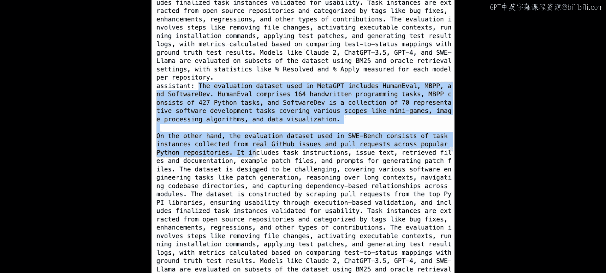

Now， as a final example， let's compare and contrast the two Laura papers， Long Gora as well as LoFQ。

And analyze the approach in each paper first。We see that the agent is executing this query and the first step it takes is it takes this input task and actually retrieves a set of input tools to help it fulfill this task。

 and so through the object retrievetr， the hope is that it actually retrieves Long Lauraura and LoftQ query tools in order to help it fulfill its response。

So if we take a look at the intermediate outputs of the agent。

 we see that it is able to have access to relevant tools from Lng Lauraura and also LoFQ。

We see that first calls summarym tool long Lauraura with arguments approaching L Lauraura。

 and you're able to get back a summary of the approach。

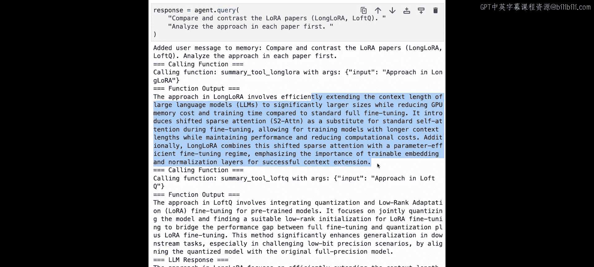

Similarly， you're able to get back。The approach in WFQ by calling summaryum tool a WQ。

The final LLM response is able to compare these two approaches by comparing the responses from these two tools and combining it to synthesize an answer that satisfies the user query。

So that concludes our lesson， so now you should be equipped with the right tools to build agents not only over a single document。

 but also over multiple documents， enabling you to build more general。

 complex context augmented research assistants that can answer complex questions。

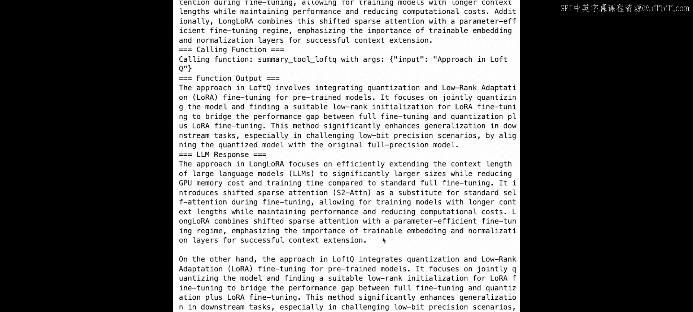