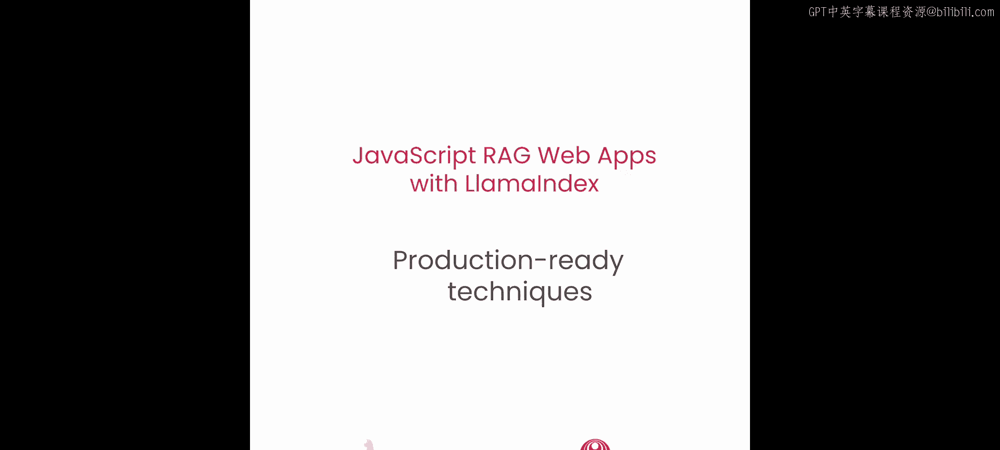
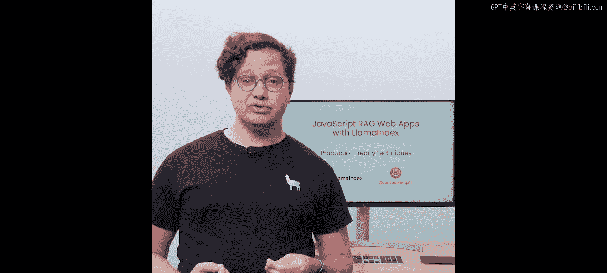
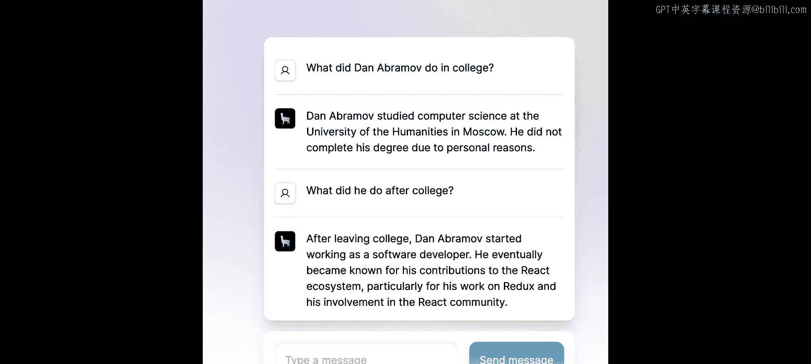

# 吴恩达《使用LlamaIndex构建RAG全栈Web应用｜JavaScript RAG Web Apps with LlamaIndex》中英字幕 - P5：5.L4_Production-ready_techniques.zh - GPT中英字幕课程资源 - BV1N1421D7dS

We're going to level up one more time in this lesson by showing you some techniques to make a real production app。

 We'll start by showing you how to persist your data and how to load it again so you aren't constantly reinexing your data。

 Then we'll move from simple one off queries to ongoing chat and switch from waiting for answers to getting real time responses with streaming。

 We'll wrap up by talking about create Lama， a tool from Lama index to get all of this into production。

 Let's get coding。😊。

In this lesson we're going to learn some production techniques and integrate them into a fancier web app。

The first technique is persisting your data in production。

 you won't want to ingest your data every single time。

 so you'll persist your data to a vector store like a vector database。

 We're going to demonstrate how to do that by persisting our data to disk。First。

 we have to load in our depths just as usual。Now we're going to do something new。

 we have to set up a storage context， This tells Lama index where to store the data In this case。

 we're telling it to store to disk in a directory called storage。

Now we load our data just as before and create an index from it using that storage context。

 this is just like we've done in the previous lessons。Just like before。

 we can create a query engine and ask it some questions。In this case。

 instead of asking it what is react， we're going to ask it what is JSX？

Now let's do something else new。Let's get an index without parsing the documents first by loading them directly from storage where we just put them。

To do this， we're going to create a new storage context， exactly the same as the old one。

And now we can initialize an index without having to parse the data first by just initializing the index from that storage context。

And now we can query it just as we did before。Great。

 now you can index as many documents as you want beforehand and quickly access them from your app without having to parse them every single time。

 You won't need to create the documents and put them into a vectorstore index。

 That part's already done。 You just load the vector store index from your storage directory and start querying。

 Another thing you want to do in production is not to ask a single question。

 but instead chat with your data， allowing you to ask follow up questions with the LLM aware of the previous questions and responses。

😊，Lma indexd supports this natively with chat engine。Let's see how to use it。First。

 we'll create a retriever for our data and create a new chat engine using that retriever。

You'll remember retrievers from lesson one， where we split up our query engine into all of the component parts。

 This is the retriever that we're passing to the chat engine。

 We've also changed the similarity top K property to 3。

 This parameter controls how many pieces of context your query engine retrieves from your vector store。

 Next， we'll simulate a chat by passing a message history consisting of the question we already gave it and an answer similar to the one it just gave and ask it a follow up question。

 What was that last acronym that it mentioned。 First， let's create the message history。😊。

Now let's add a new message。Now let's combine those two into a chat and see what it does。

As you can see， we were able to ask a follow up question。

The last thing that it mentioned in its answer is X， H。 P。 and we were able to ask it。

 What was that last thing you mentioned。 It knows what it said。

 And so it's able to answer a question about it without us having to specify that we mean X， H P。

 You can see how being able to ask follow up questions from a context to where chatbo is helpful。

 Let's move to our final production technique， which is streaming。😊。

Streaming allows us to start giving the user responses instantly。

 even if the LLM takes a long time to generate the full answer by sending the answer piece by piece or streaming the response as it comes。

 this is as simple as setting streamre equals true in our chat。

Printing the results of the stream is a little more complicated since instead of one string。

 you'll get a response subject for every part of the answer。This is what that looks like。

As you can see， you get each chunk of the answer as a separate line of text。

We now have a persistent store of our data and it streams to the client。

 Let's see what that stuff looks like in a real web app Lama indexd has a great one line command that will generate a working web app for you including all of these features You run it by running NX create Lama on the command line and then answering some questions because it's hard to do that from a notebook we've already run that command for you and the app is already built so we can just start up the frontend and the backend that we generated previously。

😊，We'll use our u functions again to get this going。As you can see。

 it streamed and answered directly to us， let's ask it a follow up question。As you can see。

 it streams another answer and its context aware。Fantastic。

 we've demonstrated streaming to the UI and our context to wear chat。

 The next thing to do is try out all of this yourself。

 You can download create Lama from Lama indexded。 AI and it will generate an app exactly like this for you。

 You'll be able to poke around the code and see everything that's being done。

There'll be a back end API， just like the one we created in these lessons and a front end containing a react component。

 again， just like the ones that we made。 You'll also be able to change the styles and colors to suit your preferences。

 Web development is a lot of fun to mess around with。 So I hope you have a great time。😊。

