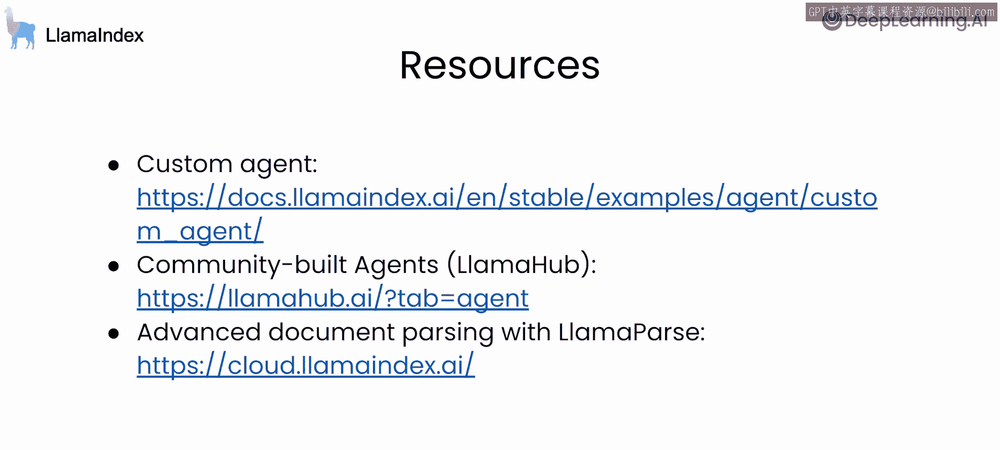

# 吴恩达《使用LlamaIndex构建主动式RAG｜Building Agentic RAG with LlamaIndex》中英字幕 - P6：6.conclusion.zh_en - GPT中英字幕课程资源 - BV18m421u7zD

Thanks for joining me on this course and congratulations on completing it In this course。

 you got to learn about agent gen rag starting from building a router agent to tool calling to building your own agent that can reason not just over a single document。

 but over multiple documents。😊，If you want to build custom agents。

 submit an agent implementation as a community template or leverage advanced document parsing services。

 check out the linked resources， I look forward to seeing all the things that you'll build using Age RaG。

