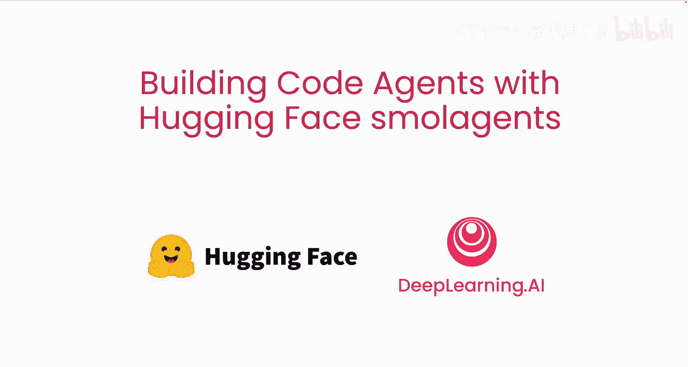
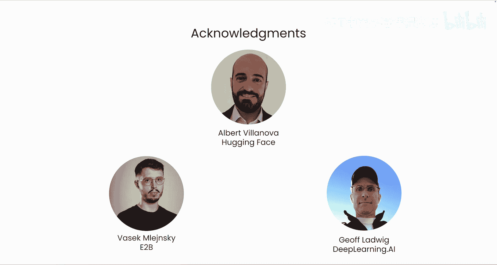

# 吴恩达《使用smolagents构建代码智能体｜Building Code Agents with Hugging Face smolagents》 - P1：1.intro.zh_en - GPT中英字幕课程资源 - BV1twLZzwE6o

Welcome toBuild code agents with hugging face small agents， built in partnership with hugging F。

 This call shows you how to build code agents。 Co agents are agents that write code to perform sequences of actions。

 This is the from coding agents， which are agents like those in Winsurf or Cruser。

 the write code for you to execute。 I'm delighted to are instructors for this course are Thomas Wolf。

 whose cofounder and CSO of hugging F， who join you in the next lesson， as well as Amri Croche。

 who is developer of small agents at Huging F。 Thanks， Andrew， I'm really excited about this course。

 I used to write code for me all the time to get stuff done。😊。

The idea behind this clause is let your LM write code for your agent as well suggests gets that done code agents lets you take advantage of Lm's coding ability to write code to perform actions。

 So rather than have an OM generate function calls one after another to complete a complex sequence task where you generate one function called and execute that。

 then have the L decide what's the second function call to generate and execute that and solve one at time In contrast。

 a code agent would consolidate all of these calls into a single sniet of code。😊。

So let an LM lay out an entire plan of action all at the same time that can then be executed efficiently rather than forcing an LM to review the plan to you one small step at a time。

And this turns out to be more efficient and also give more reliable results in the first lesson。

 Damas will describe a brief history of agents to bring you to the current。

 Then in the second lesson， you will learn about hug andface small agents and get a chance to explore the benefits of code agents yourself will also review some of the academic results showing the savings of this approach。

 It is important when using own generated code to protect your system from potential ill effects。

 For example， the code may have syntax errors or may perform actions that could harm your system to protect against this in lesson 3。

 you will learn about a constrained Python interpreter using small agents and also how to execute your code in a sendbook for safety。

In lesson4 you will see how to trace your agents in order to debug more complex scenarios and in lesson5 you'll learn about and build a multiagent system。

 many people have worked to create this course， I likeitathan from HugingFse。

 Albert V Lenova and from DeepLda AI Jev Ladwig also contributed to this course。

 Additionally will receive helper support from Basiklensky， Cofounder and CEO of E2B。

 a company which provides Cloudbasedase securero sandboxes， which you used。

