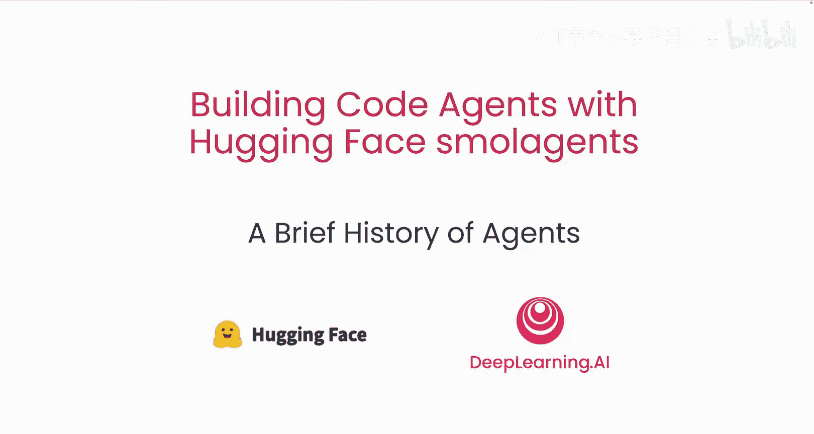
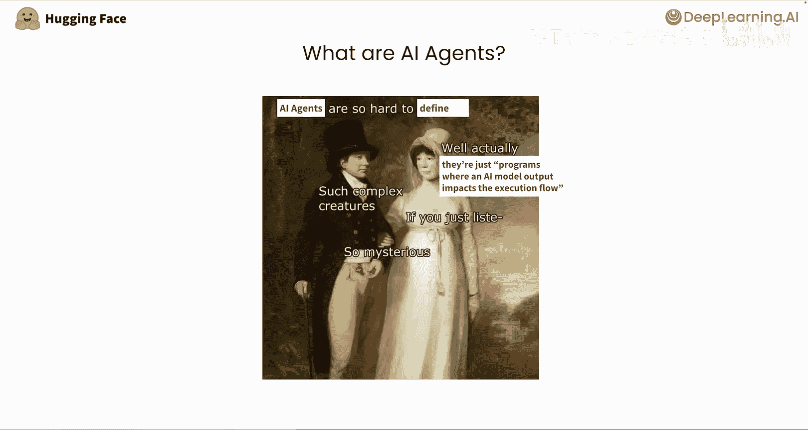
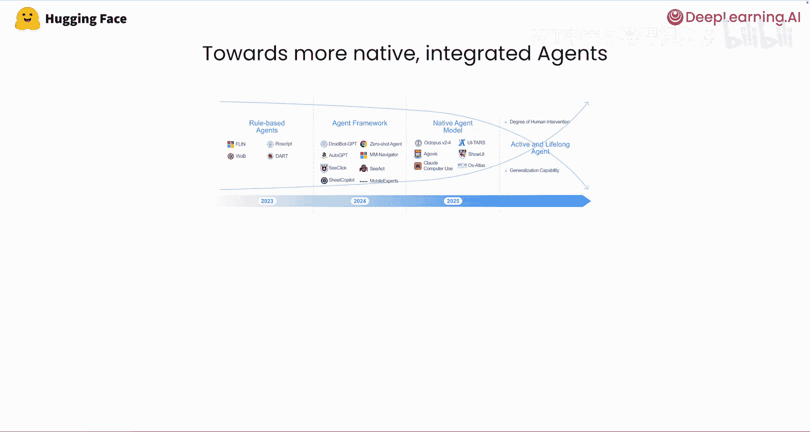
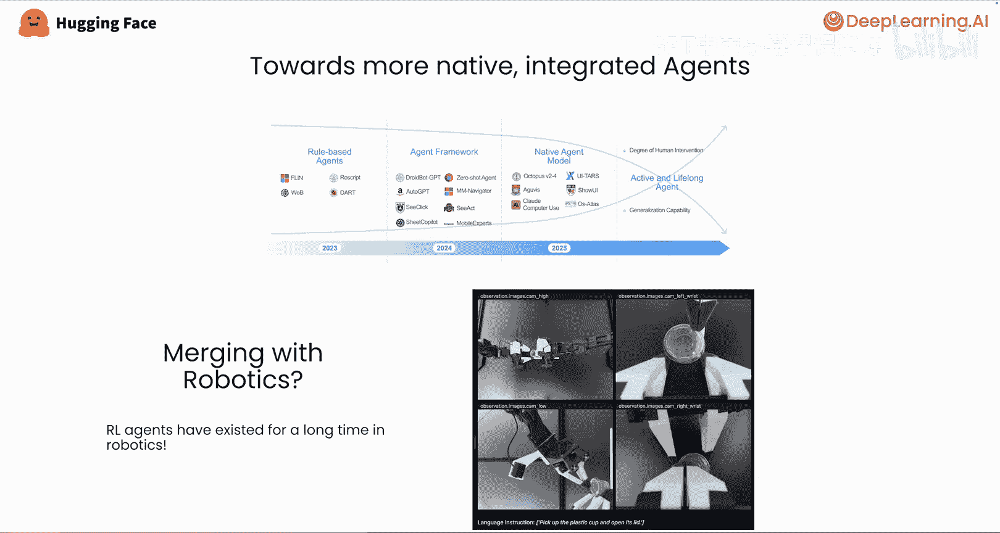
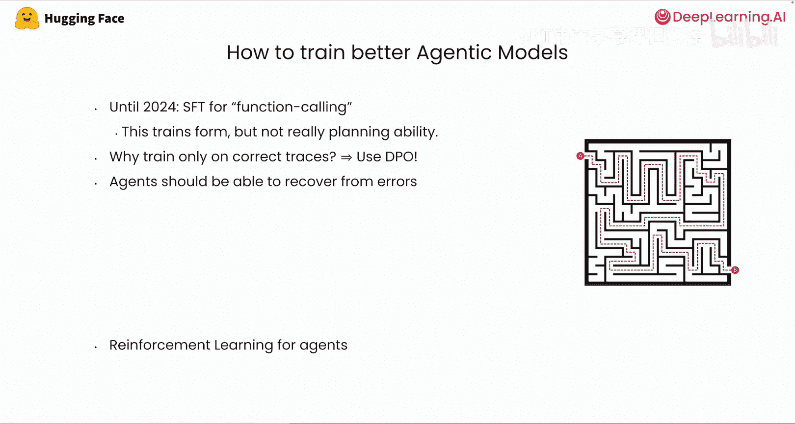

# 吴恩达《使用smolagents构建代码智能体｜Building Code Agents with Hugging Face smolagents》 - P2：2.a-brief-history-of-agents.zh_en - GPT中英字幕课程资源 - BV1twLZzwE6o

Hi everyone I'm Thomas Wolff I the cofounder and chief science officer of Hugingface Today I would like to provide a brief history of agents as a foundation for this course on code agents Now let's dive writing with the elephant in the room question What is an agent This question has been debated for month if not years and no definition will be perfect but the most rigorous that we found is this one an AI agent is a program where an AI model output impacts the execution flow In other words。

 the LLM is embeddedded as a brain in the computer program as a vehicle the LLM decisions then drive the vehicle towards the user expected goal。

 but impact of AI models on the execution flow can vary being agentic is not a clearcut 10 concept。

The levels of agency in the first the lowest level。

 the LLM output simply controls a decision in a program workflow at a higher level of agency。

 the LLM can call an external tool at yet a higher level of agency we will see the agent taking decisions on the next step or the next iteration or even the stop condition of the program This is what's called the multi-step workflow Finally at the highest level of agency an agency workflow and create or start another agency workflow at a meta level。

 this notion of level of agency has been reflected in the evolution of agency capabilities throughout the years since the release of the first LLms more and more agency has been unlocked for a agents which went from simple routers where the LLM output mostly decide toward which branch of ifL switch to program should go to tool calling and multi-step agents and taking a step back the highest level of agency that we can give an LLM is to let them write。

Execute code。 This is what we call cult agents。 and it's the breadonverter of the small agents library that we'll cover in details in the next lesson of this short course。

 but let's continue on our history of agents。 The performance of agent system has been strongly tied to the wave of increasing capabilities for the LLms that power them as the performance of generalist LLms group。

 So in their planning ability， making them increasingly suit to power multistep agents with longer time horizons。

 the graph we're showing here is the evolution of the top models score on the Gaia benchmark。

 a benchmark could be looked by Hugen phase and meta on which measures the performance of agents on a wide runs of task using computer and internet。

 Most of the tasking Gaia takes about 10 minutes for yourman to solve by using a set of standard softwares available any computers predicting future capabilities of AA system is always a challenging。

Exercise， but when we extrapolate this past coimp on Gaa。

 we see that we could reach humanle performance sometimes in 2026 this would mean that in about 12 to 181 from now we would have agentic system as efficient as you and I on a large number of task that currently takes about 10 minutes for human to complete on a computer provided of course that we give them access to all the problems they need to solve these tasks Another interesting trend that I wanted to mention is our agents have a tendency to rely less and less on the specific framework as well as the capabilities of LLms are increasing。

 they can more and more decide autonomously what next step they should take without any specific scaffolding help or hand engineered framework As an example you can now in many case load a vision language model show it a capture of your screen and let it decide where to click or what to type on the keyboard without merge guidance。

The result is that you get an agent that can operate seamlessly on many user interface and when integrated in a wide range of systems and agent libraries。

 another interesting emerging synergy is with the field of robotics。

 given that there is not such loud difference in API between a computer tool and a physical electronic device command。

 the wide scope of capabilities of multimodole elements。

Means that just like our agents was able to decide what to do from a screenshot。

 the LLM controlling robots can more and more decide what next step to take simply on the basis of a video image acquired by its camera more and more the modelpoing AI agents are actually trained on a mix of computer interface data and physical world data Now let us finished with a few high-level words on how to train agents until recently many teams and companies were pushing for a specific fine tuning of LLM socalled the function call fine tuning for agents This typically consisted in training an LLM to call a set of prettyfin tools that was given at training time while this approach trained LLM to write tool calls in the expected formats and with proper arguments。

 more LLMs like Deepse Rner orqui key key are now powerful enough to write tool calls even without any specific training and just by being given a few examples。

In their promptsThe main remaining struggle for agent LLNs in early 2025 is the ability to plan and reason over many steps and this is where reinforcement learning and a recent wave of reasoning models I expect to step in and to be game changers I expect the continued improvements of LLNs and the development of agent specific training methods to proper agent system to new level of performance and reliability so much that well see more more real life usage of agent systems so following this course was a great decision Now I'll leave you with EmI to tell you more。

