# 吴恩达《使用smolagents构建代码智能体｜Building Code Agents with Hugging Face smolagents》 - P3：3.introduction-to-code-agents.zh_en - GPT中英字幕课程资源 - BV1twLZzwE6o

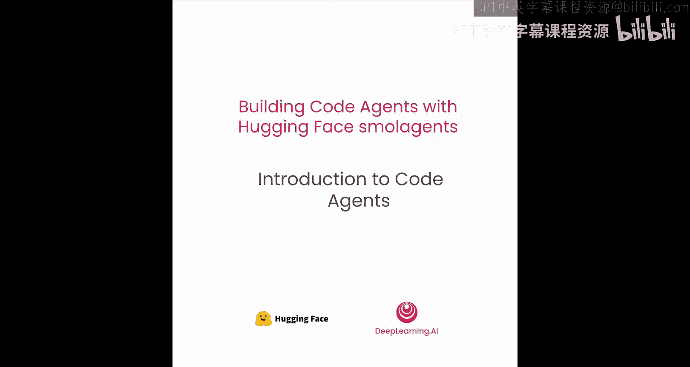

I'm excited to get to help you learn more about coding agents in this lesson。

Hugging face has built an agent framework called Small Age。

 Small agents is a lightweight framework that has limited abstractions and is simple to use。

 Important， in small agents， we make code agents first class citizens All right， let's get started。

 So now you're going to learn about the core idea of small agents。

 This agent write their actions in code to understand why let us take a look at the standard react loop。

 This is how most agents work nowadays。 they follow the principle called react for reflect and act And so their action follows a cycle of thought then action。

 Then an observation of the results that their action had on their environment and this cycle repeats until the task given by the user has been sold。

 So let's take an example if I ask an agent to give me the weather in Stanport。 First。

 the agent will think that it needs to call the weather API。

Then take this action， observe the results from their tool call which are at present it's sunnyny out there well it always is so there was no real need for a tool call here and then in step 2 it will think again that now time has come to return the answer it will take the action to use the tool filelanr and return that the weather is sunnyny but how does the action occur and that's where code agents have the real difference compared to other agents so if we zoom in on the action taken in the first step here is how a JSN or text agents would do this it would think first I need to call the weather API and then write its action as a JSN dictionary with as name key the name of the tool and as arguments Stanford because the goal here is to target Stanford as opposed to this the code agent will write its action as follows with a code。

niipets and the tool will just be written as if it was calling a Python function here when you see this it doesn't make that much of a difference but you will now see how much of a difference it can do now if the task was more complex like determining the most costeffect country to purchase a smartphone out of a list of countries and you have several tools to apply in a sequence for each of these count to get the final price well in code it's quite simple to do you just write a Python snippets that would loop through the countries and for each of these perform a few actions chain together。

Before returning the file answer in the same patenton snippet as opposed to this。

 the JSN or text agent would have needed to perform many steps in a succession。

 so here maybe 12 steps to get to the same result or is it actually the same result each new step means that you have more latency。

 more costs and more chances of error Now writing actions as JSN or text has become a de facto standard probably because it was the first attempts to do agent in behaviors since it's so simple to just write out to Json parse it and execute the tool that was found in the dictionary。

 but we believe that we now need to do agent actions in code not only for the reasons that we've just illustrated that it's easier to chain or parallelize actions in code。

 but also for many other reasons for instance， in code you can assign variables to reuse them later or。

🎼Manipulate nontext elements or build your own tools by defining functions。 In short。

 code is a much more powerful way to describe actions performed by a computer。

 because it was built for that。 If Jasonson was a better way。

 you would be coding every day in Jasonson。 But， of course， no one does that。

 The example in the previous slide was taken from a great paper shown here on this slide。

 You should read it。 This paper also compares the success rates and count of AM calls needed for both code and Json actions。

 and it shows that code actions are both more successful and lean。

 This is also what we've experienced when comparing code and Json agents in small agents。

 but you don't have to take my word for it， let's dive into the notebook and we'll see how it turns out in practice。

 In the next few lessons。 We will be using the example of an ice cream truck。 Indeed。

 you have finally decided to pursue a true passion。

 You have decided to start an ice cream tro business。 Congratulations。

 I think that's a great idea to start with。 You've bought the truck。 All the required equipment。😊。

🎼And you estimated that you would sell 30 liters of ice cream per day。 Now。

 you will need to get raw ice cream every morning。 You want to compare different options of daily delivery from wholesale suppliers。

 And that's where I jump in to help you。 I will show you how to build an agent that can calculate and compare the total prices for all the options。

 I will first set up the environments。Then imports the necessary data。

Here are the different suppliers。 Let us calculate which supplier is actually the cheapest。

I have made the calculations for you to use， as a reference。And from these calculations。

 it turns out that the cheapest supplier that you can source your delivery from is this one Brainfreeze Brothers。

 Now， let me show you these agents。 I start by defining the tools that it can use I use the tool decorator from small agents that can turn any function equipped with proper type hints and do strings into a tool that an agent can use to use this decorator on a function you need to make sure that these type hints or property setup as well as the function do strings。

 including a description for each input arguments。 Each new tool now has all the required attributes like name and description。

These will be used by the agent to properly use the tool。

 We then initialize the model that we will use as the engine to power our agents here。

 I use a Quen model provided by together AI through the huggingface hub。

 I have to give you disclaimer that I'm a big fan of Quen models。

 I think they do an amazing work for this model to work。

 We have logged in above using a token created from the settings page of our hub accounts with access enabled to inference providers Let us now set up our agents。

 code agents is the main class of agents in small agents。

 It is a versatile agents that generates and executes Python code snippets in its code。

 It can also call the tools that you've given to it here。

 It will call them as regular Python functions to initialize your agent You need the two arguments model and tools here。

 I also give it additional authorized imports to let it efficiently run calculations and panda。

That frames Now， let me show you what one single tool call looks like in code。

I give the agents a simple task that requires only one call。

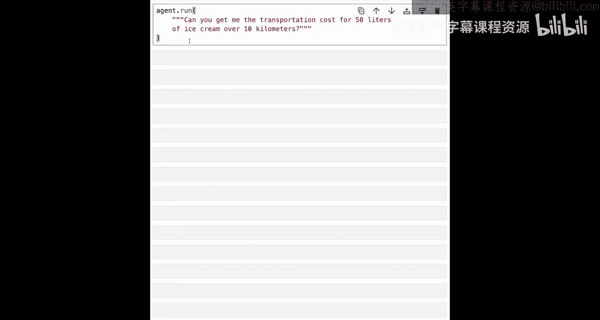

Here you can see that the row model output contained a codenippets。

 which was then extracted and run by our agents In thisnippets。

 the tool calculate transport costs is just called as if it was a standard patent function After printing the outputs of the first step to inspect it。

 The agent could just go on to return the answer in its second step。 Now。

 I will give the agent its true task。 compareare supplier costs for you Note that it's important to give your agent detailed instructions as to what to do。

 exactly like you would do with a teammate。 here， I give it all the required information。

 as well as additional detail about including transportation costs and possible tariffs。

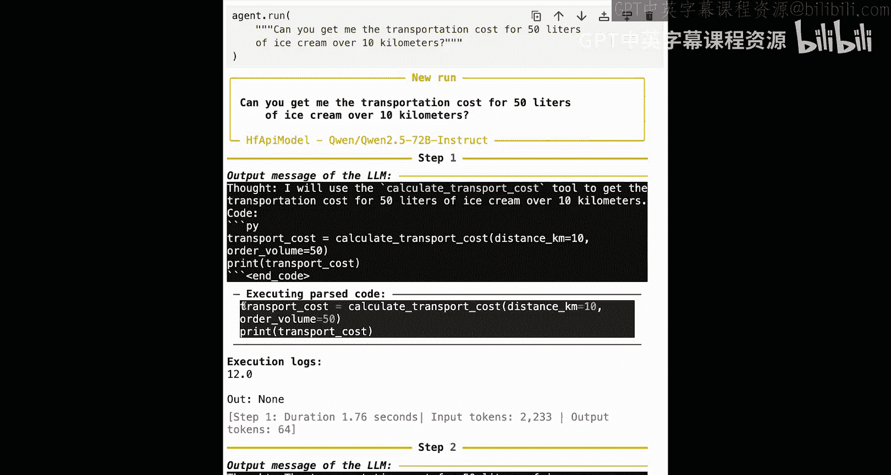

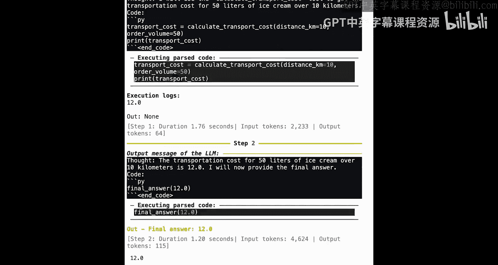

And it seems that the coig has successfully solved the task at hand。

 giving the correct results that Brainfrze Brothers was the cheapest supplier with the correct price。

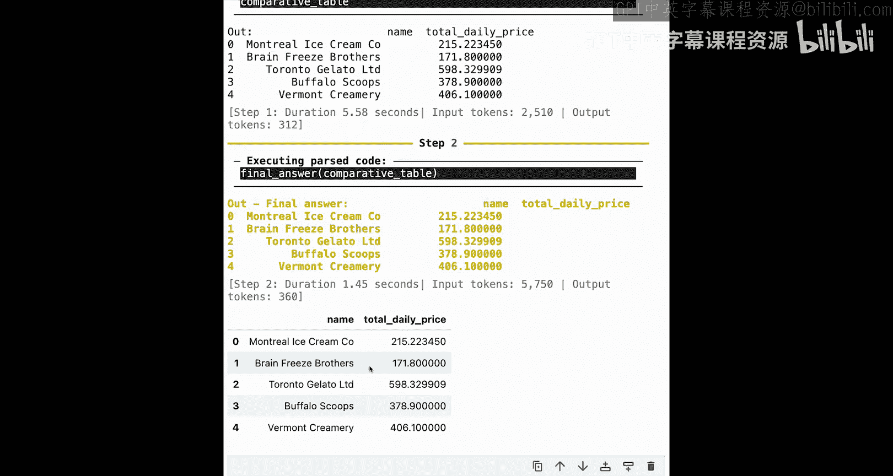

How did the agent do this， It only needed two steps to do it， In the first step。

 it generated its own function to calculate the price in Python。 This is very interesting。

 It means that the function will be ready to be called again in the future。 Basically。

 the agent just created a new tool for itself as a great way to shortcut future effort。

 Then it displayed the results for itself to inspect。 And in step 2， after inspecting the results。

 it just returned them。

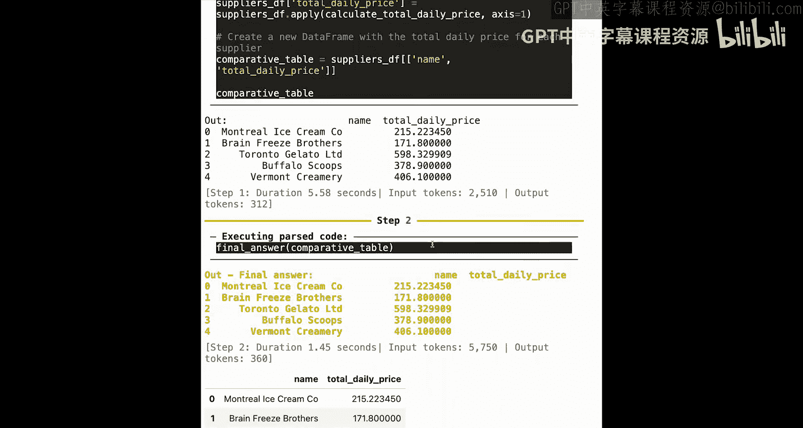

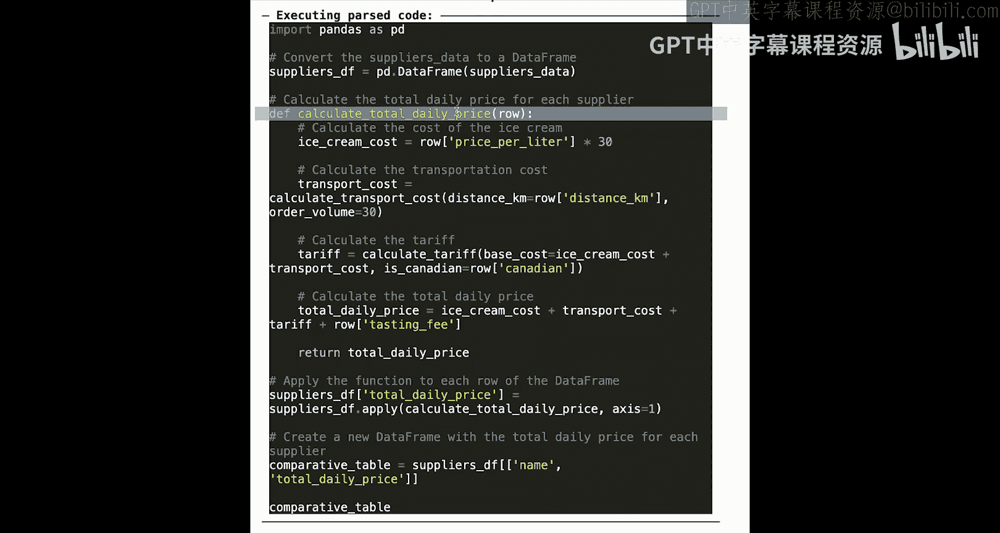

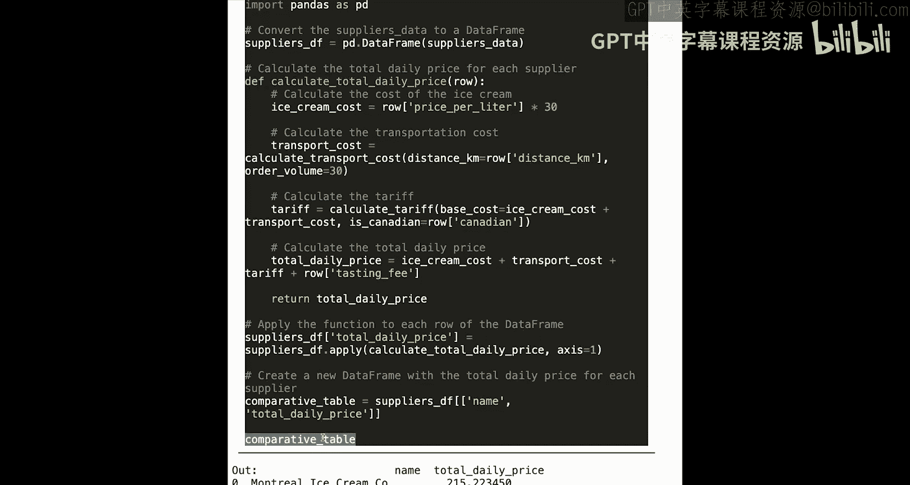

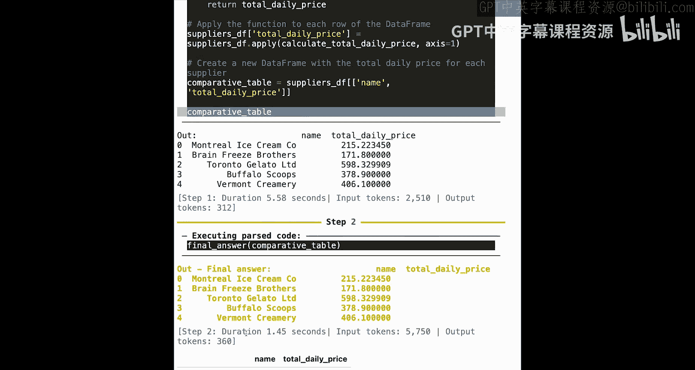

So this was a code agents， but how does it compare against a traditional tool coding formats？

Let me show you first how they differ。 Here is how a code agent would write its output to a simple question about how to calculate a transportation cost。

 As you can see， there's the same type of Python code snippets as above。 Instead。

 a traditional tool calling agent would write its actions as Jasonblob。Something like this。

The thoughts can be exactly the same， but the actions are formulated differently。

In this example of a single tool call， no formulation is really more natural than the other。

But how would it work for more complex tasks， Small agents also implements traditional tool calling in the class name tool calling agents。

 So I'll now assure you how to create such an agent。 I give it the same model as above。

And the same set of tools。 Now， let us run these new agents on the exact same task as above。

As you can see， this agents chains many individual tool because it cannot make use of for loops or chain sequential actions using different variables like our code agent could the code agent was solving the task in two steps。

Here， the agents runs many more steps， thus accumulating tokens， latency and price。

 each new step is also an additional risk of making an error。

The agents could only return its stable as a markdown text。

 because it does not have the ability to return the data frame， like our code agent did。

 And in the end， since each calculation needed to input all variables again in texts instead of handling them naturally encode。

 theLM had to remember them all correctly and get the calculations right。 As a result。

 it looks like the LLM did a mistake。Because the final price for brain freeze brothers doesn't match the ground truth that we established above。

 Note that the results might differ for you。 For instance。

 you might have a tool calling agent that nails the task on the first try。

 But we often see this scan of failure happening。 In any case。

 the runs take much longer because the agent always has to change these many individual tool calls。

 So that's it。 I have shown you a head to head comparison between code agents and tool calling agents。

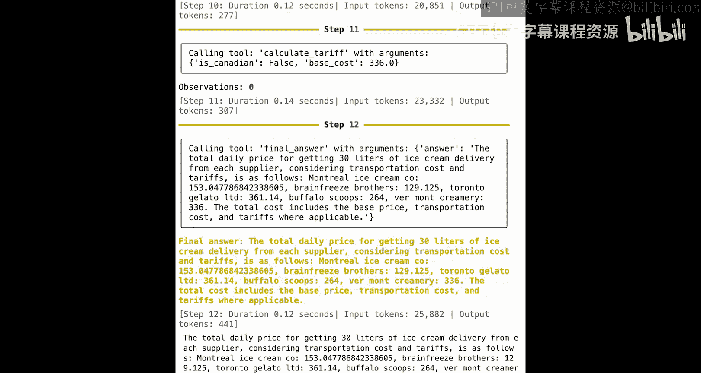

But maybe you are wondering about how this coig can run LLM generated code in a secure way。

 That is what I will show you in the next lesson。

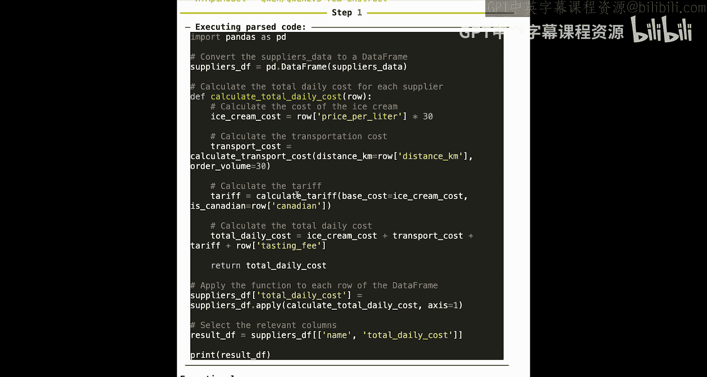