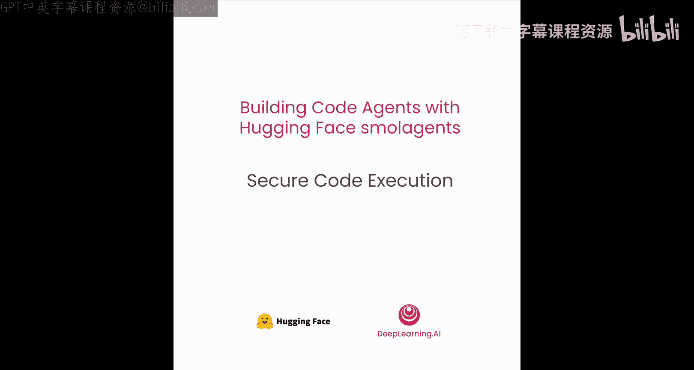
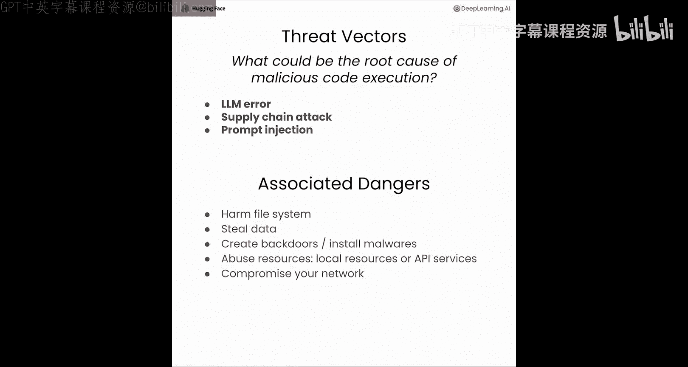
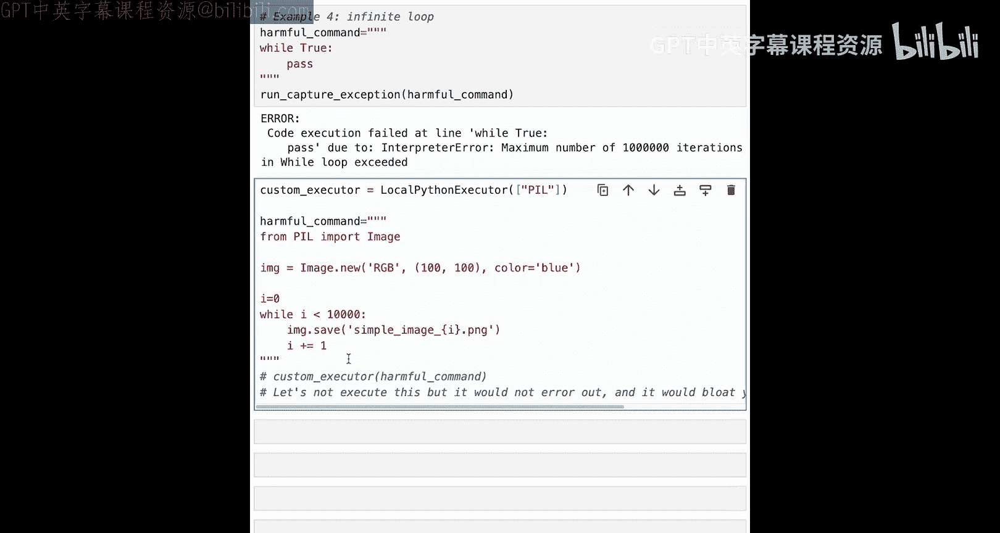
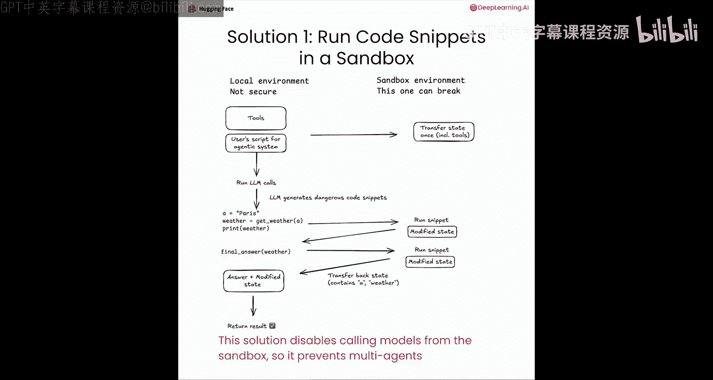
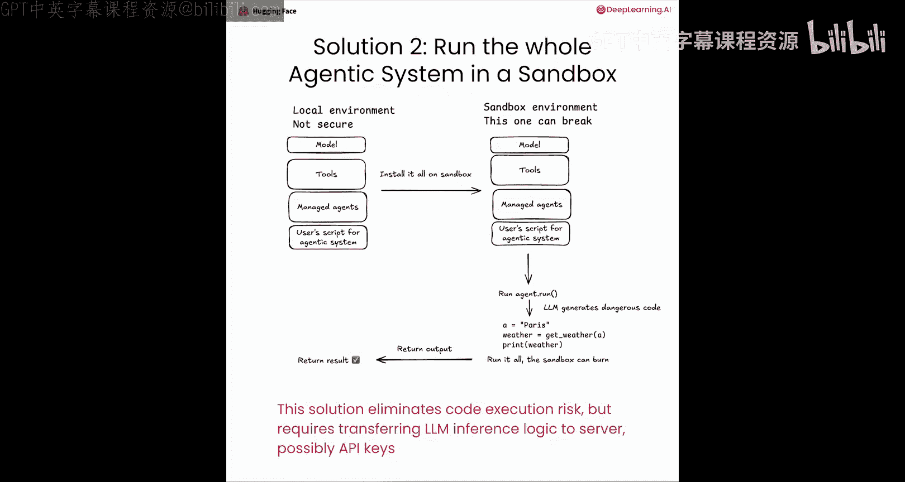
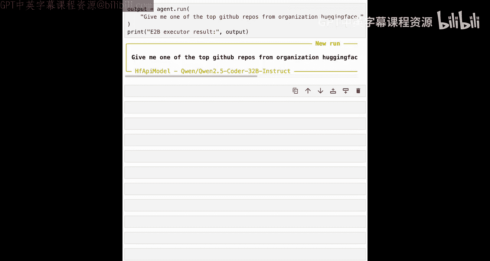
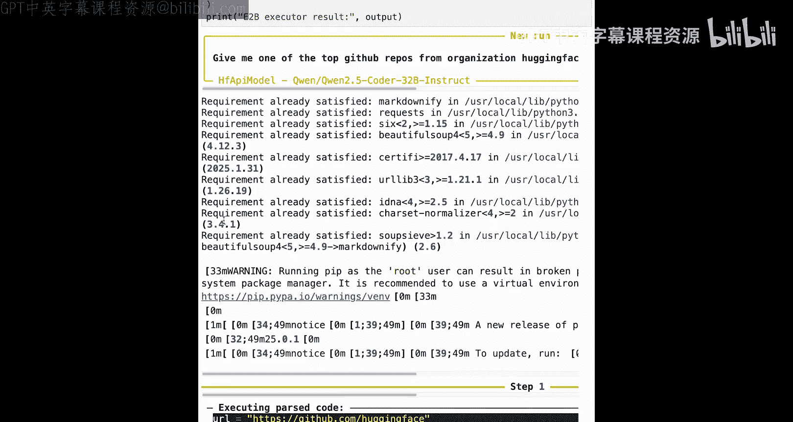
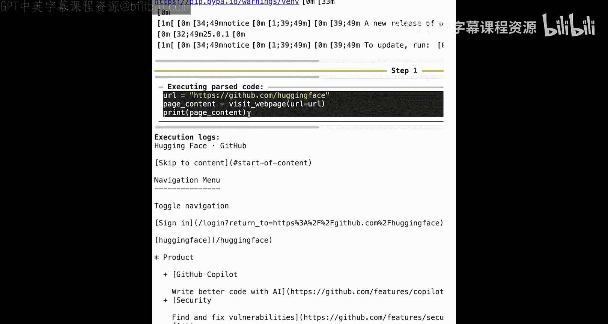
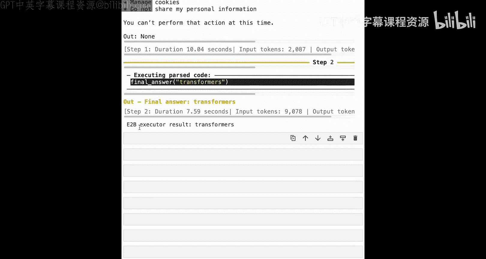

# 吴恩达《使用smolagents构建代码智能体｜Building Code Agents with Hugging Face smolagents》 - P4：4.secure-code-execution.zh_en - GPT中英字幕课程资源 - BV1twLZzwE6o

You've probably noticed that your code agent executing LLM generated Python code creates a risk of arbitrary Python execution。

 Thus of malicious attacks。 What if the program calls a command to remove every file in your system。

 one could argue that on the spectrum of agency code agents give much higher agency to the LLM on your system than other less agent setups。

 This goes hand in hand with higher risk， malicious code execution could happen in at least three ways。

 LLM error。 LLMs are still quite dumb。 and they might destroy your system by trying to help you。

 This risk is low， but in my thousands of agents runs。

 I've observed a few attempts to run code that could have been harmful。

 Two supply chain attack where you run a malicious LLM。

 than this LLM will generate code that actively tries to harm your system。

 This risk is extremely low when using wellknown models on secure inference。

 but it could happen 3 prompt injection。 An agent browsing the web could arrive on a malicious website。

😊。

That contains harmful instructions， thus injecting an attack into the agent's memory。

 These are only a few of the ways that malicious code can be executed on your system Acally or intentionally once it's done。

 this code can target many things。 It can harm your file system。 Steel data。

 Abuse resources beat local resources or API services。 compromiseise your network。

 or install malware or back doors to be used in a layer attack。

 All these risks mean that code execution should be made as safe as possible。

 We will now see how to use the various protection layers available for running code agents。

 Let us thoughts with the custom Python interpreter that we've built to add a first layer of security code execution in small agents is not performed by the vanilla Python interpreter。

 We have revolt a more secure local pathython executor from the ground up to be precise。

 This interpreter works by loading the abstract syntax tree AsT from your code and execute。

O by operation， making sure to always follow certain rules。 These are the following。

 Any undefined command is ignored。 Is or secured and infinite loops or prevented。

 let's go take a look at these in practice So let us start by setting up the executor here we also make a wrapper around the executor to nicely display only the final error instead of the whole traceback。

 Now here are the safe guards built into the Python interpreter First。

 what about running undefined commands。 Some commands would work in a Jupyter environment like this one here you see。

 I manage to execute the command that I wanted。 that in this patent interpreter since we re the interpreter from the ground up。

 Any non implementedmented behavior would fail。Here。

 as you can see anarrow is thrown Now let us move on to imports。

 any import outside of this white list must be explicitly allowed to be performed。 Let's try it out。

 We will try to import OS and use OS dot system to run an arbitrary command。As you can see。

 it throws an error， this fails because the import was not allowed by default。

 imports are disallowed unless they have been explicitly added to an authorization list。 even so。

 because some innocuous packages like random can give access to potentially harmful packages as in random dot OS set packages that match a list of dangerous patterns are not imported。

 let me show you， I'll try to start from an innocuous module imported by you like random and get access to OS commands from it。

Does it work。As you can see。It gives an error as well。Now。

 here's the final saveguard that I wanted to show you today。

 We have a cap over the total counts of elementary operations process to prevent infinite loops and resource bloating。

 Let's see what you would get with an infinite loop。 So the command starts to run。

 but after some time you will get this。 our hard limit on the number of iterations in the wall loop has been exceeded and this throws an error。

 As a result of all these safeguards。 The interpreter is safer personally。

 I have used it on a diversity of use case without ever observing any damage to my environment。

 However， this solution is certainly not watertight as no local pattern sandbox can really be。

 One could imagine occasions where LLm's function for malignant actions could still hurt your environment。

 For instance， if you have allowed an inocchuous package like pillow to process images。

 the LLM could generate thousands of images to blo your high drive。 here's how it would play。

 So you would have this import here。Would be allowed because you've explicitly added it to the list of authorized race packages。

 and then you just set up a loop， which is not that big。 so it won't trigger the iterations counter。

 and it saves an image each time in your system。 Let's not execute this because I don't want to b my system。

 but it could certainly end up bloating yours。 So the solution to this is to use more sandboxs environment。

 Let's show how to do this。 Now I've just demonstrated that even with builtin safeguards。

 the custom Python interpreter is not 100 person safe。 Actually。

 any Python sandboxs run on your local system will still bear risk。 So how to improve security。

 the best way to secure LLm generated code execution is to use secure sandboxes even better。

 Remote sandboxes that are not in your local environment。 You could do this in two ways。

 The first one would be to keep most of the code local。

 and only after the agent generated code snippetss sendend them to the remote。

For execution。 This is quite safe。 We will demonstrate this method in the notebook。 However。

 if you want to do multiagent runs， this first solution will limit you。 Indeed。

 since your code is not entirely ported on the sandbox you cannot run multiagent systems So let me precise why imagine you have a manager agents writing a call in a code snippet to a managed agents and you send the snippets for execution to the remote sandbox。

 the remote code executor will not be able to call the managed agent unless it has all the code to run it and all the API keys required to call its underlying LLM。

 So to solve this， the second solution would be to export everything on your sandbox code API keys tools This will unlock multiagent systems but it forces you to export potentially sensitive API keys to call models Small agents allows you to use either local Docker containers or E2B sandboxes in the notebook I will show you how to implement the first solution。

Out of the two that we've mentioned before using E2B， let's jump in。

 so let us use E2B sandbox to run a code agent we start by passing our E2B API key。

Then we define our agents here we're going to define a custom visit web page tool。

 We will not use the default one providing small agents because I want to show you that you can just define a custom tool and send it to the E2B sandbox and this will be done very naturally you just have to define the tool then pass it to the agent and then you pass executor type equals E2B and the executor quarks。

 take your E2B API key when running this the agent will automatically be initialized on the sandbox with the tool that has been transferred to the server and using our API key This might take a while as the sandbox as a call start。

You can see that all the necessary imports and installs are performed on the server。

 Then we get this message， which means that our agent is ready， Let's run it。

 We give our agent a request that will leverage the visit web page tool that we've just defined。

And after a few installs to make sure the tool works， our agent runs normallyally。

 but this code is executed from within the sunbox。

So this displays the GithHub page from Huging face。With the top prepost shown here。And our agents。

Property returns， one of the top repos， namely transformers。 So， of course。

 you could build much more complex agents with E2 B。 bear in mind that as we've seen on the slides。

 this is a solution where you cannot build multiagent systems。

 single agent systems are often powerful enough to run all the workloads you need。

 But if you want to switch to a multiagent system， you can set up the whole system on the sandbox。

 this will require some custom setup and the diagram for it was shown in the solution to in our slides。

 Now that you have a safer environment to run your agents will move on to the next lesson where I will show you how to monitor your agent in production。

